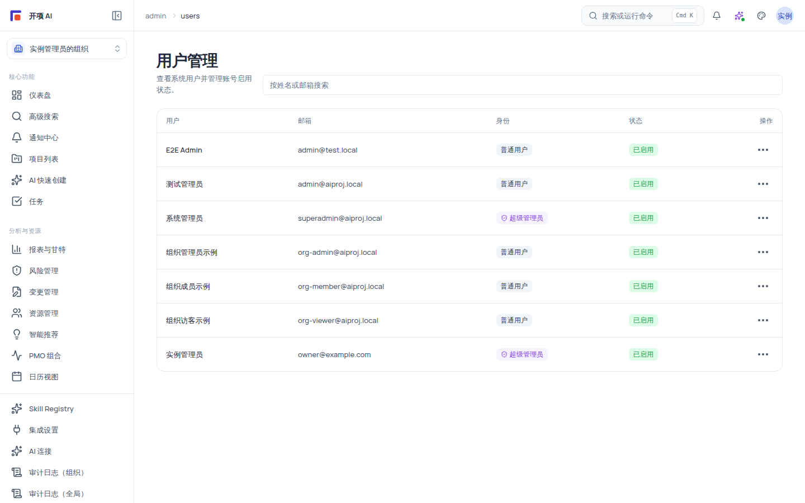
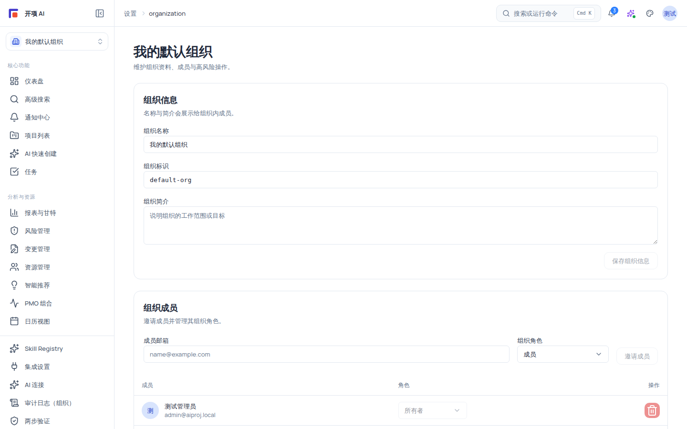

# 账号、组织与角色

本页解释「你是谁」「你在哪个组织」「你能做什么」三层关系：个人账号 → 组织成员 → 角色权限。三者混淆是大多数「看不到数据 / 操作被拒」问题的根源。文中给出六种规范角色与组织成员角色的完整权限矩阵，以及用户管理（启用/禁用账号）的标准操作。

## 适用范围

- **适用角色**：所有用户；组织管理员（`org_admin`）与系统管理员（`system_admin`）重点阅读成员邀请、角色分配与账号管理。
- **适用版本**：个人版与企业版共用同一套账号与组织模型。
- **本地化**：界面文字支持简体中文 / 台湾繁体 / 香港繁体切换（见《界面文字切换》），本页正文为简体中文。

## 开始之前

- 无特殊准备。本页是概念介绍，阅读后可对照「操作步骤」逐项核对你的账号现状。
- 先区分两个容易混淆的词：**登录身份**（你的邮箱账号）与**权限角色**（该身份在某个组织/项目里能做什么）。

## 三层模型：账号 → 组织成员 → 角色

1. **个人账号**：你的登录身份（邮箱 + 密码，或 Google 登录）。一个账号可以属于多个组织。
2. **组织成员**：账号在某组织中的成员记录，带一个**组织成员角色**（`owner` / `admin` / `member` / `viewer`）。
3. **版本与角色权限**：由组织套餐上限、组织成员角色、项目角色与显式附加权限共同决定你能做什么；最终判定以服务端 RBAC（基于角色的访问控制）为准。

> [!NOTE]
> 全新 Google 身份会自动获得一个 free 个人组织，界面称为「个人空间」。这个内部组织只用于数据隔离与统一模型。个人账号后来受邀加入其他组织时，可以在工作区切换器中切换。

### 两套角色坐标

平台同时存在两套角色体系，不要混为一谈：

| 坐标           | 取值                                                                                                        | 作用范围       | 由谁分配                                         |
| -------------- | ----------------------------------------------------------------------------------------------------------- | -------------- | ------------------------------------------------ |
| 组织成员角色   | `owner` / `admin` / `member` / `viewer`                                                                     | 整个组织       | 组织 `owner`（或具备管理权限者）在组织设置中分配 |
| 项目内规范角色 | `system_admin` / `org_admin` / `project_manager` / `member` / `external_collaborator` / `readonly_observer` | 平台级权限判定 | 由组织成员角色与项目角色映射而来（见下表）       |

组织成员角色会映射为规范角色参与服务端判定：

| 组织成员角色 | 映射的规范角色                  | 说明                                   |
| ------------ | ------------------------------- | -------------------------------------- |
| `owner`      | `org_admin`（组织管理员权限集） | 组织所有者；只能通过组织内转移流程变更 |
| `admin`      | `org_admin`                     | 组织管理员                             |
| `member`     | `member`                        | 组织成员                               |
| `viewer`     | `readonly_observer`             | 只读观察者                             |

项目内角色（项目 Owner / 项目经理 / 成员 / 外部协作者 / 只读观察者）按同样方式映射到规范角色；组织与项目两级判定取交集，跨组织访问一律按「资源不存在」处理（不泄露存在性）。

## 六种规范角色说明

| 规范角色                | 定位                   | 典型职责                                                                                                                           |
| ----------------------- | ---------------------- | ---------------------------------------------------------------------------------------------------------------------------------- |
| `system_admin`          | 系统管理员（哨兵角色） | 实例级运维：全局用户管理、全局审计日志。判定链直接放行                                                                             |
| `org_admin`             | 组织管理员             | 组织级控制面：成员与角色、Skill Registry 管理、插件目录治理、审计日志（本组织）                                                    |
| `project_manager`       | 项目经理               | 项目计划与执行、甘特/WBS/看板、资源、风险、变更、报表；集成管理（webhook、网页搜索）；**默认没有 Skill Registry 的查看与写作权限** |
| `member`                | 成员                   | 项目内任务协作；可查看 Skill Registry 并可创作 Skill（`ai:compiler:skill:author`）                                                 |
| `external_collaborator` | 外部协作者             | 受限的项目协作；无报表查看权限（`report:view`），其余项目查看权限与 `member` 一致                                                  |
| `readonly_observer`     | 只读观察者             | 只能查看，不能写；无任何管理类权限                                                                                                 |

> [!NOTE]
> `system_admin` 身份来自账号的 `is_super_admin` 标记（例如系统种子账号 `superadmin@aiproj.local`），不是组织成员角色；前端把 `system:admin` 视为通配权限（`hasPermission` 对 `system:admin` 恒真），服务端同样直接放行。因此系统管理员**事实上拥有全部权限**，承担平台级运维职责，与组织内管理互不替代。

## 权限矩阵（六角色 × 关键权限）

下表为服务端 RBAC 权威映射（来源：`apps/backend/start/rbac/roles.ts` 脚本核验）。✓ = 拥有；✗ = 不拥有；「通配」= `system:admin` 哨兵直接放行。

| 权限                                                | system_admin | org_admin | project_manager | member | external_collaborator | readonly_observer |
| --------------------------------------------------- | ------------ | --------- | --------------- | ------ | --------------------- | ----------------- |
| 全局用户管理（`/admin/users`）                      | ✓            | ✗         | ✗               | ✗      | ✗                     | ✗                 |
| 全局审计日志（`/admin/audit-logs`）                 | ✓            | ✗         | ✗               | ✗      | ✗                     | ✗                 |
| 本组织审计日志（`audit:view`）                      | ✓（通配）    | ✓         | ✗               | ✗      | ✗                     | ✗                 |
| 集成连接（`integration:connect`）                   | ✓（通配）    | ✓         | ✓               | ✓      | ✓                     | ✓                 |
| 出站 Webhook 管理（`outgoing_webhook:manage`）      | ✓（通配）    | ✓         | ✓               | ✗      | ✗                     | ✗                 |
| Copilot 网页搜索管理（`copilot:web_search:manage`） | ✓（通配）    | ✓         | ✓               | ✗      | ✗                     | ✗                 |
| AI 连接管理（`ai:connection:manage`）               | ✓（通配）    | ✓         | ✓               | ✗      | ✗                     | ✗                 |
| Skill Registry 查看（`ai:compiler:skill:view`）     | ✓（通配）    | ✓         | **✗**           | ✓      | ✓                     | ✓                 |
| Skill Registry 创作（`ai:compiler:skill:author`）   | ✓（通配）    | ✓         | ✗               | ✓      | ✗                     | ✗                 |
| Skill Registry 管理（`ai:compiler:skill:manage`）   | ✓（通配）    | ✓         | ✗               | ✗      | ✗                     | ✗                 |
| 项目/任务/风险/通知查看                             | ✓（通配）    | ✓         | ✓               | ✓      | ✓                     | ✓                 |
| 报表查看（`report:view`）                           | ✓（通配）    | ✓         | ✓               | ✓      | **✗**                 | ✓                 |
| 组合查看（`portfolio:view`）                        | ✓（通配）    | ✓         | ✓               | ✓      | ✓                     | ✓                 |
| AI 触发（`ai:trigger`）                             | ✓（通配）    | ✓         | ✓               | ✗      | ✗                     | ✗                 |

> [!IMPORTANT]
> 两个容易想当然的例外：**项目经理默认没有 Skill Registry 查看权限**（成员反而有）；**外部协作者没有报表查看权限**。写权限相关结论前先查本表。

## 操作步骤

### 步骤 1：查看你的账号与组织归属

1. 登录后查看工作区切换器：只有个人空间时显示「个人空间」；加入其他组织后可看到组织名称并切换。
2. 打开「设置 → 个人资料」核对姓名、邮箱与当前版本。界面文字变体也在这里切换。

### 步骤 2：全局用户管理（仅系统管理员）

1. 在浏览器地址栏直接输入 `/admin/users`（该页面**没有主导航入口**，也不在命令面板中，只能 URL 直达）。
2. 你会看到页面标题「用户管理」，副标题「查看系统用户并管理账号启用状态。」；没有 `system:admin` 权限时会显示「无权访问用户管理」警示。
3. 在搜索框（占位提示「按姓名或邮箱搜索」）输入关键词过滤；你会看到表格实时刷新，列依次为 用户 / 邮箱 / 身份 / 状态 / 操作。

   

4. 身份徽章说明：`isSuperAdmin` 的用户显示「超级管理员」（品牌色徽章 + 盾牌图标），其余显示「普通用户」。
5. 状态徽章说明：「已启用」（绿色）表示账号可正常登录；「已禁用」（中性色）表示账号被停用。
6. 在目标行点击「…」按钮（悬停提示如「管理 {邮箱}」），菜单按当前状态给出「禁用账号」或「启用账号」：

   - 当前「已启用」→ 点击「**禁用账号**」：账号被停用，列表自动刷新，该行状态变为「已禁用」。
   - 当前「已禁用」→ 点击「**启用账号**」：账号恢复，状态变回「已启用」。

> [!WARNING]
> 禁用/启用账号在点击菜单项后**立即执行，没有二次确认对话框**。误操作只需再次点击菜单切换回来，但请谨慎对待禁用操作——被禁用账号会立刻无法登录。

7. 搜索无结果时会看到「没有匹配的用户」与「尝试使用其他姓名或邮箱搜索。」；组织内还没有任何用户时显示「暂无用户」「用户创建后会显示在这里。」

### 步骤 3：在组织设置中邀请成员与分配角色

1. 组织管理员打开「设置 → 组织」（`/settings/organization`）：你会看到组织信息表单（组织名称、唯一标识 `slug`、套餐与配额，如 free 套餐 `max_projects=10`、`max_members=20`）与成员邀请区、成员列表。

   

2. 在邀请区填写成员邮箱并选择组织成员角色（`owner` / `admin` / `member` / `viewer`）发送邀请；你会在成员列表中看到待接受（pending）状态的记录。
3. 为成员调整组织成员角色后，成员列表中的角色徽章即时更新；**已有项目内的角色**需在项目成员管理中另行安排。

### 步骤 4：核对最终结果

回到「设置 → 组织 → 成员」，确认每个成员的邮箱、组织角色与项目角色符合预期；有 `system:admin` 权限时可到 `/admin/users` 核对账号启用状态。

## 验证结果

- 你能分清：登录身份 ≠ 组织管理员；组织管理员 ≠ 系统管理员；组织成员角色（owner/admin/member/viewer）与规范角色（六种）是两套坐标。
- 你清楚：数据按组织隔离；跨组织不可见，跨组织访问按「资源不存在」处理。
- 邀请、改角色、删成员等操作都能在成员列表看到对应记录（按你当前角色的权限）。
- 系统管理员能在 `/admin/users` 完成账号禁用/启用，且列表自动刷新至最新状态。

## 常见问题

**症状：登录后看不到某个项目。**
可能原因：项目属于另一个组织，或你在该项目没有角色。
检查：右上角组织是否选对；项目成员列表是否有你。
修复：切换组织，或让项目负责人把你添加为项目成员。
仍失败时：记录组织名、项目名与 request id，联系组织管理员核对成员列表。

**症状：邀请邮件一直收不到。**
可能原因：邮件进了垃圾箱、邮箱写错，或邀请已过期。
检查：垃圾邮件箱；邀请记录中的邮箱地址；邀请有效期状态。
修复：重新发送邀请，或改正邮箱后再次邀请。
仍失败时：提供邀请记录的请求信息与 request id，联系组织管理员或技术支持。

**症状：角色已调整，但界面还是提示无权操作。**
可能原因：登录 token 还是旧角色版本（缓存）。
检查：重新登录后再次尝试同一操作。
修复：退出并重新登录刷新角色信息；权限最终以服务端 Policy/RBAC 判定为准。
仍失败时：记录操作、角色变化时间与 request id，到帮助中心「故障排查」查找。

**症状：访问 `/admin/users` 提示「无权访问用户管理」。**
可能原因：该页面只对 `system:admin` 开放，且无导航入口。
修复：确认当前账号是否为系统管理员账号；普通账号无法查看全局用户列表，组织内成员管理请走「设置 → 组织 → 成员」。

## 安全与限制

- 组织级数据隔离：所有查询与写入自动附加 `organization_id` 过滤，跨组织数据不可见，跨组织访问一律 404。
- 权限判定以服务端 Policy/RBAC 为准，界面上的权限提示只用于引导，不构成安全边界。
- `system_admin` 是哨兵权限：判定链直接放行，前端视为通配；只有系统管理员账号持有，不通过组织成员角色获得。
- 用户管理页面（`/admin/users`）无主导航入口，仅 URL 直达；全局审计同理只对 `system:admin` 开放。
- 开发/演示环境的种子账号（如 `admin@aiproj.local`、`superadmin@aiproj.local`、`org-admin@aiproj.local`、`org-member@aiproj.local`、`org-viewer@aiproj.local`）仅存在于 development/test 环境，生产环境不产生这些账号。

## 下一步

- [权限参考](/help/articles/reference.permissions)
- [登录与账号](/help/articles/getting-started.login-and-accounts)
- [邀请你的团队](/help/articles/getting-started.invite-your-team)
- [界面文字切换](/help/articles/admin.interface-text-variant)
