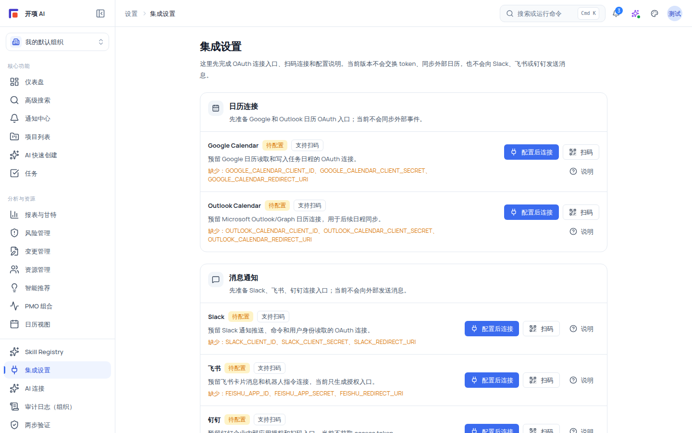

# 集成设置与插件边界

「设置 → 集成」（`/settings/integrations`）承载第三方连接的三块能力：① 第三方日历/消息/代码仓库的 **OAuth 连接入口**（共 7 个 provider，多数只做预连接）；② **出站 Webhook**（订阅/账本/模板/统计，投递默认未启用）；③ **Copilot 外部网页搜索**（组织级开关，默认关闭）。组织私有插件目录与插件策略见《组织私有插件目录与插件策略》。

## 适用范围

- **适用角色**：集成页对所有角色开放（`integration:connect` 六角色均持有）；**出站 Webhook 管理**（`outgoing_webhook:manage`）与 **Copilot 网页搜索管理**（`copilot:web_search:manage`）仅 `org_admin` / `project_manager`（`system_admin` 通配）。
- **适用版本**：基础集成适用于 free / team / enterprise；组织私有插件目录、安装治理与策略仅适用于 team / enterprise。
- **前置说明**：OAuth 回调页 `/settings/integrations/callback` 为只读结果页；授权失败或未登录时页面有对应空态（「登录后连接第三方账号」「没有第三方集成连接权限」）。

## 开始之前

- 准备目标平台的开发者应用凭据（Client ID / Secret / Redirect URI），各 provider 的环境变量见下方表。
- 了解能力边界（页面原文）：「当前版本不会交换 token、同步外部日历，也不会向 Slack、飞书或钉钉发送消息。」
- 不要在文档、代码或聊天中粘贴任何真实 OAuth 密钥与令牌；密钥仅存于服务端加密存储。
- 需要强调的是：**AI 连接**（`/settings/ai-connections`）是模型/OCR 接入，不是「集成页」里的外部工具开关，两者不要混淆。

## 第三方 Provider 全景

| Provider         | 分类     | 连接性质         | 环境变量（以代码为准）                                                                                              | 说明                                                                                                                                     |
| ---------------- | -------- | ---------------- | ------------------------------------------------------------------------------------------------------------------- | ---------------------------------------------------------------------------------------------------------------------------------------- |
| Google Calendar  | 日历     | **真实连接**     | `GOOGLE_CALENDAR_CLIENT_ID` / `SECRET` / `REDIRECT_URI`                                                             | 回调会交换 token 并保存加密连接，可执行连接检查与后续日历同步；是日历类唯一真实交换 token 的 provider                                    |
| Outlook Calendar | 日历     | **预连接**       | `OUTLOOK_CALENDAR_*`                                                                                                | 只校验回调链路，不交换 token、不同步外部事件；连接时报 `token_exchange_not_enabled`                                                      |
| Slack            | 消息     | **预连接**       | `SLACK_CLIENT_ID` / `SECRET` / `REDIRECT_URI`                                                                       | 同上；不向外部发送消息                                                                                                                   |
| 飞书             | 消息     | **预连接**       | `FEISHU_APP_ID` / `APP_SECRET` / `REDIRECT_URI`                                                                     | 同上                                                                                                                                     |
| 钉钉             | 消息     | **预连接**       | `DINGTALK_APP_ID` / `APP_SECRET` / `REDIRECT_URI`                                                                   | 同上                                                                                                                                     |
| GitHub           | 代码仓库 | **真实只读连接** | `GITHUB_CLIENT_ID` / `SECRET` / `REDIRECT_URI`（另有 `GITHUB_APP_ID` 可选）                                         | 回调换 token、存加密连接，「检查」做真实健康检查；无 refresh token，令牌失效会进入 `needs_reauth`（需重连）或 `check_failed`（检查失败） |
| GitLab           | 代码仓库 | **真实只读连接** | `GITLAB_CLIENT_ID` / `SECRET` / `REDIRECT_URI` + `GITLAB_BASE_URL`（默认 `https://gitlab.com`，自托管仅服务端可配） | 同 GitHub；只读，不做状态自动刷新                                                                                                        |

状态徽章全集：`待配置`（not_configured）/ `可连接`（ready）/ `预连接`（preconnected）/ `已连接`（connected）/ `未连接`（disconnected）/ `已停用`（disabled）/ `需重连`（needs_reauth）/ `检查失败`（check_failed）。未配置环境变量的 provider 行下方会显示「缺少：{环境变量名}」提示（warning 色）。

## 操作步骤

### 步骤 1：查看 provider 状态与配置说明

1. 打开「设置 → 集成」（`/settings/integrations`；也支持 `?category=calendar|message|code_repository` 直达分组）。
2. 逐行查看状态徽章与提示：缺失环境变量的 provider 按钮为「**配置后连接**」，显示「缺少：{环境变量}」。
3. 点击「**说明**」打开配置说明弹窗：里面列出「需要填写」的环境变量清单与 setupGuide 分步（含去平台申请的链接）。请记住弹窗原文提示：「环境变量是可选部署配置，不代表用户已经绑定。填好后点击连接即可进入 OAuth。」

### 步骤 2：配置环境变量并连接（以 Google Calendar 为例）

1. 按「说明」弹窗到 Google Cloud Console 创建 OAuth 应用，回填三个环境变量并重启后端。
2. 回到集成页：Google Calendar 行变为「可连接」（备注「点击连接后会保存真实 Calendar 授权。」）。
3. 点击「**连接**」：新窗口跳转到 Google 授权页，授权后回调 `POST /api/v1/integrations/:provider/callback`（该端点为公开免登录回调），随后 302 到结果页。
4. 结果页按 provider 显示「Google Calendar 已连接」/「GitHub 已连接」/「GitLab 已连接」；预连接类显示「OAuth 预连接已完成」；否则显示「OAuth 预连接未完成」，副文案为「当前版本只校验回调链路，不交换 token，也不会开始同步或外部推送。」；点「返回集成设置」回到页面。
5. 已连接后可使用「**检查**」（GitHub/GitLab 做真实健康检查，Google 读日历列表）刷新「上次检查」时间；失败时显示错误并把状态置为「检查失败」。
6. 「**断开**」清除连接：Google/GitHub/GitLab 会清除本地加密 token 并记录审计；预连接 provider 显示「已清除当前预连接状态；当前版本没有保存第三方 token。」。

### 步骤 3：扫码连接（支持扫码的 provider）

1. 对带「支持扫码」标记的 provider 点击「**扫码**」：弹出二维码弹窗（220px），显示「过期时间：{本地时间}」与「复制链接」「打开授权页」。
2. 用手机扫码或打开链接完成授权；二维码打开的是同一个 OAuth 地址，不绕过 state 校验。
3. 注意：预连接 provider（Outlook/Slack/飞书/钉钉）点连接或扫码会返回「{displayName} 当前为代码仓库预连接模式，不支持 OAuth 授权。」——这是预期行为，不是故障。

### 步骤 4：出站 Webhook 订阅（投递默认未启用）

1. 面板标题「出站 Webhook 订阅」；页面固定 Info 横幅（必读）：**「订阅状态为「已配置」并不代表已投递事件——投递功能尚未启用（delivery_not_enabled）。」**
2. 有 `outgoing_webhook:manage` 权限时显示创建表单：`订阅名称`（如「团队通知接收器」）、`目标 URL（HTTPS）`、`订阅事件`（复选框，事件白名单：`project.updated` 项目更新 / `task.created` 任务创建 / `task.updated` 任务更新 / `task.completed` 任务完成 / `risk.created` 风险登记）。前端校验：URL 必须 HTTPS、不得内嵌凭据、必须含 host 等。
3. 点击「**创建订阅**」成功后弹出**一次性密钥提示框**：「请立即保存一次性密钥」「密钥明文仅此一次显示，关闭后将无法再次获取。指纹：{fingerprint}」+ 密钥明文 +「我已保存」按钮。列表页只显示「密钥指纹：{fp} · 最近轮换：{时间}」，**不包含明文**。
4. 列表项含名称、「已配置」/「已停用」徽章、事件标签；管理按钮「轮换密钥」「停用」。
5. **投递账本**面板：「默认使用 fixture 投递，不发起真实外发。真实投递需启用并经明确授权。」状态：待发送/发送中/成功/失败/已暂停；失败分类：超时/网络错误/限流/服务端错误/客户端错误/签名错误/配置错误/已禁用/重试耗尽/未知；「手动重试」仅对失败且未暂停的条目可用（可重试类 = 超时/网络/限流/服务端错误；默认最多 5 次、指数退避）。
6. **模板面板**：内置 6 个稳定模板（任务状态变更通知 / 任务分配通知 / 任务到期提醒 / 项目里程碑通知 / 风险登记通知 / 全事件推送），「使用此模板创建」预填事件类型；模板预设 header（如 `X-Event-Source: aiproj-task`）并自带「限制」说明（如「仅发送低敏任务标题和项目名称，不包含任务描述、评论或附件」）。内部夹具模板不对外展示。
7. **统计面板**：8 张统计卡（投递总数/成功/失败/待处理/总重试次数/活跃订阅/最近投递/下次重试）；`OUTGOING_WEBHOOK_STATS_ENABLED` 默认关闭时显示「统计功能未启用」。
8. 无管理权限时以上面板为只读视图（「你无权管理出站 webhook 订阅，以下为只读视图。」）。

> [!WARNING]
> 投递相关开关 `OUTGOING_WEBHOOKS_ENABLED` / `OUTGOING_WEBHOOK_DELIVERY_ENABLED` / `OUTGOING_WEBHOOK_STATS_ENABLED` **默认关闭**：关闭时写操作（创建/轮换/停用/重试）返回 503 `FEATURE_DISABLED`，列表仍可读。真实外发另需平台明确授权，当前默认以 fixture 投递，不发起任何真实请求。

### 步骤 5：Copilot 外部网页搜索（默认关闭）

1. 面板标题「Copilot 工具：外部网页搜索」+「已启用」/「默认关闭」徽章；说明原文：「默认关闭：只有组织启用、成员有权限，且你在每次提问时显式开启『允许本次使用网页搜索』后，Copilot 才可能查询外部资料。每次调用都单独计量并落低敏审计；外部来源会与项目内部事实明确分区。」
2. 管理项（`copilot:web_search:manage`）：总开关「启用外部网页搜索」（关闭时 Copilot 与 AI 快速创建不会发起任何外部请求）；`Provider 连接 ID`（需先在 AI 连接中保存带 API 密钥的连接再回填）；`每自然日搜索额度`（1–10000）；允许域名（准入制，每行一个，支持 `*.gov.cn` 通配）/ 拒绝域名（黑名单，每行一个）；场景开关「允许用于通用 Copilot」「允许用于 AI 快速创建」。
3. 用量行：「今日已用 {usedToday} / {limitToday}」「按次同意：必须」「单次结果上限：{maxResultsPerQuery}」——**每次提问都需按次同意**，服务端锁定该策略。
4. 红线提示（页面固定文案）：「外部搜索使用隔离的 fixture/受控 provider；真实 provider 接入需单独授权。搜索结果仅作为带引用的参考，不会自动写入正式项目。」API 密钥只存储在服务端加密服务中，页面不显示、不要求填写。

## 验证结果

- 配置了环境变量的 provider 状态变为「可连接」，连接后变为「已连接」，检查/断开动作生效且状态徽章正确。
- 预连接 provider（Outlook/Slack/飞书/钉钉）点击连接收到「不支持 OAuth 授权」的预连接提示，符合预期。
- Webhook 订阅创建成功且只展示一次性密钥与指纹；投递账本/统计在开关关闭时给出明确的未启用提示。
- Copilot 网页搜索未启用时，AI 提问不会发起任何外部请求；启用且成员按次同意后才可能联网，且结果仅为带引用参考。

## 常见问题

**症状：点「连接」报「缺少 OAuth 应用配置」。**
原因：该 provider 的环境变量未配置（或不完整），错误详情给出缺失键列表。
处理：按「说明」弹窗申请并配置环境变量后重启后端；状态从「待配置」变为「可连接」。

**症状：Outlook/Slack/飞书/钉钉连接时报「token_exchange_not_enabled」。**
原因：这些 provider 当前为**预连接模式**，只校验回调链路，不做真实 token 交换或消息发送。
处理：这是当前版本的既定边界；需要真实同步/推送能力时请关注发布说明。

**症状：创建 Webhook 订阅提示「投递功能尚未启用」。**
原因：`OUTGOING_WEBHOOKS_ENABLED` 等投递开关默认关闭。
处理：订阅/账本/模板/统计的只读部分始终可用；启用投递需平台开启对应开关并授权真实外发，当前默认 fixture。

**症状：创建订阅后没保存密钥。**
处理：密钥明文无法从任何界面找回；请「轮换密钥」生成新密钥并立即保存（仍然只展示一次）。任何场景不要尝试从日志或存储翻查旧密钥。

**症状：Copilot 提问时没有联网搜索。**
可能原因：总开关关闭、无允许域名、未按次同意，或 provider 连接未配置。
处理：逐项核对治理面板；「已启用（provider 未配置，实际不会联网）」时先在 AI 连接保存带密钥的连接并回填连接 ID。

**症状：把「AI 连接」当成外部工具开关。**
说明：AI 连接是模型接入（对话/结构化输出/OCR），不是 web-search 等工具设置。
处理：模型问题去「设置 → AI 连接」；工具类能力（网页搜索）在集成页的 Copilot 面板管理。

## 安全与限制

- 连接按 `(组织, 用户, provider)` 隔离；跨组织访问 404/403，未登录 401；OAuth state 有效期 10 分钟，过期报「OAuth state 已过期」。
- 环境变量是可选部署配置：缺失只影响对应 provider，不阻塞页面。
- 预连接 provider 不保存任何第三方 token；真实连接（Google/GitHub/GitLab）的 token 加密存储于服务端，断开即清除并记审计。
- 出站 Webhook 投递与 Copilot 网页搜索的真实外发均需平台明确授权；默认 fixture，不发起真实请求。
- 集成配置变更与连接/断开等关键操作进入审计范围；权限判定以服务端 RBAC 为准。
- 组织私有插件目录与插件策略（maker-checker 审批流）见《组织私有插件目录与插件策略》，不要与集成设置混为一谈。

## 下一步

- [组织私有插件目录与插件策略](/help/articles/admin.organization-plugins)
- [可选网页搜索](/help/articles/ai.optional-web-search)
- [配置 AI 连接](/help/articles/ai.configure-ai-connections)
- [API 错误码参考](/help/articles/reference.api-errors)
