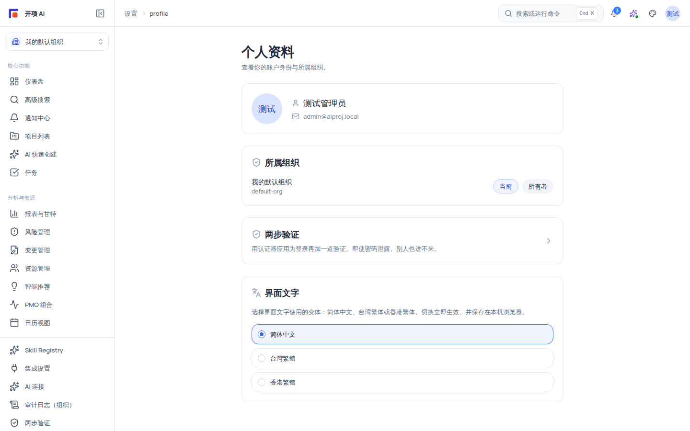

# 界面文字切换（简体 / 台湾繁体 / 香港繁体）

平台的**界面文字**（导航、按钮、表单标签等词条）支持三种变体：**简体中文**（默认）、**台湾繁体**、**香港繁体**。个人设置页与登录页都能切换，且切换后**即时生效**。本页说明切换位置、生效范围与偏好存储方式。

## 适用范围

- **适用角色**：所有登录用户都可以为自己的账号/浏览器设置界面文字变体；无需任何管理权限。
- **适用版本**：free / team / enterprise 一致。
- 说明：本能力只转换**界面词条**；用户自己创建的数据内容（项目名、任务描述、评论等）与文档正文不会被转换。

## 开始之前

- 无需准备；登录后即可操作。
- 想了解哪些内容会跟随切换、哪些不会，先读下方「生效范围」表。

## 生效范围

| 内容                                         | 是否跟随「界面文字」切换 | 说明                                           |
| -------------------------------------------- | ------------------------ | ---------------------------------------------- |
| 界面词条（导航、按钮、表单标签、提示文案等） | ✅ 是                    | 登录页、工作台、设置、帮助中心界面等均生效     |
| 登录页                                       | ✅ 是（即时）            | 登录页右上角有文字变体切换按钮，未登录也可切换 |
| 帮助中心界面词条                             | ✅ 是                    | 帮助中心搜索框、分类标题等界面文字跟随变体     |
| 文档正文                                     | ❌ 否                    | 帮助文章正文为简体中文撰写，不随变体转换       |
| 用户数据内容                                 | ❌ 否                    | 项目/任务/评论等用户输入内容原样保留           |
| 系统审计与权限判定                           | 不受影响                 | 切换仅为显示层偏好，不影响权限与数据           |

## 操作步骤

### 切换入口对照

| 入口       | 位置                                                                         | 是否需要登录         | 生效方式                 |
| ---------- | ---------------------------------------------------------------------------- | -------------------- | ------------------------ |
| 个人设置页 | 「设置 → 个人资料」→「界面文字」卡（单选组：简体中文 / 台灣繁體 / 香港繁體） | 需要                 | 点选即生效，无需保存按钮 |
| 登录页     | 登录页右上角文字变体切换按钮                                                 | 不需要（未登录也可） | 点选即生效               |

两个入口共用同一偏好（浏览器本地存储），互相同步。

### 步骤 1：在个人设置页切换

1. 登录后打开「设置 → 个人资料」（`/settings/profile`）：页面包含「个人资料」卡（头像、姓名、邮箱、所属组织）与「**界面文字**」卡。

   

2. 在「界面文字」卡中选择目标变体：
   - **简体中文**（默认）：如「登录」「项目」「任务看板」。
   - **台灣繁體**：如「登入」「專案」「任務看板」。
   - **香港繁體**：香港用语习惯的繁体表达。
3. 选择后**立即生效**：不需要保存按钮，也不强制刷新；界面词条随所选变体即时重渲染。
4. 打开帮助中心：搜索框与界面词条（如「帮助與文件」「搜尋：…」）即为所选的繁体/简体变体；**文档正文**仍保持简体中文。

### 步骤 2：在登录页切换（未登录/重新登录场景）

1. 打开登录页：右上角有**文字变体切换按钮**（简体/台湾繁体/香港繁体）。
2. 切换后登录页词条（如「邮箱」「密码」「登录」→「登入」）立即变为所选变体；该选择与你登录后的个人设置保持同一偏好。
3. 切换不影响登录流程本身：账号、密码与登录方式不变。

### 步骤 3：核对与切回

1. 依次打开工作台导航、设置各页与帮助中心，抽查界面词条是否全部为所选变体。
2. 需要切回时：回到「界面文字」卡点选「简体中文」（或登录页右上角按钮）即恢复默认。
3. 核对你的数据内容（项目名、任务描述）始终原样；如有工具需要转换，请在平台外自行处理。

## 验证结果

- 在个人设置页选择任一繁体变体后，页面与帮助中心界面词条立即以繁体显示；换回简体后立即还原。
- 登录页右上角切换按钮可用，未登录状态也能切换界面文字。
- 重新登录（或换一台设备登录同一账号所在浏览器）后，偏好保持——它记录在**浏览器本地**（localStorage，键 `aiproj-text-variant`，例如 `tw` 代表台湾繁体），而不是服务端账号设置；换浏览器/清除浏览器数据后回到默认简体。
- 项目数据、评论与文档正文始终保持原样，不被转换。

## 常见问题

**症状：切换繁体后，项目名称/任务描述还是简体。**
原因：界面文字只转换系统词条；用户数据内容（标题、描述、评论）与文档正文原样保留。
处理：无需处理；如需转换用户数据内容，请用支持简繁转换的外部工具，平台不做自动改写。

**症状：换了一台设备/浏览器，界面文字回到简体。**
原因：偏好保存在浏览器本地存储（localStorage 键 `aiproj-text-variant`），不是账号级服务端设置；清除浏览器数据也会重置。
处理：在新设备上到「设置 → 个人资料 → 界面文字」或登录页右上角重新选择。

**症状：找不到「界面文字」卡。**
可能原因：在旧版本缓存页面，或误在「组织设置」里寻找。
处理：确认在「设置 → 个人资料」；登录页右上角按钮也可切换。若仍找不到，刷新页面后重试。

**症状：切换后部分页面仍显示简体。**
可能原因：个别页面词条尚未纳入变体转换范围（词条化覆盖不全），或浏览器缓存旧资源。
处理：刷新页面；仍有个别词条不生效时记录页面与词条反馈，属显示层问题，不影响功能与数据。

**症状：台湾繁体与香港繁体看起来差不多，选哪个？**
说明：两者都是繁体，但用语习惯不同（例如湾式用语与港式用语在个别词条上存在差异），选项名也分别标注「台灣繁體」与「香港繁體」。
处理：按你的目标读者习惯选择；切换即时生效，可随时改回。

**症状：切换后刷新页面丢了选择。**
可能原因：浏览器禁用了本地存储（localStorage），或浏览器处于隐私模式且清除了存储。
处理：偏好依赖 localStorage（键 `aiproj-text-variant`）；确认浏览器允许站点存储后重选即可。

## 安全与限制

- 本能力仅为**显示层偏好**：不影响权限判定、数据内容与审计记录；组织隔离与 RBAC 判定不受任何影响。
- 偏好存储于浏览器 localStorage（键 `aiproj-text-variant`），不包含任何敏感信息；切换行为不产生审计事件（非关键操作）。
- 繁体变体为词条层面的用语转换，不保证对用户生成内容做简繁转换；文档正文固定简体中文。

## 下一步

- [产品概览](/help/articles/getting-started.product-overview)
- [账号、组织与角色](/help/articles/admin.accounts-organizations-and-roles)
- [邀请你的团队](/help/articles/getting-started.invite-your-team)
