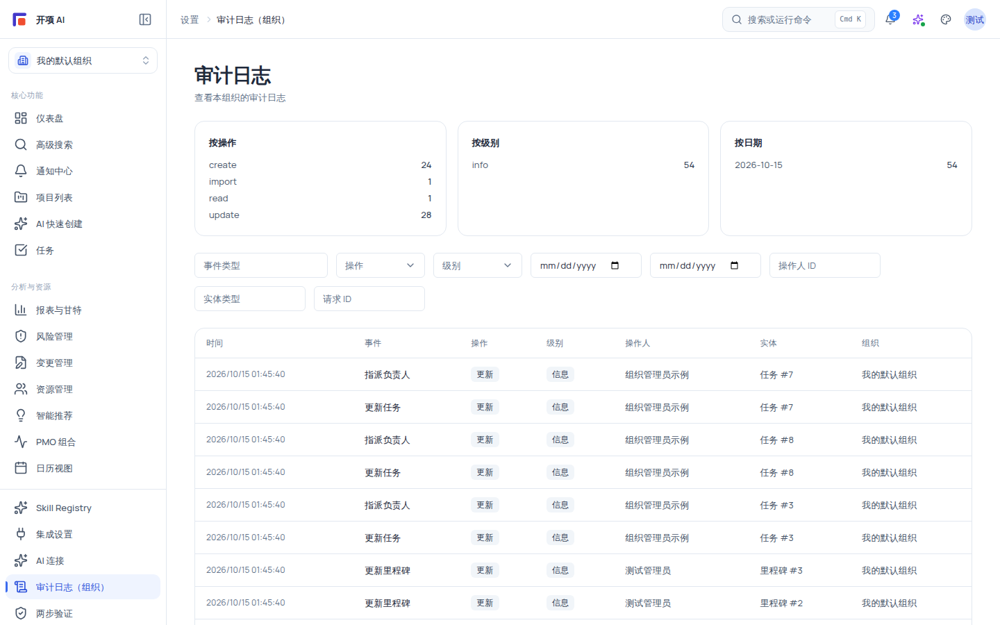

# 安全审计与数据隔离

了解组织级数据隔离与审计日志（本组织/全局两级）的边界，明确你的数据在哪里、谁能看到、以及出了事去哪里查。

## 适用范围

- **适用角色**：审计日志查看需 `audit:view`（六角色中仅 `org_admin`，`system_admin` 通配）；全局审计日志（`/admin/audit-logs`）仅 `system_admin`。所有成员都应了解数据隔离与审计的基本边界。
- **关键认知**：审计**写入**由后端 AuditService 自动完成（关键操作落库），页面与本文档都只涉及**读取**；审计日志按组织隔离，跨组织不可见。

## 开始之前

- 无特殊准备。本页为安全边界与审计说明。
- 先确认你要查的范围：**本组织**的审计走「设置 → 审计日志」；**跨所有组织**的审计走 `/admin/audit-logs`（仅系统管理员）。

## 审计日志：两级视图

两个页面共用同一套组件，仅 scope 不同：

| 页面           | 路由                                            | 权限                           | 标题/副标题                                      |
| -------------- | ----------------------------------------------- | ------------------------------ | ------------------------------------------------ |
| 本组织审计日志 | 侧栏「设置 → 审计日志」(`/settings/audit-logs`) | `audit:view`（仅 `org_admin`） | 「审计日志」「查看本组织的审计日志」             |
| 全局审计日志   | `/admin/audit-logs`                             | `system:admin`                 | 「审计日志（全局）」「查看跨所有组织的审计日志」 |

### 页面结构（自上而下）

1. **统计卡片区**：三张卡「按操作」「按级别」「按日期」（按日期仅统计最近 14 天）。统计请求带 800ms 超时，失败时显示「统计加载失败」+「重试」按钮——重试即可，不影响下方记录列表。
2. **过滤器**：事件类型（文本）、操作（下拉：create / read / update / delete / export / login / logout / approve / reject）、级别（info / warning / error / critical）、开始日期、结束日期、操作人 ID、实体类型、请求 ID。**每改一个条件立即刷新**，条件写入 URL query：可以后退、收藏深链。
3. **记录表格**：列 时间 / 事件 / 操作 / 级别 / 操作人 / 实体 / 组织。操作人优先显示实名，查不到时回退「用户#id」，无用户显示「系统」；实体优先项目名/实体名，否则显示「中文类型 #id」；组织优先中文名，回退「组织#id」。空态「暂无审计记录」；「加载更多」按钮翻页。
4. **详情抽屉**：点任意一行打开「审计日志详情」，字段 事件 / 操作 / 级别 / 操作人 / 组织 / 项目 / 实体 / 时间；有变更时显示「变更前后」两个 JSON 块（附「（数据已截断）」提示——长变更内容只保留部分），无变更显示「该记录无变更前后值」；另有「上下文」JSON 块展示请求上下文。请求 ID 就在「上下文」里，可作为反馈排障的线索。

### 覆盖面与边界

- 审计写入自动完成：关键操作（登录/登出、读写删除、导出、审批/拒绝、权限与配置变更、AI 相关关键动作等）都会落库，页面纯读。
- 服务端 `AuditLogPolicy`：超级管理员可见全部；其他账号强制按 `organization_id` 过滤；无组织上下文时返回「需要组织上下文」。
- 组织级数据隔离是产品红线：所有查询自动附加组织过滤，跨组织不可见，跨组织访问一律 404。

## 企业版提供的数据保护能力

数据防泄漏（DLP）、导出水印、KMS 密钥管理、合规准备度与企业审计增强属于企业版能力，开源版不包含对应界面与接口。直接访问这些页面的地址时，会看到「企业版提供」的说明页。

## 安全与限制

- 组织级数据隔离不可关闭；审计日志覆盖关键操作，页面纯读，写入自动完成。
- 密钥/令牌只存服务端加密存储；帮助文档与导出内容不含密钥；「只写不读、一次性展示」纪律适用于所有秘密材料。
- AI 相关能力仍受红线约束：AI 只建议、不自动执行；草案须人工确认；AI 输出不自动落库。

## 常见问题

**症状：担心数据被其他组织看到。**
说明：组织级数据隔离是产品红线：查询自动附加组织过滤，跨组织访问按「不存在」处理。
处理：切换组织核对归属；跨组织数据不可见。

**症状：找不到某次操作的审计记录。**
可能原因：操作不在关键操作覆盖范围、无审计查看权限（需 `audit:view`）、或统计卡超时（800ms 竞态）只影响统计不影响列表。
处理：确认操作类型与你的权限；统计卡失败时点「重试」；仍失败时收集 request id 反馈。

**症状：统计卡显示「统计加载失败」。**
说明：统计请求带 800ms 超时（竞态保护）；超时只影响顶部统计卡，不影响下方记录列表。
处理：点击「重试」刷新统计卡；列表「加载更多」不受影响。

## 下一步

- [权限参考](/help/articles/reference.permissions)
- [账号、组织与角色](/help/articles/admin.accounts-organizations-and-roles)
