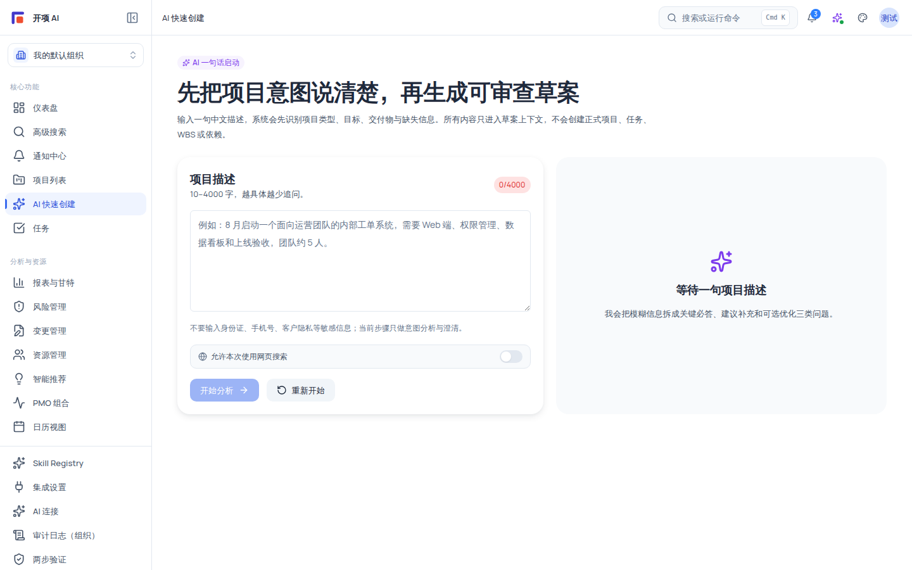
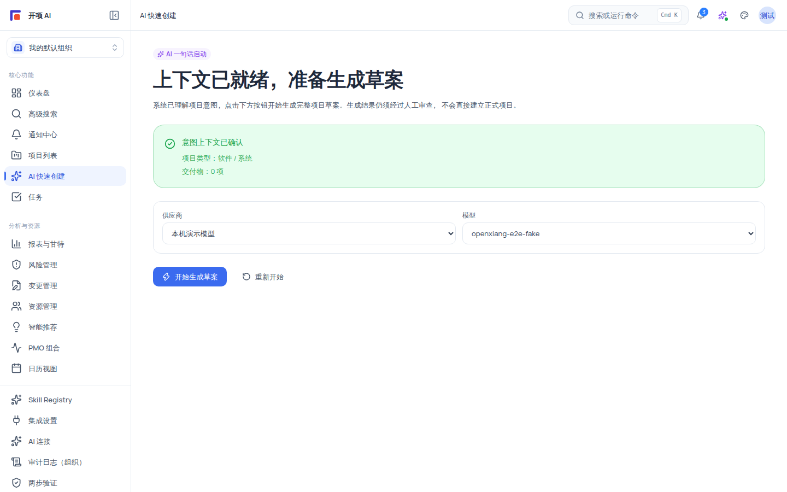

# 使用 AI 快速创建项目（一句话建项全流程）

用一句话描述项目意图，系统依次完成「意图分析 → 澄清追问 → 草案生成 → 人工审查 → 人工导入」五个阶段。全程 **AI 只建议、不自动执行**：草案生成阶段零正式落库，唯一写正式项目数据的入口是你的人工「确认导入」。

本教程带你走完一次完整的 AI 建项流程，预计用时 5–15 分钟（视生成速度与审查细致程度）。

## 适用范围

| 项目                 | 说明                                                            |
| -------------------- | --------------------------------------------------------------- |
| **入口**             | 侧边栏「核心功能 → AI 快速创建」，或直达 `/ai-create`           |
| **页面所需权限**     | `ai:trigger`（持有者：组织管理员、项目经理、普通成员）          |
| **确认导入所需权限** | `ai:confirm` **且** `project:create` 同时具备（见下方权限矩阵） |
| **适用版本**         | free / team / enterprise                                        |

### 权限矩阵（AI 快速创建相关）

| 角色                                      | `ai:trigger`（进入并生成草案） | 侧栏入口可见（`project:create`）                                 | `ai:confirm` + `project:create`（确认导入） |
| ----------------------------------------- | ------------------------------ | ---------------------------------------------------------------- | ------------------------------------------- |
| system_admin                              | ✅（哨兵）                     | ✅                                                               | ✅                                          |
| org_admin                                 | ✅                             | ✅                                                               | ✅                                          |
| project_manager                           | ✅                             | ✅                                                               | ❌（有 `ai:confirm` 但无 `project:create`） |
| member                                    | ✅                             | ❌（无 `project:create`，看不到侧栏入口；直达 URL 仍可生成草案） | ❌                                          |
| external_collaborator / readonly_observer | ❌                             | ❌                                                               | ❌                                          |

> [!WARNING]
> 当前矩阵下，真正能完成「确认导入」的是**组织管理员与系统管理员**。项目经历（project_manager）和成员可生成草案并提交给管理员导入；成员注意：即使直达 `/ai-create` 完成生成，也会在导入动作上被拦截。

无 `ai:trigger` 权限时页面显示兜底文案：「当前账号不能使用 AI 创建入口」「该能力需要组织内的 ai:trigger 权限。你仍然可以查看已有项目，但不能触发 AI 意图分析。」

## 开始之前

1. 确认你的角色满足上表需求；准备一个明确的项目意图（目标、交付物、时间与团队规模）。组织需至少有一条可用的草案模型连接（见《配置 AI 连接》）；没有可用连接时系统会使用**系统兜底**（审查页会标注「Fallback / 离线结果」），流程一致。
2. 了解输入约束：项目描述 **10–4000 字**，支持中文；页面提示「不要输入身份证、手机号、客户隐私等敏感信息；当前步骤只做意图分析与澄清。」（提示仅做提醒，不会强制拦截敏感内容——请自行保护隐私数据）。

## 全流程概览

| 阶段       | 页面状态            | 你要做的事                                 | 是否写正式数据         |
| ---------- | ------------------- | ------------------------------------------ | ---------------------- |
| 1 意图输入 | 初始态              | 输入一句话描述，点「开始分析」             | 否                     |
| 2 意图分析 | 分析中              | 等待 AI 识别项目类型、实体、交付物         | 否                     |
| 3 澄清追问 | clarifying          | 回答三阶段澄清卡或进入对话式澄清           | 否                     |
| 4 草案生成 | ready → drafting    | 选择模型（或系统兜底），点「开始生成草案」 | 否                     |
| 5 草案审查 | reviewing / editing | 核对内容、处理校验、行内编辑               | 否                     |
| 6 确认导入 | importing → 完成    | 点「确认导入（全部/所选）」                | **是（唯一落库入口）** |

## 操作步骤

### 步骤 1：进入 AI 快速创建

点击侧边栏「核心功能 → **AI 快速创建**」。如果你没有 `project:create`（如普通成员）但拥有 `ai:trigger`，侧栏不显示该入口——此时可在浏览器地址栏直接访问 `/ai-create` 继续本教程。

### 步骤 2：输入项目意图并开始分析

1. 在「项目描述」输入框填写意图，例如：`8 月启动一个面向运营团队的内部工单系统，需要 Web 端、权限管理、数据看板和上线验收，团队约 5 人。`（10–4000 字，输入框下方显示字数徽章 `{字数}/4000`）。
2. 如本次分析需要检索外部资料，先打开 **「允许本次使用网页搜索」** 开关（AI 快速创建的分析会话中该开关不会在提交后自动复位）；开启后文案说明「本次允许联网搜索：可能发送你问题涉及的主题；组织域名策略与额度适用；外部资料仅作参考，不会直接写入正式项目」。
3. 点击 **「开始分析」**（已有分析结果后该按钮变为「重新分析」）。右侧摘要卡立即显示「AI 正在分析项目意图…」。
4. 分析失败时页面显示红色错误块「分析失败」+ 错误文案 + **「重试」**按钮；兜底文案为「分析失败，请稍后重试」。

分析成功后右侧「识别摘要」卡显示：

- **项目类型**：软件 / 系统、活动 / 会务、研究 / 调研、产品 / 上市、通用项目之一；
- **实体数量 N 个 / 交付物 N 项 / 置信度 N%**；
- **澄清进度**三栏计数：关键必答 / 建议补充 / 可选优化；
- **「AI 假设与已确认信息」**：AI 自行推断的内容带「AI 假设」徽章，你确认过的内容归类为已确认；
- 状态提示：全部关键问题解决后出现绿色提示「已准备生成草案——当前只完成草案上下文准备；正式项目创建必须进入后续审查确认流程。」；否则显示警告「还有 N 个关键问题未解决，暂不能进入 ready。」

### 步骤 3：回答澄清问题（三阶段 + 对话式澄清）

系统按三个「阶段」逐题追问，一次只确认一个关键决定：

| 阶段 | 标题       | 追问范围                                                          |
| ---- | ---------- | ----------------------------------------------------------------- |
| 1/3  | 核心必答   | 「先确认所有项目都需要的 7 个事实。」关键问题未答完无法进入 ready |
| 2/3  | 专业补充   | 「依据已确认答案，只询问本项目实际触发的专业问题。」              |
| 3/3  | Agent 追问 | 「Agent 只针对仍会影响计划质量的缺口继续追问。」                  |

澄清队列顶部显示「还剩 N 题」「已完成 N 题」与进度条；每张澄清卡包含：

- **类别徽章**与说明：关键必答（不补齐会阻断后续草案生成）/ 建议补充（可采用 AI 默认假设，但会影响计划质量）/ 可选优化（不回答也可以继续，用于让草案更贴近偏好）；
- **置信度百分比**（右上）与 **影响范围** chip（形如 `{domain} · {severity}`）；
- **快捷选项按钮**（推荐项用 secondary 样式）、多选时显示「确认已选 N 项」；有预填值时显示「已从原始描述预填，请确认或修改：{value}」；
- **自定义输入**按题型渲染 number/date/text 输入框 + 「回答」按钮；
- 底部 **「采用 AI 建议：{value}」**（关键必答卡禁用）与 **「跳过」**（非 allowSkip 或关键必答卡禁用）。

除逐题回答外，你还可以进入**对话式澄清**（当前澄清项支持时）：用自然语言直接回答或反问，对话区提供快捷按钮「为什么要问？」「我不明白」「请给我建议」「还不确定」（允许未知时）「其他」（允许其他时），以及「查看本题对话」折叠区、「AI 目前的理解」与「修改之前的回答」（预填「我想修改之前的回答：」）、「待决定事项」清单（最近 5 条）。

- 回答造成资料冲突时，会话进入 `needs_human_review`：页面提示「需要先人工检查目前的资料」并展示原因，你需要先处理后再继续。
- 关键资料备齐后出现「先生成初步草案」区块：「关键资料已确认；尚未决定的内容会明确列为假设、待决定事项或风险，并继续经过人工审查。」
- 若澄清队列内部检查失败，会停止发布后续问题并提示「问题计划未通过遗漏检查，已停止发布后续问题。请重试分析。」

### 步骤 4：确认上下文并开始生成草案

1. 关键问题全部回答后，页面切换为「上下文已就绪，准备生成草案」：「系统已理解项目意图，点击下方按钮开始生成完整项目草案。生成结果仍须经过人工审查，不会直接建立正式项目。」
2. 页面显示绿色「意图上下文已确认」卡（项目类型 / 交付物 N 项）；如存在未决项，还有黄色「初步草案仍有 N 项待确认」卡：「AI 会把这些内容标为假设、待决定事项或风险，不会自行编造具体答案。」
3. 在 **供应商/模型选择器** 中选择本次生成使用的模型（候选项 = 已启用连接中带 `项目草案` 或 `聊天/问答` 能力的模型）。组织未配置可用草案模型时，下拉显示 **「未配置草案模型，使用系统兜底」**——此时流程照常，但审查页会标注「Fallback / 离线结果」。上次使用的模型会被记住（按组织与账号保存在本机），失效时提示「上次使用的模型已不可用，请重新确认本次要使用的模型。」

4. 点击 **「开始生成草案」**（闪电图标）。想重新来可以从右上「重新开始」清空上下文。

### 步骤 5：观察生成进度与实时输出

生成阶段（`AI 正在生成项目草案`）展示真实流式进度：

- **9 个模块**：项目章程、工作分解结构、任务清单、任务依赖、验收标准、资源建议、风险建议、里程碑、甘特图预览，各带已完成/生成中/失败/等待中图标；进度条显示「已完成模块 n/9」，ETA 显示「估算中… / 预计剩余 + 时长」。
- **健康徽章**：实时连接 / 生成用时较长 / 连接暂时停滞 / 正在恢复连接 / 正在同步进度 / 需要重试。
- **「AI 实时输出」面板**：终端风格深色底，显示「当前生成：{模块中文名}」+ `{n} 字符`，结束显示「— 已结束 —」；滚动区自动跟随，暂停跟随后出现「已暂停跟随 · 点击回到底部」。
- **断线恢复**：连接静默超过 20 秒会自动重连（最多 3 次，退避 1s/2s/4s）；刷新页面后会自动从上次位置续传（进度游标保存在本机浏览器，24 小时有效，只含低敏标识）。重连失败时提示「进度连接已中断，可从上次位置继续。」，并提供「继续接收进度」「重试生成」「重新生成」。

> [!NOTE]
> 上图展示的是生成刚启动时的画面（模块进度 0/9）。生成期间进度条与实时输出持续更新，请以页面实时状态为准。

### 步骤 6：审查草案并处理校验结果

生成完成后进入草案审查（「草案审查」「AI 生成的草案须经人工确认才可导入正式项目」）：

1. 查看头部徽章：**结构完整 / 结构已修复 / 低保证**（一致性结论）、`{N}% 置信` 与生成策略原文；「生成来源」卡标注「Fallback / 离线结果 | 真实模型结果 · 请求策略 X · 生效策略 Y」，旧版草案显示「旧版草案未记录阶段产物」。
2. 阅读**反幻觉/校验结果**（规则 ID 为真实的 `HL-001~HL-010` 自检 + `VE-001~VE-012` 校验）：
   - **blocking**：红色「校验未通过，禁止确认导入」——不改掉无法导入；
   - **warning**：黄色「校验警告，建议人工检查」——确认导入时会弹出确认对话框；
   - **info**：灰色提示，带 `ruleId` chip。
3. 查看「自动修正差异」卡：每条显示字段 `path`、修正前（红底）→ 修正后（绿底）与 `reason`，确认系统自动修复是否符合预期。
4. 服务端校验判定不可导入时，页面显示「当前草案不可确认导入」+ 原因列表。
5. 逐节核对与行内编辑：「项目章程」（项目名称/项目愿景/项目范围/目标/成功标准/开始日期/结束日期，hover 铅笔按钮行内编辑）、「WBS 结构（N 节点）」（可全选）、「任务清单（N）· 依赖（N）」（表格列：名称/工期(天)/开始/结束/负责人；依赖用 chip 显示 `{前 6 位} → {后 6 位} +{lag}d`）、「风险建议」（high/medium/low 三色徽章）、「里程碑建议」「甘特图预览」（开始/结束/总工期 N 天/阶段数）。
6. **行内编辑只暂存改动**——操作区明确提示「行内编辑仅暂存改动，点「确认导入」才会创建正式项目」。

> [!IMPORTANT]
> 上图展示的「禁止确认导入」是反幻觉系统的**正常安全行为**：当前草案（本机示例为 Fallback 兜底结果）未通过校验，系统禁止导入以守住红线。配置可用模型后生成真实草案，校验通过路径与流程完全相同。

### 步骤 7：确认导入为正式项目

1. 操作列提供 **「确认导入（全部）」** 与 **「确认导入（所选 N）」**（勾选任务大于 0 时出现）。部分导入：在 WBS 节点、任务、风险建议中勾选需要的项，未选内容按不导入策略丢弃。
2. 存在校验警告时，点击导入会弹出「确认操作」对话框，列出全部警告并要求「确认」后才继续。
3. 点击确认后进入「正在导入草案到正式项目...」——**请勿刷新页面**（服务端单事务创建项目与任务，并发送通知「AI 草案已确认导入：「{项目名}」」）。
4. 导入完成显示「项目已创建」「项目 ID：{id} · 已导入 {N} 个任务」，提供「查看项目」与「创建下一个项目」。

### 可选：保存草稿 / 拒绝重试 / 失败处理

- **保存草稿**：生成完成后可「保存草稿」，显示「草案已保存到会话，可稍后继续」，之后通过「返回上下文」或「重新开始」继续。
- **拒绝重试**：点「拒绝重试」后显示「已拒绝草案」「可修改上下文后重新生成」。
- **失败面板**：生成失败时显示「草案生成失败」「失败阶段：{章程与范围 / WBS 与任务 / 排期与依赖 / 资源、风险与验收 / 一致性复核}」「原因码：{code}」与「脱敏错误摘要」，提供「重试」「返回上下文」；后端常见提示「生成服务繁忙，请稍后重试。」「草案生成失败，请稍后重试或调整输入。」，后台任务中断提示「后台生成任务已中断，请重新生成草案。」。

## 验证结果

- 澄清完成后右侧摘要显示「已准备生成草案」绿色提示，页面出现「开始生成草案」按钮。
- 生成阶段看到 9 个模块逐一完成、实时输出面板滚动输出；断线后自动续传不重复已生成模块。
- 审查页能看到校验结论（blocking/warning/info）与「自动修正差异」前后对照；blocking 未清时「确认导入」不可用。
- 导入成功出现「项目已创建 · 项目 ID：{id} · 已导入 {N} 个任务」；到「项目」列表可见新项目，WBS/任务/依赖与草案一致。
- 在确认导入之前，项目列表与正式数据**没有任何变化**。

## 限制与安全边界

| 边界                    | 说明                                                                                                   |
| ----------------------- | ------------------------------------------------------------------------------------------------------ |
| **AI 零自动执行**       | 草案生成阶段绝不写正式业务表；唯一写正式项目数据的动作是你的人工「确认导入」                           |
| **确认导入权限**        | 需 `ai:confirm` 且 `project:create`，当前矩阵下为组织管理员/系统管理员；项目经理与成员可生成但不能导入 |
| **反幻觉红线**          | `HL-001~HL-010` 自检 + `VE-001~VE-012` 校验；blocking 项禁止导入、warning 需确认对话框                 |
| **导航门控 ≠ 页面门控** | 侧栏入口要 `project:create`；页面本身只要 `ai:trigger`，成员可直达 URL 生成草案但不能确认导入          |
| **模型兜底**            | 无可用草案模型连接时使用系统兜底，审查页标注「Fallback / 离线结果」                                    |
| **组织隔离**            | 草案、会话按组织隔离，跨组织访问返回资源不存在                                                         |
| **输入隐私**            | 10–4000 字；页面提醒不要输入身份证、手机号、客户隐私等敏感信息                                         |

## 常见问题

| 症状                                           | 可能原因                                                 | 检查与修复                                                                   |
| ---------------------------------------------- | -------------------------------------------------------- | ---------------------------------------------------------------------------- |
| 页面显示「当前账号不能使用 AI 创建入口」       | 角色无 `ai:trigger`                                      | 联系组织管理员授权；external/readonly 角色无此能力                           |
| 分析失败（「分析失败」+ 重试按钮）             | 生成服务繁忙或输入异常                                   | 点「重试」；确认描述在 10–4000 字                                            |
| 「还有 N 个关键问题未解决，暂不能进入 ready」  | 关键必答题未答完                                         | 回到澄清队列继续回答阶段 1/3 的问题，完成后自动解锁                          |
| 提示「问题计划未通过遗漏检查…」                | 澄清队列内部校验失败                                     | 点「重新分析」重建上下文                                                     |
| 模型选择器只有「未配置草案模型，使用系统兜底」 | 组织无启用 + 具草案/聊天能力的连接                       | 由管理员在「设置 → AI 连接」配置并启用模型（流程不受影响，仅质量受兜底限制） |
| 生成中断 / 进度卡住                            | SSE 中断、服务超时或模型配额耗尽                         | 等待自动重连；或点「重试生成」重新生成（已答信息保留）；刷新页面会自动续传   |
| 「校验未通过，禁止确认导入」                   | 草案未通过反幻觉 blocking 检查                           | 按校验项逐条修正（日期逻辑、依赖环路、验收标准等）后重新校验                 |
| 「确认导入」按钮不可用或导入被拒               | 无 `ai:confirm` + `project:create`，或存在 blocking 校验 | 确认角色；处理全部 blocking 项；由组织管理员/系统管理员执行导入              |
| 导入时提示请勿刷新但页面被关闭                 | 导入事务中断                                             | 重新进入草案会话查看结果；草案数据以服务端为准，必要时重新生成               |

## 下一步

- [动态追问卡片：AI 如何澄清你的需求](/help/articles/ai.clarification-cards)
- [查看生成进度与审查 AI 草案](/help/articles/ai.generation-progress-and-review)
- [AI 草案层（Draft Layer）交互审查](/help/articles/ai.draft-layer-review)
- [配置 AI 连接](/help/articles/ai.configure-ai-connections)
- [创建第一个项目（完整教程）](/help/articles/getting-started.create-first-project)
