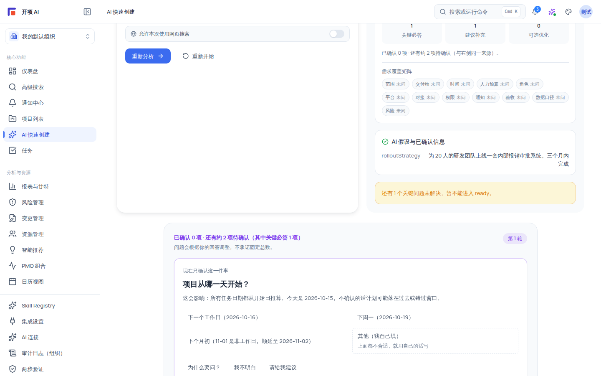

# 动态追问卡片：AI 如何澄清你的需求

一句话项目描述往往信息不全（范围、里程碑、预算、团队都缺失）。AI 快速创建在意图分析之后，用**澄清卡片**和**对话式澄清**逐项补齐信息，让草案更贴近真实项目；未补齐的内容会显式列为假设、待决定事项或风险，而不是被 AI 悄悄编造。

本文解释澄清机制的构成、每类问题的含义，以及「跳过 / 采用 AI 建议」在什么条件下可用。

## 适用范围

| 项目         | 说明                                                                |
| ------------ | ------------------------------------------------------------------- |
| **触发条件** | 在 AI 快速创建（`/ai-create`）完成意图分析后自动进入澄清队列        |
| **适用角色** | 具备 `ai:trigger` 的用户（组织管理员、项目经理、成员）              |
| **前置依赖** | 已完成一次[意图分析](/help/articles/ai.ai-quick-create)（步骤 1–2） |
| **适用版本** | free / team / enterprise                                            |

## 开始之前

- 已阅读《使用 AI 快速创建项目》了解全流程。
- 澄清阶段**不产生任何正式数据**：你的回答只进入草案上下文。

## 澄清的三种问题类别

系统把追问问题分成三类，用不同徽章与说明标注：

| 类别         | 徽章     | 说明                                   | 不回答的后果                 |
| ------------ | -------- | -------------------------------------- | ---------------------------- |
| **关键必答** | 关键必答 | 不补齐会阻断后续草案生成               | 无法进入 ready，草案无法生成 |
| **建议补充** | 建议补充 | 可采用 AI 默认假设，但会影响计划质量   | 可继续，但 AI 会用假设填充   |
| **可选优化** | 可选优化 | 不回答也可以继续，用于让草案更贴近偏好 | 无阻断，仅精细度差别         |

> [!WARNING]
> 「跳过」在关键必答卡上不可用；「采用 AI 建议」在关键必答卡上同样不可用——关键事实不允许由 AI 自行假设。

## 三阶段澄清队列

澄清不是一次问完，而是按「一次只确认一个关键决定」的方式分三阶段发布：

| 阶段     | 标题       | 追问原则                                                |
| -------- | ---------- | ------------------------------------------------------- |
| 阶段 1/3 | 核心必答   | 先确认所有项目都需要的 7 个事实（范围、时间、交付物等） |
| 阶段 2/3 | 专业补充   | 依据已确认答案，只询问本项目实际触发的专业问题          |
| 阶段 3/3 | Agent 追问 | Agent 只针对仍会影响计划质量的缺口继续追问              |

队列顶部显示「还剩 N 题」「已完成 N 题」与进度条。阶段之间或回答过程中若产生资料冲突，会话可能进入 `needs_human_review`：「需要先人工检查目前的资料」——系统展示原因，你处理后才能继续。

## 澄清卡的结构

每张澄清卡包含以下组成部分：

| 组成                | 说明                                                                   |
| ------------------- | ---------------------------------------------------------------------- |
| **类别徽章 + 说明** | 关键必答 / 建议补充 / 可选优化及其含义                                 |
| **置信度**          | 卡片右上角的百分比，表示 AI 对该项当前理解的把握                       |
| **影响范围 chip**   | 形如 `{domain} · {severity}`，说明该问题影响哪个领域与严重程度         |
| **快捷选项**        | 推荐的选项按钮（推荐项用 secondary 样式）；多选时出现「确认已选 N 项」 |
| **预填值**          | 已从原始描述预填时显示「已从原始描述预填，请确认或修改：{value}」      |
| **自定义输入**      | 按题型渲染 number / date / text 输入框 + 「回答」按钮                  |
| **采用 AI 建议**    | 显示「采用 AI 建议：{value}」；关键必答卡禁用                          |
| **跳过**            | 非关键必答且允许跳过时可用；跳过项按类别的默认策略处理（假设或忽略）   |

## 对话式澄清

你不需要只会点按钮：当前澄清项支持时，可以直接用自己的话回答，也可以反问：

- **快捷按钮**：「为什么要问？」（了解原因）、「我不明白」（换一种解释）、「请给我建议」（让 AI 给推荐值）、「还不确定」（允许未知时，把该事项标记为待决定）、「其他」（允许其他时自由表达）。
- **「查看本题对话」**：展开折叠区查看本题到目前为止的问答过程。
- **「AI 目前的理解」**：AI 对已确认内容的实时归纳；想改就点「修改之前的回答」（输入框预填「我想修改之前的回答：」）。
- **「待决定事项」**：ledger 中最近 5 条未决项列表，随时可回看。
- 关键资料备齐后出现「先生成初步草案」区块：「关键资料已确认；尚未决定的内容会明确列为假设、待决定事项或风险，并继续经过人工审查。」

## 澄清之后发生了什么

- 所有关键必答完成后，右侧摘要卡出现绿色「已准备生成草案」提示并解锁「开始生成草案」。
- 你跳过或 AI 假设的内容不会消失：草案审查阶段会以「AI 假设」标注、黄色「初步草案仍有 N 项待确认」卡和「自动修正差异」形式呈现，可逐条核对与修改。
- 澄清队列若内部检查失败，会停止发布后续问题并提示「问题计划未通过遗漏检查，已停止发布后续问题。请重试分析。」——此时点「重新分析」重建上下文。

## 验证结果

- 关键必答全部回答后，页面从「还有 N 个关键问题未解决」变为「已准备生成草案」。
- 三类徽章在卡片上正确显示；关键必答卡看不到「跳过」与「采用 AI 建议」。
- 跳过/假设的内容在草案审查阶段可见「AI 假设」标注，未出现在最终草案中的已答内容可追溯回你的回答。
- 澄清全程项目列表与正式数据无任何变化。

## 限制与安全边界

- **零落库**：澄清回答只进入草案上下文，不写正式业务数据。
- **隐私**：页面提醒不要输入身份证、手机号、客户隐私等敏感信息；提醒仅为提示，不强制拦截。
- **不编造**：未决定内容显式列为假设、待决定事项或风险，AI 不会自行编造具体答案。
- **中断恢复**：刷新浏览器后可继续澄清；答案保存在草案会话上下文中（组织隔离）。

## 常见问题

| 症状                             | 可能原因                                   | 检查与修复                                                              |
| -------------------------------- | ------------------------------------------ | ----------------------------------------------------------------------- |
| 卡片问的问题与项目无关           | 初始意图过于宽泛或含矛盾信息               | 修改项目描述后「重新分析」；或在卡片里用「其他」补充说明                |
| 想跳过又怕草案变差               | 对「跳过 = 采用默认假设」机制不熟悉        | 关键必答不能跳过；建议补充/可选优化跳过会在审查阶段标注假设，可随后修正 |
| 卡片一轮接一轮像问不完           | 回答前后矛盾触发继续澄清，或触发遗漏检查   | 检查「待决定事项」与「AI 目前的理解」；回答不一致信息，必要时重新分析   |
| 提示「需要先人工检查目前的资料」 | 回答与既有上下文冲突（needs_human_review） | 查看 guardReason，按提示修正回答后再继续                                |
| 提示「问题计划未通过遗漏检查…」  | 澄清队列内部校验失败                       | 点「重新分析」重建上下文后重试                                          |

## 下一步

- [使用 AI 快速创建项目（完整教程）](/help/articles/ai.ai-quick-create)
- [查看生成进度与审查 AI 草案](/help/articles/ai.generation-progress-and-review)
- [AI 草案层（Draft Layer）交互审查](/help/articles/ai.draft-layer-review)
