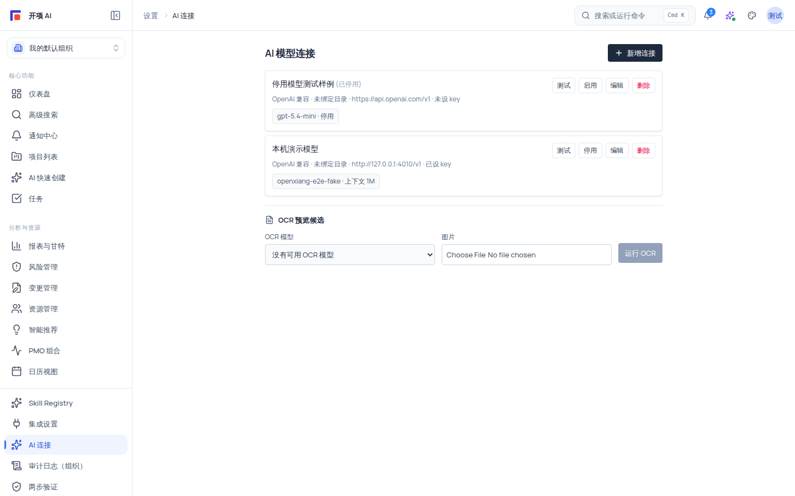
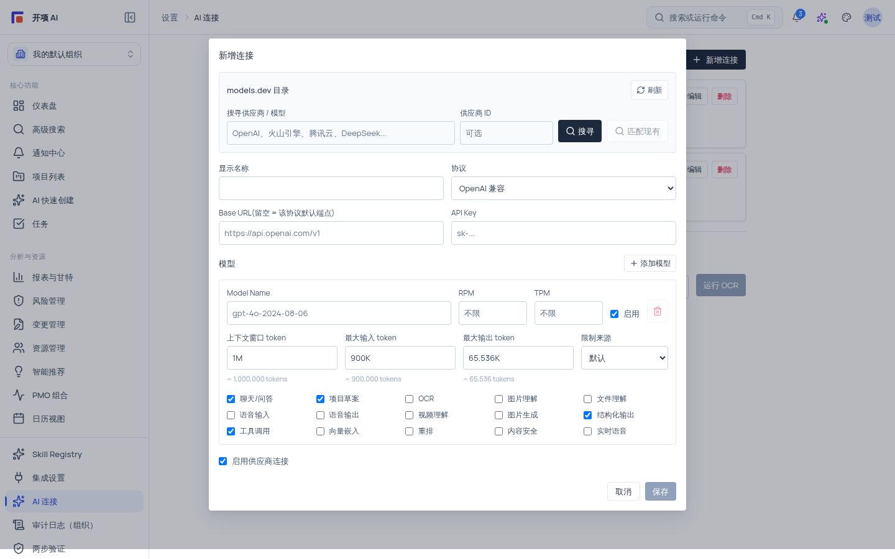

# 配置 AI 连接

平台内的 AI 能力（AI 快速创建、Copilot 问答、OCR 预览）都通过「AI 模型连接」使用真实模型服务。本文介绍如何在「设置 → AI 连接」中从 models.dev 目录选用供应商、填写连接参数、配置模型与能力、测试连通性，并顺带确认「OCR 预览候选」。

AI 输出始终遵循「只建议、人工确认后落库」的边界：配置连接只决定模型可用性，不会让任何 AI 能力自动写入正式项目数据。

## 适用范围

| 项目         | 说明                                                                                                                               |
| ------------ | ---------------------------------------------------------------------------------------------------------------------------------- |
| **适用角色** | 需要 `ai:connection:manage` 权限。该权限通常授予组织管理员、系统管理员；项目经理或其他成员如已被授予该权限同样可管理连接           |
| **入口**     | 侧边栏底部「AI 连接」→ `/settings/ai-connections`（导航入口要求 `ai:connection:manage` 或 `ai:trigger`，无权限用户看到权限兜底页） |
| **生效范围** | 连接按组织独立配置，组织 A 的连接不会出现在组织 B 的设置中                                                                         |
| **适用版本** | free / team / enterprise                                                                                                           |

> [!IMPORTANT]
> 未登录时页面显示「登录后管理 AI 连接」，登录后会自动返回本页。无 `ai:connection:manage` 权限时页面显示「没有 AI 连接管理权限」——请切换到有权限的组织，或联系组织管理员授权。

## 开始之前

1. 确认你拥有 **`ai:connection:manage`** 权限（可在「设置 → AI 连接」直接看到管理界面为准）。
2. 准备模型服务的四类信息：**显示名称**、**协议**（OpenAI 兼容或 Anthropic 兼容）、**Base URL**（或留空使用协议默认端点）、**API Key**。
3. 决定模型用途，以便勾选对应能力（聊天/问答、项目草案、OCR、结构化输出等）。

## 理解三个概念

- **连接（Connection）**：一个「供应商端点 + 密钥 + 一个或多个模型」的组合。你可以为不同用途建多个连接（例如一个对话模型连接、一个 OCR 专用连接）。
- **能力（Capability）**：每个模型可以勾选多种能力。只有勾选「项目草案」或「聊天/问答」的启用模型会进入 AI 快速创建的模型选择器；只有勾选「OCR」的启用模型会进入「OCR 预览候选」下拉。
- **目录（models.dev 目录）**：内置的供应商与模型清单，可搜索后「选用」，自动预填 Base URL、模型名、价格与上下文限制，减少手填错误。

## 操作步骤

### 步骤 1：进入 AI 连接页

1. 登录后点击左侧边栏底部 **「AI 连接」**，或直接在浏览器地址栏访问 `/settings/ai-connections`。
2. 你会看到「AI 模型连接」标题与连接列表。首次使用的组织为空列表，显示「尚无连接,点「新增连接」添加你的第一个 AI 模型。」；已有连接时每张连接卡显示：供应商 logo、显示名称（停用连接带「(已停用)」标记）、协议徽章（「OpenAI 兼容 / Anthropic 兼容 / 需手动配置」）、目录供应商与端点信息（`{目录供应商名 | 未绑定目录} · {baseUrl | 默认端点} · 已设 key|未设 key`），以及每个模型的状态 chip（`{modelName} · {providerId} · 上下文 {N}K/M · 已快照价格 · 停用 · RPM N · TPM N`）。

3. 点击右上角 **「新增连接」** 打开配置弹窗。

### 步骤 2：从 models.dev 目录选用模型（推荐）

这是避免手填错误的最快路径：

1. 在弹窗顶部的 **「models.dev 目录」** 搜索框中输入供应商关键字，例如 `OpenAI`、`火山引擎`、`腾讯云`、`DeepSeek`；也可以填写「供应商 ID」后点 **「搜寻」**。
2. 在结果卡中核对：provider 与模型名、支持度徽章（「可一键保存 / 需处理 Base URL / 仅浏览资料」）、协议、Base URL、上下文/输入/输出 token、知识截止日期、状态与价格行，然后点击 **「选用」**。
3. 选用后表单会提示「已预填供应商、Base URL、模型、价格和上下文限制。」；如果该供应商需要手动确认，会提示「已载入目录资料；这个供应商需要手动确认协议与 Base URL 后再保存。」
4. 目录快照过期时页面会提示「目前使用的是过期目录快照，仍可选择，建议有权限时手动刷新。」，可点击 **「刷新」** 获取最新目录；刷新成功后显示「目录已刷新：N 个供应商，N 个模型。」

> [!TIP]
> 目录中没有的供应商也可以手动配置：协议选「OpenAI 兼容」或「Anthropic 兼容」，Base URL 填你的端点即可。若所选目录模型缺 Base URL，表单会提示「当前目录模型需要手动填写 Base URL 后再保存。」

### 步骤 3：填写连接参数

| 字段         | 必填                 | 默认值                | 说明与示例                                                                                      |
| ------------ | -------------------- | --------------------- | ----------------------------------------------------------------------------------------------- |
| **显示名称** | 是                   | 无                    | 连接列表与模型选择器中展示的名称，例如「对话模型 A」                                            |
| **协议**     | 是                   | 无                    | 「OpenAI 兼容」或「Anthropic 兼容」，决定默认端点与请求格式                                     |
| **Base URL** | 否                   | 留空 = 该协议默认端点 | 例如 `https://api.openai.com/v1`（OpenAI 兼容）或 `https://api.anthropic.com`（Anthropic 兼容） |
| **API Key**  | 否（新建时建议必填） | 留空 = 不变           | 编辑连接时留空表示不修改；**保存后永不回显明文**，页面只显示 Key 的已设/未设状态                |

> [!WARNING]
> API Key 只由后端加密保存。不要把它写进文档、代码、聊天工具或任何导出内容。

### 步骤 4：配置模型与能力

1. 在「添加模型」区为每个模型填写：

| 字段                                       | 必填 | 默认值       | 说明                                                                              |
| ------------------------------------------ | ---- | ------------ | --------------------------------------------------------------------------------- |
| **Model Name**                             | 是   | 无           | 模型标识，例如 `gpt-4o-2024-08-06`、`claude-haiku-4-5-20251001`，以供应商文档为准 |
| **RPM / TPM**                              | 否   | 不限         | 每分钟请求数 / 每分钟 Token 数限制，可为「不限」                                  |
| **启用**                                   | 否   | 勾选         | 未启用的模型不参与任何能力候选                                                    |
| **上下文窗口 / 最大输入 / 最大输出 token** | 否   | 目录值或默认 | 限制来源可为「默认 / 目录 / 手动」                                                |

2. 按用途勾选能力（至少勾选一项）：

| 能力                                                                              | 典型用途                                                       |
| --------------------------------------------------------------------------------- | -------------------------------------------------------------- |
| 聊天/问答                                                                         | Copilot 通用问答、项目上下文问答                               |
| 项目草案                                                                          | AI 快速创建的草案生成（与「聊天/问答」任一即可进入模型选择器） |
| OCR                                                                               | 进入「OCR 预览候选」下拉，用于图片文字提取预览                 |
| 图片理解 / 文件理解                                                               | 多模态问答与文件内容理解                                       |
| 结构化输出 / 工具调用                                                             | 强结构的 JSON 生成与工具调用场景                               |
| 语音输入 / 语音输出 / 实时语音 / 视频理解 / 图片生成 / 向量嵌入 / 重排 / 内容安全 | 对应模态与安全场景                                             |

> [!NOTE]
> 能力是否真正可用取决于模型本身。目录模型会显示模态与价格信息；价格未知时显示「价格未知」。

3. 勾选「启用供应商连接」使整条连接生效，然后点击 **「保存」**（保存中按钮显示「保存中...」）。

### 步骤 5：测试连接

1. 回到连接列表，找到目标连接卡，点击 **「测试」**（测试期间按钮文字变为「测试中...」）。
2. 测试通过时显示：`已连通 · {latency}ms · {model} · Token 输入 N / 输出 N / 缓存命中 N / 缓存写入 N / 音频输入 N / 音频输出 N / 推理 N / 总计 N`。
3. 连接未启用时直接测试会失败，提示「请你先启用之后才可以测试」——先启用连接再测试。

### 步骤 6（可选）：确认 OCR 预览候选

列表页底部是 **「OCR 预览候选」** 面板：在「OCR 模型」下拉中会列出**已启用、已设 Key 且模型勾选了 OCR 能力**的连接候选（格式 `{连接} / {模型}`）；无候选时显示「没有可用 OCR 模型」。详见《配置与使用 OCR 识别》。

## 验证结果

- 连接卡显示「已设 key」，测试返回「已连通 · {latency}ms · {model}」与 Token 统计。
- 勾选了「项目草案」或「聊天/问答」的启用模型出现在 AI 快速创建的模型选择器中。
- 勾选了「OCR」的启用模型出现在「OCR 预览候选」下拉中。
- 跨组织切换后，本组织的连接列表不包含其他组织的连接。

## 限制与安全边界

- **权限**：连接 CRUD、启停与测试均需要 `ai:connection:manage`；仅有 `ai:trigger` 的用户（如普通成员）可进入页面但看到权限兜底。
- **密钥**：API Key 仅后端加密保存，任何界面、日志与导出均不回显明文。
- **组织隔离**：连接按组织隔离，跨组织访问返回资源不存在，不泄露存在性。
- **AI 只建议**：配置连接不改变 AI 的落库边界，模型输出仍需人工确认。
- **能力候选规则**：停用的连接、未设 Key 的连接、未勾选对应能力的模型不会进入能力候选。

## 常见问题

| 症状                                         | 可能原因                                         | 检查与修复                                                          |
| -------------------------------------------- | ------------------------------------------------ | ------------------------------------------------------------------- |
| 测试返回 401 Unauthorized                    | API Key 无效、过期或被覆盖                       | 重新粘贴正确 Key 并保存，再次测试                                   |
| 测试返回 404（模型不存在）                   | 模型名与供应商目录不一致                         | 对照供应商文档核对 Model Name；确认模型支持勾选的能力               |
| 测试 timeout / 连接失败                      | 网络策略（代理/防火墙）拦截或端点不可达          | 确认 Base URL 在目标网络可访问；必要时调整网络策略                  |
| 点击「测试」提示「请你先启用之后才可以测试」 | 连接未启用                                       | 在编辑弹窗勾选「启用供应商连接」并保存                              |
| 模型不出现在 AI 快速创建的选择器             | 模型缺 `project_draft`/`chat` 能力，或连接未启用 | 编辑连接，勾选「项目草案」或「聊天/问答」能力并启用                 |
| 提示目录快照过期                             | 本地目录数据早于最新 release                     | 点「刷新」更新目录（需有权限）                                      |
| 删除连接                                     | 删除后不可恢复                                   | 系统会弹确认「删除该连接?」，谨慎确认；删除后依赖该连接的模型不可用 |

## 下一步

- [配置与使用 OCR 识别](/help/articles/ai.configure-ocr)
- [使用 AI 快速创建项目](/help/articles/ai.ai-quick-create)
- [Copilot 通用问答与项目上下文](/help/articles/ai.copilot-general-and-project-context)
