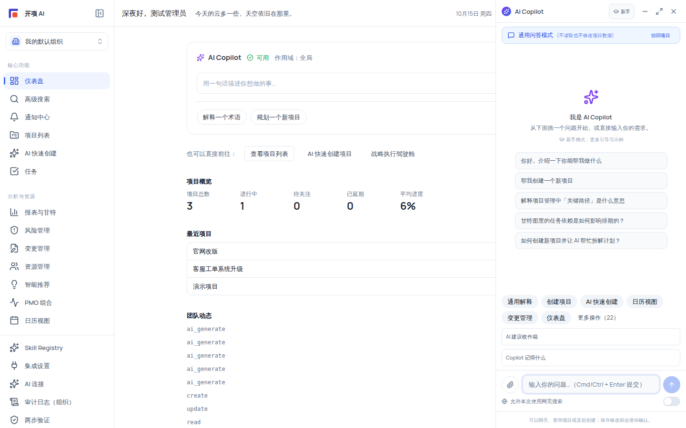

# Copilot 通用问答与项目上下文

全局 AI Copilot 是挂在所有仪表盘页面右下侧的对话助手：它读取你**已被授权查看**的项目数据回答提问，回答基于提交时的页面语境快照；它**只给建议，不会自动执行任何修改**——即便未来接入动作通道，任何修改仍需你在预览中确认后才能生效。

## 适用范围

| 项目         | 说明                                                                                                                                           |
| ------------ | ---------------------------------------------------------------------------------------------------------------------------------------------- |
| **入口**     | 顶栏 Sparkles 按钮（悬停显示可用状态：正在检查/可用/部分可用/暂不可用/演示模式），或仪表盘页面的「AI Copilot」操作入口；按 <kbd>Esc</kbd> 关闭 |
| **适用角色** | 所有登录用户；示例问题按你的权限过滤（`project:view` / `project:create` 两档），无可用权限时显示降级说明                                       |
| **版本**     | free / team / enterprise                                                                                                                       |

> [!NOTE]
> 空态下无任何可用权限时，侧栏显示「当前没有可用于 AI 协助的权限。可以在项目页面或具备权限的入口稍后再试。」——External 协作者与只读观察者可能看到该提示。

## 开始之前

- 保持登录状态；网络问题会导致侧栏显示「暂不可用」。
- 在项目页面内提问会使用当前项目授权数据；通用问答模式**不读取也不修改项目数据**。

## 操作步骤

### 步骤 1：打开 Copilot 侧栏

1. 点击顶栏右侧的 **Sparkles（AI Copilot）** 按钮，或点击仪表盘页面的「AI Copilot」入口卡片。
2. 侧栏展开（默认 400px 宽，可拖拽调整 360–560px），输入框自动聚焦。
3. 侧栏标题栏提供：**「新手」「专业」模式切换**（偏好持久保存）与窗口控件「最小化面板」「全屏专注（退出全屏）」「关闭面板」。

空态时面板显示「我是 AI Copilot」；新手模式文案「从下面挑一个问题开始，或直接输入你的需求。」+「新手模式：更多引导与示例」，专业模式文案「输入你的需求，或选择一个示例。」；示例问题点击后只填入输入框，不会自动提交。

> [!IMPORTANT]
> 上图底部显示的是演示态脚注。生产环境接入回合通道后，脚注显示「已接入回合通道：AI 只给建议，任何修改仍需你在预览中确认。」——两条脚注都强调同一红线：**对话不会自动修改任何项目数据**。

### 步骤 2：提问并观察页面语境

1. 在输入框输入问题（placeholder「输入你的问题…（Cmd/Ctrl + Enter 提交）」），或从空态示例中选择一条。
2. 消息区显示页面语境 disclosure chips：**「当前项目 #id」「页面 {routeLabel}」「筛选 k=v（已忽略 N 项未知筛选）」「数据时间 HH:MM」**——回答基于提交时的语境快照。
3. 页面切换后重问会看到提示「页面已切换，本次回答基于提交时的页面语境。」+ **「使用当前页面重试」**按钮；拿不到项目数据时显示「我目前无法取得这个项目的数据。你可以重试，或告诉我想查看的项目。」
4. 每次回答固定附带隐私说明：只读取你已授权的产品数据，不读取屏幕像素或 DOM。

### 步骤 3：使用高级输入（提及 / 命令 / 附件）

- **`@` 提及**与 **`/` 命令**：输入时自动弹出补全列表，选中后插入。
- **附件**：点击「添加附件（图片或 PDF）」，支持 PNG/JPEG/WebP/PDF、单个 ≤ 10MB、单回合最多 5 个；附件只能**在项目页面内**上传（其他路由会提示「请在项目页面内上传附件」）。错误提示：「仅支持图片（PNG/JPEG/WebP）和 PDF 文件」「文件大小超过限制（最大 10MB）」「最多上传 5 个附件」「上传失败」。
- 已选中的提及与附件以 chip 形式显示，可点 × 移除。

### 步骤 4：按需开启网页搜索

需要外部资料时，先打开输入区下方的 **「允许本次使用网页搜索」** 开关（开启后说明：「本次允许联网搜索：可能发送你问题涉及的主题；组织域名策略与额度适用；外部来源会带引用标记」）。注意：

- Copilot 侧栏的搜索开关**提交后自动复位**（每次提问需重新开），与 AI 快速创建中「本次分析持续生效」不同；
- 回答带「已使用外部网页搜索」门状态条（success）或「外部资料不可用」（warning）；外部来源带引用标记，仅供参考，项目内部事实仍以项目数据为准。
- 组织未启用搜索、额度耗尽或域名受限时，对应门码文案会在消息区显示（详见《可选 Web 搜索能力——门码对照表》）。

### 步骤 5：解读回答与插槽

- 回复以气泡形式展示（用户/助手 + HH:MM 时间戳）；生成中有流式占位气泡「正在生成…」。
- 提问产生的**澄清项、假设、未指明信息、快捷建议**出现在插槽区（可滚动），空内容自动折叠；演示态下假设插槽带「假设（演示）」与「可信度 N」徽章。
- 不需要当前回答时，点击取消——显示「已取消生成——本次未生成任何答复。」

### 步骤 6：使用全屏专注与最小化

- **全屏专注**：标题栏「全屏专注」展开独立视图，包含「证据详情（N 条假设）」「澄清历史 · {destination}」「变更摘要」等面板。
- **最小化**：面板收起为右下角圆形悬浮按钮「恢复 AI Copilot 面板」；生成中的任务不中断，恢复后继续查看。

### 步骤 7：理解演示模式与动作边界

- **演示模式**：仅当宿主声明支持演示且你**显式点击「查看本机演示（不写入任何数据）」**才进入；进入后显示「当前是本机演示，回答来自固定示例，不会读写任何真实数据。」+「返回生产通道」按钮。**生产通道出错时绝不会静默切换到演示**。
- **动作通道**：当前版本动作卡片一律显示「预览不可用：动作通道尚未接入，不会自动执行任何修改。」——Copilot 当前不提供任何自动执行能力；未来动作通道接入后，修改也仍须经预览确认。
- 在 `/ai-create` 页面打开侧栏时显示特殊提示：「当前为全局只读模式：不会读取未导入草案，也不能修改或确认草案。需要比较时请在问题中提供低敏摘要。」

## 验证结果

- 侧栏打开并聚焦输入框；页面语境 chips 与当前页面一致。
- 项目问题回答基于你本可看到的数据范围；语境切换后旧回答保留「基于提交时语境」提示。
- 附件上传在项目页内成功，非项目页提示「请在项目页面内上传附件」。
- 未确认任何动作的情况下，项目数据零变化（动作通道未接入，天然只读）。
- 演示模式仅在显式点击后进入，生产错误不会降级。

## 限制与安全边界

| 边界                 | 说明                                                                          |
| -------------------- | ----------------------------------------------------------------------------- |
| **只建议不执行**     | 动作通道未接入，所有动作卡片禁用并标注「预览不可用…」；任何修改都需要人工确认 |
| **授权数据**         | 回答只使用你已授权查看的项目数据（组织级数据隔离），不读取屏幕像素/DOM        |
| **通用问答模式**     | 不读取也不修改项目数据                                                        |
| **/ai-create 只读**  | 在 AI 快速创建页面为全局只读，不读未导入草案                                  |
| **网页搜索双重条件** | 组织启用 + 每次提问显式开启（提交后自动复位）；额度与域名策略适用             |
| **附件限制**         | PNG/JPEG/WebP/PDF、≤10MB、单回合 ≤5 个、仅项目页内                            |
| **演示模式**         | 仅显式进入；演示回答为固定示例，不读写真实数据                                |

## 常见问题

| 症状                                   | 可能原因                                       | 检查与修复                                                      |
| -------------------------------------- | ---------------------------------------------- | --------------------------------------------------------------- |
| 顶栏按钮「暂不可用」                   | 网络或后端 readiness 异常                      | 刷新页面重试；查看故障排查                                      |
| 回答「我目前无法取得这个项目的数据」   | 页面语境不可用（context_unavailable）          | 重试，或告诉 Copilot 想查看的项目                               |
| 回答基于旧页面数据                     | 提交后页面已切换                               | 点消息区「使用当前页面重试」                                    |
| 提示「请在项目页面内上传附件」         | 非项目页尝试上传                               | 进入项目页面后重传                                              |
| 提问要外部资料但回答无引用             | 网页搜索未开启或组织未启用                     | 开启「允许本次使用网页搜索」；组织级启用见《可选 Web 搜索能力》 |
| 期望 Copilot 执行任务（建任务/改计划） | 动作通道尚未接入                               | 当前版本所有动作卡显示「预览不可用…」；请在页面中手动操作       |
| 侧栏显示「当前是本机演示」             | 你显式点击了「查看本机演示（不写入任何数据）」 | 点「返回生产通道」继续使用真实能力                              |

## 下一步

- [可选 Web 搜索能力](/help/articles/ai.optional-web-search)
- [使用 AI 快速创建项目](/help/articles/ai.ai-quick-create)
- [Copilot 故障排查](/help/articles/troubleshooting.copilot-unavailable)
- [项目视图总览](/help/articles/projects.views-overview)
