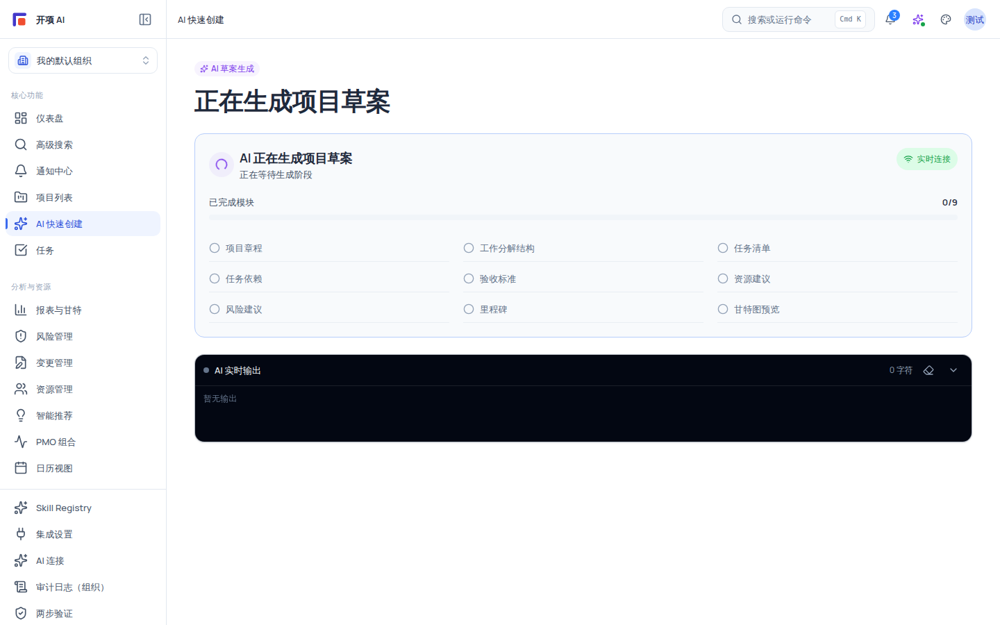
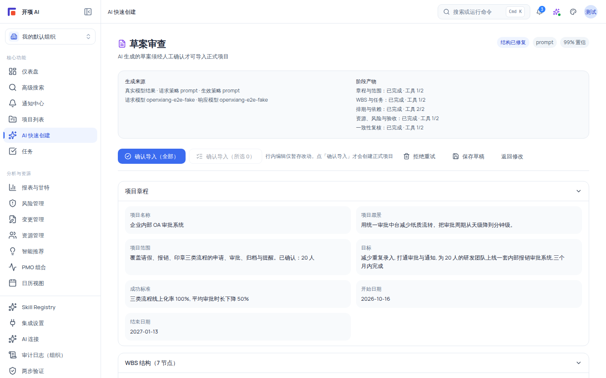

# 查看生成进度与审查 AI 草案

本文覆盖 AI 快速创建的两个关键阶段：**生成阶段**（九模块真实流式进度、断线恢复、失败处理）与**审查阶段**（反幻觉校验、自动修正差异、行内编辑、人工确认导入）。审查是红线所在：草案不通过校验即禁止导入，导入动作只能由你完成。

## 适用范围

| 项目           | 说明                                                                  |
| -------------- | --------------------------------------------------------------------- |
| **前置**       | 已发起一次[AI 快速创建](/help/articles/ai.ai-quick-create)并完成澄清  |
| **生成与审查** | `ai:trigger`（组织管理员、项目经理、成员）                            |
| **确认导入**   | `ai:confirm` 且 `project:create`（当前矩阵下为组织管理员/系统管理员） |
| **适用版本**   | free / team / enterprise                                              |

## 开始之前

- 已阅读《使用 AI 快速创建项目》完成步骤 1–4（意图分析 → 澄清 → 上下文就绪）。
- 理解两处诚实预期：
  - 组织未配置可用草案模型时使用**系统兜底**，审查页「生成来源」会标注「Fallback / 离线结果」，流程一致。
  - **「校验未通过，禁止确认导入」是反幻觉系统的正常阻断态**（尤其对兜底/mock 草案），不是错误。

## 操作步骤

### 步骤 1：观察生成进度

点击「开始生成草案」后，页面进入「AI 正在生成项目草案」：

- **进度条**：「已完成模块 n/9」+ ETA（「估算中… / 预计剩余 + 时长」）。
- **9 个模块清单**：项目章程、工作分解结构、任务清单、任务依赖、验收标准、资源建议、风险建议、里程碑、甘特图预览，各带已完成/生成中/失败/等待中图标。
- **健康徽章**：实时连接 / 生成用时较长 / 连接暂时停滞 / 正在恢复连接 / 正在同步进度 / 需要重试——反映流式通道的实时状态。
- **「AI 实时输出」面板**：深色终端风格，标题「AI 实时输出」，显示「当前生成：{模块中文名}」+ `{n} 字符`；结束时显示「— 已结束 —」。滚动自动跟随，暂停跟随后出现「已暂停跟随 · 点击回到底部」。

### 步骤 2：处理断线与续传

- **自动重连**：生成流静默超过 20 秒触发看门狗，自动重连最多 3 次（退避 1s/2s/4s）。
- **刷新续传**：刷新或误关页面后，浏览器会从上次位置自动续传（进度游标保存在本机浏览器，24 小时有效，只含低敏标识），已生成模块不重复。
- **人工兜底**：连接无法自动恢复时，页面提示「进度连接已中断，可从上次位置继续。」并显示「继续接收进度」「重试生成」「重新生成」按钮；说明文字：「重试会开始新的生成尝试。您之前提供的信息将保留，草案仍需要人工审查确认后才能导入正式项目。」

> [!IMPORTANT]
> 刷新页面前请确认浏览器未清理 `sessionStorage`（进度游标存放于此）。若重连后仍失败，使用「重试生成」——你之前澄清的信息会保留。

### 步骤 3：处理生成失败

失败时出现「草案生成失败」面板（`DraftErrorPanel`）：

- **失败阶段**：章程与范围 / WBS 与任务 / 排期与依赖 / 资源、风险与验收 / 一致性复核之一；
- **原因码**：等宽字体 chip 显示 `{reasonCode}`；
- **脱敏错误摘要**：逐条列出 path / code / message；
- **操作**：「重试」「返回上下文」。

常见后端提示：「生成服务繁忙，请稍后重试。」、「草案生成失败，请稍后重试或调整输入。」；后台任务中断时提示「后台生成任务已中断，请重新生成草案。」——先「重试」，仍失败则「返回上下文」检查输入后重新生成。

### 步骤 4：审查草案结构

生成完成进入审查（标题「草案审查」+ 副文案「AI 生成的草案须经人工确认才可导入正式项目」）：

- **头部徽章**：`结构完整 / 结构已修复 / 低保证`（一致性结论）+ 生成策略原文 + `{N}% 置信`（草案不可确认时置信上限压到 85）。
- **「生成来源」卡**：「生成来源：Fallback / 离线结果 | 真实模型结果 · 请求策略 X · 生效策略 Y」「请求模型 X · 响应模型 Y」；旧版草案显示「旧版草案未记录阶段产物」。
- **章节**：项目章程（7 字段行内编辑）、WBS 结构（N 节点 + 全选）、任务清单（N）· 依赖（N）（表格：名称/工期(天)/开始/结束/负责人；依赖 chips `{前 6 位} → {后 6 位} +{lag}d`）、风险建议（high/medium/low 三色徽章）、里程碑建议、甘特图预览（开始/结束/总工期 N 天/阶段数）。

### 步骤 5：阅读反幻觉/校验结果

校验结果按严重级展示，规则 ID 为真实编号（self_checking 阶段 `HL-001~HL-010`，validating 阶段 `VE-001~VE-012`）：

| 严重级       | 展示                             | 行为                                                                      |
| ------------ | -------------------------------- | ------------------------------------------------------------------------- |
| **blocking** | 红色「校验未通过，禁止确认导入」 | 阻断全部导入动作（HL-001/002/003/006/007/008 与 VE-001/002/010 等属此类） |
| **warning**  | 黄色「校验警告，建议人工检查」   | 确认导入时弹出「确认操作」对话框，列警告清单并要求「确认」                |
| **info**     | 灰色「校验提示」+ `ruleId` chip  | 仅提示，不影响导入                                                        |

- **「自动修正差异」卡**：每条显示字段 `path`、修正前（红底）→ 修正后（绿底）与 `reason`（部分 HL/VE 规则可自动修复，例如日期逻辑、依赖环路、格式问题）。
- **服务端判定**：服务端校验不可确认时显示「当前草案不可确认导入」+ 原因列表。

### 步骤 6：行内编辑与部分导入

1. 对不满意的字段 hover 铅笔图标行内编辑（名称、工期、起止日期、负责人、章程字段等）。**行内编辑仅暂存改动**——页面明确提示「行内编辑仅暂存改动，点「确认导入」才会创建正式项目」。
2. 部分导入：在 WBS 节点、任务、风险建议中勾选需要的项，操作区出现「确认导入（所选 N）」；未选的项按不导入策略处理（服务端 discard）。

### 步骤 7：确认导入

1. 无 blocking 校验时，点击 **「确认导入（全部）」** 或 **「确认导入（所选 N）」**；存在 warning 时先读「确认操作」对话框中的警告清单并点「确认」。
2. 页面显示「正在导入草案到正式项目...」（**请勿刷新页面**）；服务端单事务创建项目与任务并发送通知。
3. 完成后显示「项目已创建」「项目 ID：{id} · 已导入 {N} 个任务」+「查看项目」「创建下一个项目」。

## 验证结果

- 生成阶段看到九模块逐一完成、实时输出滚动；断线/刷新后续传，已完成模块不重复生成。
- 审查页显示一致性徽章、生成来源标注、校验结论与「自动修正差异」前后对照。
- blocking 存在时「确认导入」不可用；warning 存在时需过确认对话框。
- 导入成功出现「项目已创建」，项目列表出现新项目；导入前项目列表无任何变化。

## 限制与安全边界

- **零自动执行**：生成阶段绝不写正式业务表；唯一落库入口是人工「确认导入」。
- **反幻觉不可绕过**：blocking 校验硬阻断；warning 需确认对话；置信上限在不可确认时压到 85。
- **权限**：生成需 `ai:trigger`；导入需 `ai:confirm` + `project:create`（当前只有组织管理员/系统管理员）。
- **组织隔离**：草案、进度游标按组织隔离；跨组织访问资源不存在。
- **兜底标注**：Fallback 草案会在「生成来源」卡明确标注，不会伪装成真实模型结果。

## 常见问题

| 症状                                       | 可能原因                                             | 检查与修复                                                       |
| ------------------------------------------ | ---------------------------------------------------- | ---------------------------------------------------------------- |
| 进度长时间不动                             | SSE 流中断或生成服务无响应                           | 等自动重连（3 次）；不行点「重试生成」或刷新页面续传             |
| 提示「进度连接已中断，可从上次位置继续」   | 自动重连耗尽                                         | 点「继续接收进度」；仍失败用「重试生成」（已答信息保留）         |
| 提示「后台生成任务已中断，请重新生成草案」 | 后台任务被中断                                       | 直接「重新生成」                                                 |
| 出现「草案生成失败」面板                   | 生成阶段失败                                         | 看失败阶段与原因码，点「重试」；反复失败则「返回上下文」调整输入 |
| 「校验未通过，禁止确认导入」               | 草案未过 blocking 校验（如日期逻辑 HL、依赖环路）    | 按校验项修正并重新校验；自动修复的看「自动修正差异」前后对照     |
| 「当前草案不可确认导入」                   | 服务端判定不可确认                                   | 查看原因列表逐条处理；必要时重新生成                             |
| 「确认导入」不可用                         | 有 blocking 校验，或缺 `ai:confirm`/`project:create` | 处理校验；确认角色（项目经理/成员请管理员导入）                  |
| 行内编辑后导入内容没变                     | 只暂存未确认                                         | 点「确认导入」后修改才会落库                                     |

## 下一步

- [动态追问卡片：AI 如何澄清你的需求](/help/articles/ai.clarification-cards)
- [AI 草案层（Draft Layer）交互审查](/help/articles/ai.draft-layer-review)
- [AI 生成故障排查](/help/articles/troubleshooting.ai-generation)
- [SSE 流式连接问题](/help/articles/troubleshooting.sse-streaming)
