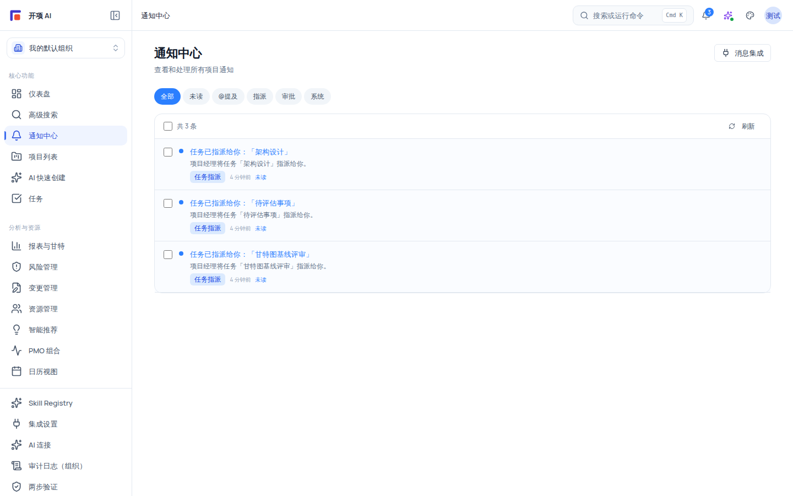
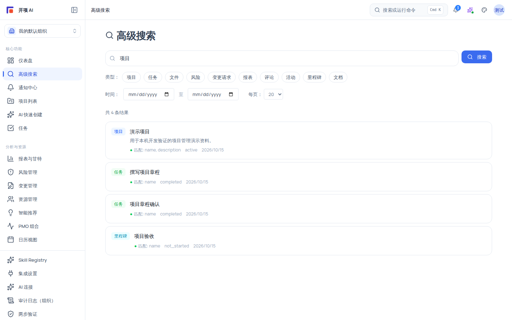

# 登录后第一屏：快速认识工作台与 AI Copilot

登录成功后你首先落在仪表盘（`/dashboard`）。本教程用 5 分钟带你认完这一屏：**AI Copilot 操作入口、仪表盘概览、顶栏工具、侧栏导航**，以及跨项目的任务与日历入口。

## 适用范围

- **适用角色**：全部六种角色——登录后的首屏对所有人可见，导航门槛只影响个别菜单项（如项目列表需要 `project:view`）。
- **所需权限**：无，任何已登录用户均可浏览本页描述的内容。

## 开始之前

- 已按[登录与账号](/help/articles/getting-started.login-and-accounts)完成登录。

## 操作步骤

### 步骤 1：认识登录后的落脚页

登录后默认进入仪表盘。顶部面包屑位置显示的是**问候语**：按时间段显示「早上好 / 下午好 / 晚上好」+ 你的用户名 + 每日问候文案 + 日期（`M月D日 周X`）。

> [!NOTE]
> 导航按钮下方是仪表盘概览，分三块：**项目概览**（组织 KPI，点「查看全部」进入组织总览）、**最近项目**（点项目名进入项目）与**团队动态**（最近的操作记录与发生时间）。数据暂不可用时各块会单独提示，不影响 Copilot 入口。

### 步骤 2：使用 AI Copilot 操作入口

页面主区块是 **AI Copilot** 操作入口，包含：状态标签、作用域、主输入框与「打开 Copilot」按钮。状态标签的完整含义：

| 状态           | 含义                                                                   | 能否进入 Copilot               |
| -------------- | ---------------------------------------------------------------------- | ------------------------------ |
| 可用           | 可以开始提问                                                           | 是                             |
| 正在检查可用性 | 就绪快照加载中                                                         | 否（稍等自动完成）             |
| 正在刷新状态   | 状态在自动重试中                                                       | 是（可直接开始提问）           |
| 部分可用       | 部分能力不可用（如读取最近会话失败、快捷建议不可用），核心问答不受影响 | 是                             |
| 暂不可用       | 状态检查失败或当前作用域不可用                                         | 否                             |
| 无权限         | 当前账号没有使用 Copilot 的权限                                        | 否                             |
| 需要刷新       | 可用工具清单需要刷新后才能使用                                         | 是（可提问，工具清单需先刷新） |
| 演示模式       | 当前是本机演示，回答来自固定示例，不会读写任何真实数据                 | 是（仅演示）                   |

操作方式：

1. 在输入框（placeholder「用一句话描述你想做的事…」）输入问题，或点击下方的快捷建议 chip。**快捷建议只负责把草稿填进输入框并打开面板，绝不提交模型请求、也不执行业务动作。**
2. 点击 **「打开 Copilot」**，会打开既有的同一个全局 Copilot 面板，草稿被带入面板输入框。
3. 有最近会话时会出现「继续对话 / 新对话」按钮：继续前会重新检查会话可用性，若原会话已失效会提示「原会话已不可继续，已为你准备一个新的对话」并回退新会话。
4. 全新账号没有最近会话时，输入框下方显示空态引导：「还没有可继续的对话。直接描述你想了解或推进的事情，Copilot 会先给出建议，任何改动都需要你确认后才会生效。」
5. 若页面提供 **「查看本机演示（不写入任何数据）」** 入口（仅当部署方显式声明支持演示能力时出现），进入后状态行变为「演示模式」，说明「当前是本机演示，回答来自固定示例，不会读写任何真实数据。」，并显示「返回生产通道」按钮。

> [!WARNING]
> AI 只建议、不自动执行：Copilot 的任何回答都只是建议或草案，任何改动都需要你确认后才会生效。图示环境中的「最近会话」与快捷建议来自演示环境；全新账号首次进入看到的是上面的空态引导。

### 步骤 3：使用「也可以直接前往」三个快捷按钮

Copilot 入口下方有 **「也可以直接前往：」** 三个导航按钮：

| 按钮            | 目标路由                      | 说明                                                                                                                   |
| --------------- | ----------------------------- | ---------------------------------------------------------------------------------------------------------------------- |
| 查看项目列表    | `/projects`                   | 当前组织内你有权访问的项目（需要 `project:view`）                                                                      |
| AI 快速创建项目 | `/ai-create`                  | 一句话启动新项目（需要 `project:create`，教程见[创建第一个项目](/help/articles/getting-started.create-first-project)） |
| 战略执行驾驶舱  | `/strategy-execution-cockpit` | 组织级战略视角入口                                                                                                     |

### 步骤 4：认识顶栏工具

顶栏右侧共五个工具：

| 工具           | 操作                                                   | 说明                                                                                                               |
| -------------- | ------------------------------------------------------ | ------------------------------------------------------------------------------------------------------------------ |
| 搜索或运行命令 | 点击或按 <kbd>Cmd</kbd>/<kbd>Ctrl</kbd> + <kbd>K</kbd> | 唤起**命令面板**（导航跳转等快捷命令），**不是**业务搜索；业务搜索在「高级搜索」页                                 |
| 通知铃铛       | 点击展开下拉                                           | 显示未读徽章（`99+` 封顶）；下拉内可单条点开（标记已读并跳转）、「全部已读」一键清读、「查看全部通知」进入通知中心 |
| Copilot 触发   | 点击                                                   | 打开全局 Copilot 面板，按钮带状态点                                                                                |
| 外观菜单       | 点击                                                   | 切换主题（浅色/深色）与密度（舒适/紧凑）                                                                           |
| 用户菜单       | 点击头像                                               | 打开账号信息、退出登录；浏览器支持时含「安装应用」项（PWA）                                                        |

通知中心全貌（有数据时）：

> [!NOTE]
> 通知是接收人私有资源：你只能看到发给你自己的通知，跨组织不可见。全新环境中通知中心是空态「暂无通知 / 你将在此处收到任务、评论等提醒」——需要先触发业务事件（指派任务、评论、里程碑到期等）才会产生通知。

### 步骤 5：认识侧栏导航（两组）

左侧导航分两组：

| 分组       | 菜单项（路由）                                                                     | 导航项声明的展示层权限               |
| ---------- | ---------------------------------------------------------------------------------- | ------------------------------------ |
| 核心功能   | 仪表盘 `/dashboard`、高级搜索 `/search`、通知中心 `/notifications`                 | 无                                   |
| 核心功能   | 项目列表 `/projects`                                                               | `project:view`                       |
| 核心功能   | AI 快速创建 `/ai-create`                                                           | `project:create`                     |
| 核心功能   | 任务 `/tasks`                                                                      | `task:view`                          |
| 分析与资源 | 报表与甘特、风险管理、变更管理、资源管理、智能推荐、PMO 组合、日历视图 `/calendar` | 以页面自身权限为准（日历视图无门槛） |

两点需要如实说明：

1. **导航当前的显示逻辑**：导航项在定义中带有展示层权限门槛（如项目列表 `project:view`、AI 快速创建 `project:create`、任务 `task:view`），但**侧栏渲染当前并未按此过滤**——所有登录用户看到的是同一组菜单；真正的权限边界在服务端，任何越权请求都会被拒绝。
2. **跨项目入口**：「任务」（`/tasks`）默认列出分配给你的未完成任务，可切换「全部任务」、按状态筛选与搜索，逾期任务标红；「日历视图」（`/calendar`）按月汇总各项目任务与里程碑的截止日，可「只看我的」，并提供「绑定外部日历」跳转到「设置 → 集成」。项目内的 6 种任务视图仍从项目详情页进入（见[项目视图总览](/help/articles/projects.views-overview)）。

### 步骤 6：试用高级搜索

点击侧栏 **「高级搜索」** 进入 `/search`：关键词输入 + 类型筛选（项目/任务/文件/风险/变更请求/报表/评论/活动/里程碑/文档，共 10 种，可多选）+ 时间范围 + 每页条数（10/20/30/50，默认 20）。

使用要点：

- 带 `?q=`、`?dateFrom=`、`?dateTo=` 直接打开页面时，条件会自动恢复到筛选栏；其中有关键词（`?q=`）时页面会自动发起搜索。
- 结果**只来自当前组织内你有项目成员资格的项目**——跨组织数据不可见是安全事实，不是可配置项。
- 无命中时显示「未找到匹配结果 / 尝试更换关键词或调整筛选条件」，可一键「清除筛选」。

### 步骤 7：随时打开帮助中心

在任意页面访问 `/help`（或通过帮助入口），你会看到按模块组织的帮助首页——版本徽章、搜索框、角色卡片、产品模块网格，以及故障排查 / 部署入口：

## 验证结果

- 你能说出仪表盘上的内容：AI Copilot 操作入口、「也可以直接前往」三条快捷按钮，以及项目概览、最近项目、团队动态三块概览。
- 你能说出顶栏五个工具的名称与用途，并区分「命令面板（Cmd/Ctrl+K）」与「高级搜索（/search）」。
- 你能说出侧栏两组导航，并用「任务」与「日历视图」查看跨项目的待办与截止日。
- 你能确认 Copilot 的答覆只是建议，任何改动都需要人工确认。

## 常见问题

**症状：Copilot 入口显示「暂不可用」或「无权限」。**
可能原因：状态检查失败、当前作用域不可用、当前账号没有使用 Copilot 的权限，或账号还没有可用的组织（此时显示低敏提示「当前账号还没有可用的组织，请先加入或选择一个组织」）。
处理：点击「重新检查」重试；确认已加入组织；仍无权限时联系组织管理员。
仍失败时：到[故障排查 → Copilot 不可用](/help/articles/troubleshooting.copilot-unavailable)查找。

**症状：通知铃铛没有未读数。**
可能原因：全新环境中没有任何业务事件产生通知（通知没有预置数据）。
处理：指派任务给自己、在任务下评论、或让里程碑临近到期，通知即会产生。
说明：批量操作（勾选后「标记已读 / 标记未读 / 隐藏」）只能作用于你自己的通知。

**症状：按下 Cmd/Ctrl+K 打开的不是搜索。**
可能原因：顶栏搜索框唤起的是**命令面板**（导航与快捷命令），不是业务搜索。
处理：业务搜索请使用侧栏「高级搜索」（`/search`），支持跨实体关键词与类型筛选。

**症状：点「战略执行驾驶舱」没有反应或页面为空。**
可能原因：当前账号/角色对该入口的可见性，或该页面处于规划/未启用状态。
处理：以页面上的状态横幅与替代路径为准；核心路径仍从「项目列表」开始。

## 安全与限制

- AI 只建议、不自动执行：Copilot 快捷建议只填草稿并打开面板，绝不提交模型请求或执行业务动作；任何改动都需要确认后生效。
- 演示模式必须由「宿主显式声明 + 用户显式选择」进入，全程标注「演示模式（不写入任何数据）」。
- 组织隔离：搜索只返回当前组织内有项目成员资格的数据；通知是接收人私有资源（组织 + 接收人双重校验）。
- 跨项目任务与全局日历只汇总你有权访问的项目；每个项目的汇总数量有上限，超出时页面会提示进入项目查看完整列表。

## 下一步

- [创建第一个项目](/help/articles/getting-started.create-first-project)
- 深入使用 Copilot：[Copilot 通用与项目上下文](/help/articles/ai.copilot-general-and-project-context)
- 项目内的六种视图：[项目视图总览](/help/articles/projects.views-overview)
- 登录相关问题：[登录与账号](/help/articles/getting-started.login-and-accounts)
