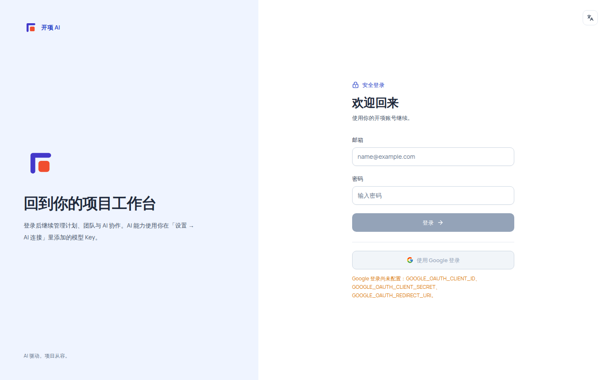
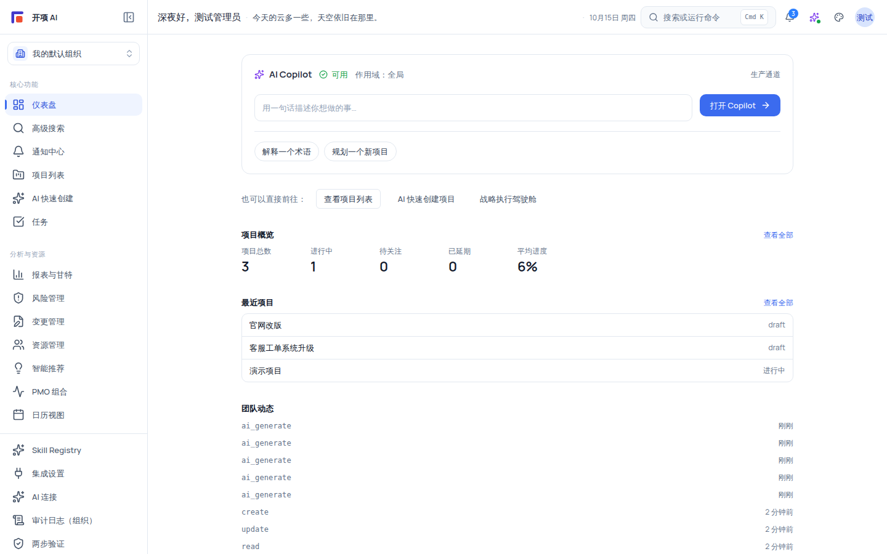
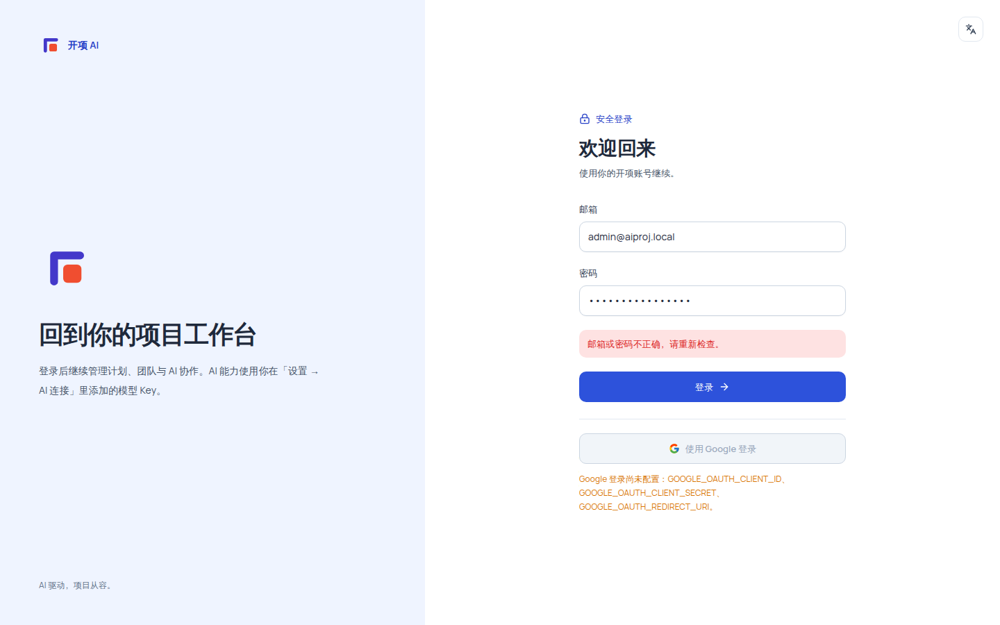

# 登录与账号

登录页（`/login`）是平台的唯一公开页面，提供两种登录方式：**邮箱密码**与 **Google 登录**（按部署配置）。本文章覆盖每种方式的适用场景与操作、`?next=` 回跳、登录失败锁定、演示账号说明与常见错误排查。

## 适用范围

- **适用角色**：全部六种角色（系统管理员 / 组织管理员 / 项目经理 / 成员 / 外部协作者 / 只读观察者）——登录是所有人的第一件事。
- **所需权限**：无。登录页是公开页面，未登录即可访问。
- **适用环境**：线上环境按部署配置提供对应登录方式；本机开发环境（`NODE_ENV=development`）额外显示开发账号提示（见「本机开发演示账号」）。

## 业务场景：两种登录方式怎么选

| 登录方式    | 入口       | 适用场景                                         | 配置依赖                                            |
| ----------- | ---------- | ------------------------------------------------ | --------------------------------------------------- |
| 邮箱密码    | 登录页表单 | 所有环境的基础方式；管理员已创建/邀请的账号      | 无（基础设施自带）                                  |
| Google 登录 | 登录页按钮 | 个人用户自助登录，或受邀组织成员使用 Google 账号 | 需部署配置 Google OAuth；未配置时按钮置灰并显示提示 |

## 开始之前

1. **准备好账号**：邮箱密码账号由组织管理员创建或邀请产生（见[邀请团队成员](/help/articles/getting-started.invite-your-team)）；Google 登录启用后可用于首次自助登录。
2. **了解回跳规则**：未登录时访问任意受保护页面，会自动跳转到 `/login?next=<原路径>`；登录成功后**回跳到原路径**，默认落脚点为仪表盘（`/dashboard`）。
3. **了解浏览器会话行为**：登录会话保存在标签页级的 sessionStorage 中——刷新页面可以保持登录，但**关闭标签页后需要重新登录**；平台没有「记住我」能力。

## 操作步骤

### 步骤 1：打开登录页

- 未登录访问 `/`（根路由）时，自动跳转到登录页；直接访问任意受保护路径（如 `/projects`）也会被引导到登录页并带上 `?next=` 参数。
- 页面为左右两栏布局：左侧是品牌区（Logo、标题「回到你的项目工作台」、副文案与标语「AI 驱动，项目从容。」）；右侧是「安全登录」表单区。

  

### 步骤 2：使用邮箱密码登录

填写表单字段：

| 字段     | 类型/格式                                         | 必填 | 填写说明                                                                        |
| -------- | ------------------------------------------------- | ---- | ------------------------------------------------------------------------------- |
| 邮箱     | 邮箱格式（`type=email`，浏览器自动补全）          | 是   | 占位符 `name@example.com`；输入组织内已登记的账号                               |
| 密码     | 密码框（`type=password`，浏览器自动补全当前密码） | 是   | 占位符 `输入密码`；登录校验只要求非空                                           |
| 登录按钮 | 按钮                                              | —    | 点击后提交；提交中按钮变为「正在登录…」并显示旋转图标；邮箱或密码为空时按钮禁用 |

流程说明：

1. 点击 **「登录」**，前端请求 `POST /api/v1/auth/login`。
2. 成功：会话（用户信息、访问令牌、刷新令牌）写入标签页会话存储，随后**回跳**到 `?next=` 指定的页面（未指定时默认 `/dashboard`）。
3. 失败：表单内显示对应的中文错误提示条（红色，`role="alert"`），不会跳转（见「常见问题」）。

登录后的第一屏长这样：

### 步骤 3：使用 Google 登录

1. 点击 **「使用 Google 登录」**（Google 图标按钮）进入 Google 授权流程。
2. 授权完成后回跳到平台并自动登录；回跳失败时页面显示对应的中文提示（映射见下表）。
3. 登录页加载时会向 `GET /api/v1/auth/google/config` 做一次无秘密的配置预检；**未配置时按钮处于置灰状态**，并显示如「Google 登录尚未配置：AIPROJ_GOOGLE_OAUTH_SECRET_FILE。」或「Google 登录未配置：回调地址未登记，请在 Google Console 登记 `{origin}/api/v1/auth/google/callback`。」之类的中文提示。

首次使用 Google 登录时，平台会为该身份建立一个隔离的 **free 个人组织**。它在界面中显示为「个人空间」，用于复用统一的数据隔离模型。若这个邮箱已接受某个组织的邀请，则沿用已有成员关系与角色，不会再创建重复组织。

> 说明：Google 登录未配置属于「配置项缺失」，不是故障；需要部署者补齐配置后按钮才可点击（配置见[Docker Compose 部署](/help/articles/deployment.docker-compose)的「Google 登录」一节）。

Google 回跳错误会映射为如下中文（低敏提示，不回显原始参数）：

| 错误码                  | 页面提示                               |
| ----------------------- | -------------------------------------- |
| `access_denied`         | 已取消 Google 授权。                   |
| `invalid_state`         | Google 登录请求已失效，请重新登录。    |
| `token_exchange_failed` | Google 登录暂时不可用，请稍后再试。    |
| `google_api_error`      | 读取 Google 账号信息失败，请稍后再试。 |
| `account_inactive`      | 账户已被禁用，请联系管理员。           |
| `not_configured`        | Google 登录未配置完整。                |
| `google_login_failed`   | Google 登录失败，请重试。              |

### 步骤 4：切换文字变体（简体 / 繁体）

登录页右上角有文字变体切换按钮，随时可在「简体 / 繁体」间切换界面文案，**不影响登录流程**。繁体变体效果示例：

### 步骤 5：登录后要退出时

点击顶栏右侧用户菜单（头像）→ **「退出登录」**。退出会撤销刷新令牌、清理本地离线缓存并退订浏览器推送，完成后提示「已退出登录」。未登录状态下，用户菜单显示「登录」链接（带 `?next=` 回跳当前页）。

### 步骤 6：本机开发演示账号

开发环境（`NODE_ENV=development`）下，登录页表单区会额外显示：**「本机开发账号：admin@aiproj.local」/「默认密码：password123」**。该提示**只在开发环境渲染**，生产构建不显示。本机 seed 提供的全部演示账号（密码均为 `password123`）：

| 邮箱                      | 显示名         | 组织角色（默认组织） | 项目角色（演示项目） | 特殊标记                                   |
| ------------------------- | -------------- | -------------------- | -------------------- | ------------------------------------------ |
| `admin@aiproj.local`      | 测试管理员     | owner（组织负责人）  | project_manager      | 默认组织负责人；登录页提示展示的就是此账号 |
| `superadmin@aiproj.local` | 系统管理员     | —                    | —                    | 系统管理员（跨组织放行，哨兵权限）         |
| `org-admin@aiproj.local`  | 组织管理员示例 | admin                | project_manager      | —                                          |
| `org-member@aiproj.local` | 组织成员示例   | member               | member               | 大部分演示任务的执行人                     |
| `org-viewer@aiproj.local` | 组织访客示例   | viewer               | readonly_observer    | —                                          |

> [!CAUTION]
> 演示密码 `password123` 由 seed 直接写入哈希，**不满足注册/改密的密码策略**（8–32 位且包含大小写字母与数字）。它只用于本机开发环境体验，请勿引导任何人用它注册正式账号。

## 验证结果

- 邮箱密码登录成功后，自动回跳到 `?next=` 指定的页面（无 `?next=` 时进入 `/dashboard`）。Google 首次登录的个人用户看到「个人空间」；受邀成员看到所在组织。
- 刷新当前页保持登录；关闭标签页后再次访问，需要重新登录（会话保存在标签页级 sessionStorage）。
- 连续输错 5 次密码后，页面提示登录次数过多；30 分钟锁定期内即使凭证正确也会被拒绝。
- 从登录页访问被保护路径（如手动输入 `/projects`）会带上 `?next=/projects`，登录后直接落在项目列表。

## 常见问题

**症状：提示「邮箱或密码不正确，请重新检查。」**

可能原因：邮箱或密码输入错误（后端 `INVALID_CREDENTIALS`/`AUTH_REQUIRED`）；或账号未启用（此时显示「账户已被禁用」等后端透传文案）。
处理：检查邮箱大小写与全角字符、密码是否带多余空格；忘记密码时联系组织管理员。
仍失败时：到[故障排查 → 登录](/help/articles/troubleshooting.login)对照排查。

**症状：提示「登录尝试过多，请稍后再试。」，或「登录失败次数过多，账户已临时锁定，请 30 分钟后再试」。**
可能原因：同一邮箱（小写）+ IP 连续失败 5 次触发登录锁定。
处理：**等待 30 分钟自动解锁**——锁定期内即使凭证正确也会被拒绝；确需提前恢复时联系管理员协助。
仍失败时：记录邮箱与时间，到[故障排查 → 登录](/help/articles/troubleshooting.login)查找。

**症状：提示「暂时无法登录，请检查网络后重试。」**
可能原因：网络异常、服务端错误或登录接口不可用。
处理：检查网络后重试；仍失败时记录时间与 request id，联系技术支持。

**症状：Google 登录按钮置灰或提示「Google 登录尚未配置：…」。**
可能原因：部署未配置 Google OAuth（配置项缺失，不是故障）。
处理：联系部署者按[Docker Compose 部署](/help/articles/deployment.docker-compose)的「Google 登录」一节完成配置；配置完成后刷新登录页即可点击。

**症状：登录成功后没有回到原来想去的页面。**
可能原因：`?next=` 参数缺失、已被回跳保护拦截，或会话过期后重新登录。
说明：回跳只允许站内绝对路径；外部 URL、`//` 开头的协议相对地址、以及 `/login` 自身都会被安全策略打回 `/dashboard`（防开放重定向）。这是安全设计，不是故障。

**症状：换个标签页/关掉浏览器后要重新登录。**
可能原因：会话保存在当前标签页的 sessionStorage（key `aiproj-auth-session`），关标签页即失效。
处理：重新登录即可；登录后任一 API 返回 401 时会先静默刷新一次并重放请求，刷新失败才跳登录页——这不是异常。

## 安全与限制

- **失败锁定**：同一邮箱（小写）+ IP 连续失败 5 次，锁定 30 分钟；锁定期内正确凭证也会被拒绝（`ACCOUNT_LOCKED`）。
- **回跳保护**：`?next=` 只接受站内绝对路径；外部 URL、`//` 协议相对、`/login` 自身一律回退 `/dashboard`。
- **无「记住我」**：会话不跨标签页持久化；长期闲置重新登录是设计行为。
- **密码策略**：注册/改密要求 8–32 位且包含大小写字母与数字；登录校验只要求非空字符串。
- 登录页 `robots` 为 `noindex, nofollow`，不会被搜索引擎收录。
- Google 登录需要部署配置，未配置时的置灰与提示是「配置项缺失」，按配置流程处理即可。

## 下一步

- [登录后第一屏：快速认识工作台与 AI Copilot](/help/articles/getting-started.add-a-quick-tour)
- [创建第一个项目](/help/articles/getting-started.create-first-project)
- [邀请团队成员](/help/articles/getting-started.invite-your-team)
- 部署者配置 Google 登录：[Docker Compose 部署](/help/articles/deployment.docker-compose)
- 登录问题专项排查：[故障排查 → 登录](/help/articles/troubleshooting.login)
