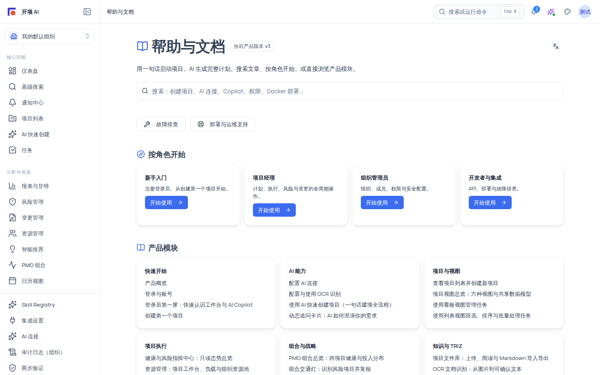

# 产品概览

开项 OpenXiang（aiproj）是 AI-first 的简体中文原生专业项目管理平台：**用一句话启动项目，AI 自动生成完整计划——专业 PM 可控，新手也能用。**

## 三个差异化

### 差异化一：AI 一句话启动项目

用自然语言描述「想做的事」，AI 会生成完整计划草案：项目章程、WBS 工作分解、任务清单、依赖、验收标准等。草案必须经过你逐项审查、通过规则校验与反幻觉检查后才能导入为正式项目——这一条红线贯穿全平台：**AI 只建议、不自动执行**，AI 生成的任何内容都不会未经确认就落库。

### 差异化二：专业与直觉双入口，底层统一

平台同时提供专业入口（WBS、甘特图、关键路径、资源、风险等全功能）与直觉入口（Kanban、极简界面）。两个入口共享**同一套数据模型**：直觉入口的「简单」只是前端呈现上的隐藏，不是后端功能的阉割；你在看板拖动卡片、在甘特图调整排期，修改的都是同一条任务数据。

### 差异化三：简体中文原生

术语、报告、AI 交互都以简体中文为一等公民，同时内置「简体 / 繁体」文字变体切换（登录页右上角与个人资料中均可调整）。这是其他项目管理工具通常作为「多语言插件」补齐的部分，在本平台是默认体验。

## 适用范围（角色与权限）

平台规范定义六种角色，决定你在组织与项目中能做什么。**所有权限判定都在服务端完成**：界面上看不到的入口，后端同样会拒绝；导航上的展示层过滤只用于引导，不是安全边界。

| 角色                    | 定位       | 典型能力                                                 |
| ----------------------- | ---------- | -------------------------------------------------------- |
| `system_admin`          | 系统管理员 | 跨组织放行、系统级资源配置（哨兵权限），通常由部署方持有 |
| `org_admin`             | 组织管理员 | 管理组织成员、组织级 AI 连接、集成与安全配置             |
| `project_manager`       | 项目经理   | 创建项目、管理项目内计划（WBS/甘特/任务/依赖/风险）      |
| `member`                | 成员       | 参与项目协作：查看与执行被指派的任务、评论、上传附件     |
| `external_collaborator` | 外部协作者 | 受项目邀请的外部人员，只能访问被授予的项目范围           |
| `readonly_observer`     | 只读观察者 | 只能查看项目数据，不能修改任何内容                       |

侧栏导航项带有展示层权限声明（如「项目列表」要求 `project:view`、「AI 快速创建」要求 `project:create`）；**所有权限判定都在服务端完成**——界面上看不到的入口，后端同样会拒绝。角色能做什么的完整清单见[权限参考](/help/articles/reference.permissions)。

## 产品模块地图

登录后，你看到的产品由几大模块组成：

| 模块         | 内容                                                         | 说明                                                                                    |
| ------------ | ------------------------------------------------------------ | --------------------------------------------------------------------------------------- |
| 登录与门户   | 登录页（邮箱密码 / Google）、仪表盘、高级搜索、通知中心      | 登录方式总览见[登录与账号](/help/articles/getting-started.login-and-accounts)           |
| 项目与视图   | 项目列表、新建项目（AI 快速创建 / 手动创建）、项目内六种视图 | 六视图：看板、列表、日历、Timeline、甘特、WBS                                           |
| 项目执行     | 任务、WBS、依赖、里程碑、风险、变更请求、资源、报表          | 从项目详情页进入                                                                        |
| AI 能力      | AI 快速创建、需求澄清卡片、草案生成与审查、全局 Copilot      | 遵循「只建议、人工确认后落库」红线                                                      |
| 组织与管理员 | 成员与角色、AI 连接、集成与插件、安全审计                    | 由组织管理员维护                                                                        |
| 帮助中心     | 当前这套手册（/help）                                        | 按「快速开始 / AI 能力 / 项目与视图 / 组织与管理员 / 部署与运维 / 参考 / 故障排查」检索 |

平台还提供两个跨项目入口：「全局日历」（`/calendar`）按月汇总各项目任务与里程碑的截止日；「跨项目任务聚合」（`/tasks`）默认列出分配给你的未完成任务，可切换全部任务与状态。项目内的日历视图与 6 种任务视图同样可用。

## 核心红线

1. **AI 只建议、不自动执行**：AI 生成的任何计划、修改都只是草案或建议，必须经人工确认才落库；任何界面操作（包括 Copilot 的快捷建议按钮）都不会替你做决定或执行业务动作。
2. **组织级数据隔离**：所有查询自动附加当前组织过滤，你只能看到自己组织内、且自己有项目成员资格的项目与数据；跨组织数据不可见是安全事实，不是可配置项。
3. **草案必须经审查**：AI 草案必须通过规则引擎校验与反幻觉检查（HL-001~HL-010）才能导入为正式项目。

## 开始之前

- 无。本页是概念介绍，无需任何前置配置；使用其他功能前先完成[登录](/help/articles/getting-started.login-and-accounts)。

## 操作步骤

1. **登录并进入项目列表**：按[登录与账号](/help/articles/getting-started.login-and-accounts)登录后，打开「项目」；你会看到当前组织内你有权访问的项目列表（组织还没有项目时，会看到引导创建的空状态）。
2. **认识创建入口**：点击「新建项目」；你会看到新建项目页面，可以选择 AI 快速创建或手动创建流程（完整教程见[创建第一个项目](/help/articles/getting-started.create-first-project)）。
3. **认识项目内视图**：进入任意项目详情页，顶部有视图切换器；你会看到看板、列表、日历、Timeline、甘特、WBS 六种视图（详见[项目视图总览](/help/articles/projects.views-overview)）。
4. **认识 AI 快速创建**：在新建项目页选择 AI 快速创建，输入一句话需求；你会看到动态追问卡片与草案模块的流式生成进度；草案经人工确认后才落库（详见[使用 AI 快速创建项目](/help/articles/ai.ai-quick-create)）。
5. **认识 AI 连接配置入口**：打开「设置 → AI 连接」；你会看到组织级的 AI 连接列表与「测试连接」能力（需要 `ai:connection:manage` 权限，见[配置 AI 连接](/help/articles/ai.configure-ai-connections)）。
6. **认识其他设置入口**：可在「设置 → 集成」、「设置 → Skills/知识」、「组织 → 插件目录」浏览组织可用的扩展能力；实际可用项以服务端权限判定为准。
7. **返回帮助中心**：随时打开 `/help`；你会看到按模块组织的帮助首页，可用搜索框直接查找主题：

   

## 验证结果

- 你能说清三件事：项目从哪里创建（`/projects/new`）；AI 草案必须经人工确认才会落库（AI 只建议）；专业与直觉入口共用同一套数据。
- 你能在导航中定位：项目列表（`/projects`）、AI 快速创建（`/ai-create`）、高级搜索（`/search`）、通知中心（`/notifications`）、帮助中心（`/help`）。
- 你能说出自己的角色，并知道侧栏哪些入口可能因权限不显示。

## 常见问题

**症状：想直接开始做项目。**
可能原因：还没有创建过项目。
检查：左侧导航点击「项目」→「新建项目」，或直接访问 `/projects/new`。
修复：按[创建第一个项目](/help/articles/getting-started.create-first-project)教程或[使用 AI 快速创建项目](/help/articles/ai.ai-quick-create)文章操作。
仍失败时：记录页面上出现的错误信息与 request id（错误面板或浏览器网络请求响应头），到帮助中心「故障排查」查找或提供给技术支持。

**症状：看不到某个组织的项目。**
可能原因：当前登录的身份不在该组织，或该项目未授予你任何角色。
检查：右上角组织切换器确认当前组织；项目成员列表是否有你。
修复：切换到正确的组织，或请项目负责人在成员列表中添加你。
仍失败时：记录操作时间与 request id，联系组织管理员核对你的成员关系。

**症状：AI 生成的草案想直接当正式项目用。**
可能原因：误解了 AI 能力的边界。
检查：草案页顶部的状态提示（草案 / 已校验 / 可导入）。
修复：草案必须经你逐项确认、通过规则校验与反幻觉检查后，才会落库为正式项目；AI 只建议，不自动执行。
仍失败时：记录 request id，到「故障排查 → AI 生成」查找。

## 安全与限制

- AI 只建议、不自动执行：AI 生成的任何计划或修改必须经人工确认后才进入正式数据。
- 组织级数据隔离：所有查询自动附加组织过滤（`organization_id`），你只能看到自己组织内的项目与数据。
- 双入口（专业 / 直觉）共用同一套数据模型，任何视图的改动都是对同一数据的修改。
- 全局日历与跨项目任务聚合每个项目最多汇总 100～200 项，超出时页面会提示并建议进入项目查看完整列表。

## 下一步

- [登录与账号（登录方式总览）](/help/articles/getting-started.login-and-accounts)
- [登录后第一屏：快速认识工作台](/help/articles/getting-started.add-a-quick-tour)
- [创建第一个项目](/help/articles/getting-started.create-first-project)
- [使用 AI 快速创建项目](/help/articles/ai.ai-quick-create)
- [项目视图总览](/help/articles/projects.views-overview)
