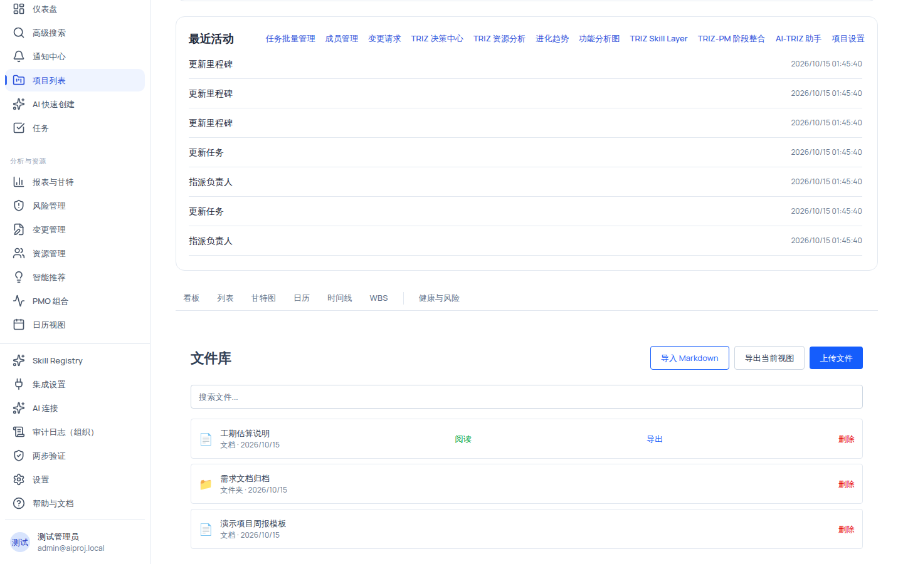
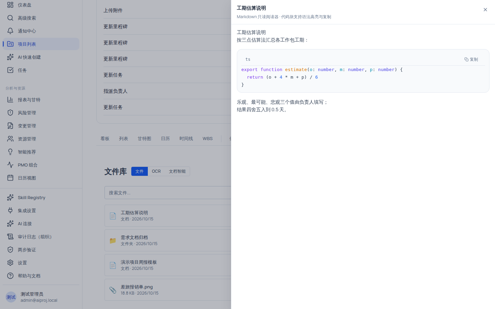

# 项目文件库：上传、阅读与 Markdown 导入导出

项目文件库是项目级的内容中心，集中管理三类内容：**文件夹**（归档组织用）、**文档**（Markdown 文本）与**附件**（图片等二进制文件）。文件库同时是 OCR 识别与文档智能工作台的入口页。

## 适用范围

- **适用角色**：六种规范角色均可查看文件库（需要 `file:view`）；**导入 Markdown 与删除文件**需要 `file:manage`（当前仅组织管理员、项目经理持有）。
- **所需权限**：`file:view`（查看/阅读/导出/下载）、`file:manage`（导入 Markdown、删除）。
- **适用版本**：免费版、团队版、企业版。

> [!IMPORTANT]
> 文件库当前**不在左侧导航栏中**，也没有命令面板入口。请直接输入项目文件库 URL：`/projects/{项目ID}/files`，或从项目头相关入口进入。文档中所有「从左侧导航进入」的说法均不适用于本页面。

## 开始之前

- 确认你已登录并在目标项目内（文件库按项目隔离，组织级数据隔离对文件同样生效）。
- 准备要上传的内容：
  - **附件**：单文件大小上限 **10MB**；支持类型包括图片（PNG/JPEG/WebP，可被 OCR 识别）与其他二进制文件。
  - **文档**：Markdown 文本，标题 1–255 字符、正文不超过 100000 字符。
- 需要导入/删除时，确认当前账号持有 `file:manage`（组织管理员或项目经理；其他角色看不到这些按钮，或操作被后端拒绝）。

## 操作步骤

### 步骤 1：进入文件库并识别三类内容

1. 在浏览器打开 `/projects/{项目ID}/files`；你会看到标题栏「文件库」与右上角按钮组（「导入 Markdown」「导出当前视图」「上传文件」）。
2. 识别列表中的三类行：
   - **文件夹**（📁 前缀，行内标注「文件夹」与 `zh-CN` 日期）：用于归档组织。当前版本文件夹行**没有进入/展开交互**，其树结构由导入/导出对话框使用。
   - **文档**（📄 前缀，行内标注「文档」）：Markdown 文本内容，行操作有「阅读」「导出」「删除」。
   - **附件**（📎 前缀，行内标注大小，如 `1.2 MB`）：上传的二进制文件，行操作有「下载」「删除」。

3. 需要查找时，在搜索框（placeholder「搜索文件...」）输入关键词；空列表时你会看到「暂无文件」与「点击上方按钮上传第一个文件」的提示。

### 步骤 2：上传文件

1. 点击右上角 **「上传文件」** 按钮；文件选择对话框弹出（每次选择一个文件）。
2. 选择本地文件；你会看到按钮短暂变为「上传中...」，成功后在列表出现一行**附件**。
3. 如果上传的是 **PNG / JPEG / WebP 图片**，标题栏会额外出现「OCR」「文档智能」两个 tab，且 OCR tab 中该行显示「未识别」。

> [!WARNING]
> 「上传文件」按钮对所有角色可见，但上传请求在后端按 `file:manage` 校验。没有该权限的角色点击上传会看到红色错误提示「上传失败」（后端返回「无权管理附件」），这不是网络问题。

### 步骤 3：阅读 Markdown 文档（只读阅读器）

1. 在文档行点击 **「阅读」**（绿色按钮）；右侧滑出「Markdown 只读阅读器」面板。
2. 阅读器以只读方式渲染 Markdown，**代码块支持语法高亮与复制**；无需导出即可快速查看。

3. 无法读取时，阅读器显示「读取失败或无权访问此文档」；确认文档存在且你有 `file:view` 权限。

### 步骤 4：导入 Markdown 文档

1. 点击 **「导入 Markdown」**（仅 `file:manage` 可见）；导入对话框弹出。
2. 选择导入方式（新建文档，或替换目标文档）、粘贴 Markdown 内容；对话框会尝试根据内容推断标题。
3. 若检测到陈旧内容（存在旧的 source hash），会显示「md-stale-block」样式的警告，阻止直接替换——你需要先确认冲突后再操作。
4. 勾选确认复选框（确认目标无误），点击确认导入；成功后会看到列表出现新文档行。

### 步骤 5：导出当前视图

1. 点击 **「导出当前视图」**（需要 `file:view`，且存在非文件夹文档时显示）。
2. 选择导出模式（tree）；导出内容为当前列表视图中可见的文档结构。

### 步骤 6：下载与删除附件 / 删除文档

1. **下载附件**：附件行点击 **「下载」**；浏览器新窗口打开附件下载地址。
2. **删除**：文档行或附件行点击 **「删除」**（红色按钮，仅 `file:manage`）；删除后列表不再显示该行。删除操作不可恢复，请先确认。

## 验证结果

- 上传文件后，列表出现对应行：图片为附件行（📎），且标题栏出现「OCR」「文档智能」tab（OCR 支持类型才有）。
- 点击「阅读」后，Markdown 只读阅读器正确渲染正文与代码高亮。
- 导入 Markdown 后，列表出现新文档行；导出文件包含当前视图内容。
- 无 `file:manage` 的角色：看不到「导入 Markdown」「删除」按钮；强行上传会得到「上传失败 / 无权管理附件」提示。
- 无 `file:view` 的角色：无法进入文件库、阅读器显示无权限提示、附件下载返回「无权查看附件」。

## 安全与边界限制

- **AI 只建议、不自动执行**：文件上传、导入、删除均不会触发任何 AI 自动修改；AI 相关能力（OCR、文档智能）产生的结果一律先审查确认，再进入下游。
- **大小与格式边界**：附件单文件上限 **10MB**；文档标题 1–255 字符、正文 ≤ 100000 字符；Name 与搜索校验相同。
- **OCR 边界**：仅图片（PNG/JPEG/WebP）可被 OCR 识别，**不支持 PDF/Office 文件**；预览图片 ≤ 2MB。
- **文件夹边界**：文件夹行不可进入/展开（无导航交互），仅作为导入导出时的目标位置概念存在。
- **组织隔离**：文件严格按项目与组织隔离，跨组织不可见。
- **删除不可恢复**：删除操作没有回收站（任务回收站不适用于文件库），请谨慎操作。

## 常见问题

**症状：上传图片后没看到「OCR」「文档智能」tab。**
可能原因：图片格式不在 OCR 支持列表（仅 PNG/JPEG/WebP）。
检查：文件扩展名与 MIME；换一张 png/jpeg/webp 图片重新上传。
修复：把文件转为 PNG/JPEG/WebP 后重试。
仍失败时：记录文件格式与大小，到帮助中心「故障排查 → OCR」查找。

**症状：点击「上传文件」后出现红色「上传失败」。**
可能原因：当前角色没有 `file:manage`（后端返回「无权管理附件」），或文件超过 10MB。
检查：账号角色是否为组织管理员/项目经理；文件大小是否 ≤ 10MB。
修复：向组织管理员申请权限，或压缩文件后重试。

**症状：阅读文档时提示「读取失败或无权访问此文档」。**
可能原因：文档已被删除，或当前角色缺少 `file:view`。
检查：文件是否还在列表中；账号角色权限。
修复：换有权限的账号查看，或让文档所有者重新导入。

**症状：导入 Markdown 时确认按钮不可用。**
可能原因：存在陈旧 source hash 冲突（stale block），或未勾选确认复选框。
检查：页面上的警告条与确认复选框。
修复：核对冲突内容后勾选确认框再提交。

## 下一步

- [OCR 文档识别：从图片到可确认文本](/help/articles/knowledge.ocr-documents)
- [配置与使用 OCR 识别](/help/articles/ai.configure-ocr)
- [故障排查：OCR 无法识别](/help/articles/troubleshooting.ocr)
