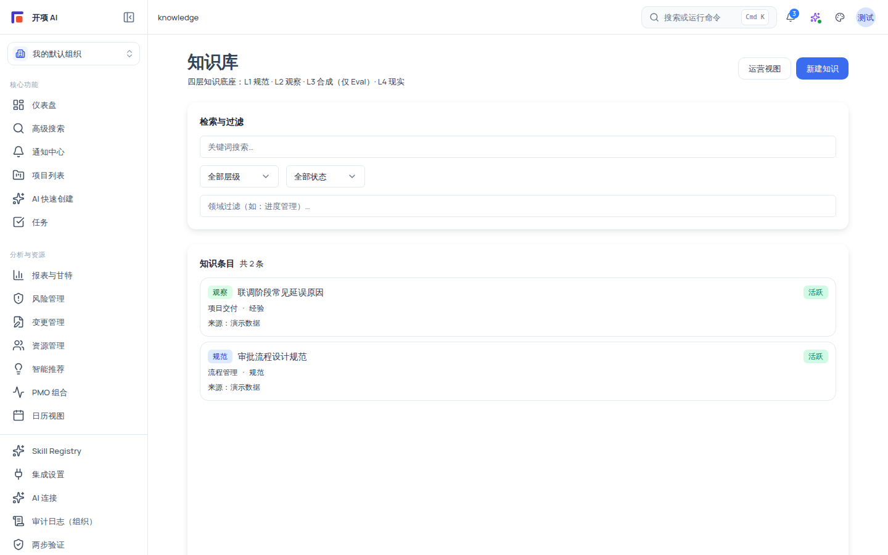
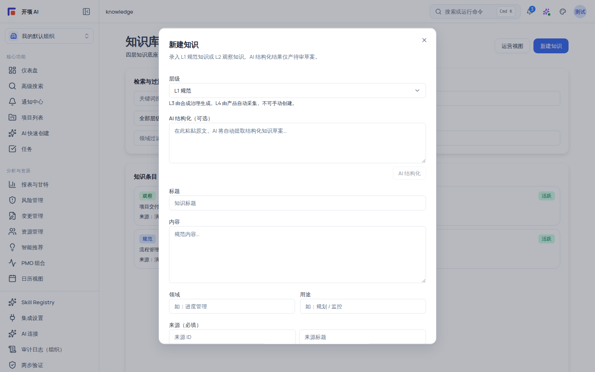

# 知识库：L1–L4 知识底座与审查流转

知识库是组织的四层知识底座，副题「L1 规范 · L2 观察 · L3 合成（仅 Eval）· L4 现实」。你可以在其中浏览、检索、新建知识条目，并参与「草稿 → 待审 → 活跃」的审查流转。知识条目是后续检索、Copilot 记忆与 TRIZ 工具链的候选事实来源——但**知识写入与状态流转全部要求人工确认**。

## 适用范围

- **适用角色**：查看知识库需要 `knowledge:view`——授予**组织管理员、成员、外部协作者、只读观察者**；**项目经理没有 `knowledge:view`**，打开 `/knowledge` 会看到「您没有查看知识库的权限（需要 knowledge:view）。」，这是**已知的角色门控设计**，不是故障。
- **所需权限**：`knowledge:view`（浏览/检索）、`knowledge:author`（新建知识）、`knowledge:manage`（确认转正、状态流转）。
- **适用版本**：免费版、团队版、企业版。

> [!IMPORTANT]
> 知识库当前**不在左侧导航栏中**，也没有命令面板入口。请直接输入 URL：`/knowledge`。文档中任何「从左侧导航进入知识库」的说法均不适用于当前版本。

## 开始之前

- 确认你的角色持有 `knowledge:view`（否则页面显示无权限空态）。
- 想好要录入的知识层级：**L1 规范**（组织约定/规范类知识）或 **L2 观察**（观察类知识）可手动创建；**L3 由合成治理生成**、**L4 由产品自动采集**，二者不可手动创建。
- 准备来源信息：新建弹窗的「来源（必填）」需要来源 ID 与来源标题；不填时系统使用默认值（来源 ID `manual-{时间戳}`、标题「手动录入」）。

## 操作步骤

### 步骤 1：进入知识库并理解四层结构

1. 打开 `/knowledge`；你会看到页面副题「四层知识底座：L1 规范 · L2 观察 · L3 合成（仅 Eval）· L4 现实」，右上角有「运营视图」（仅运营权限可见）与「新建知识」按钮。
2. 理解层级徽标配色：**L1 规范=蓝色**、**L2 观察=绿色**、**L3 合成=紫色**、**L4 现实=琥珀色**；合成条目另有 `SYNTHETIC` 徽标。

| 层级    | 含义                     | 谁创建                                           | 状态起点             |
| ------- | ------------------------ | ------------------------------------------------ | -------------------- |
| L1 规范 | 规范、约定类知识         | 人工创建（本页「新建知识」）或 AI 结构化 -> 草稿 | 草稿/待审            |
| L2 观察 | 观察、事实类知识         | 人工创建（本页「新建知识」）或 AI 结构化 -> 草稿 | 草稿/待审            |
| L3 合成 | 由合成治理生成的合成知识 | 合成治理自动生成，不可手动创建                   | 待审（仅 Eval 环境） |
| L4 现实 | 由产品自动采集的现实知识 | 产品自动采集，不可手动创建                       | 随采集状态           |

### 步骤 2：检索与过滤知识条目

1. 在「检索与过滤」卡中组合使用以下条件：
   - **关键词搜索**：输入框 placeholder「关键词搜索…」。
   - **层级**：全部层级 / L1 规范 / L2 观察 / L3 合成 / L4 现实。
   - **状态**：全部状态 / 活跃 / 待审 / 草稿 / 已弃用 / 已过时。
   - **领域过滤**：自由输入，例如「进度管理」。
2. 列表卡「知识条目」显示 `共 {总数} 条`；每行包含：层级徽标、`SYNTHETIC` 徽标（合成条目）、标题、`{领域}·{用途}·复杂度：{复杂度}`、状态徽标（草稿/待审/活跃/已弃用/已过时）、来源行（`来源：{标题1} · {标题2}`）。
3. 无匹配时看到「暂无匹配的知识记录。」；加载失败时看到红色「加载失败：{错误}」。

### 步骤 3：新建知识条目

1. 点击右上角 **「新建知识」**（需要 `knowledge:author`）；「新建知识」弹窗弹出，说明「录入 L1 规范知识或 L2 观察知识。AI 结构化结果仅产待审草案。」。
2. 按下表填写字段：

| 字段              | 必填 | 说明与取值                                                                                                                                                           |
| ----------------- | ---- | -------------------------------------------------------------------------------------------------------------------------------------------------------------------- |
| 层级              | 是   | 下拉：`L1 规范` / `L2 观察`。提示「L3 由合成治理生成，L4 由产品自动采集，不可手动创建。」                                                                            |
| AI 结构化（可选） | 否   | 粘贴原文（placeholder「在此粘贴原文，AI 将自动提取结构化知识草案…」），点击「AI 结构化」；结构化中按钮变为「结构化中…」。AI 只产出**待审草案**，不会直接落为正式条目 |
| 标题              | 是   | placeholder「知识标题」                                                                                                                                              |
| 内容              | 是   | placeholder 随层级切换：「规范内容…」/「观察内容…」                                                                                                                  |
| 领域              | 否   | placeholder「如：进度管理」；不填默认 `通用`                                                                                                                         |
| 用途              | 否   | placeholder「如：规划 / 监控」；不填默认 `参考`                                                                                                                      |
| 来源（必填）      | 是   | 来源 ID + 来源标题；不填来源 ID 默认 `manual-{时间戳}`、标题默认「手动录入」                                                                                         |

3. 点击 **「创建（草稿）」** 提交（按钮在提交中变为「创建中…」），或「取消」放弃。创建的条目状态为**草稿**（若走 AI 结构化，则为**待审**草案）。

### 步骤 4：审查与状态流转

1. 点击列表中的条目行，打开「审查抽屉」：包含层级徽标 + `SYNTHETIC` 标记、`状态：{状态}` 徽标、区块「基本信息」（领域/用途/复杂度/保留期：N 天）、「内容」、「合成方法」（合成条目）、「来源（SourceRef）」（`{层级} · {标题} ({来源ID})`，空则显示「无来源记录」）、「审核历史（ReviewRecord）」（空则「暂无审核记录」）、层级元数据。
2. 持有 `knowledge:manage` 时，在抽屉执行流转（按钮按当前状态渲染）：
   - **草稿 → 待审**：「待审」转移按钮。
   - **待审（pending）→ 活跃**：「确认转正」按钮（pending 时可用）。
   - **活跃 → 已弃用/已过时**：状态转移按钮。
   - **已弃用 → 活跃**；**已过时 → 活跃/已弃用**：恢复转移按钮。
3. 生命周期关系见下表的「状态流转表」。

## 状态流转表

| 当前状态             | 可转移到        | 触发条件               |
| -------------------- | --------------- | ---------------------- |
| 草稿（draft）        | 待审            | 提交待审（可随时提交） |
| 待审（pending）      | 活跃 / 草稿     | 确认转正，或退回草稿   |
| 活跃（active）       | 已弃用 / 已过时 | 知识失效或过时         |
| 已弃用（deprecated） | 活跃            | 重新启用               |
| 已过时（outdated）   | 活跃 / 已弃用   | 刷新或弃用             |

## 验证结果

- 检索条件组合后列表条数与状态徽标符合预期；「共 N 条」计数与筛选一致。
- 新建条目按「创建（草稿）」后出现在列表，状态徽标为「草稿」；内容与来源显示正确。
- 使用 AI 结构化后产生的条目状态为**待审**，不会自动转活跃。
- 持有 `knowledge:manage` 时，「确认转正」可将待审条目转为活跃；无权限角色看不到这些按钮。
- 项目经理角色打开 `/knowledge` 看到「您没有查看知识库的权限（需要 knowledge:view）。」。

## 安全与边界限制

- **AI 只建议、不自动执行**：AI 结构化结果仅产**待审草案**；任何知识条目落库、转正、弃用都需人工在审查抽屉中确认。
- **角色门控**：`knowledge:view` **不授予项目经理**；需要查看时可向组织管理员申请授予该权限。
- **层级边界**：L3/L4 不可手动创建；L3 由合成治理生成（仅 Eval 环境），L4 由产品自动采集。
- **组织隔离**：知识条目按组织隔离；跨组织不可见（后端 policy 对 view/author/manage 均做组织双检）。

## 常见问题

**症状：打开 /knowledge 显示「您没有查看知识库的权限（需要 knowledge:view）。」。**
可能原因：当前角色是项目经理——知识库权限**不含 project_manager**（设计如此）。
检查：账号角色与组织授权。
修复：使用组织管理员/成员/外部协作者/只读观察者账号，或向组织管理员申请 `knowledge:view`。

**症状：没有「新建知识」按钮。**
可能原因：缺少 `knowledge:author` 权限。
检查：角色权限配置。
修复：联系组织管理员授予 `knowledge:author`。

**症状：列表为空但确定已有条目。**
可能原因：检索条件过严（关键词/层级/状态/领域组合），或加载失败（红色「加载失败：{错误}」）。
检查：清空检索条件；查看错误信息。
修复：重置筛选后重试；持续失败时记录错误信息反馈。

**症状：AI 结构化结果去哪了？**
可能原因：AI 结构化只生成草案，状态为「待审」，不会自动转活跃。
检查：列表按「状态=待审」过滤。
修复：在审查抽屉执行「确认转正」后才会成为活跃条目。

## 下一步

- [知识与记忆运营层：启用与使用](/help/articles/knowledge.knowledge-operations)
- [配置 AI 连接](/help/articles/ai.configure-ai-connections)
