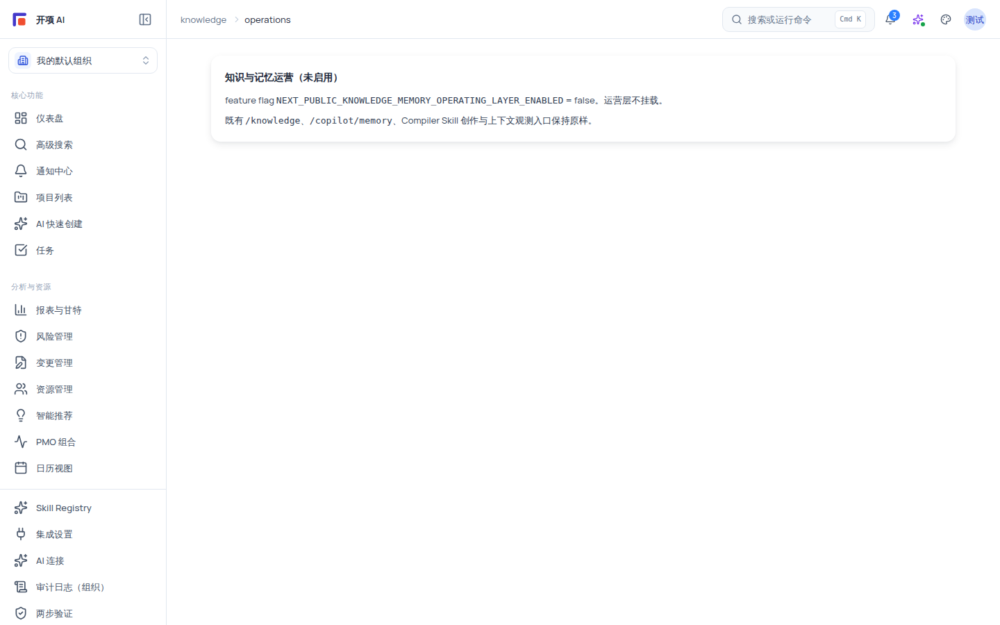

# 知识与记忆运营层：启用与使用

知识与记忆运营层（`/knowledge/operations`）是跨**四层知识、Copilot 记忆、Skill 草稿与上下文观测**的运营入口：它把来自不同来源的对象（knowledge_item / copilot_memory / skill_knowledge_draft / retrieval_signal）按统一的「attention 关注度」队列聚合，让运营者一次看清「有哪些待处置项」。**写入仍由各 owning capability 接管**——运营层只读聚合，不直接改数据。

## 适用范围

- **适用角色**：需要 `knowledge_memory_operating:view` 权限——当前授予**组织管理员与项目经理**。
- **所需权限**：`knowledge_memory_operating:view`。
- **适用版本**：免费版、团队版、企业版。
- **前置条件**：见下节——运营层默认**未启用**，需要配置 feature flag。

> [!IMPORTANT]
> 运营层是 **feature flag + 角色双门控**。即使你有权限，flag 未开启时页面也只会显示「知识与记忆运营（未启用）」卡，不挂载任何数据请求。默认情况下你是**看不到**运营内容的——这是设计，不是故障。

## 开始之前：理解门控与启用方式

运营层需要同时满足三个条件：

1. **前端 flag**：环境变量 `NEXT_PUBLIC_KNOWLEDGE_MEMORY_OPERATING_LAYER_ENABLED=true`（值为 `true` 才启用）。
2. **后端 flag**：同名环境变量 `KNOWLEDGE_MEMORY_OPERATING_LAYER_ENABLED`，接受 `1 / true / on / yes / enabled`（大小写不敏感），默认 **false**。
3. **角色权限**：`knowledge_memory_operating:view`（org_admin、project_manager）。

两个 URL 等效：`/knowledge/operations` 与 `/knowledge?view=operations` 渲染同一个运营视图；`/knowledge` 右上角「运营视图」按钮（仅运营权限可见）也会跳转到该视图。

### 启用步骤（部署/运维侧）

1. 在部署环境的前端与后端配置中分别设置 `NEXT_PUBLIC_KNOWLEDGE_MEMORY_OPERATING_LAYER_ENABLED=true` 与 `KNOWLEDGE_MEMORY_OPERATING_LAYER_ENABLED=true`。
2. **重启前端与后端进程**，使环境变量生效。
3. 用持有 `knowledge_memory_operating:view` 的账号（组织管理员/项目经理）打开 `/knowledge/operations`；你会看到页面标题「知识与记忆运营」，副题「跨四层知识、Copilot 记忆、Skill 草稿与上下文观测的运营入口；写入仍由 owning capability 接管。」，以及运营总览卡与统一队列。

> [!WARNING]
> 本机开发或单机部署默认 flag 为关闭态：打开 `/knowledge/operations` 只会看到「知识与记忆运营（未启用）」卡，卡片文案说明「feature flag `NEXT_PUBLIC_KNOWLEDGE_MEMORY_OPERATING_LAYER_ENABLED` = false。运营层不挂载。既有 `/knowledge`、`/copilot/memory`、Compiler Skill 创作与上下文观测入口保持原样。」——此状态不发送任何数据请求，属预期安全态。

## 页面能力一览

### 运营总览卡

- 「生成于 {时间}（{n} 个 lane，{m} 个待处置）」；四个 lane 计数瓦片带「待处置 {n}」与 coverage 标签。
- 「按 attention facet 聚合」：needs_review / stale_or_unconfirmed / conflict / provenance_gap / synthetic_eval_only / retention_attention / retrieval_gap / degraded 等拐点。
- 特殊提示（如实呈现）：
  - degraded lane：`{lane} lane 读取失败，已标 degraded；显示计数 0 不可信，请勿据 0 处置`。
  - hidden lane：`{lane} lane 当前 scope 内全部对象不可见（按权限排除）`。
  - summary 接口失败时降级为「summary 暂不可用，但 list/detail 仍可访问。」
  - 空数据：「暂无任何 lane 数据。」

### 筛选与排序卡

- 下拉：`kind`（knowledge_item / copilot_memory / skill_knowledge_draft / retrieval_signal）、`scope`（organization / project / user / session / global）、`status`、`attention`。
- `sort`（attention priority / attention time / kind / scopedRef）+ `order`（desc / asc）+ `perPage`（20/50/100）+ 分页（上一页/下一页，「page {n}」）。
- URL state 自动同步；前/后向按钮可恢复。flag off 时不发起任何请求。

### 统一队列与详情抽屉

- 队列行展示 scoped ref、kind 徽标、状态/attention 徽标、摘要；按筛选结果滚动浏览。
- 详情抽屉展示运行态字段（scope、layer、lifecycle、statusDetail、confidence source、current/base version、base-stale、live-fact 冲突、provenance 数、review 数、section 数、summary byte size、truncated/degraded、query category、retrieval kind、permission excluded、reasonCode、note、plugin provenance、draft、sample count、zero-result rate 等），以及「Owning surface handoff」区——按 kind 渲染对应的 owning 面板，把处置动作交还给能力所属方。

### 字段速查表（详情抽屉）

| 字段                                        | 含义要点                                                                           |
| ------------------------------------------- | ---------------------------------------------------------------------------------- |
| kind · scope · layer                        | 对象种类（详见上表）/ 作用域（organization/project/user/session/global）/ 知识层级 |
| lifecycle · statusDetail                    | 生命周期状态与明细状态                                                             |
| confidence source                           | 置信度来源                                                                         |
| current version / base version · base-stale | 当前版本与基准版本；base 是否已陈旧                                                |
| live-fact 冲突                              | 与实时事实的冲突标记                                                               |
| provenance 数 / review 数 / section 数      | 溯源记录数、审查记录数、章节数                                                     |
| summary byte size · truncated / degraded    | 摘要大小；是否截断或降级                                                           |
| query category · retrieval kind             | 检索类别与检索类型                                                                 |
| permission excluded · reasonCode · note     | 权限排除状态、原因码、备注                                                         |
| plugin provenance · draft                   | 插件溯源、草稿标记                                                                 |
| sample count · zero-result rate             | 样本数与零结果率（检索类 lane）                                                    |

## 使用边界

- **只读运营**：运营层 API（summary / items / items detail / surfaces）全部只读；任何写入与变更都在各 owning capability 的面板中人工确认执行。
- **flag off = 零请求**：未启用时页面不挂载 hook、不发请求，无数据副作用。
- **无权限空态**：有 flag 但无 `knowledge_memory_operating:view` 时显示「您没有查看权限（需要 knowledge_memory_operating:view）。」。
- **组织隔离**：运营数据按组织可见性过滤；hidden lane 即按权限排除后的结果。

## 验证结果

- 默认配置下打开 `/knowledge/operations`：看到「知识与记忆运营（未启用）」卡（feature-off 态），控制台无该页面的网络请求。
- 配置 flag 并重启后：看到「知识与记忆运营」页面与运营总览卡（或有真实数据后的 lane 计数）。
- 无权限账号：看到「您没有查看权限（需要 knowledge_memory_operating:view）。」空态。
- 队列与详情可按 kind/scope/status/attention 组合筛选，URL 同步恢复。

## 常见问题

**症状：页面只有「知识与记忆运营（未启用）」卡。**
可能原因：前端或后端 flag 未开启（默认关闭）。
检查：`NEXT_PUBLIC_KNOWLEDGE_MEMORY_OPERATING_LAYER_ENABLED` 与 `KNOWLEDGE_MEMORY_OPERATING_LAYER_ENABLED` 是否均为启用值。
修复：设置后**重启前后端**；再次打开页面观察。

**症状：提示「您没有查看权限（需要 knowledge_memory_operating:view）。」。**
可能原因：角色不在授权集合（当前为组织管理员、项目经理）。
检查：当前账号角色。
修复：使用组织管理员/项目经理账号，或由组织管理员调整授权。

**症状：总览显示某个 lane 计数为 0，但感觉有数据。**
可能原因：该 lane 已 degraded（读取失败，计数不可信）或 hidden（按权限排除）。
检查：总览卡上的 degraded/hidden 提示文案。
修复：按提示先恢复 lane 读取或调整权限后重新查看。

## 下一步

- [知识库：L1–L4 知识底座与审查流转](/help/articles/knowledge.knowledge-base)
