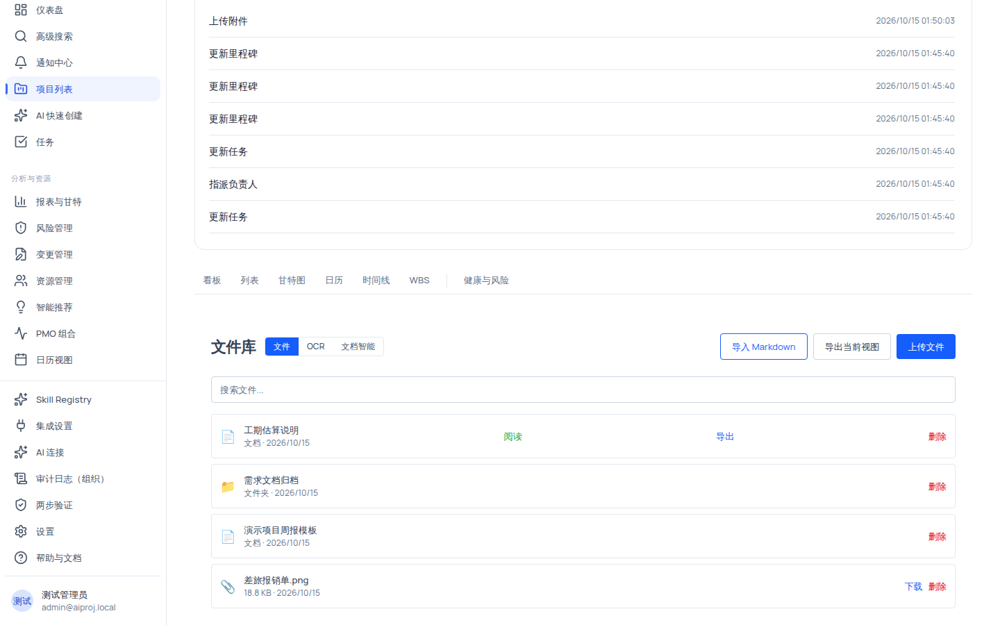

# OCR 文档识别：从图片到可确认文本

OCR 工作台位于项目文件库的「OCR」tab，把图片中的文字提取为可编辑文本。提取结果**必须经人工审查确认**后才允许进入下游（搜索索引、结构化提取、实体关联）；OCR 不会自动把文本当作真实项目事实写入任何正式数据。

## 适用范围

- **适用角色**：六种规范角色均可查看与使用（需要 `file:view`）；识别作业的创建与审查走后端「file:manage / OCR」权限链路（组织管理员、项目经理完整可用；其他角色为只读态，可查看状态与已确认结果，无法执行管理类操作）。
- **所需权限**：`file:view`（进入 OCR 工作台、查看）、`file:manage`（创建识别、确认、下游操作）。
- **适用版本**：免费版、团队版、企业版。

> [!IMPORTANT]
> OCR 需要先在「设置 → AI 连接」中配置**带 OCR 能力的模型连接**（配置方法见「配置与使用 OCR 识别」）。未配置时，AI 连接页的「OCR 预览候选」下拉会显示「**没有可用 OCR 模型**」，文件库中的识别作业也无法成功——这是预期的未配置态，不是故障。

## 开始之前

- 你的组织已配置可用的 OCR 模型连接（勾选了 OCR 能力的模型；专用 OCR 模型准确度更高）。
- 准备图片素材：仅支持 **PNG / JPEG / WebP** 三种格式；单文件 ≤ **10MB**；预览图片 ≤ 2MB；不支持 PDF 与 Office 文档。
- 图片文字清晰、方向正常、光线充足，识别准确率更高。

## 操作步骤

### 步骤 1：上传图片并进入 OCR 工作台

1. 打开 `/projects/{项目ID}/files`，点击右上角 **「上传文件」** 选择一张 PNG/JPEG/WebP 图片；你会看到列表出现附件行（📎）。
2. 因为存在 OCR 支持的文件，标题栏出现「文件」「OCR」「文档智能」三个 tab；切换到 **「OCR」** tab。
3. 你会看到筛选与状态区：文件行显示「**未识别**」状态徽标，行内主按钮为「**识别文字**」。筛选 chips（全部/待审查/处理中/已确认/失败/未识别/已阻止/已过期）带计数。

### 步骤 2：创建识别作业

1. 在文件行点击 **「识别文字」**；行状态从「未识别」变为「**排队中**」或「**处理中**」，同时显示 `x/y 页` 进度（多页图片时页数推进会更新）。
2. 完成后的状态可能是「**待审查**」（OCR tab 角标 +1，琥珀色）或「**失败**」（可「重试」）。
3. 行内还可能显示：`警告 × N`、阻止原因、`≈ 0.xxxx {货币}` 预估成本、`源已变更`（stale）等标记。10 种状态的含义见下表的「状态字典」。

### 步骤 3：审查并确认提取结果

1. 对「待审查」的文件行点击 **「审查」**，打开 OCR 文档详情抽屉；抽屉有 5 个 tab：**概览 / 作业 / 审查 / 下游 / 治理**。
   - 「概览」：文件信息（文件名、MIME 类型、OCR 支持 是/否）、最新作业（作业 ID、状态、页面进度、服务商 model）、预估费用、警告、可用操作。
   - 「作业」：当前作业详情；可「重试此作业」或「进入审查」。
   - 「审查」：说明「审查 OCR 作业的输出结果。确认操作将受到预览哈希和显式用户确认的保护。」；点击 **「打开审查面板」** 跳转到文档智能 tab 的审查确认面板。若当前状态不可审查，会显示琥珀提示「当前状态不允许审查操作。原因：{原因}」。
2. 在审查确认面板（OCR 审查工作台）中：查看「作业状态」「供应商」「已接受的提取记录」「提取文本」；在「审查备注（可选）」填写备注（placeholder「添加审查备注...」）。
3. 核对文本与图片一致后点击 **「确认保存」**；成功时你会看到 toast「**确认保存成功！**」。此时状态变为「**已确认**」。

> [!WARNING]
> OCR 工作区**不提供「自动应用」或「一键执行」功能**。任何产生写入、索引、导出、抽取快照或清理的操作都会跳转到各自的预览/确认面板，由你人工确认后才执行——这是产品红线「AI 只建议、不自动执行」在 OCR 域的落地。

### 步骤 4：进入下游（索引 / 提取 / 关联）

1. 需要确认后的提取结果才能进入下游。在详情抽屉「下游」tab 查看三项：
   - **索引**（search_index）：为已确认文本创建搜索索引条目。
   - **提取**（structured_extraction）：从已确认文本中提取结构化数据。
   - **关联**（entity_linking）：链接到相关任务、WBS、风险或其他实体。
2. 空态提示「没有已确认的提取结果 / 请先完成 OCR 审查并确认提取」时，先回到步骤 3 完成确认。
3. 每个下游面板都要求「先预览、再确认」：例如「OCR 搜索索引」面板展示「索引预览」「预览条目（前 10 条）」，「取消索引确认」对话框在确认前拦截。

### 步骤 5：查看治理信息（可选）

在抽屉「治理」tab 查看：保留策略、隐私策略、权限状态（「允许操作：{列表}」或「无」）、审计日志（仅事件计数/操作类型/时间戳/结果状态，**不显示原文**）、服务商与成本。这些信息帮助判断该文件的合规状态。

## 状态字典（10 态）

| 状态标签 | 含义                                            | 可执行的主操作                |
| -------- | ----------------------------------------------- | ----------------------------- |
| 不支持   | 文件 MIME 不在 OCR 支持列表（非 png/jpeg/webp） | 无（不可识别）                |
| 未识别   | 尚未创建识别作业                                | 识别文字                      |
| 排队中   | 作业已创建，等待处理                            | 无                            |
| 处理中   | 正在识别，显示 `x/y 页` 进度                    | 无                            |
| 失败     | 识别失败                                        | 重试                          |
| 待审查   | 识别完成，等待人工确认                          | 审查/确认                     |
| 已确认   | 人工确认完成                                    | 索引/结构化提取/实体关联/导出 |
| 已过期   | 来源已变更（stale），结果不再可信               | 重新识别                      |
| 已阻止   | 被治理/权限阻止，显示阻止原因                   | 按原因解除后重试              |
| 降级     | 服务降级态                                      | 按降级原因处理                |

**阻止原因标签**：`保留限制` / `隐私限制` / `已过期` / `已清除` / `权限不足` / `不可访问` / `文件不支持`。

## 验证结果

- 上传 png/jpeg/webp 图片后，OCR tab 出现该文件且状态为「未识别」。
- 点击「识别文字」后进度推进，完成后状态变为「待审查」，OCR tab 角标 +1。
- 审查面板确认保存后出现 toast「确认保存成功！」，状态变为「已确认」。
- 确认后的文件才允许创建搜索索引/结构化提取/实体关联；未确认时下游为空态提示。
- 未配置 OCR 模型时：AI 连接页「OCR 预览候选」显示「没有可用 OCR 模型」，识别作业无法成功——如实标注为配置缺口，而非产品故障。

## 安全与边界限制

- **AI 只建议、不自动执行**：识别、提取、索引、关联全部需要人工预览与确认；确认操作受预览哈希与显式用户确认双重保护。
- **格式边界**：仅图片（PNG/JPEG/WebP），不支持 PDF/Office；附件 ≤ 10MB；预览图 ≤ 2MB；审查提示词 ≤ 500 字符。
- **下游依赖**：搜索索引/结构化提取/实体关联必须先有**已确认的提取结果**。
- **治理与审计**：保留/隐私策略在组织级配置；审计日志不展示原文字内容。
- **组织隔离**：OCR 作业与结果按组织隔离；跨组织不可见。
- **配置依赖**：OCR 依赖组织已配置的 OCR 模型连接；未配置时呈现「没有可用 OCR 模型」的诚实空态。

## 常见问题

**症状：AI 连接页显示「没有可用 OCR 模型」。**
可能原因：组织尚未配置勾选 OCR 能力的模型连接，或连接已停用/未设置 API Key。
检查：「设置 → AI 连接」中连接状态与能力勾选。
修复：按「配置 AI 连接」新建或启用一个带 OCR 能力的连接（可先用「OCR 预览候选」验证提取效果）。
仍失败时：记录连接名称与模型名，到帮助中心「故障排查 → OCR」查找。

**症状：识别后状态一直是「失败」。**
可能原因：图片模糊/方向错误、模型不适配，或来源文件已变更。
检查：图片清晰度；行内警告与失败时间。
修复：点击「重试」；仍失败则换清晰图片并确认模型能力。

**症状：点击「审查」提示「当前状态不允许审查操作。原因：{原因}」。**
可能原因：状态不是「待审查」（例如已过期、已阻止），或权限不足（只读态角色）。
检查：当前状态与阻止原因标签（保留限制/隐私限制/权限不足等）。
修复：按原因解除（换文件、恢复来源、申请权限）后重试。

**症状：「下游」tab 三项按钮不可用。**
可能原因：尚无已确认的提取结果。
检查：是否完成步骤 3 的确认保存。
修复：先完成审查确认，再进入下游。

## 下一步

- [项目文件库：上传、阅读与 Markdown 导入导出](/help/articles/knowledge.files-library)
- [配置与使用 OCR 识别](/help/articles/ai.configure-ocr)
- [配置 AI 连接](/help/articles/ai.configure-ai-connections)
- [故障排查：OCR 无法识别](/help/articles/troubleshooting.ocr)
