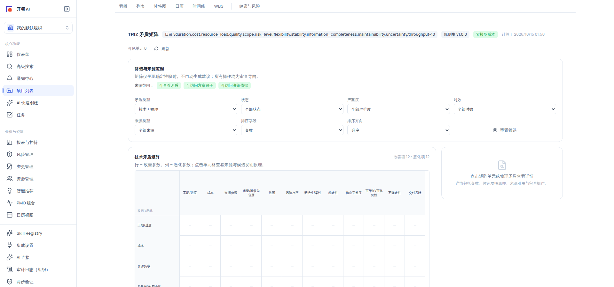

# TRIZ 矛盾矩阵：参数热力图与候选原理

矛盾矩阵把项目内规则派生的「改善项 ↔ 恶化项」对立信号铺成一张参数热力图：横轴为改善参数、纵轴为恶化参数，点击单元即可查看候选发明原理与来源证据。矩阵计算全部是**确定性规则，零模型成本**（页面带「零模型成本」绿徽标）；AI 只用于可选的解释增强，失败时会明确降级，不影响矩阵本身的使用。

## 适用范围

- **适用角色**：六种规范角色均可查看（需要 `contradiction:view`，项目成员）。
- **所需权限**：`contradiction:view`（查看矩阵）；「加入方案篮子」另需工作台可用性（`triz_innovation:view`），打开审查/交接另需 `triz_innovation:handoff` 与 `rationale:view`。
- **适用版本**：免费版、团队版、企业版。
- **进入路径**：`/projects/{项目ID}/triz/contradiction-matrix`；项目头摘要卡「查看矩阵」也可进入本页。
- **与「项目矛盾」的区别**：`/projects/{项目ID}/contradictions` 是**规则派生矛盾列表**（确认/忽略）；本页是**参数矩阵热力图**（筛选/查看/引用）。两者是不同页面，项目头摘要卡会分别链向它们（「查看矩阵」「查看全部」）。

## 开始之前

- 项目内已运行过矛盾刷新（「项目矛盾」页的「刷新矛盾」是只读确定性规则，不调 AI、不改项目数据），或已有 TRIZ 分析产物，否则矩阵为空态「暂无矛盾矩阵数据」。
- 无需任何 AI 模型连接即可使用矩阵的全部确定性功能。

## 操作步骤

### 步骤 1：读取头部状态

打开 `/projects/{项目ID}/triz/contradiction-matrix`，查看头栏：

- `规则集 v{版本}` 徽标：当前确定性规则集版本。
- `零模型成本` 绿徽标：本页核心计算不消耗模型调用。
- `计算于 {时间}` 与 `可见单元 {n}`：矩阵渲染的可见单元数（只渲染项目数据中实际出现的参数组合）。
- 全局警告摘要 Alert：「共 {n} 条」（blocking > 0 时为红色）。
- 无权限时页面显示「当前角色无权查看 TRIZ 矛盾矩阵。」；加载失败显示「无法加载矛盾矩阵数据，请稍后重试。」。

### 步骤 2：理解矩阵布局

1. 矩阵按「**改善参数横轴 × 恶化参数纵轴**」组织，参数轴来自项目的参数目录。
2. 单元状态：
   - 有矛盾：热力格显示来源数与严重度点；悬停 aria 提示 `改善 {参数} 恶化 {参数}`。
   - 无已知矛盾：单元显示为占位（aria `无已知矛盾`）。
   - `无权限` / `不可用`：空标签单元。
   - `来源已过期` 标记：该单元来源已过期。
   - 无任何参数轴时，矩阵显示「目录中无可用的参数轴」。

> [!NOTE]
> 参数目录覆盖 39 项改善参数 × 40 项恶化参数；页面只渲染项目数据中出现的参数轴（「可见单元 {n}」），因此实际可视矩阵规模随数据变化——例如本帮助文档配图所在的项目环境仅为 12×12 可视窗口，并非矩阵上限。

### 步骤 3：筛选与来源范围

在「筛选与来源范围」卡中设置六个下拉（均可组合）：

| 下拉            | 选项                                                                                          |
| --------------- | --------------------------------------------------------------------------------------------- |
| 来源范围        | 可查看矛盾 / 无查看权限、可访问方案篮子 / 方案篮子不可访问、可访问决策依据 / 决策依据不可访问 |
| 矛盾类型        | 全部 → `技术 + 物理` / `技术矛盾` / `物理矛盾`                                                |
| 状态            | 全部状态 / 草稿 / 已确认 / 已驳回 / 已替代                                                    |
| 严重度          | 全部严重度 / 严重 / 高 / 中 / 低                                                              |
| 时效            | 全部时效 / 仅已过期 / 仅最新                                                                  |
| 来源类型        | 全部来源 / 矛盾记录 / TRIZ 分析 / 决策依据 / 方案篮子                                         |
| 排序字段 + 方向 | 参数 / 严重度 / 置信度 / 来源数 / 时效 + 升序/降序                                            |

筛选为「物理矛盾」时，技术矩阵收起，显示说明「当前筛选为「物理矛盾」，技术矩阵已收起」；筛选为「技术矛盾」时物理矛盾卡收起（「当前筛选为「技术矛盾」，物理矛盾已收起」）。

### 步骤 4：查看矛盾详情

1. 点击矩阵单元（或「物理矛盾」卡中的条目）打开详情面板（`技术矛盾详情` / `物理矛盾详情`）：
   - `置信度 {n}%` 或区间徽标。
   - **候选发明原理**：名称与相关说明；空则「暂无确定性候选原理。」。
   - **来源引用** 与 **警告摘要**；来源已过期时出现 `来源已过期` Alert。
   - **决策依据** 与 **参数引用**（物理矛盾另有「对立要求」区块）；空则「暂无可展示证据。」。
2. 空态提示「点击矩阵单元或物理矛盾查看详情」/「暂无确定性候选原理。」/「暂无可展示证据。」按场景出现。

### 步骤 5：使用单元动作

单元/详情面板可用动作（按权限显示）：

| 动作         | 说明                                       | 权限                                 |
| ------------ | ------------------------------------------ | ------------------------------------ |
| 查看依据     | 查看该单元的证据与依据                     | `rationale:view` 等                  |
| 加入方案篮子 | 把该矛盾作为候选路径加入创新工作台方案篮子 | 工作台可用（`triz_innovation:view`） |
| 打开审查     | 打开该矛盾的审查入口                       | `triz_innovation:handoff`            |
| 复制引用     | 复制该矛盾的引用标识（hash 等）            | 查看                                 |

失败时会看到明确提示：`无法确定当前用户或组织，请重新登录后重试` / `加入方案篮子失败` / `打开审查失败`。

## 验证结果

- 项目刷新矛盾后，矩阵出现热力格（来源数 + 严重度点），头栏「可见单元 {n}」增长。
- 筛选任一维度后矩阵/物理矛盾卡按条件收起或更新；「仅最新」排除过期来源。
- 点击单元打开详情，展示置信度、候选发明原理、来源引用与警告摘要。
- 「加入方案篮子」成功后，对应矛盾出现在创新工作台的方案篮子来源中。
- 即使未接入 AI 模型，上述全部确定性功能可用；页面维持「零模型成本」徽标。

## 安全与边界限制

- **零模型成本**：矩阵的规则派生、渲染、筛选、候选原理全部为确定性计算；AI 仅为可选的解释增强。
- **AI 降级**：AI 相关增强（如解释）在未连接模型或服务失败时显示「AI 已降级」/`Fallback` 等降级提示，矩阵功能不受影响。
- **确认与决策边界**：「加入方案篮子」「打开审查」交接后，任何正式落地仍需方案/草案层的人工审查与 Apply 确认。
- **双页区分**：确认/忽略矛盾请在「项目矛盾」页（`/projects/{id}/contradictions`）进行；本页不提供确认/忽略动作。
- **组织隔离**：矩阵数据严格按项目与组织隔离；`无权限` 单元即按可见性排除后的占位。

## 常见问题

**症状：矩阵为空，提示「暂无矛盾矩阵数据」。**
可能原因：项目尚未运行矛盾刷新，或没有可派生的矛盾数据。
检查：「项目矛盾」页是否有条目；点击「刷新矛盾」（只读确定性规则，不调 AI）。
修复：刷新后再回矩阵页查看。

**症状：某些单元显示「无权限」或「不可用」。**
可能原因：来源范围设置（可查看矛盾/可访问方案篮子/可访问决策依据）不满足，或数据不可用。
检查：「筛选与来源范围」卡中的三个来源范围项。
修复：调整来源范围或由管理员授予对应查看权限。

**症状：详情面板提示「暂无确定性候选原理。」**
可能原因：该参数组合没有命中候选原理规则，或来源已过期。
检查：警告摘要与 `来源已过期` Alert。
修复：刷新项目矛盾后重看；过期来源需先恢复时效。

**症状：点击「加入方案篮子」提示「加入方案篮子失败」。**
可能原因：编码/会话过期（提示「无法确定当前用户或组织，请重新登录后重试」）或工作台不可访问。
检查：登录态与工作台权限（`triz_innovation:view`）。
修复：重新登录后重试；仍失败联系管理员。

## 下一步

- [TRIZ 创新工作台：方案篮子与候选路径对比](/help/articles/knowledge.triz-workbench)
- [AI-TRIZ 助手：对话式分析与工具推荐](/help/articles/knowledge.triz-assistant)
