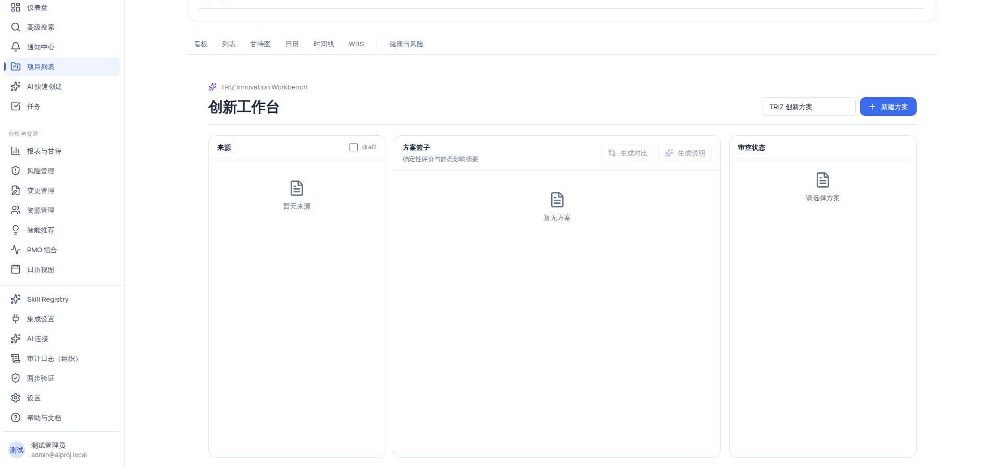

# TRIZ 创新工作台：方案篮子与候选路径对比

创新工作台把 TRIZ 工具链的产出聚合到一起：从「来源」（未确认的矛盾、TRIZ 分析产物）中收集候选路径，放入**方案篮子**，生成**确定性评分与静态影响摘要**（六维影响对比），最后在「审查状态」栏确认后**创建待审核草案**。整个过程遵循「确定性 TRIZ 工具路由 · 只建议，不自动执行」——AI 只做可选说明，不自动落库。

## 适用范围

- **适用角色**：查看需要 `triz_innovation:view` **且** `contradiction:view`（双权限；六种规范角色均可查看）；**加入来源/新建方案/生成对比**需要 `triz_innovation:manage`；**创建待审核草案**需要 `triz_innovation:handoff`；**生成说明**需要 `ai:trigger`。
- **所需权限**：`triz_innovation:view`、`contradiction:view`、`triz_innovation:manage`、`triz_innovation:handoff`。
- **适用版本**：免费版、团队版、企业版。
- **进入路径**：`/projects/{项目ID}/triz-workbench`（当前无侧栏入口；可从项目头「创新工作台」相关链接进入，或直接输入 URL）。

## 开始之前

- 项目内已存在**未确认的矛盾**（来自「项目矛盾」页面的规则派生，或分析产物），否则「来源」栏为空态「暂无来源」。
- 需要「生成对比」时，先保证篮子内至少有一个候选路径。
- 确认角色权限：manage/handoff 主要面向组织管理员与项目经理；只读角色可查看对比结果，但无法新建/对比/交接。

## 操作步骤

### 步骤 1：创建方案并加入候选路径

1. 打开 `/projects/{项目ID}/triz-workbench`；你会看到三栏布局：**来源 / 方案篮子 / 审查状态**。无权限时页面显示「无权限查看 TRIZ 创新工作台」；加载失败时显示「工作台加载失败」。
2. 在头部输入方案名称（aria-label「方案名称」，默认值「TRIZ 创新方案」），点击 **「新建方案」**（仅 manage；名称为空时按钮禁用）。
3. 在**来源栏**勾选或浏览来源：来源=未确认**矛盾** + TRIZ **分析**产物（行内标题「TRIZ 分析 {artifactId}」）；每行带严重度徽标（严重/高/中/低）与 `已过期` 标记。
4. 点击目标来源行的 **「加入方案」**（仅 manage）；加入时方案名取来源标题（缺失时用 `{sourceType}:{ref}`），描述固定为「待人工审查的 TRIZ 创新候选路径」。
5. 在**方案篮子栏**左侧选择你的方案：显示 `{方案名}` + `{n} 个候选`；右侧对比表出现候选路径行。空态文案：「暂无方案」/「尚未加入候选路径」。

### 步骤 2：生成确定性对比

1. 点击方案篮子右上角 **「生成对比」**（仅 manage）；系统按确定性命中规则计算候选路径评分与六维影响，对比表更新。
2. 阅读对比表列：`候选路径` / `分数` / 六维影响 / `Warning`。六维影响与取值如下表：

| 影响维度   | 可选值                      | 说明                   |
| ---------- | --------------------------- | ---------------------- |
| 工期       | 改善 / 加重 / 中性 / 不确定 | 对项目工期的影响方向   |
| 资源负载   | 改善 / 加重 / 中性 / 不确定 | 对资源负载的影响方向   |
| 风险       | 改善 / 加重 / 中性 / 不确定 | 对风险的影响方向       |
| 范围弹性   | 改善 / 加重 / 中性 / 不确定 | 对范围弹性的影响方向   |
| 质量维护   | 改善 / 加重 / 中性 / 不确定 | 对质量维护的影响方向   |
| 变更复杂度 | 改善 / 加重 / 中性 / 不确定 | 对变更复杂度的影响方向 |

> [!NOTE]
> 评分与六维影响是**确定性规则计算的静态摘要**（非 AI 生成），即使未接入任何 AI 模型也可以完成对比。

3. 需要 AI 解读时，点击 **「生成说明」**（Sparkles 图标，需 `ai:trigger`）；AI 说明会显示在审查状态栏，「AI 说明」区带 `已校验` 或 `Fallback` 徽标与 `tokens {n} · cost {n}` 成本信息。

### 步骤 3：审查状态与创建待审核草案

1. 在**审查状态栏**选择方案，查看瓦片：`状态` / `Handoff` / `Warning` / `Hash`；空态「请选择方案」。
2. 点击 **「查看详情」** 打开「方案详情」抽屉，查看：
   - **来源 refs**：`已过期`/`有效` 徽标 + `{sourceType}:{ref} · {hash 前 16 位}`；空则「暂无来源。」。
   - **评分明细**：严重度/置信度/warning/hash/适用性/评审 + 总分徽标（未评分为「未评分」）。
   - **AI 说明状态**：`Fallback`/`通过校验` + `{provider} / {model}`；空则「暂无 AI 说明。」。
   - **审计摘要**：创建人/创建时间/更新时间/复核时间/对比 ref。
   - **Draft Layer**：「打开草案」→ `/draft-layer/{sessionRef}`。
3. 点击 **「创建待审核草案」**（仅 handoff；options 为空或 handoff=stale 时按钮禁用，blockedReason 以红字显示原因）；成功创建后可在审查状态栏看到新的 Handoff 状态。

> [!WARNING]
> 「创建待审核草案」只是进入草案层等待审查；**正式项目数据仍需草案预览、差异对照（Preview/Diff/dry-run）与人工 Apply 确认**——工作台不会自动修改任何正式实体。

## 验证结果

- 新建方案后，方案篮子出现 `{方案名} + {n} 个候选`（初始 0 个候选，空态「尚未加入候选路径」）。
- 「加入方案」后对比表出现候选路径行；「生成对比」后分数与六维影响徽标（改善/加重/中性/不确定）更新。
- 「生成说明」后，审查状态栏显示 AI 说明与 tokens/cost；未接 AI 或失败时显示 `Fallback` 徽标与降级提示。
- 「创建待审核草案」后 Handoff 瓦片有值；options 为空或来源已过期时按钮禁用并有原因说明。
- 无 `triz_innovation:manage` 的角色：看不到「新建方案」「加入方案」「生成对比」按钮；无 permission 时页面显示「无权限查看 TRIZ 创新工作台」。

## 安全与边界限制

- **AI 只建议、不自动执行**：评分/六维影响是确定性计算，AI 仅用于「生成说明」（可选，失败时降级为 Fallback）；草案创建只写尽调态，不触碰正式项目数据。
- **权限分层**：view（查看）/ manage（建方案、加入、对比）/ handoff（创建草案）/ ai:trigger（AI 说明）四级分明；只读角色停留在查看层。
- **来源时效**：来源过期（stale）会阻断加入、对比与 handoff——先刷新项目矛盾（只读确定性规则，不调 AI）再回来。
- **组织隔离**：方案与来源严格按项目/组织隔离。

## 常见问题

**症状：「来源」栏为空（「暂无来源」）。**
可能原因：项目内尚无派生矛盾或分析产物。
检查：打开「项目矛盾」页面点击「刷新矛盾」（只读收集项目事实并运行确定性规则，不会触发 AI 或修改项目数据）。
修复：刷新后有矛盾来源后再回到工作台。

**症状：「创建待审核草案」按钮禁用。**
可能原因：options 为空（篮子没有候选路径），或 handoff=stale（来源已过期），blockedReason 红字会说明。
检查：审查状态栏的 Warning/blockedReason。
修复：先加入候选路径并重新生成对比；来源过期则先刷新矛盾。

**症状：对比表某些列看不全。**
可能原因：对比表列较多（候选路径/分数/六维影响/Warning 共 9 列），容器横向裁剪属产品布局现状（截图中仅前 5 列完整呈现）。
检查：横向滚动或调整窗口大小。
修复：横拖动查看其余列；裁剪不是数据缺失。

**症状：无权限提示「无权限查看 TRIZ 创新工作台」。**
可能原因：缺少 `triz_innovation:view` 或 `contradiction:view` 之一（页面双权限校验）。
检查：账号角色。
修复：联系组织管理员授予相应权限。

## 下一步

- [TRIZ 矛盾矩阵：参数热力图与候选原理](/help/articles/knowledge.triz-contradiction-matrix)
- [AI-TRIZ 助手：对话式分析与工具推荐](/help/articles/knowledge.triz-assistant)
