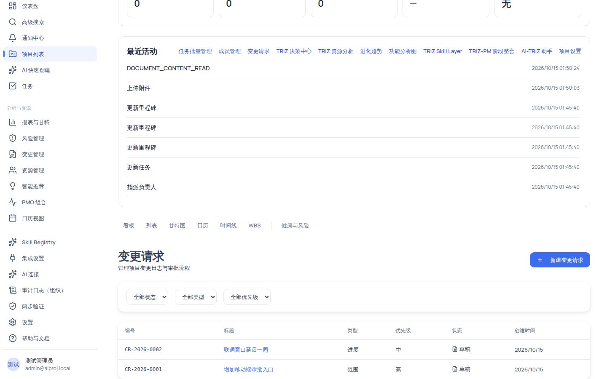
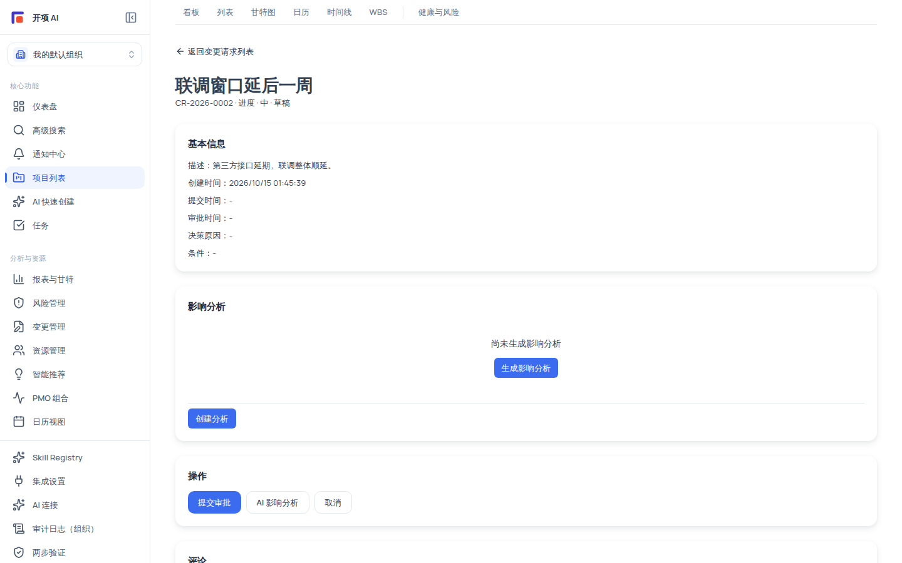

# 变更管理：请求生命周期与影响分析

变更请求按项目登记，生命周期为：**草稿 → 提交审批 → 批准/拒绝/退回 → 标记已实施 → 关闭**（也可随时取消）。每个请求携带标题、描述、变更类型、优先级与六维影响摘要；V2 起可生成**确定性规则引擎**的影响分析快照作为审批证据。全程两条红线：**AI 只建议不执行**（影响分析是规则引擎而非真实 AI，"AI 影响分析"按钮当前返回内置模板），**审批引用只作证据留存，不自动修改任何任务、依赖、资源或基线**。

## 适用范围

| 角色                    | 变更管理能力                                                             | 影响分析能力                                            |
| ----------------------- | ------------------------------------------------------------------------ | ------------------------------------------------------- |
| 组织管理员 / 项目经理   | 创建、提交、取消、标记已实施 + 审批（批准/拒绝/退回/关闭）               | 查看 + 生成/刷新/确认/AI 解释（`change_impact:manage`） |
| 成员（member）          | 创建、提交、取消、标记已实施；**不可审批**                               | 查看 + 生成分析（无刷新/确认/AI 解释）                  |
| 外部协作者 / 只读观察者 | 无 `change_request:create`：无导航入口，直接访问显示「无权查看变更请求」 | 理论上有 `change_impact:view`，因无入口实际到不了       |

审批动作以服务端 RBAC 为准（`change_request:approve` 且**请求人不得自批**）：审批按钮对能进页面的用户可见，但没有权限时点击会返回「操作失败，请检查权限或状态后重试。」——按钮可见不代表可执行。

## 开始之前

- 变更请求是**项目级**能力：先确定目标项目，不支持跨项目聚合列表。
- 每个请求有全局唯一业务编号 `CR-YYYY-NNNN`（按年自增、跨组织不重复）。
- 准备好变更描述与六维影响（范围/进度/资源/成本/风险/假设）；后续会生成影响分析，先关联任务/文档可获得更完整的分析结果。

## 操作步骤

### 步骤 1：进入变更管理

左侧导航「分析与资源 → 变更管理」（`/change-requests`，需要 `change_request:create`）。枢纽页不做聚合列表，而是列出组织内项目卡片（名称 + 编码，无编码显示「未设置编码」），点击项目卡进入该项目的变更请求列表（`/projects/:id/change-requests`）。无项目时显示「还没有项目」；项目取前 50 个。

列表页每页 20 条，表格列：**编号**（mono 字体）/ **标题**（链接进详情）/ **类型** / **优先级** / **状态**（图标 + 中文）/ **创建时间**。筛选栏三个下拉：

| 筛选   | 选项                                                                      |
| ------ | ------------------------------------------------------------------------- |
| 状态   | 全部状态 + 草稿/已提交/审核中/已批准/已拒绝/退回修改/已实施/已关闭/已取消 |
| 类型   | 全部类型 + 范围/进度/成本/资源/质量/风险/其他                             |
| 优先级 | 全部优先级 + 低/中/高/紧急                                                |

**注意**：「审核中」状态在状态机中合法但没有入口可达，提交审批后状态直接是「已提交」，不要等待"审核中"出现。

### 步骤 2：新建变更请求（创建即草稿）

点击「新建变更请求」进入表单（`/projects/:id/change-requests/new`）：

**基本信息卡**：

| 字段     | 必填 | 默认值 | 约束                               |
| -------- | ---- | ------ | ---------------------------------- |
| 标题     | 是   | —      | 1–255 字符；为空时提交按钮禁用     |
| 描述     | 否   | —      | ≤5000 字符                         |
| 变更类型 | 否   | 其他   | 范围/进度/成本/资源/质量/风险/其他 |
| 优先级   | 否   | 中     | 低/中/高/紧急                      |

**影响摘要卡**：六个 textarea（范围影响/进度影响/资源影响/成本影响/风险/假设），全部留空时摘要不提交。

点击「创建草稿」→ 成功后跳转到详情页。创建失败时页面显示「创建失败：{错误消息}」。

### 步骤 3：提交审批与处置（详情页操作区）

详情页自上而下为：返回链接、标题区（`{crCode} · {类型} · {优先级} · {状态}`）、基本信息卡（描述/创建时间/提交时间/审批时间/决策原因/条件，无值显示 `-`）、影响摘要卡、影响分析卡、操作卡、评论卡（项目内评论线程）。

操作区按钮随状态变化：

| 状态                     | 可用操作                      |
| ------------------------ | ----------------------------- |
| 草稿 / 退回修改          | 提交审批 · AI 影响分析 · 取消 |
| 已提交                   | 批准 · 拒绝 · 退回修改 · 取消 |
| 已批准                   | 标记已实施                    |
| 已实施                   | 关闭                          |
| 已拒绝 / 已关闭 / 已取消 | 无（终态，不可再操作）        |

提交审批由请求人执行（仅草稿/退回状态）；提交后状态变为「已提交」。

审批（已提交状态）操作前填写：**审批意见（可选）**、**批准条件（有条件批准时填写）**；若当前存在影响分析快照，可勾选「审批时引用当前影响分析快照（#N）作为决策证据」（默认勾选，引用仅作证据留存，不会自动修改任务、依赖、资源或基线）。**若快照已过期**，必须填写"确认继续使用的理由"，否则整个审批会被阻断并回滚，提示「影响分析已过期：{原因}」。

退回修改后，请求人可重新「提交审批」或「取消」；当前界面**没有编辑入口**（后端支持编辑但前端未提供 UI），如需修改内容请走退回并重新提交的流程。

### 步骤 4：生成影响分析（规则引擎，非 AI）

「影响分析」面板（`change_impact:view` 可见「生成影响分析」）：

1. **生成**：点击「生成影响分析」（`change_impact:view` 即可创建分析）。分析由**确定性规则引擎**完成（R001–R009，规则版本 2.0.0，可复现、可审计，**不调用 LLM**），输出严重度分布（严重/高/中/低/无）、受影响项列表（每项含实体 `task:12` 形式、规则号、传播路径链、深度，"需要人工复核"项有黄色提醒）与 warnings。
2. **刷新 / 确认**（`change_impact:manage`）：项目事实变化或规则版本升级后分析会变"已过期"，面板提示「影响分析已过期：{原因}」并给出两个选择——刷新生成新快照（旧快照保留），或填写理由"确认继续使用"。既不想刷新也无法确认时，过期分析不能作为审批证据。
3. **AI 解释**（`change_impact:manage`）：生成解释文本，结果标注「（待人工确认）」；当前默认由规则模板生成（接入真实模型需环境变量开关）。

> [!NOTE]
> 影响分析全程只读：不修改任务、依赖、WBS、里程碑、资源、风险或基线；审批时的引用只是把快照内容留作决策证据。

### 步骤 5：明白「AI 影响分析」按钮的真实边界

草稿/退回状态下的「AI 影响分析」按钮会弹出一个浏览器提示框，展示六维 AI 建议文本（范围/进度/资源/成本/风险/假设）+「置信度：75%」「来源：ai_generated」+ 明确的警示：**「AI 建议仅供参考，需人工确认后才可保存。」**

如实说明：当前版本该功能返回的是**内置模板结果，未接入真实模型**（代码实现为简化版模拟结果），且**永不自动保存**——不会覆盖影响摘要、不改变草稿状态、不自动提交审批。请把它当作格式化的建议草稿，不要依赖它的具体内容做决策。

### 步骤 6：查看变更日志与审计

「变更日志」没有独立页面：项目变更请求列表本身就是变更台账。每一次状态迁移与操作都会写入**审计日志**（`CHANGE_REQUEST_CREATED/SUBMITTED/APPROVED/REJECTED/RETURNED/IMPLEMENTED/CLOSED/CANCELLED` 以及影响分析的 `CHANGE_IMPACT_*` 事件，含"审批引用"关键事件），由组织管理员/系统管理员在「管理员 → 审计日志」查看。

## 验证结果

- 新建后详情页标题区显示「草稿」，操作区出现「提交审批」；提交后状态变为「已提交」且审批按钮出现。
- 生成影响分析后面板显示严重度分布与受影响项；操作卡出现「引用当前影响分析快照」勾选。
- 批准后状态「已批准」，操作区只剩「标记已实施」；实施后「关闭」；终态（已拒绝/已关闭/已取消）不可再操作。
- 全部关键动作可在审计日志中找到对应 `CHANGE_REQUEST_*` 事件。

## 常见问题

**症状：提示无权访问变更管理。**
可能原因：缺少 `change_request:create`（外部协作者/只读观察者没有该权限）。
处理：联系组织管理员调整角色后重新登录。

**症状：审批点击后提示「操作失败，请检查权限或状态后重试。」**
可能原因：非审批角色（member）操作，或请求人试图自批，或状态不匹配。
处理：核对角色与状态；审批必须由具备 `change_request:approve` 且非请求人的用户执行。

**症状：影响分析一直空或只有 warning。**
可能原因：变更请求未关联任务/文档（`relatedTaskIds`/`relatedDocumentIds` 当前仅数据层可写，界面无法关联），分析缺少输入。
处理：查看 warnings 中的具体原因；「关联任务未找到或无权限查看」类 warning 不属于错误，属数据前提不足。

**症状：审批被拦截提示「影响分析已过期」。**
处理：回详情页影响分析面板「刷新分析」，或填写理由「确认继续使用」后再审批。

**症状：找不到跨项目的变更汇总。**
说明：变更请求按项目管理，无跨项目聚合；顶层 `/change-requests` 只是项目选择枢纽。
处理：进入目标项目后查看该项目的变更列表。

**症状：要求删除一条变更请求。**
说明：变更请求没有删除功能；已是终态（已拒绝/已关闭/已取消）的记录不可再操作，会永久留痕以供审计。

## 安全与限制

- **AI 只建议、不执行**：AI 影响建议永不自动保存/提交；影响分析与 AI 解释只读，不修改任何业务事实。
- **组织隔离**：跨组织访问一律返回与"不存在"一致的 404（`变更请求不存在`/`项目不存在`/`影响分析不存在`）。
- **状态机约束**：非法迁移返回 400（`不允许从 {from} 变更到 {to}`）；终态不可逆。
- **审批证据**：影响分析引用仅作证据留存，不会自动修改任务、依赖、资源或基线；过期分析无确认理由时阻断审批。

## 下一步

- [项目问题与风险：登记册、矩阵与 AI 建议](/help/articles/management.issues-and-risks)
- [报表与 BI：V1 模板报表与 V2 报表工作台](/help/articles/management.reports)
- [审计日志与安全](/help/articles/admin.security-audit-and-dlp)
- [权限参考](/help/articles/reference.permissions)
