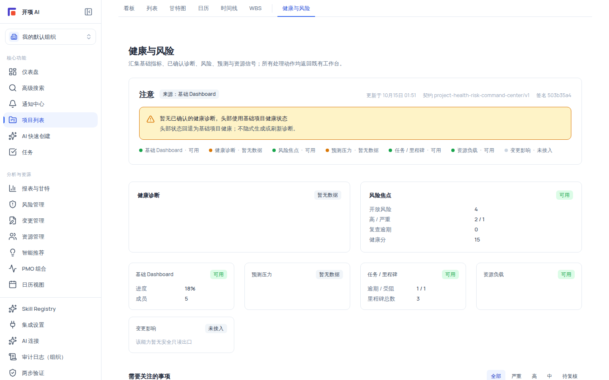

# 健康与风险指挥中心：只读态势总览

「健康与风险」指挥中心把项目的基础指标、已确认诊断、风险、预测与资源信号**汇集到一个只读页面**：头部健康态势、来源新鲜度条带、来源摘要与「需要关注的事项」注意力队列。它**不生成、不刷新、不确认任何领域事实**——所有处理动作都通过「前往处理」跳回既有工作台完成，目标页会再次做权限校验。

## 适用范围

- 项目成员即可访问（项目门 `project:view`；跨组织/软删项目/无权限统一显示 404「项目不存在」）。
- 维度裁剪：缺少 `risk:view` / `resource:view` / `change_impact:view` 时，对应来源显示「当前账号无该维度查看权限」并缺席，但**不阻止整页加载**。
- 预测来源无独立权限门：项目可读即可看到最新预测快照摘要。
- 本页面适合项目经理、组织管理员做每日/每周态势巡检；成员可用它快速发现自己负责领域的待办信号。

## 开始之前

- 把指挥中心当作"仪表盘"而非"工作台"：这里只读，处置请前往对应工作台。
- 没有数据不代表"零风险"：页面会如实显示各来源「暂无数据/不可用/无权限」，请结合来源条带判断覆盖度。
- 若你配置了 AI 连接与风险数据，注意力队列通常更丰富；全新项目的开局页面会是大量"暂无数据"——这是正常空态。

## 操作步骤

### 步骤 1：进入指挥中心

在项目内顶部 Tab 找到「健康与风险」（位于基础 6 视图分隔线之后、我的视图之前），点击进入；直连 URL 为 `/projects/:id/health-risk-command-center`。

### 步骤 2：读头部健康态势

页面顶部是态势头部：**健康状态**（良好/注意/风险/未知）+ 来源徽章（「来源：已确认诊断」或「来源：基础 Dashboard」）+ **评分 N**（有分时显示）+ 右侧「更新于 M/D HH:mm」「契约 project-health-risk-command-center/v1」「签名 {projectionSignature}」。

头部优先级规则：**最新已确认且未过期的健康诊断**优先；否则回退为基础 Dashboard 派生的健康状态，并显示降级提示「暂无已确认的健康诊断，头部使用基础项目健康状态」（或「最新已确认健康诊断已过期…」）。头部**永不合成新的总体评分**——诊断与基础指标结论并存，不会捏造一个"总分数"。

### 步骤 3：看来源新鲜度条带

条带列出各来源与状态（彩色圆点 + 中文）：**可用 / 暂无数据 / 已过期 / 无权限 / 不可用 / 未接入**。来源包括：基础 Dashboard、健康诊断、风险焦点、预测压力、任务、里程碑、资源负载，以及变更影响（首期恒为「未接入」，显示"该能力暂无安全只读出口"——这是未接入占位，不是故障）。

### 步骤 4：读来源摘要卡片

来源摘要区按非等权栅格排布：**健康诊断、风险焦点**两张卡占主列，其余占次列。每卡含来源名、可用性徽章与事实摘要：

| 来源           | 摘要内容                                                         |
| -------------- | ---------------------------------------------------------------- |
| 风险焦点       | 开放风险 / 高 / 严重（`N / M`）/ 复查逾期 / 健康分（无则 `—`）   |
| 健康诊断       | overallScore + 标签 + 已过期徽章                                 |
| 任务 / 里程碑  | 逾期 / 受阻（`N / M`）、里程碑总数                               |
| 基础 Dashboard | 进度百分比、成员数                                               |
| 受限来源       | 「当前账号无该维度查看权限」；不可用来源显示「该来源暂时不可用」 |

### 步骤 5：处理注意力队列

「需要关注的事项」按严重度与优先级排列，顶部筛选按钮：**全部 / 严重 / 高 / 中 / 待复核**。每条目 = 严重度徽章（严重红/高橙/中灰）+ 标题 + 「需复核」徽章（stale 项）+ 来源名 + 到期时间，以及操作按钮：

- **查看证据**：在当前页打开证据抽屉（仅健康诊断类条目可用，见步骤 6）。
- **前往处理**：带上下文跳转到对应工作台——风险焦点 → 风险工作台、预测压力 → 预测页、任务 → 任务详情、资源 → 资源工作台、变更 → 变更请求列表。**这只是导航**：目标页会二次鉴权，"跳转即定位到某条具体记录"不被支持（详情深链参数目前无消费）。

空态文案如实说明：「当前没有需要立即关注的事项」+「这不代表零风险证明；各来源状态见上方条带，处理动作请前往对应工作台」。条目超过限制（默认 20 条，上限 100）时显示截断提示「已按稳定规则截断：显示 N 条，另有 M 条未展示」。部分条目会附带有序警告说明（如"该注意力项暂无安全处理入口，可展开证据查看详情"），点「知道了」关闭。

### 步骤 6：查看健康诊断证据抽屉

仅健康诊断类条目支持「查看证据」：抽屉标题「健康诊断证据」，视图为**只读证据视图（不含生成、刷新或确认操作）**，包含诊断编号、证据类别（已确认诊断）、新鲜度（当前有效 / 已过期）、确认时间、综合评分与 8 个维度得分（进度/关键路径/里程碑/资源/风险/变更影响/协作活跃度/数据完整性，严重度按 严重/高/中/低/提示 分级）。没有已确认诊断时显示「暂无已确认的健康诊断证据」——生成或确认诊断请前往既有的项目健康诊断流程，本页面不提供这些操作。

## 验证结果

- 页面只读：找不到任何"生成/刷新/确认"类控件；「前往处理」都落在既有工作台（二次鉴权）。
- 头部、条带、摘要、队列四处数据一致：有高/严重风险时注意力队列出现对应条目，风险焦点卡计数同步。
- 无维度权限时对应来源显示受限说明，其他来源不受影响。
- 数据按需更新（约 30 秒内自动刷新，页面无手动刷新按钮）。

## 常见问题

**症状：头部显示"注意"但有降级提示。**
原因：没有已确认且未过期的健康诊断，头部回退使用了基础 Dashboard 派生的健康状态。
处理：这不是故障——按需在既有健康诊断流程中生成/确认诊断，或直接看来源条带与风险焦点结论。

**症状：某个来源显示「该能力暂无安全只读出口」。**
说明：该来源（首期为变更影响）尚未提供安全只读出口，属未接入占位。
处理：忽略该位，采用其他来源信号。

**症状：注意力队列是空的。**
说明：空态不等于零风险——条带上的各来源状态才是覆盖度真相。
处理：按条带状态决定是否前往对应工作台人工核查。

**症状：点击「前往处理」后没定位到具体那条记录。**
说明：当前版本目标页的深链定位参数未启用，跳转打开的是工作台首页。
处理：在目标工作台用筛选/搜索定位。

**症状：页面提示项目不存在。**
可能原因：项目跨组织、已软删除，或当前账号无 `project:view`。
处理：核对组织上下文与项目可见性；权限不足与不存在同形是隔离设计，不暴露存在性。

## 安全与限制

- **只读投影红线**：本页面不调用 AI 网关、不启动 Compiler、不生成/刷新/确认诊断；受限来源不返回任何事实线索（只有通用受限状态）。
- **前往处理 = 带上下文的导航**：目标页二次鉴权；安全目标从不携带写句柄。
- **不合成新总分**：头部健康状态与风险工作台结论并列展示；来源态势存在分歧时显示「来源态势存在分歧」警告，系统不合成新的总体评分。
- **组织隔离**：跨组织/软删/无项目权限一律 404 同形。
- 页面签名与契约版本号可追溯，便于与后端数据一致性核对。

## 下一步

- [项目问题与风险：登记册、矩阵与 AI 建议](/help/articles/management.issues-and-risks)
- [资源管理：项目工作台、负载与组织资源池](/help/articles/management.resources)
- [变更管理：请求生命周期与影响分析](/help/articles/management.change-requests)
- [报表与 BI：V1 模板报表与 V2 报表工作台](/help/articles/management.reports)
