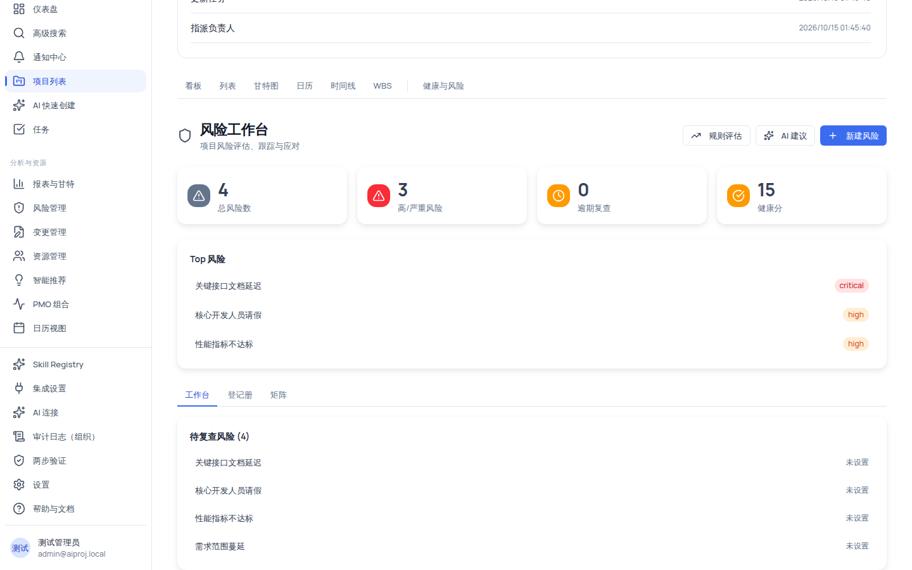
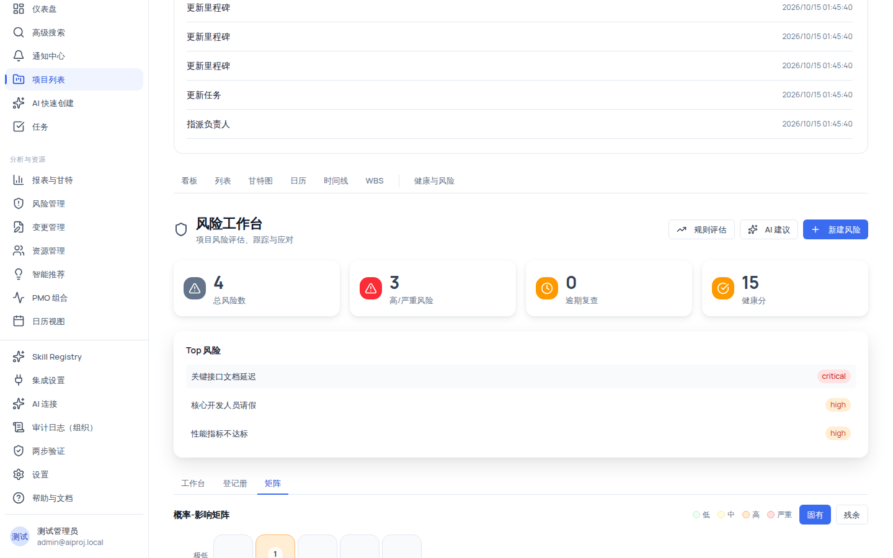

# 项目问题与风险：登记册、矩阵与 AI 建议

风险登记册按项目维护，围绕「概率 × 影响」评估量化风险；风险识别有两条受控通道——**规则评估**（确定性规则引擎，只算不落库）与 **AI 建议**（真实模型，需配置 AI 连接，逐条人工采纳才落库）。全程守住红线：**AI 只建议、不自动执行；跨组织访问一律与"不存在"同形（404），不泄露存在性。**

## 适用范围

| 角色                               | 能力                                                                 |
| ---------------------------------- | -------------------------------------------------------------------- |
| 组织管理员 / 项目经理 / 系统管理员 | 全部：查看、规则评估、AI 建议、采纳、删除、状态推进（`risk:manage`） |
| 成员（member）                     | 查看 + 仅修改自己负责的风险（不可推状态、不可采纳候选）              |
| 外部协作者 / 只读观察者            | 仅查看（`risk:view`，六角色均有）                                    |

写操作全部以服务端 RBAC 为准：即使界面显示了按钮，缺少 `risk:manage` 时服务端会返回 403。

## 开始之前

- 先分清四类记录，避免把产品故障误登记成项目风险：

| 类别     | 定义                                               | 落点                                                                 |
| -------- | -------------------------------------------------- | -------------------------------------------------------------------- |
| 项目问题 | 已发生且正阻塞目标的事实                           | 「项目问题」清单（`/risks` 的 `项目问题` Tab：登记、筛选与状态流转） |
| 项目风险 | 尚未发生、有概率与影响的不确定事件                 | 本页风险工作台（登记册）                                             |
| 产品故障 | 软件/API/配置异常（如 Copilot 报错、页面加载失败） | 帮助中心「故障排查」，反馈时携带 request id；不进项目风险            |
| AI 建议  | AI 基于项目事实给出的建议                          | AI 风险建议抽屉 / 智能推荐；采纳才产生正式记录                       |

- 创建正式风险记录的两个当前路径：**AI 建议逐条采纳**（需先在「设置 → AI 连接」配置可用的连接），或 **API 创建**。登记册页面上的「新建风险」按钮当前不可用，请勿依赖它。

## 操作步骤

### 步骤 1：进入风险工作台

左侧导航「分析与资源 → 风险管理」（`/risks`）。页面顶部有横幅说明页面状态，下方是四张概念区分卡片与两个 Tab（`项目风险` / `项目问题`）。`项目问题` Tab 先选择项目，再用「登记问题」填写标题、分类、严重度与优先级（编号自动生成）；在列表的状态下拉中按状态机流转（待处理 → 处理中 → 已解决 → 已关闭，可驳回或重新打开），标记「已解决」时必须填写根本原因与解决措施。`项目风险` Tab 列出组织内项目卡片，点击卡片上的「进入风险登记册 →」进入该项目的风险工作台（`/projects/:id/risks`）。没有项目时显示「还没有项目」，先创建项目。

### 步骤 2：读工作台概览

工作台顶部四张统计卡：**总风险数**、**高/严重风险**（两者合计）、**逾期复查**、**健康分**（≥60 绿色，否则琥珀；无风险时显示 `N/A`）。没有 `risk:manage` 时右上角显示「只读模式」。

「Top 风险」卡列出等级为 high/critical 的前 5 条（按得分降序，等级标签直接显示英文 `critical`/`high`）；无高风险时显示「当前无高风险，项目风险状态良好」。摘要加载失败时可点「重试」。

### 步骤 3：登记册——查看、筛选与删除

切到「登记册」Tab 查看风险列表：

- **搜索**：按标题/描述关键词搜索（placeholder「搜索风险...」）。
- **类别**：全部类别 + 8 项（技术/进度/成本/资源/外部/组织/法律/其他）。
- **状态**：全部状态 + 6 项（已识别/分析中/缓解中/已解决/已接受/已关闭）。
- **表格列**：标题（大字 + 描述小字）、类别徽章、概率、影响、得分（≥15 红色粗体、≥8 橙色、否则绿色）、状态徽章、负责人（显示 `#{id}` 或 `-`）、AI 列（AI 生成的风险有 AI 徽章）、操作（Copilot 行内触发 + 删除）。
- **翻页**：每页 20 条，超过一页显示「共 N 条，第 X/Y 页」。

删除风险需要 `risk:manage`：点删除后有确认框「确定删除此风险？」。注意：无权限时删除会被服务端拒绝（403），界面上**不会给出错误提示**，请以审计日志为准核对是否删除成功。

### 步骤 4：用概率-影响矩阵看分布

切到「矩阵」Tab：5×5 网格，Y 轴影响（极低/低/中/高/极高）、X 轴概率（1–5），格内白底气泡显示该格风险条数（无气泡=0，气泡越大条数越多），图例四色说明低/中/高/严重。右上角可切换基线：**固有**（默认）与**残余**（仅统计填写了残余概率/影响的风险）。

得分与等级是两个口径，不要混用：得分 = 概率 × 影响（1–25）；默认风险等级按得分划分（≥16 严重、≥10 高、≥4 中）。矩阵色块为展示用途，以卡片上标注的等级徽章为准。

### 步骤 5：规则评估——确定性规则引擎（非 AI）

「规则评估」按钮（`risk:manage` 可见）触发服务端候选评估，结果出现在「规则风险候选」卡片。规则引擎是**确定性规则、不调用大模型**，当前投入评估的事实有三类：**逾期任务**（关键任务逾期 ≥1 天或一般任务 ≥3 天）、**逾期复查**（复查逾期 >7 天）、**逾期应对计划**（超期 >3 天）。候选卡展示建议行动、严重度、规则号与版本（如 `overdue-task v1`）、置信度进度条与证据项。

重要边界：**规则评估产出的候选仅作评估参考，不会自动创建正式风险记录**——正式风险仍须通过 AI 建议采纳（需 AI 连接）或 API 创建。不要把它当作"一键登记"入口。

### 步骤 6：AI 风险建议——逐条采纳才落库

「AI 建议」按钮（`risk:manage`）打开右侧抽屉：

1. **前置条件**：组织内已配置活跃的 AI 连接（「设置 → AI 连接」）。未配置时请求失败并提示「未配置可用的 AI 连接」；限流规则：每项目 30 秒 1 次，每组织每分钟 20 次，超限提示「操作过于频繁，请 30 秒后重试」或「组织级 AI 建议配额已用尽」。
2. **生成**：点击「AI 建议风险」；生成完成后顶部显示「X 条待处理 / 共 Y 条建议」，并提供「全部采纳」「全部拒绝」。
3. **逐条处理**：每条建议卡展示标题、类别、描述（两行截断）、「概率 N 影响 N 得分 N×M」、「缓解：…」、AI 徽标（置信度 NN% + reason）。三个操作：
   - **采纳**：立即创建正式风险记录（状态=已识别），写入审计（RISK_AI_ACCEPTED）。
   - **修改后采纳**：注意——当前版本**没有编辑表单**，点击等同于以原值采纳，仅标记来源为"用户修改过"。
   - **拒绝**：不落库，仅写审计（RISK_AI_REJECTED）。
4. 已处理的建议卡会半透明化（opacity-50）并带「已采纳/已拒绝」徽章。

红线段落再强调一遍：**建议不落库，必须逐条（或全部）人工采纳才产生正式风险**。

### 步骤 7：打开风险详情与推进状态

点击登记册任一行打开详情抽屉，四个 Tab：

- **详细信息**：类别/状态/风险等级/priority（若有）/「AI 生成」徽章（有 aiMarker 时）、描述、概率/影响/得分三列、触发条件、复查安排（下次/上次）、关闭信息（仅已关闭）、缓解策略（策略/应急计划/触发事件）、残余风险（仅两值都非空）、AI 信息（置信度/来源/理由）。
- **应对计划**：策略标签（规避/缓解/转移/接受/应急/升级）+ 行动描述 + 状态（已计划/进行中/已完成/已取消/已逾期）+ 目标日期 + 完成证据；当前只读展示。
- **风险历史**：事件类型 + 时间 + 摘要 + 来源，只读。
- **评论**：项目内评论线程。

「状态推进」按当前状态给出目标按钮（需 `risk:manage`）：

| 当前状态 | 可推进到                 |
| -------- | ------------------------ |
| 已识别   | 分析中 / 已接受 / 已关闭 |
| 分析中   | 缓解中 / 已接受 / 已关闭 |
| 缓解中   | 已解决 / 分析中 / 已关闭 |
| 已解决   | 已关闭 / 缓解中          |
| 已接受   | 已关闭 / 分析中          |
| 已关闭   | （无）                   |

member 无 `risk:manage`，点击推进会被服务端拒绝（「无权推进风险状态」）。抽屉内**没有标题/概率/影响等字段的编辑表单**，修改需通过具备权限的通道。

## 验证结果

- 登记册能看到全部风险及正确得分着色；矩阵气泡数与登记册条目一致。
- 「规则评估」后候选卡出现评估依据（规则号 + 置信度 + 证据），且**没有**产生新的登记册条目。
- 配置 AI 连接后，「AI 建议」能生成建议；点「采纳」后登记册立即出现新风险（状态=已识别），风险历史中出现对应事件。

## 常见问题

**症状：要新建风险但没有可用的入口。**
说明：当前版本新建风险只能通过 AI 建议采纳（需配置 AI 连接）或 API；页面上「新建风险」按钮不可用。
处理：先配置 AI 连接并走 AI 建议流程；或由技术支持通过 API 创建。

**症状：产品故障被误登记成了风险。**
判断：软件报错/API 异常属产品故障。
处理：走帮助中心「故障排查」，反馈携带 request id；项目风险只记录业务不确定事件。

**症状：规则评估的候选点「采纳」失败。**
说明：规则候选仅作评估预览，当前版本不提供候选落库能力。
处理：需要落库时走 AI 建议采纳路径。

**症状：AI 建议提示「未配置可用的 AI 连接」。**
处理：在「设置 → AI 连接」为该组织添加并启用连接后重试；同时注意 30 秒/项目的限流。

**症状：删除风险后条目还在。**
可能原因：无 `risk:manage` 权限，删除被服务端拒绝且界面无错误提示。
处理：核对审计日志；需要删除时联系组织管理员/项目经理操作。

**症状：跨组织访问提示与"不存在"相同。**
原因：组织隔离设计——不泄露其他组织是否存在该项目/风险。
处理：在正确的组织上下文内访问。

## 安全与限制

- **AI 只建议、不自动执行**：AI 建议/规则候选一律不直接落库，采纳由具备 `risk:manage` 的操作者显式执行。
- **规则评估与预测信号是确定性规则引擎，非 LLM**：不要在解读时把它等同于 AI 生成的判断。
- **权限分层**：写操作（规则评估/AI 建议/新建/删除/状态推进）需要 `risk:manage`；member 仅能改自己负责的风险。
- **组织隔离**：所有查询自动叠加组织过滤，跨组织一律 404 同形。
- 风险数据变化（创建/采纳/拒绝/推进/删除）均写入审计日志，可在「管理员 → 审计日志」查询。

## 下一步

- [健康与风险指挥中心](/help/articles/management.health-risk-command-center)
- [变更管理：请求生命周期与影响分析](/help/articles/management.change-requests)
- [智能推荐](/help/articles/management.recommendations)
- [权限参考](/help/articles/reference.permissions)
