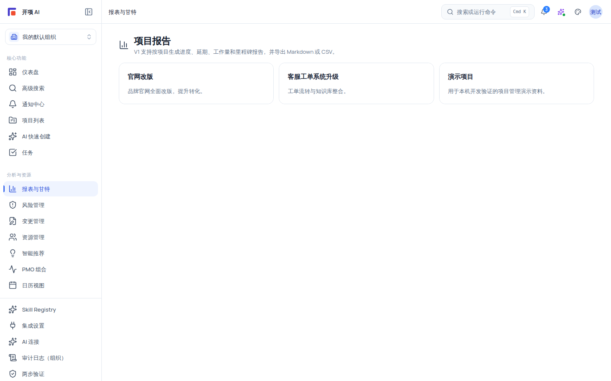
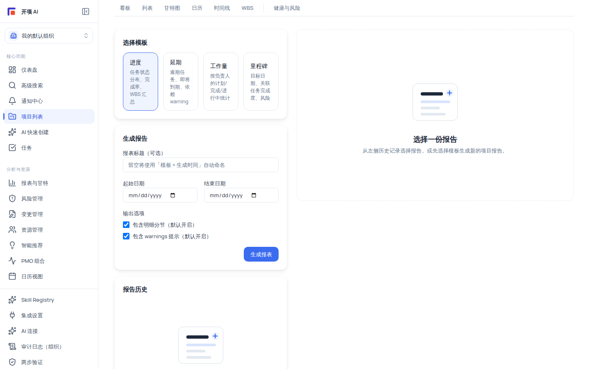
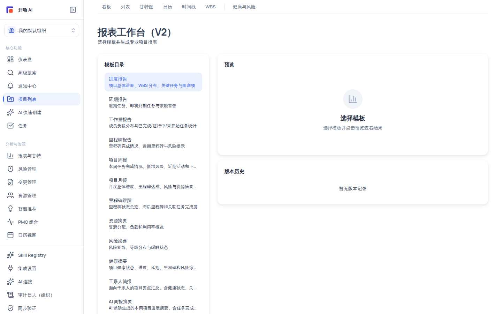

# 报表与 BI：V1 模板报表与 V2 报表工作台

报表区提供两代能力：**V1 预设模板报表**（四模板，生成 → 历史 → Markdown/CSV 导出，走侧栏「报表与甘特」入口）与 **V2 报表工作台**（13 模板、预览、AI 草稿开关、版本历史，当前无侧栏入口、需手动输入 URL）。两条核心事实：**报表详情展示的是生成时刻保存的数据快照**（历史报告反映生成时点数据，与当前项目状态可以不一致）；**AI 相关输出只生成草稿，确认才成为正式版本，且不写回任何项目事实**。

## 适用范围

| 角色                                | V1 报表                                      | V2 工作台                                           |
| ----------------------------------- | -------------------------------------------- | --------------------------------------------------- |
| 组织管理员 / 项目经理               | 查看 + 生成 + 导出 + 下载                    | 查看 + 预览/生成（`report:create`）；后端为权限兜底 |
| 成员（member）                      | 仅查看（无生成/导出/下载按钮）               | 预览/生成操作前端不隐藏，但后端会拒绝无权限请求     |
| 只读观察者（readonly_observer）     | 仅查看                                       | 仅查看                                              |
| 外部协作者（external_collaborator） | 无任何 report 权限，页面显示「暂无报告权限」 | 同理被后端拒绝                                      |

> [!NOTE]
> V2 工作台的「预览/生成」按钮没有前端权限门——无权限时点击会收到服务端 403 而不是按钮隐藏，属预期行为。

## 开始之前

- 项目内有可统计的数据（任务、进度、里程碑等）；完全空的项目也能生成，但快照多为 0 统计并附 warnings。
- 导出口径：V1 仅 **Markdown / CSV** 两种格式；「下载」需要先「导出」对应格式。
- 如果你要使用 V2 工作台或 AI 周期报表，请直接访问 `reports-v2` 路由（见下文），当前产品版本没有从 V1 页面进入 V2 的链接。

## 操作步骤

### 步骤 1：进入报表（项目选择枢纽）

左侧导航「分析与资源 → 报表与甘特」（`/reports`）——该页只做项目选择：列出当前组织可见项目（前 20 个）并显示项目名与描述，点击项目卡进入该项目的 V1 报表页（`/projects/:id/reports`）。无项目时显示「还没有项目」。

### 步骤 2：V1 报表——选择模板与生成

V1 报表页左侧三张卡、右侧为详情预览区（`lg:grid-cols-[minmax(0,420px)_1fr]` 布局）：

**选择模板**：四个模板 chip，默认选中「进度」：

| 模板   | 包含内容                         |
| ------ | -------------------------------- |
| 进度   | 任务状态分布、完成率、WBS 汇总   |
| 延期   | 逾期任务、即将到期、依赖 warning |
| 工作量 | 按负责人的计划/完成/进行中统计   |
| 里程碑 | 目标日期、关联任务完成度、风险   |

**生成报告**（`report:create` 门控，无权限整卡不渲染）：填报表标题（可选，留空自动用「模板 + 生成时间」命名）、起始日期、结束日期（起始晚于结束会被拦截：「起始日期不能晚于结束日期」）、输出选项（勾选「包含明细分节（默认开启）」「包含 warnings 提示（默认开启）」），点「生成报表」。

### 步骤 3：V1 报表——查看快照、导出与下载

生成后右侧自动选中新报告，显示头部（模板徽章 + 标题 + 「生成于 {时间} · 生成者 #{id}」）+ 快照正文：统计卡（如进度模板的总进度 %/总任务/已完成/阻塞中 +「WBS 分支进度」表 +「关键任务」表）+ warnings 面板（三档：信息/提示/严重）。

操作区三个按钮：

| 按钮     | 权限              | 行为                                                            |
| -------- | ----------------- | --------------------------------------------------------------- |
| 导出     | `report:export`   | 选择格式 markdown / csv（大写显示）后导出；成功后即可下载       |
| 下载     | `report:download` | 当前选择格式 ≠ 已导出格式时禁用（提示「请先导出该格式再下载」） |
| 重新生成 | `report:create`   | 以原模板重跑，标题追加「（重新生成）」                          |

**报告历史**卡列出历史报告（模板徽章 + 标题 + 生成时间 + 生成者 #{id} + 已导出时的格式徽章），点击任意旧报告可回看当时快照——**快照不随项目现状变化**。

### 步骤 4：V2 报表工作台（`/projects/:id/reports-v2`，直连 URL）

「报表工作台（V2）」副标题「选择模板并生成专业项目报表」。左侧「模板目录」（13 个模板，默认选中 progress）+「生成参数」；右侧「预览」+「版本历史」。

**模板目录**：

| 类别                                  | 模板                                                                                                                       |
| ------------------------------------- | -------------------------------------------------------------------------------------------------------------------------- |
| V1 等价（支持 markdown/csv/pdf/xlsx） | 进度报告、延期报告、工作量报告、里程碑报告                                                                                 |
| V2 新增                               | 项目周报（周）、项目月报（月）、里程碑跟踪、资源摘要、风险摘要、健康摘要（仅 markdown/pdf）、干系人简报（仅 markdown/pdf） |
| AI 周期                               | AI 周报摘要、AI 月报摘要（勾选「启用 AI 草稿」后生成）                                                                     |

**生成流程**：选模板 →（可选）勾选「启用 AI 草稿」→ 点「预览」→ 右侧预览区出现导出格式列表、warnings（code 徽章按 critical/warning/info 着色）与「AI 草稿：已启用/未启用」→ 确认无阻塞警告 → 点「生成」。

**阻塞警告**：当必需数据源不可用时，预览返回阻塞，按钮旁红色提示「存在阻塞警告，无法生成。请检查必需数据源可用性。」，此时「生成」不可用。

**版本历史**：每行 = 标题 + templateId 小字 + 审核状态徽章（`confirmed` 显示绿色「已确认」、`pending_review` 显示黄色「待审核」，其他显示原文）；当前为只读展示，点击无跳转。

### 步骤 5：AI 周期报表（当前为内置模板草稿 + 只读审阅页）

AI 周报/月报走「生成 → 人工审阅」闭环，但**当前版本的两点如实边界**：

1. **草稿由内置模板生成，未接入真实模型**：`provider=fake`、固定中文 fixture 内容（管理摘要/亮点/进度叙述/风险与问题/资源说明/变更说明/建议行动/数据限制八节）。不要把它当作真实模型的分析输出。
2. **审阅页只读**：`/projects/:id/reports-v2/periodic/versions/:versionId/review` 展示草稿八节与状态徽章（待审核/已确认/已退回/编辑中），页面上**没有确认/退回/编辑按钮**——审阅动作当前仅通过 API 提供，确认后版本标记「已确认」并成为正式版本；草稿确认只改版本状态，不写回任何项目事实。

### 步骤 6：组织级 BI 工作台（入口隐蔽，直连 URL）

BI 趋势分析（`/organization/bi/trends`）与 BI 风险热力图（`/organization/bi/risk-heatmap`）是**只读**组织级页面：入口要求 `org:view` 或 `portfolio:view`，维度级（风险/资源/预测/OKR）权限不足时对应指标显示为受限/不可见（脱敏）而不整页拒绝；接口不调用 AI、不修改任何业务事实。

如实标注：BI Dashboard 构建器（`/organization/bi/dashboards`）当前**组织上下文未接通**（请求会打到无效组织 ID），界面存在但不可正常保存，请勿在生产流程中依赖它。上述组织级页面均无侧栏入口，只能手动输入 URL。

## 验证结果

- V1：选模板 → 填日期 → 生成 → 右侧出现快照；选 markdown/csv 导出后可下载；历史列表出现新记录。
- V2：预览无阻塞警告后可生成，版本历史出现新版本并带「待审核/已确认」徽章。
- 空项目或数据不足时，快照显示 0 统计 + 信息级 warnings 是正常输出，不是故障。

## 常见问题

**症状：报表空白或统计全为 0。**
可能原因：项目没有任务/里程碑数据，或快照生成于数据为空时。
检查：看快照的 warnings 面板；历史报告反映生成时点数据。
处理：确认项目有数据后重新生成。

**症状：报表与当前项目视图数据不一致。**
原因：详情渲染的是生成时刻保存的快照，不随现状变化。
处理：用「重新生成」得到最新快照。

**症状：下载按钮不可点。**
原因：当前选择格式尚未导出（「请先导出该格式再下载」）。
处理：先点「导出」切换该格式，再下载。

**症状：提示「暂无报告权限」。**
原因：当前角色（如外部协作者）没有 `report:view`。
处理：联系项目管理员开通相应 report 权限。

**症状：V2 点了「生成」没反应或报错。**
可能原因：未先预览、预览有阻塞警告，或无 `report:create` 权限（后端 403）。
处理：先「预览」，处理阻塞警告后生成；权限问题联系组织管理员。

**症状：找不到 V2 / BI 的侧栏入口。**
说明：`reports-v2`、周期报表页与 `/organization/bi/*` 当前均无侧栏/页内入口，为产品现状。
处理：按文档给出的 URL 直达，或从 V1 报表入口体验基础能力。

## 安全与限制

- **快照可追溯**：历史报告永远展示生成时刻数据；引用历史报表对外沟通时注明统计时点。
- **权限裁剪**：生成/导出/下载仅组织管理员与项目经理；外部协作者无任何 report 权限；导出内容遵循权限裁剪。
- **AI 只生成草稿**：AI 草稿需人工审阅确认才成为正式版本；确认不写回任务、里程碑等任何项目事实。
- **组织隔离**：报表与 BI 数据按组织隔离，跨组织不可见；审计日志记录报表生成与导出动作。

## 下一步

- [资源管理：项目工作台、负载与组织资源池](/help/articles/management.resources)
- [项目问题与风险：登记册、矩阵与 AI 建议](/help/articles/management.issues-and-risks)
- [智能推荐：建议的产生、评估与采纳](/help/articles/management.recommendations)
- [权限参考](/help/articles/reference.permissions)
