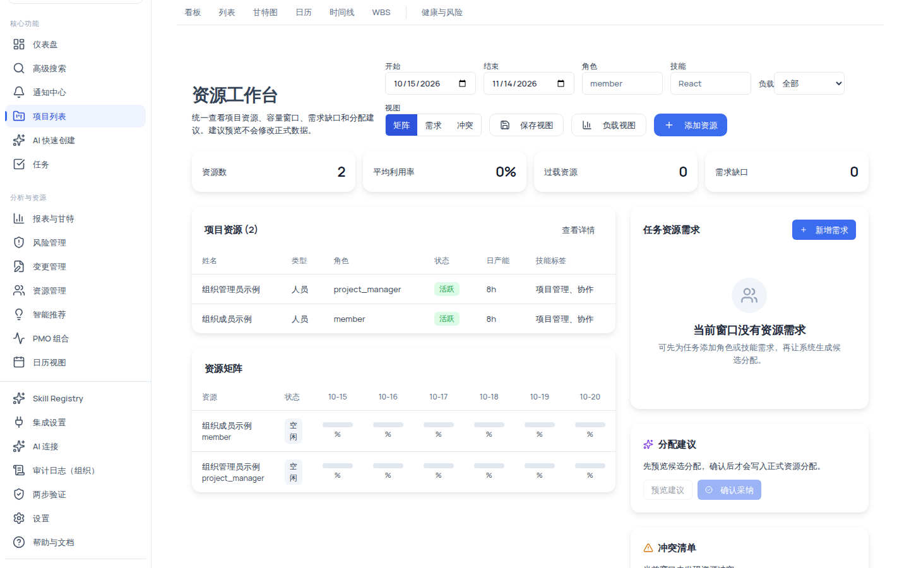
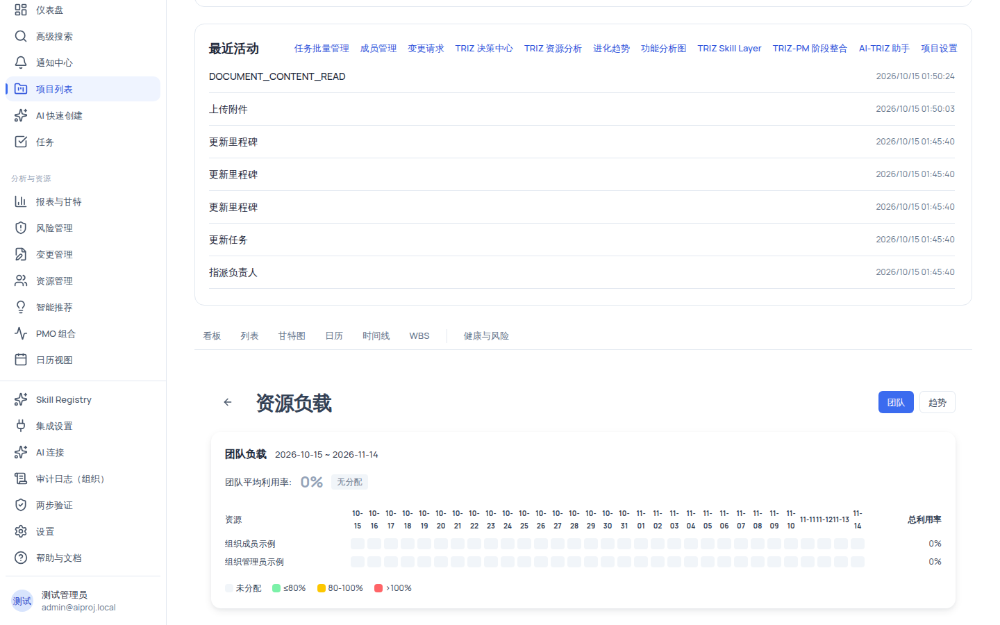
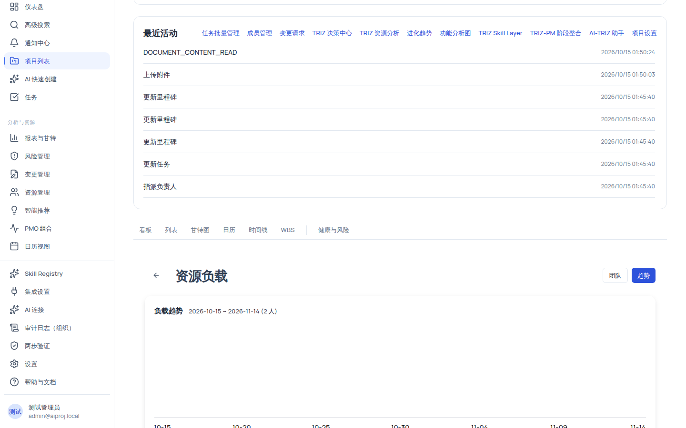

# 资源管理：项目工作台、负载与组织资源池

资源管理分「项目级」与「组织级」两层：项目内用**资源工作台**维护资源、登记任务资源需求并查看分配建议；组织级用**资源池、缺口分析、需求预测与争用检测**汇总所有可见项目的资源态势。全流程守住一条红线：**分配建议一律先预览、人工确认后才写入正式数据**，系统不会自动调整任何分配。

## 适用范围

| 角色                                | 项目级能力                                         | 组织级能力                                                                                 |
| ----------------------------------- | -------------------------------------------------- | ------------------------------------------------------------------------------------------ |
| 组织管理员（org_admin）             | 查看 + 管理（添加资源/添加需求/确认采纳/删除分配） | 查看资源池、缺口、预测、争用、容量闭环（详情按角色脱敏）                                   |
| 项目经理（project_manager）         | 查看 + 管理                                        | 查看资源池、缺口、预测、争用、容量闭环                                                     |
| 成员（member）                      | 仅查看（`resource:view`）                          | 部分组织级页面可看聚合（详情脱敏）                                                         |
| 外部协作者（external_collaborator） | 仅查看                                             | 部分组织级页面可看聚合（详情脱敏）                                                         |
| 只读观察者（readonly_observer）     | 无 `resource:view`                                 | 凭借 `org:view`/`portfolio:view` 可看资源池/争用/缺口/预测的聚合数据（名字等详情一律脱敏） |
| 系统管理员（system_admin）          | 全部（绕过角色检查）                               | 全部                                                                                       |

需要说明：组织级页面对低基数与受限数据做**脱敏**（如技能覆盖 <3 人时显示「低基数已脱敏」）；只读观察者看到的是聚合数字，看不到具体资源名。

## 开始之前

- 项目内已有资源（人员/物料/设备/预算），且任务已关联分配记录；负载按**计划/估算工时与分配比例**计算，不代表实际打卡工时。
- 若从未添加过资源，请先进入资源工作台点击「添加资源」。
- 权限判定以服务端为准：写操作需要 `resource:manage`，界面上的按钮会自动按角色隐藏。

## 操作步骤

### 步骤 1：进入项目资源工作台

- 常规入口：从项目详情页进入「资源工作台」（`/projects/:id/resources`）。
- 全局入口：左侧导航「分析与资源 → 资源管理」（`/resources`）。页面右上角有「项目」下拉框，默认选中项目列表中的第一个项目，可切换到任意项目查看资源清单；该页只读，分配与负载请点「进入项目资源页（分配/负载）」。

工作台顶部工具栏提供以下筛选：

| 控件        | 可填内容                              | 说明                         |
| ----------- | ------------------------------------- | ---------------------------- |
| 开始 / 结束 | 日期（默认今天 ~ +30 天）             | 窗口决定矩阵与需求的计算范围 |
| 角色        | 文本（placeholder「member」）         | 按角色名过滤资源             |
| 技能        | 文本（placeholder「React」）          | 按技能标签过滤资源           |
| 负载        | 下拉：全部/空闲/可用/满载/过载/不可用 | 按负载档位过滤               |
| 视图        | 矩阵 / 需求 / 冲突                    | 切换右侧主卡片               |
| 负载视图    | 按钮                                  | 跳转资源负载页（团队/趋势）  |
| 保存视图    | 按钮                                  | 把当前筛选存为自定义视图     |
| 添加资源    | 按钮（仅 `resource:manage` 可见）     | 进入添加资源表单             |

页面顶部摘要指标：**资源数**、**平均利用率**（超过 100% 显示红色）、**过载资源**（大于 0 显示黄色）、**需求缺口**（大于 0 显示黄色）。

### 步骤 2：用资源矩阵查看每日容量

「矩阵」视图把窗口内每天的资源容量画成色条：

- 色条规则按当天利用率：>100% 红、>80% 黄、>0% 绿、0% 灰，颜色右侧显示百分比与窗口利用率。
- 矩阵**只显示窗口前 10 天**；窗口更长时后续天数不渲染，属当前版本限制。
- 窗口内没有资源容量时显示「当前窗口没有资源容量」，需要调整日期窗口或先添加项目资源。

### 步骤 3：登记任务资源需求

在「任务资源需求」卡片点击「新增需求」（仅 `resource:manage`），填写：

| 字段    | 必填 | 默认值   | 说明                     |
| ------- | ---- | -------- | ------------------------ |
| 任务 ID | 是   | —        | 非空才可提交             |
| 角色    | 否   | frontend | 需求所需角色             |
| 比例 %  | 否   | 50       | 该角色在此任务的占用比例 |

提交后创建一条需求（优先级固定 medium，日期窗口 = 工作台窗口），列表每项显示「任务 #N」+ 状态徽章（open 为黄色）+「role · N% · start ~ end」。创建失败时提示「创建失败，请检查任务 ID 和日期窗口。」——请核对任务 ID 是否真实存在且属于当前项目。

### 步骤 4：分配建议——先预览、再人工确认

「分配建议」卡片针对当前选中的需求给出候选操作，**两步写入闭环，不可跳过**：

1. **预览建议**：点击「预览建议」生成候选，卡片显示「N 项候选操作 · 写入状态：未写入」与「事实源：resource_planning_service · hash xxxxxxxx」。此步只计算，不修改任何正式数据。
2. **确认采纳**：仅 `resource:manage` 可点。系统会用预览摘要哈希做防篡改校验——若项目数据在预览期间发生变化导致哈希不匹配，服务端会拒绝：「资源建议预览摘要不匹配，请重新生成预览」。重新预览后再确认。

处理失败时页面提示「建议处理失败，请刷新后重试。」

### 步骤 5：查看冲突清单

「冲突」视图列出当前窗口内检测到的资源冲突，每项 = 类型徽章（error 红色 / warning 黄色）+ 冲突描述；无冲突时显示「当前窗口未发现资源冲突。」。冲突清单是提示性的，处置仍需人工完成。

### 步骤 6：查看资源负载（团队热力 / 趋势）

从工作台「负载视图」进入（`/projects/:id/resources/load`），窗口固定为今天 ~ +30 天（无选择器）。

**团队 Tab**（默认）：顶部显示「团队平均利用率: N%」——>90% 时出现黄色「团队负载较高」标签，>100% 红色，=0 灰色「无分配」。热力表每个资源一行、每天一个色块：

| 色块 | 含义                                    |
| ---- | --------------------------------------- |
| 灰   | 未分配                                  |
| 绿   | ≤80%                                    |
| 黄   | 80%–100%                                |
| 红   | >100%（最后列「总利用率」同步加粗变红） |

每个超过 100% 的资源会有一条红色提示「{名} 综合利用率超过 100%，建议调整分配」，超过 80% 有黄色提示「关注负载」。列表仅显示前 20 名资源，超出部分标注「仅显示前 20 名资源」。

**趋势 Tab**：按天绘制团队聚合柱状图（>100% 红、>80% 黄、其余绿，每 5 天标一个日期），标题显示「负载趋势 {from} ~ {to} (N 人)」；存在超过 100% 的天数时顶部出现红色提示「N 天存在过载」。

负载计算口径（供核对数据用）：只统计状态为「活跃」的资源；非工作日容量与分配都记 0；当日分配比例 = 当日所有重叠分配的 allocationPercent 之和；资源综合利用率 = 窗口内 allocatedHours / 容量总和；团队均值 = 各资源利用率的算术平均。

### 步骤 7：添加资源

在工作台点击「添加资源」进入表单（整页要求 `resource:manage`，无权限显示「无权操作」）：

| 字段           | 必填 | 默认值 | 说明                                  |
| -------------- | ---- | ------ | ------------------------------------- |
| 姓名           | 是   | —      | placeholder「输入姓名」               |
| 邮箱           | 否   | —      | 可选；浏览器会校验邮箱格式            |
| 类型           | 否   | 人员   | 人员 / 物料 / 设备 / 预算             |
| 角色           | 否   | 成员   | 项目经理 / 团队负责人 / 成员 / 观察者 |
| 日产能（小时） | 否   | 8      | 数字 0–24，步进 0.5，非数值回退 8     |

提交成功后回到工作台并刷新资源列表。后端会为资源建立日产能版本快照并写入审计（RESOURCE_CREATED）。

注意两点：① 表单**没有技能标签、工作日、时区、单位成本字段**——这些字段当前只能通过 API 维护，添加后资源默认无技能标签；② 技能矩阵与技能覆盖依赖资源的 `skillTags` 字段，所以新添资源在登记技能前不会出现在技能聚合里。

### 步骤 8：查看资源详情

点击工作台资源行或「查看详情」进入详情页（`/projects/:id/resources/:resourceId`），标题下方为「{类型} · {角色} · 活跃|停用」，右上角有「负载」与「删除」（删除仅 `resource:manage`，确认后删除并返回工作台）。四个 Tab：

| Tab        | 内容                                                                                                                                    |
| ---------- | --------------------------------------------------------------------------------------------------------------------------------------- |
| 基本信息   | 邮箱（空显示 `-`）、日产能（N 小时）、时区、工作日（如 `[1,2,3,4,5]`）、技能标签（原始 JSON 字符串）、单位成本（非空时显示「N.NN 元」） |
| 分配 (N)   | 分配列表（任务 ID/比例/类型/开始/结束）；「添加分配」填任务 ID + 比例 0–100（默认 100）。分配类型三种：指派/分配/预留                   |
| 可用性 (N) | 可用性例外（开始/结束/容量 0–24/原因必填）。**自助编辑**：资源绑定到你的账号时，即使没有 `resource:manage` 也可为自己添加例外           |
| 负载       | 窗口固定今天 ~ +14 天，显示「综合利用率: N%」与 7 天色块                                                                                |

资源不存在时显示「资源不存在或加载失败」。另注意：详情页**没有编辑表单**（技能标签等字段只能 API 修改），属当前版本限制。

### 步骤 9：进阶——组织级资源能力（入口隐蔽，部分需管理员开启）

组织级页面均不在主导航，进入方式各不相同：

| 页面             | 直达 URL                                          | 进入方式                                                          | 可用性说明                                                                                                                                                                                                      |
| ---------------- | ------------------------------------------------- | ----------------------------------------------------------------- | --------------------------------------------------------------------------------------------------------------------------------------------------------------------------------------------------------------- |
| 组织资源池       | `/organization/resource-pool`                     | 组织总览「查看资源」（后端授权后才显示）/ PMO「组织资源池」/ 直连 | KPI 7 项（资源总数/总容量/已分配/利用率/过载/冲突/需求缺口）+ 5 个视图（容量矩阵/资源列表/技能覆盖/冲突/需求缺口）；技能覆盖 <3 人显示「低基数已脱敏」；数据 60 分钟新鲜度                                      |
| 资源缺口分析     | `/organization/resource-gaps`                     | 资源池「打开统一缺口工作台」/ 直连                                | 6 维度透视（角色/技能/时间桶/项目/组合/组织）× 4 口径 × 严重度；缺口严重度按缺口比例 ≥75% 严重 / ≥50% 高 / ≥25% 中。**注意：缺口卡上的「查看解释/下钻」目标页面当前未交付（跳转 404）**，请以卡片内解释文本为准 |
| 资源需求预测     | `/organization/resource-demand-forecasting`       | 直连                                                              | KPI 4 项 + 需求曲线/缺口分析/驱动因素三视图；窗口 1–12 周；「AI 咨询」按钮生成仅供参考的叙述性建议（advisoryOnly，不落库、不写回），失败时提示「AI 咨询服务暂不可用」但预测数据照常显示                         |
| 资源争用检测     | `/organization/resource-contentions`              | 直连                                                              | 严重度 4 卡 + 矩阵/列表视图；**建议使用列表视图**（矩阵视图点行展开详情存在匹配问题）；展开卡片可见「处置建议」与「建议动作（仅供参考，不自动执行）」——系统明确不会自动修改分配、任务负责人、任务日期或工作日历 |
| 跨项目资源调配   | `/organization/cross-project-resource-allocation` | 直连                                                              | **需管理员开启环境变量 `CROSS_PROJECT_ALLOCATION_ENABLED`**（默认关闭，未开启时页面数据加载失败/接口返回 404）。开启后走「新建草案 → 预览（哈希 30 分钟有效）→ 确认 → 应用」状态机，全程人工操作                |
| 资源容量预测闭环 | `/organization/resource-capacity-loops`           | 直连                                                              | **需管理员开启环境变量 `RESOURCE_CAPACITY_LOOP_ENABLED`**（默认关闭）。基线预测 → 情景模拟 → 人工选择 → 受控移交 → 同口径复测 → 人工复核；页面明确声明"所有建议均为咨询性质且未被应用"                          |
| 资源技能矩阵     | `/resources/skill-matrix`                         | 直连（无任何 UI 入口）                                            | 组织级技能覆盖率/严重缺口/候选资源/Skill advisory 四卡 + 覆盖明细；技能数据来自资源 `skillTags`（当前仅 seed/API 可写）                                                                                         |

> [!IMPORTANT]
> 组织级所有能力遵守同一承诺：**建议与 AI 咨询只读、不落库、不自动执行**；任何正式资源写入都走工作台「预览 → 确认采纳」或既有能力的显式确认路径。

## 验证结果

- 工作台能看到当前窗口的资源矩阵色条、需求列表与冲突清单；点「预览建议」后卡片显示「写入状态：未写入」，确认采纳后分配实际写入。
- 负载页两个 Tab 数据一致：团队热力的红/黄块与趋势图红柱都对应综合利用率 >100% / >80% 的资源。
- 组织资源池数字随项目数据变化而更新；低基数技能显示「已脱敏」，未开启 flag 的页面（跨项目调配/容量闭环）保持空态或明确报错。

## 常见问题

**症状：`/resources` 显示的不是我想看的项目。**
原因：页面默认选中项目列表中的第一个项目。
处理：用页面右上角的「项目」下拉框切换到目标项目；需要分配或负载视图时点「进入项目资源页（分配/负载）」。

**症状：点「确认采纳」被拒绝。**
原因：预览哈希与当前数据不匹配（预览后项目数据发生了变化）。
处理：重新点击「预览建议」生成新预览，再确认采纳。

**症状：矩阵看不到 10 天之后的数据。**
原因：当前版本矩阵只渲染窗口前 10 天。
处理：缩短日期窗口以聚焦分析，或使用负载趋势页面看更长跨度。

**症状：看不到「添加资源」「确认采纳」按钮。**
原因：缺少 `resource:manage` 权限。
处理：联系组织管理员调整角色；权限判定以服务端为准。

**症状：组织资源池显示「低基数已脱敏」或「已脱敏」。**
原因：该技能/资源数据基数低于阈值，或当前角色无详情查看权限。
处理：这是有意的隐私保护，聚合数字仍可用；需要详情请联系组织管理员。

**症状：跨项目调配/容量闭环页面打不开或数据全空。**
原因：对应能力由环境变量门控，默认关闭。
处理：由管理员开启 `CROSS_PROJECT_ALLOCATION_ENABLED` / `RESOURCE_CAPACITY_LOOP_ENABLED` 后重试。

## 安全与限制

- **分配建议 = 预览 → 人工确认**：预览不写库；确认携带预览哈希防篡改校验；系统从不自动调整分配。
- **组织隔离**：所有资源数据按组织过滤；跨组织访问返回与"不存在"一致的 404，不泄露存在性。
- **脱敏**：组织级页面对低基数技能（<3 人）与无详情权限者显示脱敏值，只读观察者只能看到聚合。
- **角色边界**：member / external_collaborator 只能看，不能添加资源、登记需求、确认采纳或操作组织级写功能；可用性例外支持本人自助编辑是唯一例外。
- **负载口径**：基于计划/估算工时与分配比例，不反映实际工时打卡。

## 下一步

- [项目问题与风险：登记册、矩阵与 AI 建议](/help/articles/management.issues-and-risks)
- [变更管理：请求生命周期与影响分析](/help/articles/management.change-requests)
- [报表与 BI：V1 模板报表与 V2 报表工作台](/help/articles/management.reports)
- [权限参考](/help/articles/reference.permissions)
