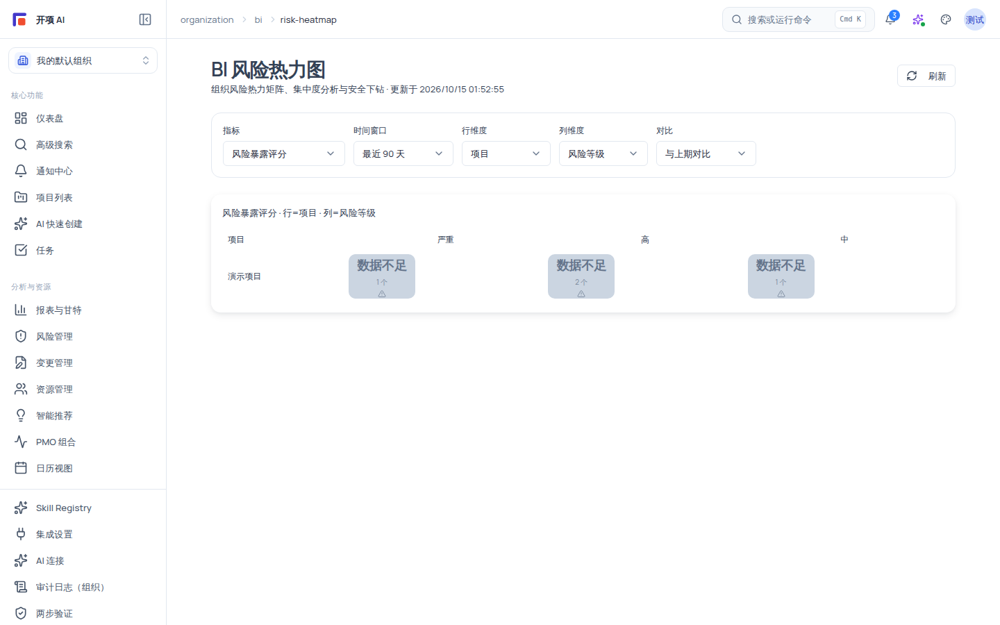

# 组织级 BI 风险热力图

组织级 BI 风险热力图（`/organization/bi/risk-heatmap`）把当前组织的风险数据按你选定的「行维度 × 列维度」聚合成一张热力矩阵，帮助管理层从组合视角看风险集中度（哪个项目、哪个类别、哪个负责人的风险最重），并支持安全下钻查看单元详情。本页为只读分析工作台：不写入任何业务数据，不启动任何生成任务。

## 适用范围

- **适用角色**：入口权限为 `org:view` 或 `portfolio:view`（任意一个即可进入；`system_admin` 跨组织可用）；六个规范角色中 `org_admin`、`project_manager`、`member`、`readonly_observer` 通常具备其一。
- **所需权限**：`org:view` 或 `portfolio:view`（前端校验任一）；维度级受限时按单元脱敏，不会整页拒绝。
- **适用版本**：free / team / enterprise。
- **进入路径**：当前页面没有主导航入口，请直接输入 URL：`https://<你的域名>/organization/bi/risk-heatmap`。

## 开始之前

- 当前组织有风险数据时热力网格才有内容；没有任何风险数据时显示空态「暂无热力图数据」。
- 页面需要组织上下文：未处于组织视图时显示「请先切换到组织视图。」的提示。
- 入口校验为 `org:view` / `portfolio:view`；若你不满足任一权限，页面显示「您没有 BI 风险热力图访问权限。」

## 页面结构

### 筛选条

标题为 **「BI 风险热力图」**，副标题「组织风险热力矩阵、集中度分析与安全下钻」，右上角「刷新」按钮（数据新鲜度不满足时提示「数据可能陈旧」）。筛选条含五个控件：

| 控件     | 选项                                                                                                |
| -------- | --------------------------------------------------------------------------------------------------- |
| 指标     | 风险暴露评分（默认）/ 风险数量 / 高风险占比 / 逾期风险占比 / 风险变化量 / 交通灯风险比              |
| 时间窗口 | 最近 7 天 / 最近 30 天 / 最近 90 天 / 最近 180 天 / 最近 365 天 / 本月 / 本季度 / 本年度            |
| 行维度   | 项目 / 组合分组 / 风险类别 / 风险等级 / 风险状态 / 负责人 / 时间桶 / 部门                           |
| 列维度   | 同左（项目 / 组合分组 / 风险类别 / 风险等级 / 风险状态 / 负责人 / 时间桶 / 部门；不能与行维度相同） |
| 对比     | 与上期对比（默认）/ 与去年同期对比 / 无对比                                                         |

- 行、列维度选择相同项时，输入框红框提示 **「行列维度不能相同」**，热力网格不会生成。
- 数据降级时（stale / 缓存降级 / 部分数据 / 来源缺失）显示黄色提示：「部分数据不完整——热力分值仅供参考，建议结合来源页面验证。」

### 热力网格与 Top 列表

- **热力网格**：每个单元格是「行维度值 × 列维度值」的风险聚合，颜色深浅代表分值高低；单元格点击打开解释抽屉。
- **分页**：超过 50 个单元时分页，底部显示「共 {total} 个热力单元 · 第 {page}/{totalPages} 页」+「上一页 / 下一页」。
- **Top 风险单元**：按风险暴露排序的单元列表，同样点击打开抽屉。
- **单元格「数据不足」标记**：当单元格内数据量过低（低基数）不足以计算可靠分值时，单元格显示「数据不足」标记，而非一个误导性的低分——这是产品的诚实呈现，不表示风险为零。

### 解释抽屉

点击任意单元格或 Top 单元打开右侧抽屉：

- **单元详情**：该单元聚合的指标值与组成。
- **安全下钻**：只展示你有权查看的风险明细；无权限部分不会出现在下钻结果中。
- **advisory copy**：抽屉附带的解读性文案（说明口径与限制），不包含隐藏计数或隐藏名称。

## 操作步骤

### 步骤 1：进入热力图

1. 输入 URL `https://<你的域名>/organization/bi/risk-heatmap`。
2. 你会看到标题与筛选条；无数据时显示空态。

### 步骤 2：选择指标与窗口

1. 在「指标」下拉选择要分析的口径（默认「风险暴露评分」）。
2. 在「时间窗口」下拉选择分析区间（如「最近 30 天」）。

### 步骤 3：配置行列维度

1. 在「行维度」选择（如「项目」），在「列维度」选择（如「风险等级」）。
2. 选择相同项会被拦截（「行列维度不能相同」），请换一个维度。

### 步骤 4：阅读热力网格

1. 观察颜色深浅定位风险集中区域；点击目标单元格打开解释抽屉。
2. 看到「数据不足」的单元格无需恐慌——它表示该格数据不足以计算分值，建议调整维度或窗口后重看。
3. 网格超过 50 单元时使用「上一页 / 下一页」翻页。

### 步骤 5：使用 Top 风险单元与对比

1. 在「Top 风险单元」列表点击条目查看详情。
2. 需要看变化趋势时，把「对比」切换为「与上期对比」或「与去年同期对比」，对比列会给出变化方向。

### 步骤 6：刷新

数据更新后点击右上角 **「刷新」** 重新拉取（前端缓存约 120 秒）；加载失败显示错误条并提示重试。

## 验证结果

- 选择行列维度后热力网格生成，单元格数量与分页信息一致。
- 「数据不足」单元格与有分值的单元格视觉可区分，注释与本文一致。
- 点击单元格能打开解释抽屉，下钻内容只含你有权查看的明细。
- 行列选择相同时出现「行列维度不能相同」提示且不生成网格。

## 常见问题

**症状：页面提示「您没有 BI 风险热力图访问权限。」**
可能原因：当前角色既无 `org:view` 也无 `portfolio:view`。
检查：组织成员角色与项目可见性。
修复：联系组织管理员调整角色或可见范围。

**症状：页面提示「请先切换到组织视图。」**
可能原因：当前没有 orgId（未处于组织上下文）。
检查：是否在组织视图/组织设置下访问。
修复：切换到组织视图后重进本页。

**症状：网格中大量「数据不足」单元格。**
可能原因：低基数脱敏——该格数据量不足以计算可靠分值（产品诚实呈现）。
检查：指标与维度的粒度是否过细。
修复：换更粗的维度或更大的时间窗口；「数据不足」不代表风险为零。

**症状：下钻看不到某些风险明细。**
可能原因：你对这些风险没有查看权限（组织隔离与维度级脱敏）。
检查：当前角色的风险可见范围。
修复：由管理员扩大可见范围；系统不会在抽屉中泄露隐藏明细。

**症状：看不到「与上期对比」的变化数字。**
可能原因：上一期数据缺失或窗口选择过短。
检查：时间窗口与对比选项。
修复：切换到更长窗口或「与去年同期对比」。

## 安全与限制

- **只读工作台**：不修改任何业务事实，不触发 AI 生成或 Compiler 任务。
- **维度限制**：行、列维度不能相同；除此之外无其他组合限制。
- **低基数脱敏**：数据量不足的单元格标记「数据不足」，不会填充误导性低分。
- **权限边界**：入口只需 `org:view` / `portfolio:view`；风险明细的下钻以你的项目/风险可见性为准，受限内容不泄露。
- **分页**：每页固定 50 个热力单元。
- **导航缺口**：本页无侧边栏/命令面板入口，只能 URL 直达。

## 下一步

- [PMO 组合总览](/help/articles/pmo.overview)
- [组合交通灯：识别风险项目并复核](/help/articles/pmo.traffic-light)
- [风险登记册与健康度](/help/articles/management.issues-and-risks)
- [项目管理报表](/help/articles/management.reports)
