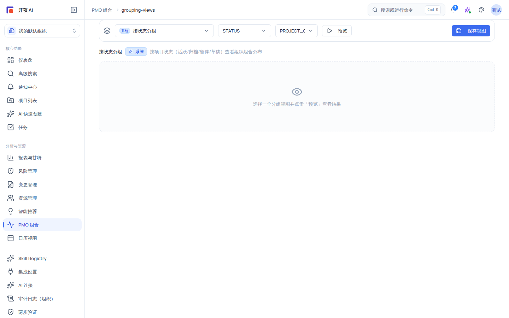

# 组合分组视图：预览、保存与共享

组合分组视图（`/pmo/grouping-views`）把组合内项目按你关心的维度（状态、健康度、负责人、部门……）聚成「组卡片」呈现，并支持把配置保存为个人视图或组织共享视图，方便反复使用。它既是 `/pmo` 组合总览的 Tab，也可通过 URL 直达。

## 适用范围

- **适用角色**：查看与预览需要 `portfolio:view`（六种规范角色均授予）；**组织内共享**保存需要 `portfolio:manage`（仅 `org_admin`）。
- **所需权限**：`portfolio:view`；组织共享 `portfolio:manage`。
- **适用版本**：free / team / enterprise。
- **进入路径**：`/pmo` 组合总览页切到「分组视图」Tab，或直接输入 URL：`https://<你的域名>/pmo/grouping-views`。

## 开始之前

- 当前组织至少有一个项目；没有项目时预览为空态。
- 系统预设视图开箱即用；个人视图与组织共享视图需要先保存配置。

## 系统预设视图

系统预设共 6 个，默认选中「按状态分组」，全部为只读（不可编辑/删除/设为默认，可复制）：

| 预设名称       | 内部标识                | 说明                       |
| -------------- | ----------------------- | -------------------------- |
| 按状态分组     | system-by-status        | 按项目状态分组（默认选中） |
| 按健康度分组   | system-by-health        | 按项目健康度分组           |
| 按交通灯分组   | system-by-traffic-light | 按交通灯灯色分组           |
| 按负责人分组   | system-by-manager       | 按负责人分组               |
| 按部门分组     | system-by-department    | 按部门分组                 |
| 按生命周期分组 | system-by-lifecycle     | 按生命周期阶段分组         |

## 页面结构

### 工具栏

- **视图选择器**：分组为 `系统预设` / `个人视图` / `组织共享`，每项带 scope 徽标（系统 = 蓝、个人 = 紫、组织 = 绿）。
- **主分组下拉**：可选 `STATUS` / `HEALTH` / `TRAFFIC_LIGHT` / `MANAGER` / `PROJECT_TYPE` / `LIFECYCLE_PHASE` / `DEPARTMENT` / `SOURCE_FRESHNESS`。此下拉直接渲染英文枚举键（产品事实），例如选择 `STATUS` 即按状态分组。
- **排序下拉**：可选 `GROUP_NAME` / `PROJECT_COUNT` / `PROGRESS_AVG` / `HEALTH_STATUS` / `TRAFFIC_LIGHT` / `UPDATED_AT`，同样为英文枚举键。
- **预览按钮**：播放图标，点击后加载（转圈）。点击后底部出现预览结果。
- **视图操作（非系统预设）**：`···` 菜单包含「复制」「设为默认」（有权限时）、「删除」（红色，有权限时）。
- **保存视图按钮**：打开「保存分组视图」对话框。

### 当前视图信息条

显示当前视图名称 + 范围徽标 + 「默认」星标（amber，仅默认视图）+ 描述（超长截断）。

### 预览结果

- meta 行：「{N} 个项目 · {N} 个分组」+「已截断」徽标（超过上限时）+「数据可能过期」或「更新于 {时间}」。
- 组卡片网格：每张组卡 = 「{组名或"(未分类)"}」+「{N} 个项目」徽标 + 每组 KPI（「{值} {key}」）+ 二级分组 + warning 徽标。
- 底部 warning 黄框：汇总预览过程中的数据告警。
- 比较模式：当前展示 **「比较模式 {mode} 暂不可用」**（产品现状，比较功能未开放）。
- 空态：「选择一个分组视图并点击「预览」查看结果」。

## 操作步骤

### 步骤 1：预览一个分组视图

1. 在视图选择器选择「系统预设」下的某个预设（如「按状态分组」），或在工具栏直接改「主分组」下拉。
2. 点击 **「预览」**；加载完成后底部出现组卡片网格。
3. 你会看到 meta 行（项目数/分组数）与每组卡片（组名、项目数、KPI、二级分组）；如有 warning 会显示在组卡与底部黄框中。

### 步骤 2：保存为个人视图

1. 点击 **「保存视图」**。
2. 在弹出的「保存分组视图」对话框中填写：

| 字段     | 必填 | 约束                                                                       |
| -------- | ---- | -------------------------------------------------------------------------- |
| 视图名称 | 是   | ≤ 120 字，placeholder「例如：按部门巡检」                                  |
| 描述     | 否   | ≤ 400 字                                                                   |
| 可见范围 | 是   | `仅自己可见` 或 `组织内共享`（无 `portfolio:manage` 时「组织内共享」禁用） |

3. 点击 **「保存」**。保存成功后视图出现在「个人视图」（或「组织共享」，如选共享）分组下，可直接复用。
4. 对话框说明文案：「保存当前分组配置以便复用。组织共享视图需管理权限。」

### 步骤 3：管理你的视图

- **复制**：在视图 `···` 菜单点「复制」，生成一份相同配置的新视图。
- **设为默认**：点「设为默认」（有权限时），当前视图带 amber 星标，之后进入页面默认选中它；系统预设不可设为默认。
- **删除**：点「删除」（红色，有权限时）移除个人视图；系统预设不可删除。

### 步骤 4：让组织共享

1. 保存时可见范围选择「组织内共享」（需 `portfolio:manage`）。
2. 保存后其他成员在视图选择器「组织共享」分组下可见并使用。

## 验证结果

- 选择预设并预览后，组卡片数量与「共 N 个项目」一致；组名与主分组取值对应。
- 保存个人视图后，视图选择器「个人视图」分组出现该视图；设为默认后带星标。
- 用 `org_admin` 保存「组织内共享」视图后，用组织成员账号登录可在「组织共享」分组看到它。
- 删除视图后它从视图选择器消失；系统预设始终只读可复制。

## 常见问题

**症状：预览显示「数据可能过期」。**
可能原因：分组数据超过新鲜度窗口。
检查：meta 行的更新时间。
修复：刷新页面或等待数据更新后重新预览；长期过期请检查数据源。

**症状：看不到「组织内共享」选项。**
可能原因：你没有 `portfolio:manage`（仅 `org_admin`）。
检查：当前角色。
修复：以 `org_admin` 登录，或联系组织管理员代为保存共享视图。

**症状：主分组下拉显示英文大写（如 STATUS）。**
可能原因：产品按设计直接渲染枚举键（产品事实），不影响功能。
检查：选择后预览的组名是否与你期望的维度一致。
修复：无需处理；如需要中文组名，请在预览结果中阅读对应说明。

**症状：保存/删除/复制失败。**
可能原因：网络或权限问题。
检查：页面顶部 toast（「保存视图失败」「删除视图失败」「复制视图失败」「设置默认视图失败」「预览分组视图失败」）。
修复：按提示重试；仍失败时记录 toast 文案与 request id 反馈支持。

## 安全与限制

- **系统预设只读**：不可编辑/删除/设为默认，仅可复制为个人视图后调整。
- **组织共享门控**：保存「组织内共享」需要 `portfolio:manage`（`org_admin`）。
- **比较模式未开放**：页面展示「比较模式暂不可用」为产品现状。
- **分页与截断**：预览结果超过上限时显示「已截断」徽标，不展示全部组。
- **组织隔离**：分组数据按当前组织隔离；受限项目不出现在组卡片中。
- **入口**：本页同时是 `/pmo` 的 Tab 与独立 URL，两者数据一致。

## 下一步

- [PMO 组合总览](/help/articles/pmo.overview)
- [组合交通灯：识别风险项目并复核](/help/articles/pmo.traffic-light)
- [优先级评分：等级、权重与队列](/help/articles/pmo.priority-scoring)
- [组织资源池](/help/articles/management.resources)
