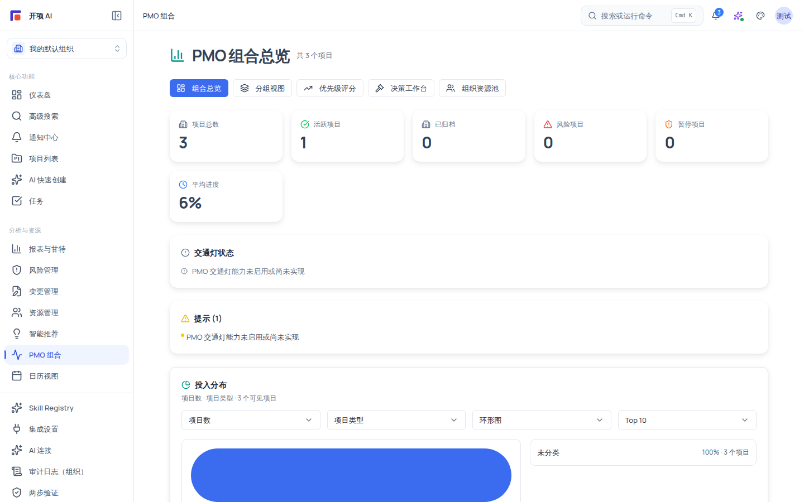

# PMO 组合总览：跨项目健康与投入分布

PMO 组合总览（`/pmo`）是组织层面的组合健康速览页：用一条 KPI 指标条、交通灯状态卡、提示卡与投入分布区块，回答「组织当前有哪些项目、整体健康度如何、投入花在哪里」。

## 适用范围

- **适用角色**：六种规范角色均授予 `portfolio:view`，包括 `system_admin`、`org_admin`、`project_manager`、`member`、`external_collaborator`、`readonly_observer`，都可查看本页。
- **所需权限**：`portfolio:view`。
- **适用版本**：free / team / enterprise；当前版本无新手/专业模式过滤，所有登录用户侧边栏均可看到「PMO 组合」入口。

## 开始之前

- 当前组织至少有一个项目；没有任何项目时 KPI 会显示为 `—`，投入分布显示空态「暂无可展示的投入分布」。
- 本页是只读总览：KPI 卡片点击后跳到项目列表（`/projects`），投入分布只提供只读下钻抽屉，页面本身不提供写操作。

## 进入页面

1. 在左侧主导航「分析与资源」分组点击 **「PMO 组合」**，进入 `https://<你的域名>/pmo`。
2. 页面标题为 **「PMO 组合总览」**，右侧显示 **「共 N 个项目」**（N 为当前组织可见项目总数）。
3. 如果你没有 `portfolio:view` 权限，整页显示红色提示「您没有 PMO 组合 Dashboard 访问权限。」；数据加载失败时显示「加载 PMO Dashboard 失败，请稍后重试。」，可稍后重试。

## 页面结构

### 子导航按钮

页面标题下方有五个子导航按钮，作用如下：

| 按钮           | 跳转目标                      | 可见条件                                                                                   |
| -------------- | ----------------------------- | ------------------------------------------------------------------------------------------ |
| **组合总览**   | 当前页（Tab 切换）            | 始终可见                                                                                   |
| **分组视图**   | 当前页内嵌的分组视图 Tab      | 始终可见                                                                                   |
| **优先级评分** | `/pmo/priority-scoring`       | 始终可见                                                                                   |
| **决策工作台** | `/pmo/decisions`              | 拥有 `pmo_decision:view`（org_admin / project_manager / member / readonly_observer）时可见 |
| **组织资源池** | `/organization/resource-pool` | 固定链接，始终可见                                                                         |

### KPI 指标条

KPI 条为 5 列卡片，每张卡片由图标 + 指标名 + 数值（数字或 `N%`）组成，无数据时显示 `—`。点击任意卡片跳到项目列表（`/projects`）。部分指标键对应的中文标签如下：

| 指标                           | 类型   | 说明                   |
| ------------------------------ | ------ | ---------------------- |
| 项目总数 / 活跃项目 / 已归档   | 计数   | 按项目状态汇总         |
| 风险项目 / 暂停项目            | 计数   | 风险与暂停状态的项目数 |
| 平均进度                       | 百分比 | 全部可见项目的进度均值 |
| 按期交付 / 延期项目            | 计数   | 按工期口径汇总         |
| 健康红色 / 健康黄色 / 健康绿色 | 计数   | 按项目健康度汇总       |
| 高风险 / 严重风险              | 计数   | 按风险等级汇总         |
| 资源超载 / 预测高压            | 计数   | 资源与预测压力类汇总   |
| 数据过期 / 不可用指标          | 计数   | 来源数据新鲜度汇总     |

个别指标带图标颜色区分（如风险项目为红色警示图标、平均进度为蓝色时钟图标）；对当前用户不可见的指标，卡片以半透明方式呈现（正常渲染的权重较低），不会报错。

### 交通灯状态卡

「交通灯状态」卡汇总四色灯的项目计数：**红 N / 黄 N / 绿 N / 灰 N**。

- 当交通灯服务可用时，四色圆点与计数正常显示。
- 当交通灯能力不可用时，卡片显示服务返回的提示 message；无提示时显示**「交通灯能力未启用」**。这是产品的正常占位表现，不代表数据丢失——对应功能的判定与复核详见 [组合交通灯](/help/articles/pmo.traffic-light)。

### 提示卡

「提示 (N)」卡以黄色圆点列表展示 `summary.warnings` 中的注意事项（例如数据源过期、部分指标受限等），数量 N 随提示条数变化。

### 投入分布区块

「投入分布」卡提供四个控件，自由组合口径、维度、展示模式与 Top-N：

| 控件     | 可选项                                                                                                           |
| -------- | ---------------------------------------------------------------------------------------------------------------- |
| 投入口径 | 项目数 / 计划工时 / 预估工时 / 资源投入比 / 预算金额 / 实际成本 / 预测成本 / 预算执行率 / ROI / 收入 / NPV / IRR |
| 分布维度 | 项目类型 / 生命周期阶段 / 优先级 / 状态 / 负责人 / 部门 / 战略主题 / 交通灯状态                                  |
| 展示模式 | 环形图 / 饼图 / 水平条形图 / 堆叠条形图 / 流向图 / 矩阵图                                                        |
| Top-N    | 5 / 10 / 15 / 20                                                                                                 |

- 区块 meta 行显示「口径 · 维度 · N 个可见项目」；存在脱敏时省略项目数。
- 点击某个分布桶（例如某个状态桶）会打开「{桶名} · 项目明细」只读抽屉；抽屉内没有可下钻项目时显示「没有可下钻的项目 / 该桶可能已脱敏，或当前用户没有项目明细权限。」
- 财务口径（预算金额、实际成本、ROI 等）在无财务数据时显示「该财务口径当前不可用」。
- 脱敏桶显示「不可用」并带「已脱敏」徽标，不会泄露受限项目的存在。

## 操作步骤

1. **读 KPI**：从 KPI 条判断整体水位——例如风险项目、延期项目、平均进度；点击任意 KPI 卡跳到 `/projects` 查看对应项目列表。
2. **读交通灯状态卡**：确认四色计数；若显示「交通灯能力未启用」，说明当前组合交通灯服务不可用（产品占位文案，见上文）。
3. **读提示卡**：展开「提示 (N)」确认是否有需要处理的数据问题（过期、受限等）。
4. **看投入分布**：选择投入口径与分布维度，确认投入集中度；点击分布桶下钻「项目明细」抽屉。
5. **切换到分组视图 Tab**：直接在当前页切换「分组视图」，或点「优先级评分」「决策工作台」跳转到对应工作台。
6. **回项目列表**：任何时候点 KPI 卡返回 `/projects`。

## 验证结果

- KPI 条显示的数字与「共 N 个项目」一致（如 N 个项目时风险项目为 0，显示 0 或 `—`）。
- 点击 KPI 卡后跳转到 `/projects`，列表筛选结果与卡片口径一致。
- 切换投入口径或分布维度后，分布图形与 meta 行文案同步更新。
- 点击分布桶能打开「项目明细」只读抽屉（或看到脱敏/空态说明）。

## 常见问题

**症状：KPI 卡全部显示 `—`。**
可能原因：当前组织没有可见项目，或指标数据尚未生成。
检查：项目列表是否为空；数据来源是否过期。
修复：先在项目列表创建项目并录入计划数据；仍为空时等待数据刷新后重试。

**症状：交通灯状态卡显示「交通灯能力未启用」。**
可能原因：交通灯服务未启用或数据源全部不可用（产品占位文案）。
检查：这是产品的正常占位表现。
修复：该文案与具体灯的判定逻辑见 [组合交通灯](/help/articles/pmo.traffic-light)；不表示你的项目数据丢失。

**症状：部分分布桶显示「不可用」「已脱敏」。**
可能原因：对应桶内项目超出当前用户可见范围（组织隔离）。
检查：当前角色的项目可见性。
修复：由组织管理员调整可见范围后重新查看；系统不会展示受限项目明细。

**症状：点「决策工作台」按钮看不到。**
可能原因：你的角色没有 `pmo_decision:view`（例如 external_collaborator）。
检查：当前角色是否在决策工作台授予角色内。
修复：参考 [决策工作台：从议题到结论](/help/articles/pmo.decisions) 的角色说明。

## 安全与限制

- **只读页面**：PMO 组合总览不提供任何写操作；对项目的修改需在项目内完成。
- **组织隔离**：所有 KPI、交通灯、投入分布均按当前登录组织隔离；受限项目以脱敏/「不可用」呈现，不泄露隐藏项目存在。
- **交通灯占位**：「交通灯能力未启用」是服务不可用时的真实占位文案，写文档时如实保留，不代表功能缺失或故障。
- **入口限制**：分组视图与决策工作台按权限显隐按钮；「组织资源池」为固定链接。

## 下一步

- [组合交通灯：识别风险项目并复核](/help/articles/pmo.traffic-light)
- [组合分组视图：预览、保存与共享](/help/articles/pmo.grouping-views)
- [优先级评分：等级、权重与队列](/help/articles/pmo.priority-scoring)
- [决策工作台：从议题到结论](/help/articles/pmo.decisions)
- [权限参考](/help/articles/reference.permissions)
