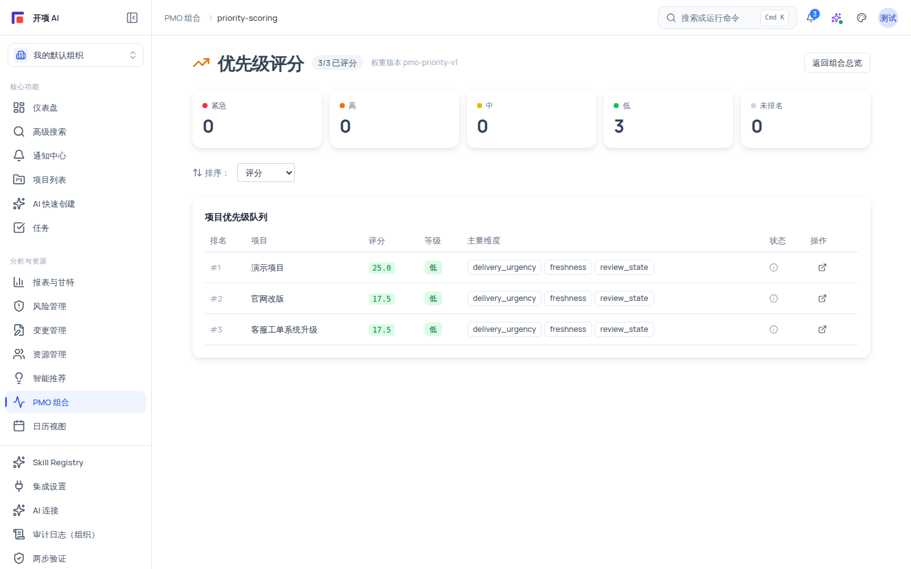

# 优先级评分：等级、权重与队列

优先级评分（`/pmo/priority-scoring`）用一套确定性评分模型为组合内每个项目计算 0–100 分并映射到五个等级（紧急/高/中/低/未排名），帮助你基于同一口径比较项目优先级，而不是凭感觉「谁更急」。本页是只读工作台：评分由服务端计算，页面只提供分布查看、筛选排序与项目详情跳转。

## 适用范围

- **适用角色**：需要 `portfolio:view`（六种规范角色均授予）。
- **所需权限**：`portfolio:view`。
- **适用版本**：free / team / enterprise。
- **进入路径**：PMO 组合总览页顶部点 **「优先级评分」**，或直接输入 URL：`https://<你的域名>/pmo/priority-scoring`。

## 开始之前

- 当前组织至少有一个项目。没有任何项目时页面显示空态「暂无项目评分数据」。
- 本页为只读：**没有评分写入能力**，也无法调整权重；权重由系统版本 `pmo-priority-v1` 固定。

## 评分模型说明

### 等级区间

| 等级   | 分数区间           | 徽标颜色 |
| ------ | ------------------ | -------- |
| 紧急   | [80, 100]          | 红       |
| 高     | [60, 80)           | 橙       |
| 中     | [40, 60)           | 黄       |
| 低     | [0, 40)            | 绿       |
| 未排名 | [-1, -1]（未评分） | 灰       |

### 权重版本 `pmo-priority-v1`

分值由 8 个维度加权求和，权重从高到低：

| 维度         | 权重 | 说明                              |
| ------------ | ---- | --------------------------------- |
| 交付紧急度   | 0.25 | 距离交付节点的紧迫程度            |
| 交通灯严重度 | 0.20 | 组合交通灯红灯/黄灯证据的严重程度 |
| 管理关注度   | 0.15 | 管理层的关注信号                  |
| 风险压力     | 0.12 | 风险登记册压力                    |
| 资源压力     | 0.10 | 资源负载与缺口压力                |
| 预测压力     | 0.08 | 预测（延期概率等）压力            |
| 数据新鲜度   | 0.05 | 数据越新权重贡献越高              |
| 复核状态     | 0.05 | 交通灯复核状态贡献                |

> 陈旧数据处理：评分引擎对过期数据施加 stale 惩罚因子（0.3），权重维度与惩罚因子均随版本号 `pmo-priority-v1` 固定；版本变更时页面标题会显示新的版本号。

### 评分着色与主要维度

- 分数着色：≥ 80 红、≥ 60 橙、≥ 40 黄、其余绿。
- 「主要维度」列展示 topReasons（贡献最大的维度徽标）；无维度数据时显示 `数据不足` 或 `无`。

## 页面结构

- 标题 **「优先级评分」** + **「{scored}/{total} 已评分」** + **「权重版本 {version}」**；右上角「返回组合总览」按钮。
- **等级分布五卡**：紧急 / 高 / 中 / 低 / 未排名 + 数量；点击卡片按等级过滤（选中带 amber 描边），再次点击取消过滤。
- **排序下拉**：评分 / 等级 / 排名 / 项目名称。
- **清除过滤**：点击「清除过滤 ({n})」一键清空当前过滤条件。
- **表格「项目优先级队列」**：列 = 排名 / 项目 / 评分 / 等级 / 主要维度 / 状态 / 操作。
- 无 `portfolio:view` 时整页提示「您没有 PMO 优先级评分访问权限。」；加载失败提示「加载优先级评分失败，请稍后重试。」

## 操作步骤

### 步骤 1：进入优先级评分

1. 从 `/pmo` 组合总览页点 **「优先级评分」**（或直接输入 URL）。
2. 你会看到标题行的已评分计数与权重版本号；计数应等于当前组织可见项目数（`scored/total`）。

### 步骤 2：按等级过滤

1. 点击「紧急」或「高」等等级卡片，下方队列只显示该等级项目。
2. 队列顶部出现「清除过滤 (n)」按钮；点击可清空过滤恢复全量视图。

### 步骤 3：排序队列

1. 展开「排序」下拉，选择「评分」「等级」「排名」或「项目名称」。
2. 你会看到表格行序随之变化；同一按钮再点可切换升序/降序（若提供）。

### 步骤 4：解读状态图标与下钻

1. 「状态」列图标含义：

| 图标             | 含义           |
| ---------------- | -------------- |
| 时钟 Clock       | 数据可能过期   |
| 盾牌 ShieldAlert | 部分维度受限   |
| 信息 Info        | 部分数据不可用 |
| 正常             | 无以上问题     |

2. 点击「操作」列的外链图标跳转到 `/projects/{id}` 查看项目详情，核实评分背后的数据。

### 步骤 5：分页浏览

1. 队列底部显示「共 N 个项目」与「{page} / {totalPages}」。
2. 点击「上一页 / 下一页」翻页（每页固定 50 条）。

## 验证结果

- 等级分布五卡的计数之和等于「共 N 个项目」。
- 点击等级卡后队列只显示该等级项目，且「清除过滤」计数与过滤条件一致。
- 排序切换后队列第一行的排名/评分符合所选排序。
- 空组织下显示「暂无项目评分数据」空态。

## 常见问题

**症状：某项目「主要维度」显示「数据不足」。**
可能原因：该项目的关键维度数据缺失或不可用。
检查：项目是否有健康诊断、风险、资源、计划等数据。
修复：补齐项目数据后刷新本页；缺失维度不参与评分。

**症状：所有项目都是「未排名」。**
可能原因：评分服务尚未对项目完成评分，或数据全部不可用。
检查：标题行「已评分」计数是否为 0。
修复：等待数据刷新后重新进入本页；仍为 0 时检查数据源可用性。

**症状：页面上找不到修改权重的地方。**
可能原因：评分权重由系统版本（`pmo-priority-v1`）固定，本页只读。
检查：标题行的权重版本号。
修复：如需调整权重口径，请联系产品团队评估新权重版本。

**症状：队列只有 50 条但项目更多。**
可能原因：分页每页固定 50 条。
检查：底部翻页控件。
修复：使用翻页浏览剩余项目，或先用等级卡过滤缩小范围。

## 安全与限制

- **只读工作台**：无评分写入能力；任何评分口径调整均为系统级变更。
- **分页边界**：每页固定 50 条。
- **数据边界**：评分依赖各维度数据与数据新鲜度；过期数据按 stale 惩罚处理，维度受限时显示「数据不足/无」。
- **组织隔离**：评分队列只含当前组织可见项目；受限项目不会出现在队列中。
- **确定性优先**：评分为确定性模型结果（非 AI 生成），AI 层只在此基础上提供「推荐」层面的草案（见 [PMO AI 优先级推荐](/help/articles/pmo.ai-priority-recommendations)）。

## 下一步

- [PMO 组合总览](/help/articles/pmo.overview)
- [组合交通灯：识别风险项目并复核](/help/articles/pmo.traffic-light)
- [PMO AI 优先级推荐](/help/articles/pmo.ai-priority-recommendations)
- [决策工作台：从议题到结论](/help/articles/pmo.decisions)
