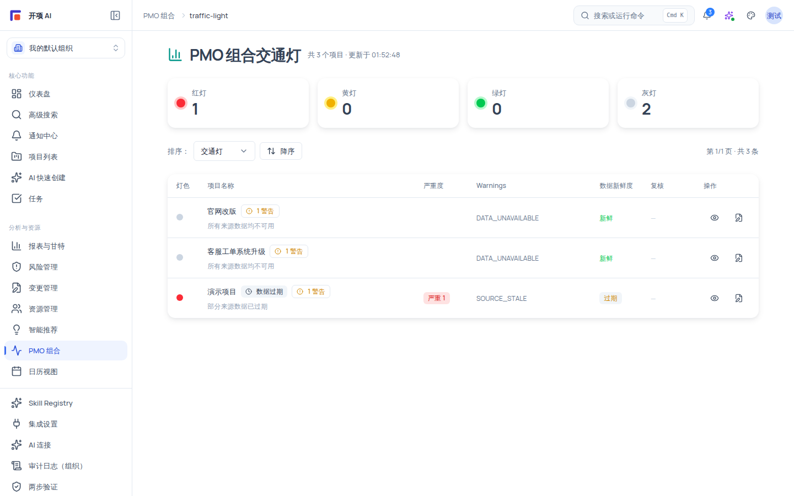

# 组合交通灯：识别风险项目并复核

组合交通灯（`/pmo/traffic-light`）为组合内每个项目计算一盏「灯」：红灯表示存在严重健康问题，黄灯表示有需要关注的证据，绿灯表示健康，灰灯表示数据不足或不可用。它帮助你快速定位「最需要投入关注的项目」，并对识别结果做人工复核。

## 适用范围

- **适用角色**：查看列表需要 `portfolio:view`（六种规范角色均授予）；执行**复核**需要 `portfolio:manage`（当前仅授予 `org_admin`，`system_admin` 可跨组织访问）。
- **所需权限**：`portfolio:view`；复核操作 `portfolio:manage`。
- **适用版本**：free / team / enterprise。
- **进入路径**：当前页面没有主导航入口，请直接输入 URL：`https://<你的域名>/pmo/traffic-light`。

## 开始之前

- 当前组织至少有一个项目，且项目具备健康诊断、预测、风险、资源、任务、里程碑等任一数据来源，灯色才有判定依据。
- 了解灯色口径：灯色由服务端规则引擎计算（规则版本 `pmo-traffic-light-v1`），**复核状态不参与灯色计算**——即使你把一个红灯项目标记为「误报」，它的灯色仍由评分引擎决定。

## 灯色判定规则

灯色来源于 7 类数据：健康诊断、预测、风险、资源、任务、里程碑、变更冲击（任一来源不可用或被限制时按缺失处理）。判定遵循「最严重证据优先」：

| 灯色     | 触发条件（任一即触发）                                                                    | 规则编号        |
| -------- | ----------------------------------------------------------------------------------------- | --------------- |
| **红灯** | 健康诊断结果为「严重」；里程碑错过；严重风险数 > 0；资源利用率 > 150%；逾期任务占比 ≥ 30% | TL-R01 ~ TL-R05 |
| **黄灯** | 存在高/中等级证据（如高风险数量超标、预测压力、资源压力等）                               | TL-R06 ~ TL-R11 |
| **绿灯** | 无任何红/黄证据                                                                           | —               |
| **灰灯** | 全部数据来源不可用或被限制（数据不足以判定）                                              | TL-R12 / TL-R13 |

> 注意：红灯阈值中的「资源利用率 > 150%」「逾期任务占比 ≥ 30%」以服务端规则为准；若你看到的文案与本文不同，以页面展示的规则版本（`pmo-traffic-light-v1`）为准。

## 页面结构

### 灯色汇总卡

页面标题为 **「PMO 组合交通灯」**，副标题显示 **「共 N 个项目 · 更新于 {时间}」**。下方四张汇总卡：

| 卡片 | 颜色 | 点击行为                   |
| ---- | ---- | -------------------------- |
| 红灯 | 红   | 按红灯筛选（再次点击取消） |
| 黄灯 | 黄   | 按黄灯筛选（再次点击取消） |
| 绿灯 | 绿   | 按绿灯筛选（再次点击取消） |
| 灰灯 | 灰   | 按灰灯筛选（再次点击取消） |

被选中的卡片带 teal 描边（选中态），工具栏出现对应的筛选徽标（如「红灯 ×」）。

### 筛选工具栏

- **排序下拉**：交通灯 / 项目名 / 严重度 / 高严重度 / 更新时间。
- **升降序切换**：`降序` 与 `升序` 切换按钮（箭头图标）。
- **分页信息**：右侧显示「第 p/n 页 · 共 N 条」。

### 项目表格

表格列：**灯色 / 项目名称 / 严重度 / Warnings / 数据新鲜度 / 复核 / 操作**。

| 列         | 取值与含义                                                                                                  |
| ---------- | ----------------------------------------------------------------------------------------------------------- |
| 灯色       | 红 / 黄 / 绿 / 灰圆点                                                                                       |
| 项目名称   | 名称旁可能带徽标：「数据过期」（时钟图标）、「{N} 警告」                                                    |
| 严重度     | 徽标「严重 {n}」（红）/「高 {n}」（橙）/「中 {n}」（黄）；n 为命中严重度数量                                |
| Warnings   | 警示 code 列表，无警示显示 `—`                                                                              |
| 数据新鲜度 | `新鲜` 或 `过期`                                                                                            |
| 复核       | `已关注` / `需跟进` / `误报` 徽标；复核已过期时显示黄色提示「复核已过期」；未复核显示 `—`                   |
| 操作       | 「查看项目」（眼睛图标，跳到 `/projects/{id}`）；「复核」（文件编辑图标，仅拥有 `portfolio:manage` 时显示） |

## 操作步骤

### 步骤 1：定位需要关注的项目

1. 打开 `/pmo/traffic-light`，先看四张汇总卡的计数：红灯数越多，组合风险越高。
2. 点击「红灯」卡（或「黄灯」卡）过滤列表，再点击一次可取消过滤。
3. 按「高严重度」或「严重度」排序，把最严重的项目排到最前。

### 步骤 2：查看项目详情

1. 在目标项目行点击 **「查看项目」**（眼睛图标）。
2. 你会跳转到该项目详情页（`/projects/{id}`），可进一步查看健康诊断、风险登记册、任务与资源等来源数据。
3. 回到交通灯页继续处理下一行。

### 步骤 3：执行复核（仅 `portfolio:manage`）

1. 在目标项目行点击 **「复核」**（文件编辑图标）。
2. 在弹出的「复核项目：{项目名}」对话框中确认「当前灯色：{红灯/黄灯/绿灯/灰灯}」。
3. 在「复核状态」中选择一项：

| 复核状态   | 含义                                         |
| ---------- | -------------------------------------------- |
| **已关注** | 你已知晓该项目风险，正在跟进                 |
| **需跟进** | 该项目需要进一步处理                         |
| **误报**   | 判定为误报（仅记录人工意见，不影响灯色计算） |

4. （可选）在「备注」中填写复核备注（placeholder「复核备注（可选）」）。
5. 点击 **「确认复核」**（提交中文案「提交中...」）；成功后该行「复核」列显示对应徽标。复核提交失败时无专用错误提示，请稍后重试并保留相关上下文反馈支持。

## 验证结果

- 四张汇总卡计数之和等于「共 N 个项目」。
- 点击某灯色卡后列表只剩该灯色项目，工具栏出现「红灯 ×」等筛选徽标。
- 复核成功后该行「复核」列显示你选择的徽标（已关注/需跟进/误报），且备注已保存。
- 一个红灯项目被标记「误报」后，灯色仍然保持红色（复核不参与灯色计算）。

## 常见问题

**症状：所有项目都是灰灯。**
可能原因：全部数据来源不可用或被权限限制（TL-R12/R13）。
检查：项目是否有健康诊断、风险、资源、任务等数据；数据源是否过期。
修复：补齐项目数据（如录入风险、计划任务）后刷新本页；仍为灰灯时检查数据源服务状态。

**症状：找不到「复核」按钮。**
可能原因：你没有 `portfolio:manage` 权限（复核仅 `org_admin` 可执行）。
检查：当前角色是否为组织管理员。
修复：联系组织管理员处理；`member` / `project_manager` 只能查看列表。

**症状：复核后灯色没有变化。**
可能原因：这是设计行为——灯色由规则引擎决定，复核状态不影响灯色计算。
检查：复核列的徽标是否已更新。
修复：如你认为灯色判定有误，以「误报」复核并备注原因，供人工评审参考。

**症状：某项目显示「数据过期」。**
可能原因：该项目数据来源超过新鲜度窗口。
检查：数据新鲜度列的状态。
修复：等待数据源更新后刷新页面；对长期过期项目检查其数据生成任务。

## 安全与限制

- **分页**：每页固定 20 条，无分页控件修改入口；数据量大时请使用筛选与排序。
- **复核边界**：复核仅记录人工意见（已关注/需跟进/误报 + 备注），**不修改任何项目业务数据**，也不参与灯色计算。
- **数据来源缺失**：任一来源不可用或受限时按缺失处理，可能导致灰灯或黄灯级别变化，属预期行为。
- **组织隔离**：只显示当前组织可见项目；跨组织数据不可见。
- **入口**：本页无主导航入口，只能通过 URL 直达（PMO 组合页也提供不了指向本页的按钮）。

## 下一步

- [PMO 组合总览](/help/articles/pmo.overview)
- [优先级评分：等级、权重与队列](/help/articles/pmo.priority-scoring)
- [决策工作台：从议题到结论](/help/articles/pmo.decisions)
- [风险登记册与健康度](/help/articles/management.issues-and-risks)
- [权限参考](/help/articles/reference.permissions)
