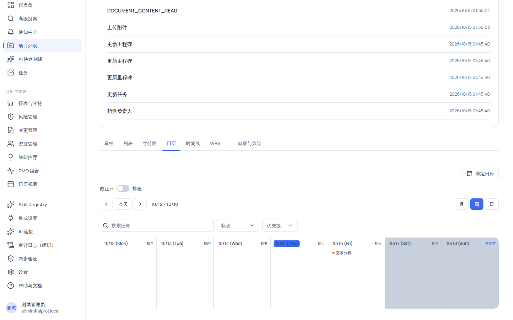

# 使用日历视图按截止日或完整排程安排任务

日历视图有两种模式，适合不同的场景：

- **截止日模式（默认）**：任务按 `截止日` 字段落入日期格，适合快速查看交付高峰；拖拽改期**直接写入截止日**（没有预览确认）。
- **排程模式**：展示任务完整排程（开始→结束区间条）与里程碑，适合对照完整排期；拖拽改期走**乐观预览**，写入失败自动回滚。

两种模式的改期行为不同，请在使用前确认当前模式（右上角的「截止日 / 排程」开关）。

## 适用范围

| 角色                                             | 查看日历 | 拖拽改期（任务）                           | 拖拽改期（里程碑）      |
| ------------------------------------------------ | -------- | ------------------------------------------ | ----------------------- |
| `system_admin` / `org_admin` / `project_manager` | ✓        | ✓（全部任务）                              | ✓（`milestone:update`） |
| `member`                                         | ✓        | 仅**自己负责**的任务（`task:update:self`） | ✓（`milestone:update`） |
| `external_collaborator`                          | ✓        | 仅自己负责的任务                           | ✗                       |
| `readonly_observer`                              | ✓        | ✗（显示「你没有改期权限…」提示条）         | ✗                       |

页面级权限为 `task:view`，无权限时显示「你没有查看项目日历的权限。」

## 开始之前

- 已进入项目详情页。
- 任务需要已设置日期字段：截止日模式要求任务有**截止日**；排程模式要求有开始或结束日期（或属于里程碑）。
- 想对照完整排期与甘特图时，优先使用排程模式。

## 操作步骤

### 步骤 1：进入日历并选择模式

在顶部视图切换器点 **「日历」**，然后在右上角用 **「截止日 / 排程」** 开关切换模式（模式写入 URL 参数 `mode=schedule`，可随链接分享）。

两种模式差异总览：

| 对比项     | 截止日模式                              | 排程模式                              |
| ---------- | --------------------------------------- | ------------------------------------- |
| 展示内容   | 任务按截止日落格                        | 任务区间条 + 里程碑                   |
| 无日期任务 | 不显示                                  | 收进「无日期任务（{count}）」折叠面板 |
| 拖拽改期   | 直接写入新截止日（无预览、无确认）      | 乐观预览，写入失败自动回滚            |
| 里程碑     | 不展示                                  | 以菱形展示，点击查看只读详情          |
| 视图范围   | 月（月首外扩到周界）/周（周一~周日）/日 | 月/周/日                              |

### 步骤 2：查看截止日模式的日历

1. 用工具栏 **「◀」/「今天」/「▶」** 切换时段；标题显示「yyyy年 M月」（月）/「M/d - M/d」（周）/「yyyy年 M月 d日」（日）。
2. 点击任意日期格会切换到该日的日视图。
3. 点击任务 chip 打开任务详情抽屉，可修改截止日等字段。

### 步骤 3：截止日模式拖拽改期

1. 按住任务 chip（可拖动）拖到另一个日期格。
2. 松开后**系统直接把该任务的截止日改为目标日期**（无预览、无确认对话框）。
3. 失败时显示红色 Alert「改期失败，请重试」或具体错误信息，任务仍在原日期。

> [!WARNING]
> 截止日模式的拖拽是**直接写入**，与甘特图的「预览 → 人工确认」流程不同——松开即落库。请确认目标日期无误后再松手。有「无预览确认」这一点与产品其他排程操作不同，是当前版本的既定行为。

### 步骤 4：查看排程模式的完整排程

1. 顶部项类型 Tab：**全部 / 任务 / 里程碑**。
2. 任务显示为横跨开始→结束日期的区间条；里程碑显示为菱形（状态着色）。
3. 点击里程碑打开只读对话框「里程碑详情（只读）」，可看到状态、目标日期；目标日期已过且未达成时显示红字「该里程碑目标日期已过且未达成，处于逾期状态。」（里程碑只读对话框不可编辑，修改目标日期请在甘特图改期模式或里程碑管理中操作）。
4. 展开「无日期任务（{count}）」面板可查看没有开始/结束日期的任务并补设日期。
5. 结果较多时会出现截断提示「结果较多，仅显示当前页。请缩小日期窗口或使用筛选查看更多排程项。」

### 步骤 5：排程模式拖拽改期

1. 用鼠标拖住区间条（或里程碑菱形）移动到目标日期；键盘也可操作：按 <kbd>Space</kbd> 起拖、方向键移动、<kbd>Space</kbd> 落下。
2. 松手后立即显示乐观预览（区块颜色变化），同时后台写入。
3. 写入成功则保留新位置并刷新数据；**失败则自动回滚**并显示红色 Alert。

拖拽的日期计算规则：

| 拖拽对象             | 修改结果                          |
| -------------------- | --------------------------------- |
| 里程碑               | 目标日期 `plannedDate` = 落点日期 |
| 任务（有开始和结束） | 整体平移 Δ 天（起止一起平移）     |
| 任务（仅截止日）     | 截止日 = 落点日期                 |
| 任务（仅开始日）     | 开始日 = 落点日期                 |
| 同日拖拽             | 不产生改动（返回空）              |

改期权限：任务需要 `task:update`，或 `task:update:self` 且为本人负责；里程碑需要 `milestone:update`。无写权限时顶部显示提示条「你没有改期权限，可查看排程与详情，但不能拖拽调整日期。」（`member` 在有 `milestone:update` 时仍可拖里程碑。）

### 步骤 6：使用筛选与链接分享

工具栏提供：搜索框（即时按任务名搜索）、状态下拉（全部状态/未开始/进行中/已完成/已阻塞/已挂起/已取消）、优先级下拉（全部/最低/低/中/高/最高）。筛选与模式、视图、日期全部记录在 URL 中，复制地址栏即可分享同一份日历视图。

> [!NOTE]
> 日历这里的六个状态中文标签与其他视图略有差异：`blocked` 显示为「已阻塞」、`on_hold` 显示为「已挂起」（看板中分别显示为「阻塞」「暂停」），不影响排序与筛选行为。

### 步骤 7：绑定外部日历

点击右上角 **「绑定日历」** 按钮，会跳转到「设置 → 集成」的日历分类（`/settings/integrations?category=calendar`），在那里配置外部日历连接。

## 验证结果

- 截止日模式下把某任务拖到下周一，任务详情中的「截止日期」立即变为下周一（松手即写入）。
- 排程模式下拖里程碑到新日期，松手后菱形位置更新；把任务拖到新周，其开始/结束日期整体平移相同天数。
- 在排程模式把某任务拖到一个保存错误（如网络中断）的场景，区块回滚到原位置并出现红色 Alert。
- 无日期任务出现在「无日期任务」面板，设置日期后进入日历网格。

## 常见问题

### 症状：任务没有出现在日历里

- **可能原因**：任务没有对应的日期字段（截止日模式需要截止日，排程模式需要开始/结束日期），或被筛选条件排除。
- **检查**：任务详情中的日期字段；排程模式的「无日期任务」面板。
- **修复**：在详情抽屉或列表中补设日期。
- **仍失败时**：记录任务 id 与当前模式反馈。

### 症状：拖拽后任务位置跳回了原处

- **可能原因**：写入失败触发了回滚（排程模式），或你没有该任务的改期权限。
- **检查**：屏幕上的红色 Alert 与你的角色权限。
- **修复**：确认自己有 `task:update`（或本人负责 + `task:update:self`）；对仅截止日任务使用截止日模式。
- **仍失败时**：记录操作与 request id 反馈。

### 症状：里程碑拖不动

- **可能原因**：需要 `milestone:update`；`external_collaborator` 与 `readonly_observer` 无此权限。
- **检查**：顶部是否出现「你没有改期权限」提示条。
- **修复**：请项目经理调整角色；或到甘特图改期模式移动里程碑。
- **仍失败时**：记录角色与操作反馈。

### 症状：排程模式下看不到某任务的区间

- **可能原因**：该任务只有截止日（排程模式显示为单日内容而非区间），或日期超出当前显示窗口。
- **检查**：任务详情中的开始日期。
- **修复**：补设开始日期；轻点「今天」回到当前窗口。
- **仍失败时**：记录任务 id 反馈。

## 限制与安全边界

- **两种模式的行为差异是设计事实**：截止日模式拖拽直接写 `endDate`（无预览确认）；排程模式乐观预览 + 失败回滚。请勿把两种行为混为一谈。
- **改期权限行级判定**：`member`/`external_collaborator` 只能改自己负责的任务。
- **里程碑在日历中只读**：点击只弹只读详情；修改目标日期请用甘特图或里程碑管理。
- **配额**：日历每页默认 200 条、上限 200 条；超出当前页显示截断提示。
- **组织隔离**：日历数据严格按当前组织过滤，跨组织任务不可见。

## 下一步

- [使用甘特图排程：改期、依赖、进度与基线](../projects/gantt.mdx)
- [使用列表视图筛选、排序与批量处理任务](../projects/list.mdx)
- [项目视图总览](../projects/views-overview.mdx)
- [权限参考](../reference/permissions.mdx)
