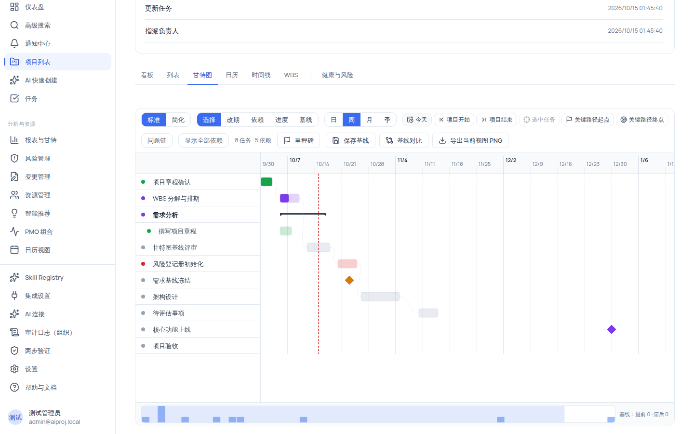
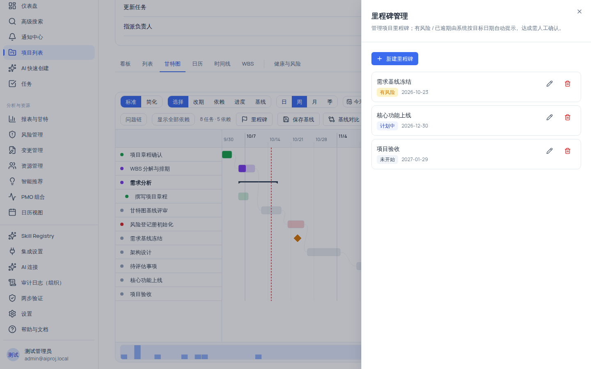

# 使用甘特图排程：改期、依赖、进度、里程碑与基线

甘特图是项目的排程主视图：任务条表示起止时间，连线表示依赖，关键路径被高亮，里程碑以菱形标记，基线用于对比计划与实际偏差。本页是五项交互模式（选择/改期/依赖/进度/基线）的完整操作指南。

**最重要的产品原则**：甘特图里所有排程类修改（改期、依赖、进度、里程碑日期）都走「**预览 → 人工确认 → 写入**」流程——确认前不会写入正式排期。**建立依赖本身不会自动改变任务日期**，需要你主动点「预览排程调整」并确认。

## 适用范围

| 角色                                             | 查看 | 改期/进度/保存基线                  | 建立依赖                                   | 管理里程碑                            |
| ------------------------------------------------ | ---- | ----------------------------------- | ------------------------------------------ | ------------------------------------- |
| `system_admin` / `org_admin` / `project_manager` | ✓    | ✓（`task:update`）                  | ✓（`task:update`）                         | ✓（`milestone:create/update/delete`） |
| `member`                                         | ✓    | ✗（无 `task:update`，显示只读模式） | ✓（`task:update:self` 且为本人负责的任务） | ✓（`milestone:create/update/delete`） |
| `external_collaborator`                          | ✓    | ✗                                   | 仅本人负责的任务                           | ✗（只有 `milestone:view`）            |
| `readonly_observer`                              | ✓    | ✗                                   | ✗                                          | ✗（只有 `milestone:view`）            |

权限要点：

- 无 `task:update` 时，工具栏只显示「选择 / 基线」两种交互模式，右上角显示「只读模式：无编辑权限」。
- 依赖权限单独判定：`task:update` **或** `task:update:self`（本人负责）即可建立依赖——`member` 可以在自己的任务之间拉依赖，但不能改期。
- **`member` 拥有里程碑的创建/更新/删除权限**（与其他任务写权限不同，不要误以为只有项目经理能建里程碑）。

## 开始之前

- 已进入项目详情页并切到「甘特图」。
- 任务需要有起止日期才会渲染任务条：没有任何带日期的任务时显示空态「暂无任务可展示」，提示「为项目添加带起止日期的任务后，甘特图会在此呈现任务条、依赖与关键路径。」
- 想演示关键路径时，先建立若干任务依赖（本教程第 5 步）。
- 修改排程前，建议先「保存基线」以便事后对比偏差（第 8 步）。

## 操作步骤

### 步骤 1：进入甘特图并选择入口

顶部「甘特入口」切换 **标准 / 简化**（只改变呈现，不改变数据）：

| 入口 | 差异                                                                           |
| ---- | ------------------------------------------------------------------------------ |
| 标准 | 显示常规依赖线（视口内常显）、关键路径、WBS 编号，工具栏有「显示全部依赖」开关 |
| 简化 | 隐藏常规依赖线（关键路径仍常显）、显示头像、大圆角，更清爽                     |

统计文字显示 `{叶任务数} 任务 · {依赖数} 依赖`。

### 步骤 2：认识任务条与标记

| 元素            | 形态                                       | 含义                                     |
| --------------- | ------------------------------------------ | ---------------------------------------- |
| 叶子任务        | 语义色轨道（22% 透明底 + 进度填充 + 描边） | 长度=工期，位置=起止日期，填充=进度      |
| 关键路径任务    | 描边为 danger 色（红色系）                 | 决定项目总工期的任务链                   |
| AI 负责人任务   | 虚线描边（`4 2`）                          | 负责人为 AI（Bot）                       |
| 里程碑          | 菱形（状态着色）                           | 项目关键节点，只代表目标日期             |
| 阶段（summary） | 细杆两端下折角                             | 汇总其子任务范围（简化入口为整行灰底纹） |
| 今日线          | 竖线                                       | 当前日期参考线                           |

### 步骤 3：导航与时间粒度

工具栏导航按钮（只改视口，不碰数据）：

| 按钮                        | 作用                                    |
| --------------------------- | --------------------------------------- |
| 今天 / 项目开始 / 项目结束  | 把视口定位到对应位置                    |
| 选中任务                    | 定位到当前选中的任务条（未选中时禁用）  |
| 关键路径起点 / 关键路径终点 | 跳到关键路径的头/尾（无关键路径时禁用） |

「时间粒度」切换 **日 / 周 / 月 / 季**（默认日）。底部「概览条」（mini-map）可拖动改变可见范围，并显示基线摘要（`基线：提前 x · 滞后 y`）。

### 步骤 4：改期（改期模式）

1. 工具栏「交互模式」选 **改期**（需 `task:update`）。
2. 拖动任务条整体移动位置；或拖动任务条右端改期手柄（提示「改期手柄：调整任务「{名称}」工期」，工期最小 1 天）。
3. 松手后弹出 **「确认排程调整」** 对话框：
   - 描述「将影响 {n} 个任务。确认前不会写入正式排期。」
   - 冲突列表（红底，逐项 `{任务名}：{message}`）
   - 对比表格：`任务 / 调整前 / 调整后`（`开始日期 → 结束日期`）
   - 黄色 warnings 提示
   - 按钮 **「取消」** 与 **「确认调整」**（存在冲突或无变更时确认按钮禁用）
4. 点 **「确认调整」**：带预览令牌提交写入，成功提示「排程已更新」与「已同步 {n} 个任务。」；预览令牌过期则提示「预览已过期」（需要重新拖一次）；调度冲突则提示「排程处理失败」。

> [!IMPORTANT]
> 这是「人工确认」红线的体现：所有影响都先在你眼前预览（含冲突与警告），确认前不写入正式排期，也不改变其他任务。

### 步骤 5：建立任务依赖（依赖模式）

1. 工具栏选 **依赖** 模式（需 `task:update` 或本人负责的 `task:update:self`）。
2. 任务条首/尾出现锚点（圆点）；里程碑也有锚点。从一个锚点拖到另一个任务（或里程碑）。
3. 松开后弹出 **「建立任务依赖」** 对话框：

| 参数                 | 说明                                                                                           |
| -------------------- | ---------------------------------------------------------------------------------------------- |
| 依赖类型             | `FS 完成→开始`（默认）/ `SS 开始→开始` / `FF 完成→完成` / `SF 开始→完成`（拖拽方向会推断类型） |
| Lag / Lead（工作日） | 数字，范围 -999 ~ 999，默认 0                                                                  |

4. 点 **「建立依赖」**：成功提示「依赖关系已添加」。随后顶部出现黄色提示条「**依赖已保存；任务日期尚未自动改变。**」旁边是 **「预览排程调整」** 按钮。

> [!WARNING]
> **建立依赖不会自动改期**。依赖只是排程约束；要看到日期被重新计算的效果，请点「预览排程调整」进入确认对话框（走第 4 步的预览确认流程）。删除依赖同理：日期不会自动改回。

常见拦截：任务不能依赖自身（提示「任务不能依赖自身」）；后端会拒绝重复依赖与循环依赖（提示「无法添加：将形成循环依赖」）。

### 步骤 6：调整任务进度（进度模式）

1. 工具栏选 **进度**（需 `task:update`）。
2. 拖动任务条上的进度手柄（提示「进度手柄：调整任务「{名称}」进度，当前 {n}%」）；拖动中任务条上方实时显示百分比文字。
3. 松开后弹出 **「确认进度调整」** 对话框，说明「仅调整任务完成度，确认前不会写入。任务起止日期、依赖与里程碑不会因此改变。」表格列出 任务/调整前/调整后。
4. 点 **「确认调整」** 生效。

进度调整不会隐式改期——日期、依赖与里程碑都保持原样。

### 步骤 7：管理里程碑

点工具栏右侧 **「里程碑」** 按钮（`milestone:view` 才显示）打开「里程碑管理」抽屉：

1. 点 **「新建里程碑」**，填写：

| 字段         | 约束                                                                                                |
| ------------ | --------------------------------------------------------------------------------------------------- |
| 名称         | 1–255 字符，占位「如：需求冻结」                                                                    |
| 目标日期     | 日期选择                                                                                            |
| 状态         | **只能选「未开始 / 计划中 / 已达成」**：`有风险` 与 `已逾期` 是系统按目标日期推导的状态，不能手工选 |
| 描述（可选） | 最多 2000 字符                                                                                      |

2. 提交按钮按状态变化：新建设为「已达成」时显示 **「确认达成」**（达成需要人工确认），编辑时「保存」，新建时「创建」。
3. 里程碑在甘特图主体中以菱形着色显示；在「改期」模式下拖动菱形可调整目标日期（对话说明「仅调整里程碑目标日期，确认前不会写入。任务、依赖与基线不会因此改变。」）。修改的是里程碑 `plannedDate`，**不会连带改动任务**。
4. 删除需要行内确认「确认删除「{名称}」？」；只读角色看到「当前角色为只读，仅可查看里程碑。」

### 步骤 8：保存与对比基线

基线 = 任务起止日期的快照，用于对比排程偏差：

1. 排程稳定后点 **「保存基线」**（仅 `task:update` 可见）。无基线时开启对比会看到黄色提示「尚未保存基线，请先点「保存基线」后再对比」。
2. 打开 **「基线对比」** 开关：每个任务条下方出现基线对比条（底部 3px 色条 + 偏差文字 `滞后 {n}天`（红）/ `提前 {n}天`（绿））。
3. 对比摘要：有差异时显示「提前 {x} · 滞后 {y} · 新增 {z} · 已删除 {w}」；无差异时显示「与基线一致，暂无变更」。
4. 需要外发时点 **「导出当前视图 PNG」**：导出文件名为 `gantt-current-view-{yyyy-MM-dd}.png`，成功提示「当前甘特视图已导出」，失败提示「导出失败」「请稍后重试。」。

### 步骤 9：查看关键路径与问题链

- **关键路径**：决定总工期的任务链，任务条描边为 danger 色；工具栏「关键路径起点/终点」可快速跳转。链上任务延期会直接推迟项目完工。
- **问题链** 按钮（受阻任务存在时才可点）：高亮受阻任务相关的依赖链，方便定位卡点与延误传导。
- **显示全部依赖**（仅标准入口）：无依赖时禁用并提示「当前项目暂无任务依赖」。

### 步骤 10：查看与删除任务依赖详情

选中一个任务后（或从任务详情面板进入），打开「任务依赖详情」对话框与依赖面板：

- 面板头说明「依赖只描述排程约束，不会自动改动任务日期。」
- 分组：**前置任务**（「这些任务约束当前任务」）与**后续任务**（「当前任务约束这些任务」），行内显示 `{类型名} · {±n 天|无延迟}` 与 FS/SS/FF/SF 徽章。
- 添加依赖：选前置任务（Combobox 可搜索；已被占用做前置的候选会排除）、依赖类型、提前/延迟天数，点 **「添加」**；系统会阻止循环依赖。
- 删除依赖有确认步骤，说明「删除后日期不变」（再次确认：删除依赖不会自动改期）。

### 步骤 11：键盘操作（高效路径）

| 按键                                                         | 作用                                                                       |
| ------------------------------------------------------------ | -------------------------------------------------------------------------- |
| <kbd>Tab</kbd> 聚焦任务条，<kbd>Enter</kbd>/<kbd>Space</kbd> | 选中（<kbd>Ctrl</kbd>/<kbd>Cmd</kbd> 多选切换、<kbd>Shift</kbd> 范围选择） |
| <kbd>←</kbd>/<kbd>→</kbd>                                    | 移动日期（<kbd>Shift</kbd> ×5 天）                                         |
| <kbd>↑</kbd>/<kbd>↓</kbd>                                    | 调整进度 ±10%（<kbd>Shift</kbd> ±25%）                                     |
| 改期手柄 <kbd>←</kbd>/<kbd>→</kbd>                           | 调整工期                                                                   |
| 依赖锚点 <kbd>Enter</kbd>/<kbd>Space</kbd>                   | 开始/结束依赖连线                                                          |
| 里程碑菱形 <kbd>←</kbd>/<kbd>→</kbd>                         | 调整目标日期（<kbd>Shift</kbd> ×5 天）                                     |

右键任务条出现「向 Copilot 询问」上下文菜单（只打开 Copilot 面板，不写入数据）。

## 验证结果

- 拖动任务条并确认后，任务的新日期出现在列表与日历中；打开「基线对比」能看到 `滞后 N 天`/`提前 N 天` 标注。
- 建立 FS 依赖并点「预览排程调整」确认后，后置任务的日期按依赖约束排到前置任务之后；若只建立依赖不确认，任务日期保持原样。
- 尝试建立循环依赖（A→B 依赖 + B→A 依赖）：被拒绝并提示「无法添加：将形成循环依赖」。
- 无 `task:update` 的账号打开甘特图：工具栏只有「选择/基线」，并显示「只读模式：无编辑权限」。
- 里程碑设为「已达成」后，菱形状态变为已达成色；目标日期过期未达成时自动显示「已逾期」。

## 常见问题

### 症状：确认调整时按钮是灰的

- **可能原因**：预览存在阻塞冲突（红底冲突列表），或调整没有产生任何变更。
- **检查**：对话框中的冲突列表与「调整前/调整后」表格。
- **修复**：先解决冲突（改回日期或解除相关依赖），再重新拖动。
- **仍失败时**：记录冲突文案与任务 id 反馈。

### 症状：预览提交时报「预览已过期」

- **可能原因**：预览令牌有有效期，拖拽后停留太久或数据已被其他成员修改。
- **检查**：toast 内容。
- **修复**：重新拖动一次并尽快确认。
- **仍失败时**：与改动同一批任务的其他成员协调后重试。

### 症状：建立了依赖但任务日期没变

- **可能原因**：这是产品设计——**依赖建立后任务日期不会自动改变**，需要主动点黄色提示条上的「预览排程调整」并确认。
- **检查**：顶部黄色提示条是否存在。
- **修复**：点「预览排程调整」，查看影响后确认。
- **仍失败时**：记录依赖对与确认过程反馈。

### 症状：看不到依赖连线

- **可能原因**：处于「简化」入口（默认隐藏常规依赖线），或项目确实没有依赖。
- **检查**：入口档位与统计文字「N 依赖」。
- **修复**：切回「标准」入口；无依赖时先建立依赖。
- **仍失败时**：记录任务对反馈。

### 症状：里程碑状态不能选「有风险/已逾期」

- **可能原因**：这两个状态由系统按目标日期自动推导，不能手工选择。
- **检查**：里程碑管理的说明文字。
- **修复**：只设置「未开始/计划中/已达成」；系统会在目标日期临近/过期时自动提示。
- **仍失败时**：记录里程碑与日期反馈。

## 限制与安全边界

- **所有排程修改都是「预览 → 人工确认」**：确认前不写入正式排期；依赖与进度操作同样受此约束。
- **依赖不自动改期**：依赖只是排程约束；改期须经「预览排程调整」人工确认。
- **权限收敛**：改期/进度/保存基线需 `task:update`；建依赖可放宽到本人负责的 `task:update:self`；只读角色只有「选择/基线」模式。
- **里程碑语义**：里程碑只代表目标日期，不直接驱动任务；达成需人工确认，`有风险/已逾期` 为系统推导态。
- **数据规模**：甘特图单项目任务拉取上限约 1000（100/页 × 10 页）。
- **视图偏好**：入口、交互模式、时间粒度等偏好保存在浏览器本地（localStorage 键 `aiproj-gantt`），换浏览器或设备不会带过去。
- **组织隔离**：甘特数据严格按当前组织过滤。

## 下一步

- [使用日历视图按截止日或完整排程安排任务](../projects/calendar.mdx)
- [用 WBS 分解项目工作](../projects/wbs.mdx)
- [使用列表视图筛选、排序与批量处理任务](../projects/list.mdx)
- [项目视图总览](../projects/views-overview.mdx)
