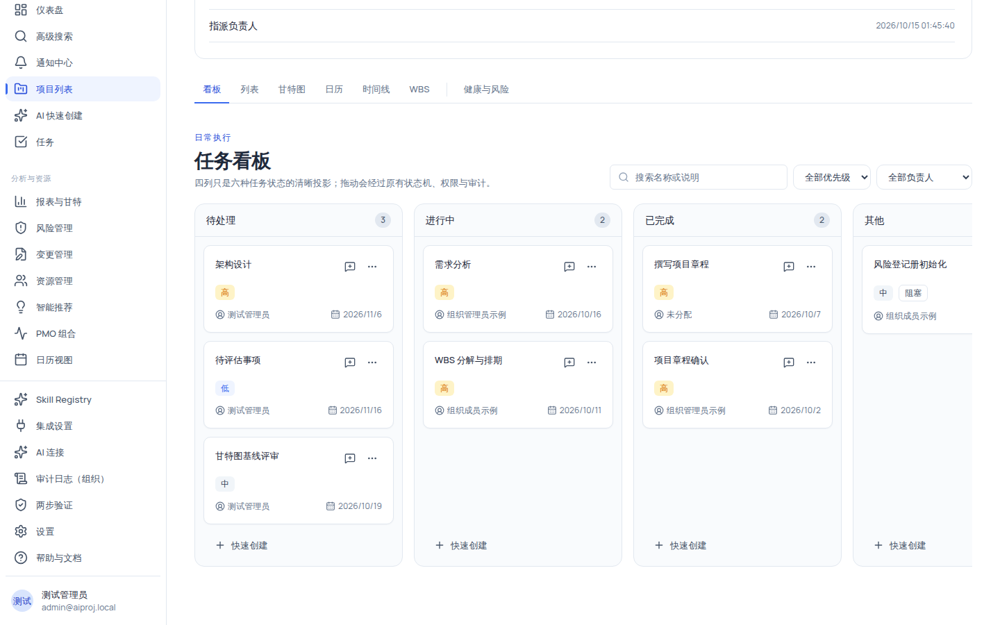
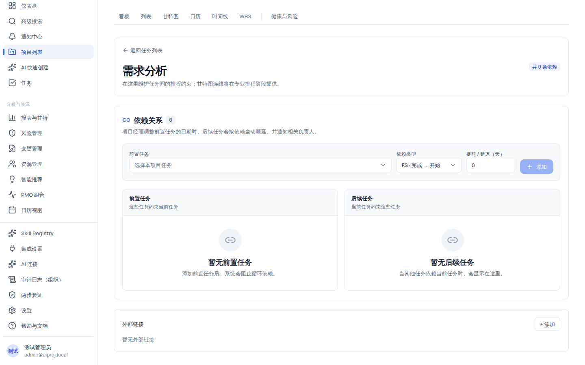

# 使用看板视图管理任务

看板把任务按状态分成四列展示：「待处理」「进行中」「已完成」「其他」。拖动卡片即可流转状态，但**不是任意拖**——所有移动都经过六态状态机、行级权限与审计校验；拖入「其他」列时必须显式选择真实状态（阻塞/暂停/已取消）。

看板是项目详情的默认落地视图，也是日常执行最常用的入口。卡片上的数据（优先级、负责人、截止日、进度）与列表、甘特图等其余视图完全共享。

## 适用范围

| 角色                            | 查看看板 | 拖动/移动任务                              | 快速创建任务       |
| ------------------------------- | -------- | ------------------------------------------ | ------------------ |
| `system_admin`                  | ✓        | ✓                                          | ✓                  |
| `org_admin` / `project_manager` | ✓        | ✓（全部任务）                              | ✓                  |
| `member`                        | ✓        | 仅**自己负责**的任务（`task:update:self`） | ✓（`task:create`） |
| `external_collaborator`         | ✓        | 仅自己负责的任务                           | ✗                  |
| `readonly_observer`             | ✓        | ✗（卡片不可拖动）                          | ✗                  |

页面级权限为 `task:view`，无权限时整页显示「你没有查看项目看板的权限。」

## 开始之前

- 已进入项目详情页（进入方法见「创建第一个项目」）。
- 了解项目成员的职能分工，以便把任务拖给正确的角色处理。
- 若你要拖动任务，先确认自己的角色：`member` 只能拖动**自己负责**的任务。

## 操作步骤

### 步骤 1：进入看板并理解四列

在项目详情页顶部视图切换器点 **「看板」**（该视图也是 `/projects/:id` 的默认落地视图，直接访问项目详情会自动跳到这里）。

四列是六种任务状态的投影，映射关系如下：

| 看板列 | 对应状态                            | 说明                                         |
| ------ | ----------------------------------- | -------------------------------------------- |
| 待处理 | `not_started`                       | 尚未开始                                     |
| 进行中 | `in_progress`                       | 正在执行                                     |
| 已完成 | `completed`                         | 已完成（可回到进行中）                       |
| 其他   | `blocked` / `on_hold` / `cancelled` | 三种状态合为一列，拖入时必须显式选择真实状态 |

每列列头显示列名与任务计数（灰底圆角数字）；空列显示虚线框「可将任务拖到这里」；单列加载失败时显示红底「本列加载失败」并保留其他列可操作。

### 步骤 2：筛选与定位任务

看板顶部提供三个筛选器：

| 筛选器 | 选项                          | 说明                                     |
| ------ | ----------------------------- | ---------------------------------------- | --- | --------------------------- |
| 搜索框 | 自由输入                      | 按任务名称或说明搜索，输入后自动防抖生效 |
| 优先级 | 全部优先级/最高/高/中/低/最低 | 原生下拉                                 |
| 负责人 | 全部负责人 + 项目成员         | 成员显示为姓名或邮箱（`fullName          |     | email` 回退为「成员 #id」） |

筛选只影响当前看板呈现；整板无匹配任务时显示「没有符合筛选条件的任务」与「清除筛选」按钮，项目本身没有任务时显示「还没有任务」。

### 步骤 3：拖动卡片流转状态

1. 把鼠标放在任务卡片上（整张卡片即拖动手柄，指针位移超过 6px 才判定为拖动，避免误触）。
2. 拖到目标列：系统按落点位置计算排序锚点（落在哪张卡前/后）。
3. 释放后等待写入：成功则卡片瞬移到新列；失败则整板回滚到拖拽前的状态并在顶部显示红色 Alert「无法移动任务」及具体原因。

移动必须遵守六态状态机，非法转换会被前端直接拦截并提示，例如：

> 不能从“待处理”直接移动到“已完成”。

完整状态机（与后端一致）：

| 当前状态             | 允许移到的状态             |
| -------------------- | -------------------------- |
| 待处理 `not_started` | 进行中、已取消             |
| 进行中 `in_progress` | 已完成、阻塞、暂停、待处理 |
| 阻塞 `blocked`       | 进行中、已取消             |
| 暂停 `on_hold`       | 进行中、已取消             |
| 已完成 `completed`   | 进行中                     |
| 已取消 `cancelled`   | 待处理                     |

> [!IMPORTANT]
> 合法状态必须**逐级或按上表路径**流转：例如 `not_started` 不能一步跳到「已完成」，需要先到「进行中」，再拖到「已完成」。所有移动都会写入审计日志（记录来源状态、目标状态与目标列）。

### 步骤 4：拖入「其他」列时显式选择状态

「其他」列收纳三种状态，拖入时必须二选一或三选一：

1. 把卡片拖到「其他」列空白处或卡位。
2. 系统弹出 Alert「请选择“其他”列中的真实状态」，提供三个按钮：**阻塞 / 暂停 / 已取消**（按钮按状态机禁用，例如从「待处理」只能选「已取消」）。
3. 点选一个状态，或点 **「取消」** 放弃移动。

不选择状态直接拖入会被拒绝（422「移动到“其他”列时必须选择阻塞、暂停或已取消状态」），任务状态与位置保持不变。

### 步骤 5：快速创建任务

1. 在任意列的底部点 **「快速创建」**（该入口仅 `task:create` 权限可见）。
2. 在表单中输入任务名称（最多 255 字符）。
3. 若当前是「其他」列，还需要选择**状态**（阻塞/暂停/已取消，默认阻塞）。
4. 点 **「创建」**：任务创建在该列对应状态，并出现在其余视图；点 **「取消」** 关闭表单。

### 步骤 6：点击卡片查看与编辑详情

点击任意卡片打开**任务详情抽屉**（六视图与日历共用同一个抽屉）：

- 抽屉说明「关闭后会保留当前看板筛选与滚动位置。」
- 可编辑时，「负责人」显示为下拉（含「未分配」选项；AI 负责人不可改选）。
- 底部是评论线程与外部链接面板，可继续协作。

### 步骤 7：使用卡片「更多」菜单

点击卡片右上角「更多」菜单（以 `{任务名}` 命名）：包含「移动到」六个目标（待处理/进行中/已完成/阻塞/暂停/已取消，非法目标按状态机禁用）；窄屏设备上还会出现「向 Copilot 询问」入口（只打开 Copilot 面板，不写入数据）。

## 验证结果

- 把任务拖到「进行中」后，刷新页面或切换到列表视图，该任务状态已变为「进行中」。
- 把任务拖到「其他」列并选择「阻塞」后，卡片进入「其他」列并显示「阻塞」状态徽章。
- 尝试把「待处理」任务一步拖到「已完成」：操作被拦截并提示不能直接移动。
- `member` 尝试拖动非自己负责的任务：卡片不可拖动（不挂拖动手柄）。

## 常见问题

### 症状：卡片拖不动

- **可能原因**：当前角色没有该任务的更新权限（`member` 只能拖动自己负责的任务；`readonly_observer` 完全不可拖），或浏览器拖拽被禁用。
- **检查**：同项目其他成员能否拖动同一张卡；卡片是否在鼠标位移 6px 后才起拖。
- **修复**：让项目经理调整角色后重试；或用卡片「更多」菜单里的「移动到」操作流转状态。
- **仍失败时**：记录角色、任务 id 与浏览器版本，提交支持。

### 症状：拖到「已完成」列被拦截

- **可能原因**：这是状态机对非法转换的正常拦截（如从「待处理」直接到「已完成」）。
- **检查**：目标任务当前状态。
- **修复**：先拖到「进行中」，再拖到「已完成」。
- **仍失败时**：记录来源/目标状态与任务 id 反馈。

### 症状：拖入「其他」列后任务没有移动

- **可能原因**：没有在 Alert 中选择真实状态，或选择了状态机不允许的状态。
- **检查**：Alert 中三个按钮的可用状态。
- **修复**：重新拖动并点选一个可用状态（阻塞/暂停/已取消）。
- **仍失败时**：记录操作序列与 request id 反馈。

### 症状：某列只显示了一部分任务

- **可能原因**：看板每列独立分页，每页 25 条。
- **检查**：列底部的 `page / totalPages` 指示。
- **修复**：使用列底左右箭头翻页（按钮以「{列名}上一页/下一页」命名）。
- **仍失败时**：记录列名与页码反馈。

## 限制与安全边界

- **拖动不是任意拖**：六态状态机由前后端双重校验，非法转换不落库、不改变排序位置。
- **行级权限**：`member`/`external_collaborator` 只能改自己负责的任务；无权卡片不可拖动，但「更多」菜单的合法移动仍然可用。
- **「其他」列必须显式选状态**：这是产品设计，防止把三种状态混为一列时产生歧义。
- **所有写入走审计**：每次看板移动记录来源/目标状态与目标列。
- **AI 边界**：卡片上的「向 Copilot 询问」只打开 Copilot 面板，不修改任何数据。
- **配额**：每列每页 25 条；后端 perPage 上限 100。

## 下一步

- [项目视图总览](../projects/views-overview.mdx)
- [使用列表视图筛选、排序与批量处理任务](../projects/list.mdx)
- [使用甘特图排程：改期、依赖、进度与基线](../projects/gantt.mdx)
- [权限参考](../reference/permissions.mdx)
