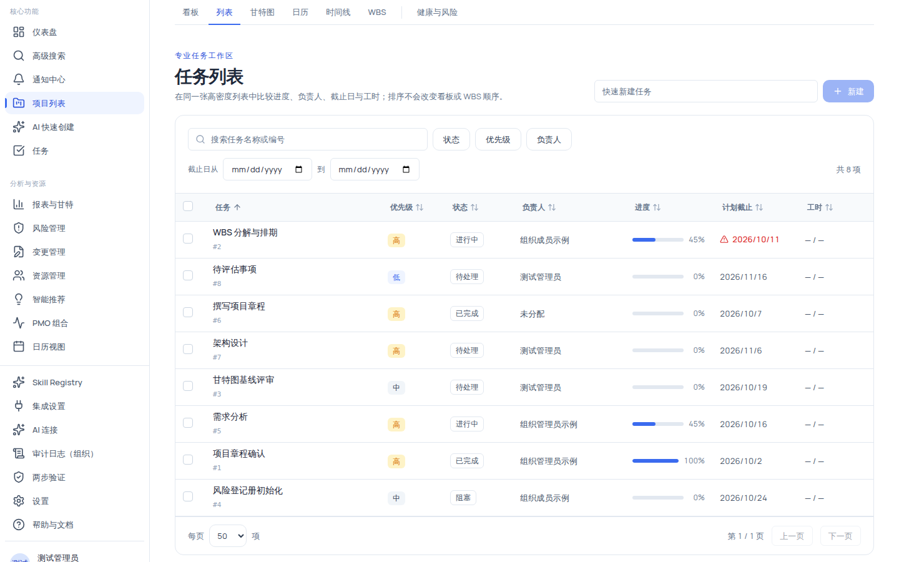

# 使用列表视图筛选、排序与批量处理任务

列表视图把项目全部任务放进同一张高密度表格（虚拟滚动），在同一屏内比较进度、负责人、截止日与工时。筛选、排序与批量操作是它的核心：排序不会改变看板或 WBS 的顺序；批量操作按动作逐项授权，**部分成功**（失败项保留供重试）。

## 适用范围

| 角色                            | 查看与筛选 | 批量编辑/变更状态                          | 重新指派              | 移入回收站            | 快速新建           |
| ------------------------------- | ---------- | ------------------------------------------ | --------------------- | --------------------- | ------------------ |
| `system_admin`                  | ✓          | ✓                                          | ✓                     | ✓                     | ✓                  |
| `org_admin` / `project_manager` | ✓          | ✓                                          | ✓                     | ✓                     | ✓                  |
| `member`                        | ✓          | 仅**自己负责**的任务（`task:update:self`） | ✗（需 `task:assign`） | ✗（需 `task:delete`） | ✓（`task:create`） |
| `external_collaborator`         | ✓          | 仅自己负责的任务                           | ✗                     | ✗                     | ✗                  |
| `readonly_observer`             | ✓          | ✗                                          | ✗                     | ✗                     | ✗                  |

列表页本身需要 `task:view`，无权限时显示「你没有查看项目任务列表的权限。」

## 开始之前

- 已进入项目详情页。
- 明确你要处理的任务集合：是「按负责人找」，还是「按日期范围找」，还是「批量改状态」。
- 批量操作前先确认你的角色权限（见上表），避免选中后才发现动作不可用。

## 操作步骤

### 步骤 1：进入列表并读懂表格

在顶部视图切换器点 **「列表」**。表格列含义：

| 列       | 内容              | 说明                                                                      |
| -------- | ----------------- | ------------------------------------------------------------------------- |
| 选择     | Checkbox          | 表头全选当前页（半选态用 indeterminate 表示）                             |
| 任务     | 名称 + 灰色 `#id` | 悬停出现下划线，点击打开任务详情抽屉                                      |
| 优先级   | Badge             | 最低=中性、低=info、中=中性、高=warning、最高=danger                      |
| 状态     | Badge             | 六态：未开始/进行中/已完成/受阻/已暂停/已取消                             |
| 负责人   | 姓名或邮箱        | AI 负责人带 Bot 图标与 AI 标签；无负责人显示「未分配」                    |
| 进度     | 进度条 + 百分比   | 如 `45%`                                                                  |
| 计划截止 | `yyyy/M/d`        | 未设置显示「未设置」；逾期（截止日已过且未完成/未取消）显示红字与预警图标 |
| 工时     | 实际 h / 预计 h   | 无数据显示 `—`                                                            |

### 步骤 2：搜索与筛选

筛选区包含：

| 筛选器        | 说明                                              |
| ------------- | ------------------------------------------------- |
| 搜索框        | 按任务名称或编号搜索，300ms 防抖后写入 URL        |
| 状态          | 下拉多选：未开始/进行中/已完成/受阻/已暂停/已取消 |
| 优先级        | 下拉多选：最高/高/中/低/最低                      |
| 负责人        | 下拉多选（成员名）                                |
| 截止日从 / 到 | 两个日期输入框，只筛选「计划截止」字段            |

多选筛选器的选中数量会以圆角计数显示在按钮上；有筛选时显示 **「清除筛选」** 按钮。筛选与排序状态都记录在 URL 中，你可以复制地址栏分享给同事查看同一批结果。

### 步骤 3：排序

1. 点击列头按该列排序：`+` 表示升序、`-` 表示降序，排序条件写入 URL 的 `sort=`。
2. 多字段排序：按住 <kbd>Shift</kbd> 再点击列头，可叠加第二、第三列（**最多 3 个排序字段**，超出会被拒绝并提示「列表最多支持三个排序字段」）。

可排序字段白名单：名称、优先级、状态、负责人、进度、计划截止、预计工时、实际工时、创建时间、更新时间（共 10 个）。

### 步骤 4：分页

表格底部提供「每页 20 / 50 / 100 项」（默认 50）与「第 {page} / {totalPages} 页」及上/下一页按钮。每页上限 100（后端 perPage 1–100）。

### 步骤 5：打开任务详情

点击任务名称打开详情抽屉，可修改负责人、截止日、依赖等共享字段；修改后列表即时刷新。

### 步骤 6：批量操作

1. 勾选任务（**一次最多选择 100 项**）；超过上限时显示 Alert「选择数量受限：一次最多选择 100 项任务。」
2. 底部批量操作栏出现「已选择 {n} 项」与动作下拉：

| 动作       | 所需权限                            | 可设置内容                                                                                                      |
| ---------- | ----------------------------------- | --------------------------------------------------------------------------------------------------------------- |
| 批量编辑   | `task:update` 或 `task:update:self` | 优先级（保持不变 + 五档）、审核人（需 `task:assign` 才显示）、计划开始、计划结束、预估工时（≥0）、进度（0–100） |
| 重新指派   | 额外需要 `task:assign`              | 新负责人（不指派 + 成员）                                                                                       |
| 变更状态   | `task:update` 或 `task:update:self` | 目标状态六项：未开始/进行中/已完成/已阻塞/已暂停/已取消                                                         |
| 移入回收站 | `task:delete`                       | 无额外参数；有红色说明「任务将移入回收站，30 天内可恢复。含活动子任务的父任务会保留并报告失败。」               |

3. 选择动作并填写参数后点 **「设置并执行」**，在确认对话框中点 **「确认处理 {n} 项」**（移入回收站的按钮为危险样式）或 **「返回」**。
4. 处理结果以结果 Alert 呈现：「已成功处理 {n} 项，失败 {m} 项」，并逐项列出「任务 {id}：{message}」（最多列 5 条，更多合并为「另有 {n} 项失败」）。

> [!IMPORTANT]
> 批量操作是**逐项独立事务、顺序执行**：系统会逐项处理，失败项不会回滚已成功的任务，并会保留选中状态供你修正后重试。

### 步骤 7：快速新建任务

点击顶部「快速新建」输入框（占位「快速新建任务」，最多 255 字符），输入名称后点 **「新建」**；新任务立即出现在列表顶部。该入口仅 `task:create` 权限可见（通过命令面板导航到列表时，输入框会自动聚焦）。

## 验证结果

- 筛选（如状态=进行中）+ 排序（如截止日升序）组合后，能在 1 分钟内定位目标任务。
- 按住 <kbd>Shift</kbd> 点击多个列头，表格按多字段排序；尝试加第 4 个字段会被拒绝。
- 勾选 3 项执行「变更状态 → 已完成」后，结果 Alert 显示成功数；其余视图（看板/甘特）中这 3 个任务状态同步为已完成。
- 把某任务截止日改为过去日期后，该行「计划截止」变红并出现预警图标与「（逾期）」无障碍文本。

## 常见问题

### 症状：过滤后结果为空

- **可能原因**：多个筛选条件组合过严。
- **检查**：按钮上的选中计数与截止日范围。
- **修复**：逐个放宽条件，或用「清除筛选」回到全量列表。
- **仍失败时**：记录筛选组合与 request id 反馈。

### 症状：勾选时提示「选择数量受限」

- **可能原因**：已选数量加上本次勾选超过 100 项上限。
- **检查**：当前已选数量。
- **修复**：先取消部分已选任务，再勾选新任务。
- **仍失败时**：记录操作步骤反馈。

### 症状：批量操作部分任务失败

- **可能原因**：失败项多为权限不足、状态机不允许的转换，或父任务含活动子任务（删除场景）。
- **检查**：结果 Alert 逐项列出的失败原因。
- **修复**：失败任务仍处于选中状态，修正参数后重试；删除含活动子任务的父任务时，先删除或移走子任务。
- **仍失败时**：记录失败任务 id 与 message 反馈。

### 症状：看不到某个任务

- **可能原因**：分页只展示当前页、筛选排除了它，或任务在回收站里。
- **检查**：顶部「共 {total} 项」计数、筛选条件、每页条数。
- **修复**：清空筛选/调整每页条数；回收站任务需在「任务批量管理 → 回收站」恢复（见该页面内的「任务回收站」说明）。
- **仍失败时**：记录任务 id 反馈。

## 限制与安全边界

- **排序与筛选只影响呈现**：不会改变看板或 WBS 顺序，也不改变数据本身。
- **批量动作逐项授权**：`member` 的批量编辑/变更状态只对**自己负责**的任务生效；「重新指派」需 `task:assign`、「移入回收站」需 `task:delete`，`member` 无这两项权限，对应动作不会出现。
- **部分成功语义**：批量处理失败项不回滚已成功项。
- **回收站规则**：任务删除进入回收站，30 天内可恢复；超过 30 天无法恢复（「软删除已超过 30 天，无法恢复」）；含活动子任务的父任务不能删除。
- **配额**：一次最多选择 100 项；每页 20/50/100；排序最多 3 个字段。

## 下一步

- [项目视图总览](../projects/views-overview.mdx)
- [使用看板视图管理任务](../projects/kanban.mdx)
- [使用时间线视图回顾项目动态](../projects/timeline.mdx)
- [权限参考](../reference/permissions.mdx)
