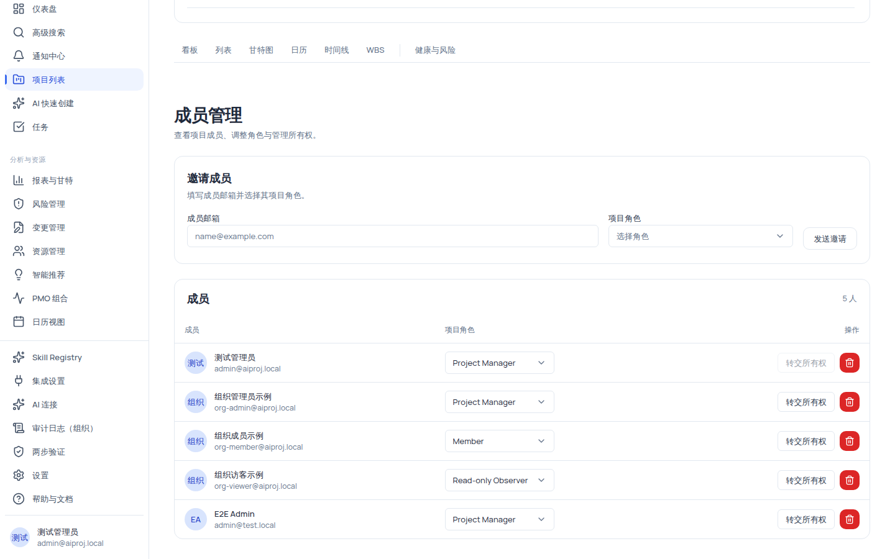

# 管理项目成员与项目角色

项目成员管理页（`/projects/:id/members`）用于查看项目成员、调整项目角色与管理所有权。**「邀请」的含义是按邮箱把「已注册且属于当前组织」的用户直接添加为项目成员**——系统不会发送邀请邮件，这是本页面最重要的事实边界。项目角色独立于组织级角色，种子数据提供五个英文命名的系统角色。

## 适用范围

| 角色                                | 查看成员 | 邀请成员 / 改角色 / 移除 / 转交所有权 |
| ----------------------------------- | -------- | ------------------------------------- |
| 项目经理（project_manager）         | ✅       | ✅（需 `project:member:manage`）      |
| 组织管理员（org_admin）             | ✅       | ✅（同上）                            |
| 成员（member）                      | ✅       | ❌                                    |
| 外部协作者（external_collaborator） | ✅       | ❌                                    |
| 只读观察者（readonly_observer）     | ✅       | ❌                                    |

> 页面本身由 `project:view` 兜底（所有项目角色均可查看）；所有写操作（邀请、改角色、移除、转交）都要求 `project:member:manage`。系统管理员是平台级角色，项目域实际权限取决于部署时的角色授予。

## 开始之前

- 目标用户**已经注册**，且属于当前组织（组织成员或项目创建者）——邀请失败最常见的原因就是这两条不满足。
- 知道目标用户的注册邮箱（格式 `name@example.com`）。
- 本机演示环境（默认组织种子数据）有 4 名成员可直接观察：测试管理员与组织管理员示例均为 `Project Manager`，组织成员示例为 `Member`，组织访客示例为 `Read-only Observer`。

## 操作步骤

### 步骤 1：进入成员管理页

1. 进入项目后，在项目头「最近活动」区域点击**「成员管理」**，或直接访问 `/projects/:id/members`。
2. 你会看到标题「成员管理」，说明「查看项目成员、调整角色与管理所有权。」；页面右上角显示「N 人」。

### 步骤 2：邀请成员（添加已注册的组织内用户）

1. 在「邀请成员」卡片中填写两个字段：

| 字段     | 必填 | 约束         | 说明                                                                                     |
| -------- | ---- | ------------ | ---------------------------------------------------------------------------------------- |
| 成员邮箱 | ✅   | 合法邮箱格式 | placeholder `name@example.com`；校验失败提示「请输入成员邮箱」/「请输入有效的邮箱地址」  |
| 项目角色 | ✅   | 项目内角色   | placeholder「选择角色」，下拉列出**项目内（自定义）角色**，种子为 5 个系统角色（见下文） |

2. 点击**「发送邀请」**。
3. 成功：新成员立即出现在下方成员表格中（无需对方任何操作）。
4. 失败：卡片内出现红色 Alert「邀请失败」+ 具体消息：

| 错误消息             | 含义与处理                                                             |
| -------------------- | ---------------------------------------------------------------------- |
| 用户不存在或已禁用   | 邮箱没有对应用户，或用户被禁用；换用已注册邮箱                         |
| 该用户不属于当前组织 | 用户注册了但不在当前组织（组织成员与项目创建者放行）；需先在组织层加入 |
| 该用户已是项目成员   | 重复添加（错误码 2006）；无需操作                                      |
| 项目角色不存在       | 所选角色已失效；重新选择角色                                           |

> [!IMPORTANT]
> **邀请 ≠ 发邮件**：这里的「邀请」只是成员表新增一行，系统不会向对方发送任何邀请邮件或通知。若你的目标用户尚未注册，请先在[组织成员邀请](/help/articles/getting-started.invite-your-team)中完成注册与加入组织。

### 步骤 3：调整项目角色

1. 在成员表格的「项目角色」列找到目标成员：有 `project:member:manage` 时是角色下拉，否则是只读 Chip。
2. 选择新角色后即生效（保存为即时写入，无二次确认对话框）。
3. 系统角色的**名称直接显示英文**（UI 无中文映射）：

| 系统角色（英文显示名） | 项目域能力概览                               |
| ---------------------- | -------------------------------------------- |
| Project Owner          | 项目所有者；见下方所有权规则                 |
| Project Manager        | 项目全套管理权限（同组织管理员的项目域权限） |
| Member                 | 任务查看 + 自己负责的任务更新 + 里程碑增删改 |
| External Collaborator  | 项目/任务只读 + 自己负责任务更新             |
| Read-only Observer     | 全部只读                                     |

> [!NOTE]
> 角色下拉的数据来自项目内角色（`/projects/:id/roles`），是**项目级角色**，与组织级六角色（system_admin/org_admin/member/external_collaborator/readonly_observer 等）是两个概念，勿混用。

### 步骤 4：移除成员

1. 点击目标成员行的垃圾桶按钮。
2. 移除成功即从列表消失；原 Owner 无法被移除（见下）。

### 步骤 5：转交 Project Owner 所有权

1. 仅非 Owner 行显示**「转交所有权」**按钮；你**不能转交给自己**（自己的行按钮禁用）。
2. 点击目标成员行的「转交所有权」→ 系统校验目标必须是当前项目成员（否则 422「转交目标必须是当前项目成员」）。
3. 成功后：**目标成员变为 Project Owner，原 Owner 自动降为 Project Manager**。
4. 若系统角色配置缺失，页面提示「项目角色配置缺失」，联系组织管理员检查角色种子。

> [!WARNING]
> Owner 行约束（全部需要先转交所有权）：
>
> - 角色下拉对 Owner 行禁用，直接改角色返回 422「不能直接变更 Project Owner 角色，请先转交所有权」；
> - 直接移除 Owner 返回 422「不能移除 Project Owner，请先转交所有权」；
> - 转交所有权不可回退到「无 Owner」状态，任何时刻恰好一位 Project Owner。

## 验证结果

- 新成员出现在成员表格且角色正确；用该成员的账号登录可看到项目（外部协作者仅只读）。
- 改角色后，该成员在任务批量管理页可见的动作集立即变化（如 Member → 无「重新指派/移入回收站」按钮）。
- 转交所有权后，成员列表的「项目所有者」Chip 移动到新 Owner；原 Owner 降为 Project Manager。
- 审计日志记录 `PROJECT_MEMBER_ADDED` / `ROLE_CHANGED` / `REMOVED` / `OWNER_TRANSFERRED` 事件。

## 常见问题

**症状：邀请后对方说没收到邮件。**
可能原因：本功能不做邮件邀请——「邀请」即按邮箱直接添加为成员。
检查：成员表格中是否已出现对方行。
修复：无需对方操作；若对方无法登录，先确认其账号已注册并属于当前组织。

**症状：邀请时报「该用户不属于当前组织」。**
可能原因：目标用户注册在其他组织（组织成员与项目创建者放行除外）。
检查：对方账号的组织归属。
修复：由组织管理员将其加入当前组织后再邀请。

**症状：找不到「转交所有权」按钮 / 按钮是禁用的。**
可能原因：你没有 `project:member:manage`；或你正看着自己的行（不能转给自己）。
检查：当前账号角色；目标行是否为本人。
修复：由有权限的角色操作；转交时选择其他成员。

**症状：Owner 想离职但没有其他管理员。**
可能原因：不能直接删除或改掉 Owner 角色。
修复：添加一名成员 → 转交所有权给他 → 原 Owner 自动降为 Project Manager，之后可按需移除或改角色。

**症状：成员页打不开或操作报「资源不存在」。**
可能原因：组织隔离——跨组织访问项目成员资源一律 404；或项目角色配置缺失。
检查：当前登录组织与项目归属。
修复：切换到正确组织；角色缺失时联系组织管理员检查 `project_roles` 种子。

## 安全与限制

- **不发邀请邮件**：邀请即添加已注册组织内用户；未注册用户需先完成注册与组织加入。
- **Owner 保护**：Owner 行不可改角色、不可移除、不可转给自己；转交后原 Owner 自动降为 Project Manager。
- **写入即审计**：增删成员、改角色、转交所有权均写审计事件。
- **权限门槛**：所有写操作需要 `project:member:manage`（项目经理、组织管理员持有）。
- **组织隔离**：跨组织成员操作表现为资源不存在（404）。
- **AI 边界**：成员管理无 AI 自动流程，全部为普通 API 写入。

## 下一步

- [批量管理任务与维护任务详情](/help/articles/projects.tasks-batch-and-detail)
- [组织成员邀请](/help/articles/getting-started.invite-your-team)
- [权限参考](/help/articles/reference.permissions)
