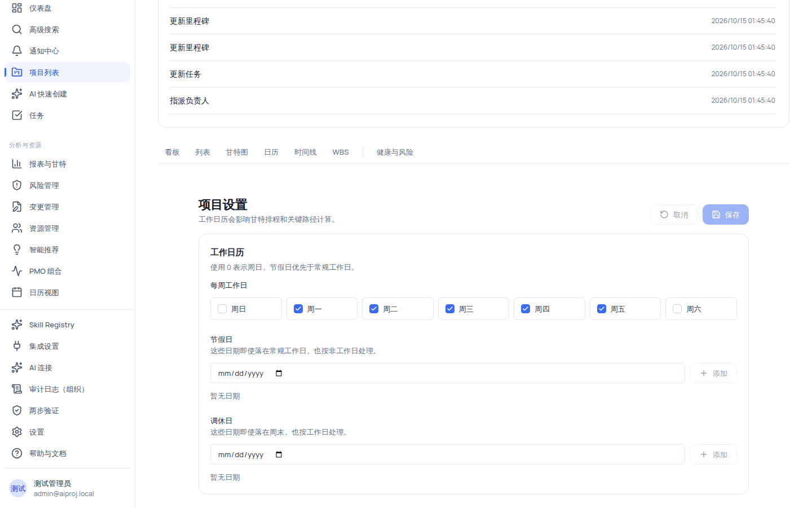

# 配置项目工作日历

项目设置页（`/projects/:id/settings`）当前只有一张卡：**工作日历**。它定义项目「哪些天算工作日」，直接影响甘特排程与关键路径计算。**保存工作日历不会回溯改写已有任务的起止日期**——这是本页面最重要的边界，改动只影响保存后的排程计算。

## 适用范围

| 角色                                | 查看工作日历 | 保存修改                  |
| ----------------------------------- | ------------ | ------------------------- |
| 项目经理（project_manager）         | ✅           | ✅（需 `project:update`） |
| 组织管理员（org_admin）             | ✅           | ✅（同上）                |
| 成员（member）                      | ✅           | ❌                        |
| 外部协作者（external_collaborator） | ✅           | ❌                        |
| 只读观察者（readonly_observer）     | ✅           | ❌                        |

> 页面查看由项目头的 `project:view` 兜底；保存需要 `project:update` 且项目**未归档**。无权限或项目已归档时，页面顶部出现只读 Alert（见下），仅可查看。

## 开始之前

- 已进入目标项目（项目头「最近活动」→「项目设置」）。
- 明确本项目的排班约定：哪几天是常规工作日、哪些日期放假、哪些周末需要补班（调休）。
- 了解数字表示：**0 = 周日，1 = 周一 … 6 = 周六**（每周工作日勾选框按此顺序排列）。
- 本机演示环境默认每周工作日为周一~周五（`[1,2,3,4,5]`），节假日与调休日为空。

## 操作步骤

### 步骤 1：进入项目设置页

1. 进入项目后，在项目头「最近活动」区域点击**「项目设置」**，或直接访问 `/projects/:id/settings`。
2. 你会看到标题「项目设置」，说明「工作日历会影响甘特排程和关键路径计算。」；页面主体是「工作日历」卡片，卡内说明「使用 0 表示周日，节假日优先于常规工作日。」

### 步骤 2：配置每周工作日

1. 在「每周工作日」区域勾选/取消周日~周六共 7 个勾选框。
2. 约束：**至少选择一个工作日**，否则保存被拦截（「至少选择一个每周工作日。」）。

### 步骤 3：添加节假日

1. 在「节假日」区域输入日期（date 输入框）并点击**「添加」**。
2. 已添加的日期以 Chip 展示，chip 上可删除。
3. 含义：**这些日期即使落在常规工作日，也按非工作日处理**（如法定假期、公司年假）。

### 步骤 4：添加调休日

1. 在「调休日」区域输入日期并点击**「添加」**（结构同节假日）。
2. 含义：**这些日期即使落在周末，也按工作日处理**（如周末补班日）。

### 步骤 5：校验并保存

1. 点击**「保存」**前，客户端会校验三条规则：

| 校验规则                                                  | 拦截提示                                 |
| --------------------------------------------------------- | ---------------------------------------- |
| 同一日期不能重复添加（含节假日/调休日各自内部与交叉重复） | 「日期不能重复。」                       |
| 同一日期不能同时作为节假日和调休日                        | 「同一日期不能同时作为节假日和调休日。」 |
| 至少选择一个每周工作日                                    | 「至少选择一个每周工作日。」             |

2. 保存成功后：已保存值与当前草稿同步；相关视图（甘特图等）刷新，任务起止日期不变。
3. 保存失败：出现 Alert「工作日历未保存」+ 具体消息。
4. 页面状态提示：
   - 草稿有未保存变更时出现 Alert「有未保存的工作日历变更」+「保存后相关视图会刷新，但任务起止日期不会自动改写。」；
   - 无 `project:update` 权限时出现只读 Alert「当前账号没有项目更新权限，只能查看工作日历。」；
   - 项目已归档时出现只读 Alert「项目已归档，需先恢复才能修改工作日历。」；
   - 点击**「取消」**可还原到上次已保存值。

> [!NOTE]
> 优先级：**节假日优先于常规工作日**（一处日期即使同时是常规工作日，只要进了节假日列表就按非工作日）。跨周/跨月的连续放假需要逐日添加，没有「区间批量添加」入口。

## 验证结果

- 保存成功后提示不再有未保存变更；刷新页面后勾选与日期保持。
- 在甘特图中，新增节假日的日期上不再出现任务排期落点（排程计算使用工作日历）。
- 已有任务的起止日期在保存前后完全不变（设计如此，非故障）。
- 审计日志出现 `PROJECT_WORKING_CALENDAR_UPDATED` 事件。
- 用只读角色（如本机 `org-viewer@aiproj.local`）打开设置页：只见只读 Alert，保存按钮不可用。

## 常见问题

**症状：保存工作日历后，已有任务的日期全变了 / 没变。**
答案：没变是**预期行为**——保存只影响之后的排程与关键路径计算，不会回溯改写已有任务日期（页面 Alert 明示）。
处理：如需调整既有任务日期，请在[批量管理](/help/articles/projects.tasks-batch-and-detail)或甘特图中显式修改。

**症状：同一个日期加不进节假日或调休日。**
可能原因：该日期已被添加过（重复），或同时在节假日与调休日两个列表中。
检查：两个列表的 Chip。
修复：先从另一个列表删除，或直接在 chip 上删除重复项。

**症状：保存按钮是灰的 / 无法点击。**
可能原因：当前账号没有 `project:update`，或项目已归档。
检查：页面顶部的只读 Alert 文案（是权限问题还是归档问题）。
修复：权限问题请项目经理/组织管理员调整角色；归档项目需先恢复项目（项目头「恢复项目」，需 `project:update`）再修改。

**症状：节假日/调休日规则在甘特图上没生效。**
可能原因：保存成功但排期计算发生在保存前，或该日期的任务本身有显式起止日期。
检查：确认保存成功且无校验错误；确认甘特排程使用项目工作日历（说明「工作日历会影响甘特排程和关键路径计算」）。
修复：保存后刷新甘特图；已有任务日期不会自动重排，需手动调整。

## 安全与限制

- **只影响未来排程**：保存不回溯改写任何已有任务起止日期；依赖、基线同样不动。
- **仅工作日历**：当前设置页只有「工作日历」一张卡，没有自定义字段、状态列等其他设置项。
- **归档只读**：已归档项目不能修改工作日历，需先恢复项目。
- **写入审计**：每次保存写 `PROJECT_WORKING_CALENDAR_UPDATED` 审计事件。
- **组织隔离**：工作日历按项目/组织隔离，跨组织访问表现为资源不存在（404）。
- **AI 边界**：本页无 AI 入口；保存为普通 API 写入。

## 下一步

- [甘特图与依赖排程](/help/articles/projects.gantt)
- [管理项目里程碑](/help/articles/projects.milestones)
- [限制与状态参考](/help/articles/reference.limits-and-statuses)
