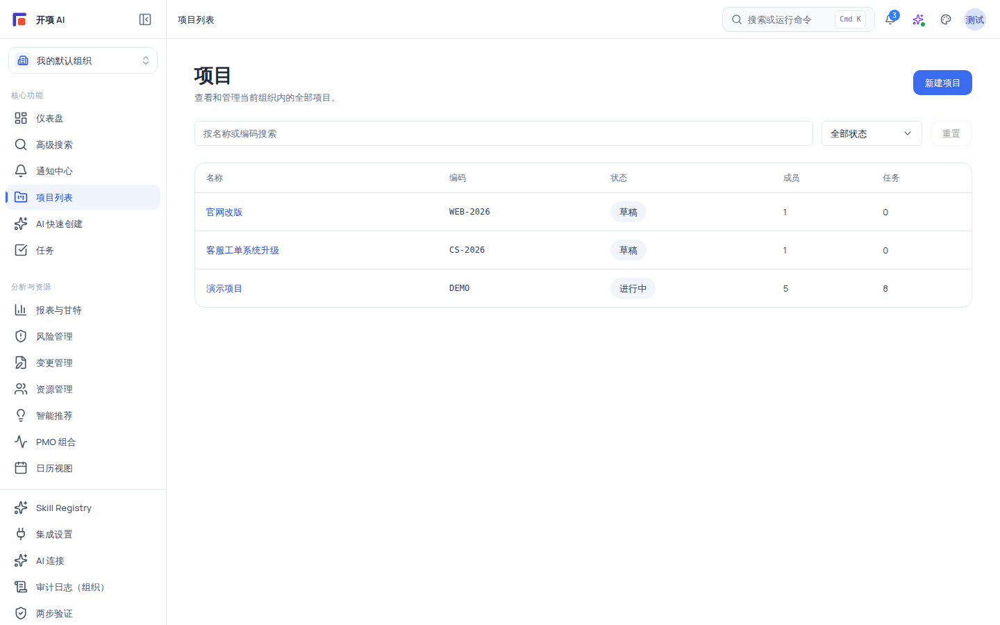
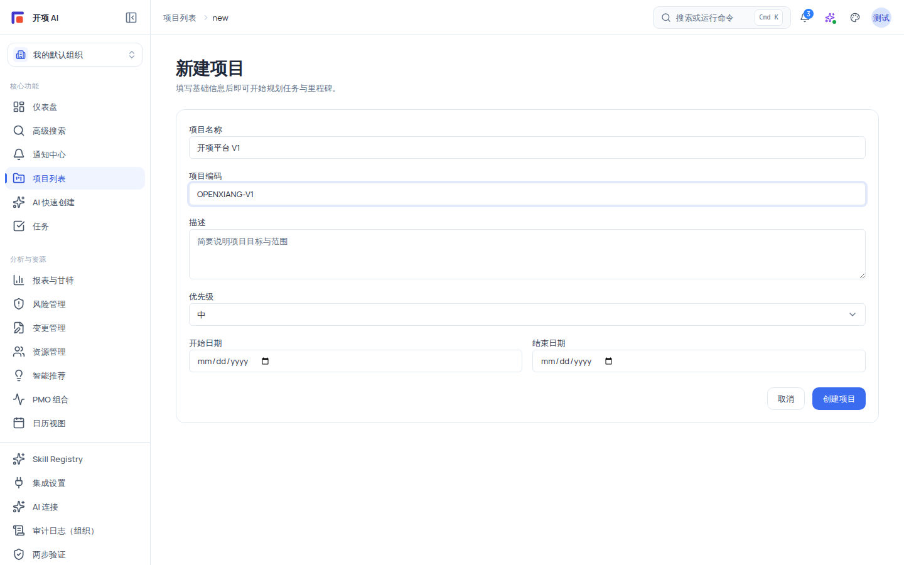

# 查看项目列表并创建新项目

项目是平台一切业务数据的容器（组织级隔离的第一层边界）。本文介绍组织内项目列表的读法、新建项目的表单规则、项目详情共享头的六项指标，以及归档/删除的语义。

## 适用范围

| 角色                                                     | 查看列表与项目详情 | 新建项目                 | 归档/删除项目                          |
| -------------------------------------------------------- | ------------------ | ------------------------ | -------------------------------------- |
| `system_admin`                                           | ✓                  | ✓（哨兵权限）            | ✓                                      |
| `org_admin`                                              | ✓                  | ✓（`project:create`）    | ✓（`project:update`/`project:delete`） |
| `project_manager`                                        | ✓                  | ✗（无 `project:create`） | ✓（`project:update`/`project:delete`） |
| `member` / `external_collaborator` / `readonly_observer` | ✓                  | ✗                        | ✗                                      |

权限要点：

- **「新建项目」按钮只对 `org_admin`（及 `system_admin`）显示**——`project:create` 只授予组织管理员；`project_manager` 及以下无此权限。
- 归档/恢复按钮按 `project:update` 渲染，删除按钮按 `project:delete` 渲染（两者 `org_admin` 与 `project_manager` 都有）。
- 列表入口需要 `project:view`；无权限的登录用户侧边栏不显示「项目列表」入口。

## 开始之前

- 已登录并处于某个组织（无组织时列表页显示「请先选择组织」）。
- 准备好项目基础信息：名称（必填）、编码（可选）、描述、优先级与起止日期。
- 编码规则（后端强制，务必遵守）：**首字符必须是字母或数字**，后续可包含字母、数字、短横线 `-` 或下划线 `_`，最长 64 字符，组织内唯一。

## 操作步骤

### 步骤 1：进入项目列表

从主导航「核心功能 → 项目列表」进入 `/projects`。页面标题「项目」，副标题「查看和管理当前组织内的全部项目。」

列表表格列：

| 列   | 内容                                                      |
| ---- | --------------------------------------------------------- |
| 名称 | 链接到项目详情（主色、悬停下划线）                        |
| 编码 | 等宽小字；未设置显示 `—`                                  |
| 状态 | Chip 徽章（草稿/计划中/进行中/暂停/已完成/已取消/已归档） |
| 成员 | 项目成员数（无数据显示 `—`）                              |
| 任务 | 项目任务数（无数据显示 `—`）                              |

每页 10 条，底部「上一页/下一页」与「第 {page} / {totalPages} 页」分页。

### 步骤 2：搜索与筛选

1. 搜索框（占位「按名称或编码搜索」）输入关键词即时过滤。
2. 状态下拉 8 项：`全部状态 / 草稿 / 计划中 / 进行中 / 暂停 / 已完成 / 已取消 / 已归档`（默认全部状态）。
3. 点 **「重置」** 清空筛选（无筛选时按钮禁用）。

> [!NOTE]
> 列表**默认不显示已归档项目**；要看归档项目，请在状态下拉选择「已归档」单独筛选。空态分两种：无筛选时显示「还没有项目」+「新建项目」按钮；有筛选无结果时显示「没有匹配的项目」+「清除筛选」。

### 步骤 3：读懂项目健康度与剩余天数

点击项目名称进入项目详情；顶部共享项目头显示编码（或「未设置项目编码」）、项目名与描述（或「尚未填写描述」），下方是 6 张指标卡（aria 标签「项目关键指标」）：

| 指标     | 读法                                                                                                          |
| -------- | ------------------------------------------------------------------------------------------------------------- |
| 进度     | `{progressPercent}%`                                                                                          |
| 健康度   | 按数值映射为文字：绿色=「正常」、黄色/橙色=「警告」、红色=「危险」、无值=「未评估」（提示「状态以文字显示」） |
| 成员     | 项目成员数                                                                                                    |
| 任务     | 项目任务数                                                                                                    |
| 里程碑   | 里程碑数                                                                                                      |
| 剩余天数 | 距计划结束日期的剩余天数；无值显示 `—`                                                                        |

> [!TIP]
> 健康度是**文字为准**的指标（正常/警告/危险/未评估），不要只凭图标颜色判断；项目头下方还可能显示指标警告区（每条一个 warning 提示条）。

### 步骤 4：新建项目

1. 在项目列表点右上角 **「新建项目」**（`/projects/new`；仅 `project:create` 可见）。
2. 填写表单（字段校验前后端双重执行）：

| 字段     | 是否必填   | 约束与示例                                                                   |
| -------- | ---------- | ---------------------------------------------------------------------------- |
| 项目名称 | 必填       | 1–255 字符；示例「开项平台 V1」                                              |
| 项目编码 | 选填       | **首字符为字母或数字**，可含 `-`/`_`，≤64 字符，组织内唯一；示例 `AIPROJ-V1` |
| 描述     | 选填       | ≤2000 字符；占位「简要说明项目目标与范围」                                   |
| 优先级   | 默认「中」 | 低 / 中 / 高 / 紧急                                                          |
| 开始日期 | 选填       | `YYYY-MM-DD`                                                                 |
| 结束日期 | 选填       | `YYYY-MM-DD`；不能早于开始日期                                               |

3. 点 **「创建项目」**（提交中显示 loading）：成功后自动跳转到新项目详情页（默认落地到看板视图）。
4. 失败时显示 Alert「创建项目失败」+ 具体原因（如「项目编码已被使用」）。

> [!IMPORTANT]
> 编码校验的已知细节：前端表单允许 `_` 或纯数字开头，但**后端要求首字符为字母或数字**——以 `_abc` 之类的编码提交会在服务端被拒绝。请直接按后端规则填写（字母/数字开头）。编码在组织内唯一，重复创建会提示「项目编码已被使用」。

### 步骤 5：归档与恢复

- **归档**：项目头操作区点 **「归档项目」**（`project:update` 门控）。归档后项目从默认列表消失（除非筛「已归档」），归档状态下**不能编辑**（系统提示「项目已归档，需先恢复才能编辑」）。
- **恢复**：在已归档项目详情页点 **「恢复项目」**，项目回到 `active` 状态并重新出现在列表。
- 归档/恢复会通知项目成员。

### 步骤 6：删除项目

点 **「删除项目」**（danger 样式，`project:delete` 门控）：先弹 `window.confirm('确认删除该项目？')`，确认后删除并返回项目列表。删除为软删除（回收站语义），操作需谨慎。

## 验证结果

- 创建项目后自动进入该项目详情页，默认视图为看板；列表页出现新项目且带任务数 0。
- 用非法编码（如下划线开头）提交：收到「创建项目失败」提示；改用字母开头后成功。
- 归档后刷新列表：该项目在「全部状态」下不可见；切到「已归档」筛选可见；恢复后回到「进行中」状态列表。
- 成员/项目经理登录：列表页右上角没有「新建项目」按钮（`project:create` 仅 `org_admin`/`system_admin`）。

## 常见问题

### 症状：没有「新建项目」按钮

- **可能原因**：当前角色没有 `project:create`（仅 `org_admin`/`system_admin` 拥有）。
- **检查**：你当前组织内的角色。
- **修复**：请组织管理员创建项目后把你加为项目成员；或改用侧边栏「AI 快速创建」生成草案（AI 只生成草案，仍需人工确认后落库）。
- **仍失败时**：联系组织管理员核对组织角色。

### 症状：项目编码提交失败

- **可能原因**：编码以非字母/数字的首字符开头（前端与后端校验规则不一致，后端要求首字符为字母或数字），或编码在组织内已存在。
- **检查**：编码首字符与列表中的既有编码。
- **修复**：改为字母/数字开头（如 `V1`、`AIPROJ-V1`）；换一个未使用的编码。
- **仍失败时**：记录编码与返回提示反馈。

### 症状：列表里找不到某个项目

- **可能原因**：它已归档（默认不显示），或你不属于该项目所在组织（跨组织项目一律 404，不泄露存在性）。
- **检查**：状态下拉切到「已归档」；确认当前组织。
- **修复**：筛选「已归档」；跨组织项目需由该组织把你加为成员。
- **仍失败时**：记录组织与项目编码反馈。

### 症状：想归档却看不到「归档项目」按钮

- **可能原因**：该按钮按 `project:update` 渲染，`member` 及以下无此权限；项目已归档时按钮会变成「恢复项目」。
- **检查**：项目状态与你当前角色。
- **修复**：请 `org_admin`/`project_manager` 操作。
- **仍失败时**：记录项目 id 与角色反馈。

## 限制与安全边界

- **项目状态机**：状态切换受状态机约束，非法切换被拒绝（422「不能从 {当前} 切换到 {目标}」）：

| 当前状态         | 可切换                         |
| ---------------- | ------------------------------ |
| 草稿 draft       | 计划中、进行中、已归档、已取消 |
| 计划中 planning  | 进行中、暂停、已归档、已取消   |
| 进行中 active    | 暂停、已完成、已归档、已取消   |
| 暂停 on_hold     | 进行中、已归档、已取消         |
| 已完成 completed | 进行中、已归档                 |
| 已取消 cancelled | 进行中、已归档                 |
| 已归档 archived  | 进行中（恢复）                 |

- **组织隔离**：所有项目查询自动附加当前组织的过滤器；跨组织的项目 id 返回 404（不泄露存在性），不存在「跨组织共享项目」。
- **归档语义**：归档后项目不可编辑，恢复后回到 `active`；归档项目默认不在列表。
- **删除语义**：删除为软删除（`force=true` 才会硬删级联；前端删除按钮不带 force）。
- **AI 边界**：AI 快速创建只会生成项目草案，必须经人工审查确认后才落库为正式项目。
- **配额**：列表每页 10 条；项目数量受组织套餐上限约束（示例组织 free 档 max_projects=10）。

## 下一步

- [项目视图总览：六种视图与共享数据模型](../projects/views-overview.mdx)
- [使用看板视图管理任务](../projects/kanban.mdx)
- [AI 快速创建项目](../ai/ai-quick-create.mdx)
- [权限参考](../reference/permissions.mdx)
