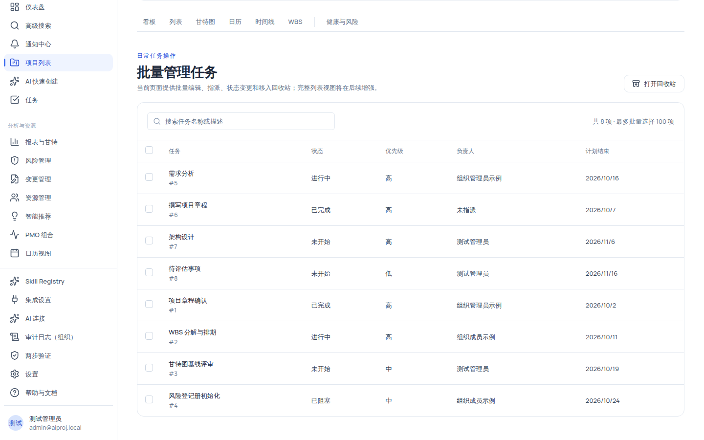

# 批量管理任务与维护任务详情

项目进入执行期后，日常高频操作集中在两处：**任务批量管理页**（`/projects/:id/tasks`）负责一次处理多项任务的共性问题；**任务详情抽屉**（看板/列表/日历中点击任务打开）与**独立详情页**（`/projects/:id/tasks/:taskId`）负责单条任务的属性查看与排程依赖维护。这两处共享同一套任务数据，改动会同步到全部视图。

## 适用范围

| 角色                                | 查看任务 | 批量编辑 / 变更状态 | 重新指派         | 移入回收站       |
| ----------------------------------- | -------- | ------------------- | ---------------- | ---------------- |
| 项目经理（project_manager）         | ✅       | ✅                  | ✅               | ✅               |
| 组织管理员（org_admin）             | ✅       | ✅                  | ✅               | ✅               |
| 成员（member）                      | ✅       | 仅限自己负责的任务  | ❌（按钮不显示） | ❌（按钮不显示） |
| 外部协作者（external_collaborator） | ✅       | 仅限自己负责的任务  | ❌（按钮不显示） | ❌（按钮不显示） |
| 只读观察者（readonly_observer）     | ✅ 只读  | ❌                  | ❌               | ❌               |

> 说明：上表以项目域角色权限为准。系统管理员是平台级角色，其项目域实际权限取决于部署时的角色授予，不在本表范围。
>
> 权限标识：查看 `task:view`；批量编辑与变更状态 `task:update`（或 `task:update:self` 且本人负责）；重新指派额外要求 `task:assign`；移入回收站 `task:delete`。

## 开始之前

- 已进入目标项目（项目访问方式见[创建第一个项目](/help/articles/getting-started.create-first-project)）。
- 项目里已有至少一项任务；本机演示环境登录 `admin@aiproj.local`（口令 `password123`）后，「演示项目」自带 4 条种子任务可直接练习。
- 如需批量「重新指派」「移入回收站」，确认当前账号持有对应权限（见上表）。

## 操作步骤

### 步骤 1：进入任务批量管理页

1. 进入项目后，在项目头「最近活动」区域点击**「任务批量管理」**，或直接访问 `/projects/:id/tasks`。
2. 你会看到页面标题区：小字「日常任务操作」+ 主标题「批量管理任务」，说明为「当前页面提供批量编辑、指派、状态变更和移入回收站；完整列表视图将在后续增强」。
3. 页面右上角有一个**「打开回收站」**按钮（垃圾桶图标）；只有持有 `task:delete` 的角色能看到它，详见[从任务回收站恢复误删任务](/help/articles/projects.tasks-recycle-bin)。

### 步骤 2：选择要处理的任务

1. 用顶部搜索框按**名称或描述**过滤任务（placeholder「搜索任务名称或描述」）；搜索框右侧显示「共 N 项 · 最多批量选择 100 项」。
2. 勾选表格首列的复选框选择任务；表头复选框可全选当前页（20 项/页），支持半选状态（indeterminate）。
3. 查看每行信息：任务名可点击（跳转到独立详情页，行下附 `#{任务id}`）；负责人为空显示「未指派」；计划结束为空显示「未设置」；状态与优先级均有徽章。
4. 需要更多任务时翻页继续选择；**单次批量处理上限为 100 项**，超出部分不会被选中。

> [!NOTE]
> 页面右下角的分页区域显示「第 x / y 页」与「上一页/下一页」；每页固定 20 条。

### 步骤 3：选择批量动作

1. 页面底部出现 sticky 批量操作栏：显示「已选择 N 项」+ 动作下拉 +「取消选择」+「设置并执行」。
2. 打开动作下拉，可选动作按你的权限裁剪：

| 动作       | 说明                                         | 所需权限                            |
| ---------- | -------------------------------------------- | ----------------------------------- |
| 变更状态   | 把所选任务统一切换到目标状态                 | `task:update` 或 `task:update:self` |
| 批量编辑   | 批量修改优先级、审核人、日期、预估工时、进度 | `task:update` 或 `task:update:self` |
| 重新指派   | 把所选任务统一指派给一名成员（或「不指派」） | 上述权限 + `task:assign`            |
| 移入回收站 | 软删除所选任务，30 天内可恢复                | `task:delete`                       |

只持有 `task:update:self` 的角色（成员/外部协作者）只会在**自己负责的任务**被选中时看到前两个动作；「重新指派」与「移入回收站」的按钮不会出现。

### 步骤 4：填写参数并执行

点击**「设置并执行」**后弹出对话框，标题为「{动作} · N 项」，并提示「系统会逐项处理；失败项不会回滚已经成功的任务，并会保留供你重试。」按动作填写字段：

**变更状态**：下拉「目标状态」——六项：**未开始 / 进行中 / 已完成 / 已阻塞 / 已暂停 / 已取消**。注意批量变更同样走状态机校验，对某项任务非法的组合会在该项上报错，但不影响其他项。

**重新指派**：「新负责人」下拉——「不指派」+ 项目成员（成员显示为 姓名 || 邮箱 || 用户 {id}）。

**批量编辑**：全部选填，但一个字段都不填时「确认处理」按钮禁用。

| 字段          | 可选值                                | 说明                       |
| ------------- | ------------------------------------- | -------------------------- |
| 优先级        | 保持不变 / 最低 / 低 / 中 / 高 / 最高 | 选「保持不变」则该字段不变 |
| 审核人        | 保持不变 / 不指派 / 项目成员          | 同上                       |
| 计划开始      | 日期                                  | —                          |
| 计划结束      | 日期                                  | 不能早于计划开始           |
| 预估工时      | 数字 ≥ 0                              | —                          |
| 进度（0–100） | 数字 0–100                            | —                          |

**移入回收站**：无字段，只有警告文案「任务将移入回收站，30 天内可恢复。含活动子任务的父任务会保留并报告失败。」，按钮变为红色危险样式。

确认无误后点击**「确认处理 N 项」**。

### 步骤 5：查看处理结果

1. 处理完成后对话框内/下方出现结果 Alert：**「已成功处理 X 项，失败 Y 项」**；全部成功时额外提示「相关任务列表与项目统计已刷新」。
2. 存在失败项时，Alert 里列出失败明细（每条「任务 {id}：{错误消息}」，最多 5 条；其余折叠为「另有 N 项失败」）。
3. **失败项会自动保持勾选**，方便你修正后重试；成功项取消勾选。
4. 常见失败原因：非法状态转换（422「不能从 X 切换到 Y」）、结束日期早于开始日期（422「结束日期不能早于开始日期」）、父任务存在未删除子任务、被指派者不是本项目活跃成员（422「被指派者必须是本项目的活跃成员」）。

> [!NOTE]
> 批量执行器对每项任务使用独立事务、顺序执行：部分成功不会回滚已成功的项，也不会中断后续项。

### 步骤 6：从看板、列表或日历打开任务详情抽屉

1. 在[看板](/help/articles/projects.kanban)、专业[列表视图](/help/articles/projects.list)或日历视图中点击任意任务卡片/行/事件，打开**任务详情抽屉**。
2. 抽屉标题为任务名（标题旁有 Copilot 内联触发按钮），描述提示「关闭后会保留当前看板筛选与滚动位置」。
3. 徽章行展示：状态徽章 +「进度 {进度百分比}%」；如果任务负责人是 AI 智能体，会显示 AI 徽章「AI 出方案」，且负责人不可手动改派。
4. 信息栅格展示：负责人 / 截止日期（空时显示「未设置」）/ 子任务数 / 依赖数 / 评论数；「说明」区块为空时显示「暂无说明」。
5. 你有 `task:update`（或 `task:update:self` 且本人负责）时，负责人是下拉框（aria-label「指派负责人」，选项「未分配」+ 项目成员，AI 智能体类型成员会被过滤），**切换即保存**（PATCH 后刷新详情与全部任务缓存）；权限不足时该字段以纯文本展示。
6. 抽屉下方是评论区（CommentThread）与「外部链接」面板。

### 步骤 7：在独立详情页维护任务依赖

从批量管理页点击任务名（或从抽屉进入）打开独立详情页 `/projects/:id/tasks/:taskId`。页面头部说明：「在这里维护任务间的排程约束」，并有徽章「共 N 条依赖」。该页包含两张卡片：**依赖关系**与**外部链接**。

1. **添加前置依赖**：在「依赖关系」面板的添加表单中：
   - 「前置任务」Combobox：搜索并选择本项目任务（候选 = 项目全部任务，排除自身与已有前置；placeholder「选择本项目任务」）。
   - 「依赖类型」下拉，四种类型见下表；
   - 「提前 / 延迟（天）」数字输入：默认 0，显示为「无延迟」/「+N 天」/「-N 天」；
   - 点击**「添加」**（未选前置时禁用）。
2. **查看分组**：面板分「前置任务（这些任务约束当前任务）」与「后续任务（当前任务约束这些任务）」两组，空态提示「暂无前置任务」「暂无后续任务」。
3. **解除依赖**：点击行内垃圾桶 → 行内出现「删除后日期不变」提示与「确认解除」「取消」按钮，需**二次点击**才生效。
4. 成功后出现 toast「依赖关系已添加」/「依赖关系已解除」。

| 依赖类型         | 含义                                       |
| ---------------- | ------------------------------------------ |
| FS · 完成 → 开始 | 前置任务完成后，当前任务才能开始（最常用） |
| SS · 开始 → 开始 | 前置任务开始后，当前任务才能开始           |
| FF · 完成 → 完成 | 前置任务完成后，当前任务才能完成           |
| SF · 开始 → 完成 | 前置任务开始后，当前任务才能完成           |

> [!IMPORTANT]
> 依赖**只描述排程约束，不会自动改动任务日期**（面板说明、删除确认、甘特图提示三处文案一致）。循环依赖（DFS 环检测）、自依赖、重复依赖、跨项目前置任务都会被服务端拒绝（「将形成循环依赖」「任务不能依赖自身」「该任务依赖已存在」「前置任务必须属于当前项目」等）。

## 任务状态与状态机

### 三套状态中文标签（按页面区分）

同一套状态在不同页面显示不同中文词，均为系统实际文案：

| 后端状态值  | 批量管理页 / 批量操作栏 / 回收站 | 看板卡片、详情抽屉、「移动到」菜单 | WBS 树状态列 |
| ----------- | -------------------------------- | ---------------------------------- | ------------ |
| not_started | 未开始                           | 待处理                             | 待开始       |
| in_progress | 进行中                           | 进行中                             | 进行中       |
| completed   | 已完成                           | 已完成                             | 已完成       |
| blocked     | 已阻塞                           | 阻塞                               | 受阻         |
| on_hold     | 已暂停                           | 暂停                               | 已暂停       |
| cancelled   | 已取消                           | 已取消                             | 已取消       |

### 合法转换表

前后端使用同一张状态机表（`task-status` / `task_status_machine`），非法转换返回 422「不能从 X 切换到 Y」；同状态转换合法且幂等（不写状态审计）：

| 当前状态      | 可转换到                           |
| ------------- | ---------------------------------- |
| 未开始/待处理 | 进行中、已取消                     |
| 进行中        | 已完成、阻塞、暂停、未开始（回退） |
| 已阻塞        | 进行中、已取消                     |
| 已暂停        | 进行中、已取消                     |
| 已完成        | 进行中（重新打开）                 |
| 已取消        | 未开始                             |

**状态副作用**：转为「已完成」时回填实际完成时间（仅当为空）；首次转为「进行中」时回填实际开始时间；已完成 → 进行中（重新打开）时清空实际完成时间。

## 验证结果

- 批量执行后结果 Alert 显示「已成功处理 X 项，失败 Y 项」，成功项在表格中的状态/负责人/字段立即更新。
- 在列表、看板、甘特视图中能看到同一批任务的变更（数据共享，非页面复制）。
- 详情抽屉与独立详情页显示一致的属性与依赖计数。
- 无权限的动作不可见（按钮不出现）或操作被服务端拒绝。

## 常见问题

**症状：批量操作栏里看不到「重新指派」或「移入回收站」。**
可能原因：当前角色没有 `task:assign` 或 `task:delete` 权限。
检查：对照适用范围表格确认角色；成员与外部协作者只有自己负责的任务可编辑。
修复：由项目经理/组织管理员调整项目角色；或自行只勾选自己负责的任务。
仍失败时：记录角色与勾选项反馈。

**症状：批量变更状态后部分任务没变。**
可能原因：这些任务的当前状态不允许直接转到目标状态（状态机硬约束）。
检查：结果 Alert 的失败明细（「不能从 X 切换到 Y」）。
修复：先把这些任务改到合法前置状态，再重新批量变更；失败项会自动保留勾选。
仍失败时：记录任务 id 与前后状态提交。

**症状：删除任务失败，提示需要先删除子任务。**
可能原因：该任务是父任务，且存在活动子任务。
检查：批量管理页或详情中的子任务列表。
修复：先删除或移走子任务，再删除父任务（批量场景下该项单独失败，其余照常处理）。
仍失败时：记录任务树结构反馈。

**症状：添加依赖提示「将形成循环依赖」。**
可能原因：A 依赖 B 的同时，B（直接或间接）依赖 A。
检查：依赖面板的前置/后续分组。
修复：解除形成环的那条依赖后再添加。
仍失败时：记录依赖链反馈。

**症状：详情抽屉里负责人、截止日期是纯文本，没有下拉。**
可能原因：当前角色无 `task:update`，也非本人负责（`task:update:self` 仅限本人）。
检查：当前登录账号与任务负责人。
修复：由有权限的成员修改，或调整项目角色。

## 安全与限制

- **批量上限**：单次最多 100 项（前后端双重限制），超出部分不会被选中；后端校验「最多批量选择 100 项」。
- **部分成功语义**：批量执行不保证原子性，失败项不会回滚已成功项；失败明细最多展示 5 条，其余折叠。
- **删除边界**：含活动子任务的父任务不可删除；任务移入回收站后 30 天内可恢复，**不提供永久删除**（见[回收站](/help/articles/projects.tasks-recycle-bin)）。
- **依赖只约束不排程**：依赖关系不会自动改写任何任务日期，也不自动重排甘特。
- **组织隔离**：任务、依赖、成员等所有项目级资源按组织隔离，跨组织访问一律表现为「资源不存在」（404），不是 403。
- **AI 边界**：页面上的 Copilot 触发均为内联建议入口，任何 AI 产出都需要人工确认后才落库；本页所有写入走普通 API + 审计，无自动执行路径。
- 子任务嵌套深度上限 3 级；任务层级与 WBS 是两棵不同的树，不要混用（WBS 见[用 WBS 分解工作任务](/help/articles/projects.wbs)）。

## 下一步

- [从任务回收站恢复误删任务](/help/articles/projects.tasks-recycle-bin)
- [管理项目里程碑](/help/articles/projects.milestones)
- [权限参考](/help/articles/reference.permissions)
- [限制与状态参考](/help/articles/reference.limits-and-statuses)
