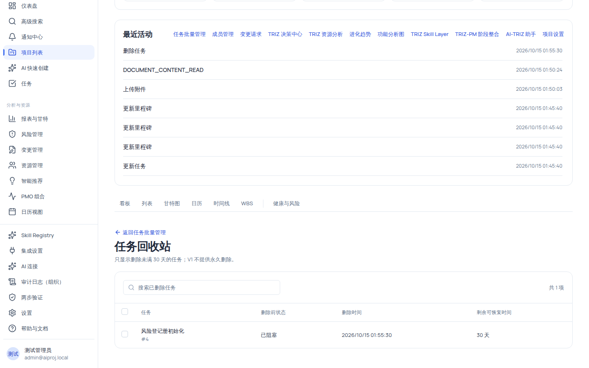

# 从任务回收站恢复误删任务

任务被「移入回收站」后并没有立刻消失：它会进入项目回收站保留 **30 天**。在此期间你可以按名称搜索、查看删除信息，并批量恢复到普通任务视图。**V1 不提供永久删除**，超出 30 天窗口后任务不再显示且无法恢复。

## 适用范围

| 角色                                | 进入回收站 | 搜索/查看 | 恢复任务 |
| ----------------------------------- | ---------- | --------- | -------- |
| 项目经理（project_manager）         | ✅         | ✅        | ✅       |
| 组织管理员（org_admin）             | ✅         | ✅        | ✅       |
| 成员（member）                      | ❌         | ❌        | ❌       |
| 外部协作者（external_collaborator） | ❌         | ❌        | ❌       |
| 只读观察者（readonly_observer）     | ❌         | ❌        | ❌       |

> 回收站页面与恢复操作都需要 `task:delete` 权限（`/projects/:id/tasks/recycle-bin` 由该权限守卫）。没有该权限的角色在批量管理页右上角也看不到「打开回收站」按钮。

## 开始之前

- 项目里至少有一个被移入回收站的任务（删除操作见[批量管理任务与维护任务详情](/help/articles/projects.tasks-batch-and-detail)中的「移入回收站」动作）。
- 当前账号持有 `task:delete`（项目经理或组织管理员）。
- 本机演示环境可先删除一条种子任务（如「风险登记册初始化」）再进入回收站练习；文章配图即删除后的回收站页面。

## 操作步骤

### 步骤 1：进入任务回收站

1. 打开项目的[任务批量管理页](/help/articles/projects.tasks-batch-and-detail)（项目头「最近活动」→「任务批量管理」）。
2. 点击页面右上角**「打开回收站」**按钮（垃圾桶图标）。
3. 你会看到回收站页面：标题「任务回收站」，说明「只显示删除未满 30 天的任务；V1 不提供永久删除。」，顶部有「返回任务批量管理」链接。

### 步骤 2：搜索并核对任务

1. 在搜索框（placeholder「搜索已删除任务」）输入任务名称关键字；右侧显示「共 N 项」。
2. 逐行核对四列信息：
   - **任务**：名称 + `#{任务id}`；
   - **删除前状态**：任务被删除时的状态（展示为「未开始/进行中/已完成/已阻塞/已暂停/已取消」标签集）；
   - **删除时间**：`toLocaleString('zh-CN')` 格式的本机时间；
   - **剩余可恢复时间**：`Math.max(0, Math.ceil(30 - 已过天数))` 天。
3. 列表默认按删除时间倒序（最新的在前），每页 20 条，底部翻页。
4. 「删除前状态」列展示的是任务被删除那一刻的状态（标签集为「未开始/进行中/已完成/已阻塞/已暂停/已取消」），恢复后该状态原样保留；若任务在删除前是「已阻塞」等状态，恢复后仍是该状态，不会自动跳回「未开始」。

> [!NOTE]
> 回收站只返回「删除未满 30 天」的任务（软删除窗口 `SOFT_DELETE_RESTORE_WINDOW_DAYS = 30`）。满 30 天后任务从列表消失，且无法再恢复。

### 步骤 3：批量恢复

1. 勾选要恢复的任务（上限 100 项/次），顶部出现**「恢复所选 N 项」**按钮。
2. 点击按钮弹出确认对话框：「恢复 N 项任务？」说明为「成功项会重新出现在普通任务视图；超过恢复期限的任务会保留并报告失败。」
3. 点击**「确认恢复」**；处理完成后出现结果 Alert：「已成功处理 X 项，失败 Y 项」，失败明细每条「任务 {id}：{错误消息}」最多列 5 条（其余「另有 N 项失败」）。
4. 失败项自动保留勾选供重试；成功后回到任务批量管理页或列表视图，可看到任务恢复且数据（状态、负责人、计划日期等）原样保留。

### 步骤 4：验证恢复结果

1. 点击**「返回任务批量管理」**，在搜索框输入刚恢复的任务名。
2. 确认该任务重新出现在表格中，状态、优先级、负责人、计划结束均与删除前一致。
3. 在列表/看板/甘特视图中也能看到该任务（数据共享）。

## 验证结果

- 恢复成功的任务重新出现在所有普通任务视图中，属性与删除前一致。
- 恢复失败的任务仍在回收站列表中并保持勾选，可修正后重试。
- 超过 30 天的任务在回收站中不可见，也不存在任何恢复入口。

## 常见问题

**症状：刚删除的任务在回收站里找不到。**
可能原因：搜索关键字不匹配，或删除时该任务未被真正软删除（例如含活动子任务的父任务，删除时会被拒绝）。
检查：清空搜索框；核对普通任务视图中该任务是否还在。
修复：先删/移走子任务再删除父任务；或换用任务名称的一部分搜索。
仍失败时：记录任务 id 与删除时间反馈。

**症状：恢复时提示「软删除已超过 30 天，无法恢复」。**
可能原因：任务在回收站中停留超过 30 天才执行恢复。
检查：列表中的「剩余可恢复时间」列。
修复：在 30 天窗口内恢复；逾期任务无法找回。
仍失败时：确认该任务是否真的移入过回收站（未删除任务恢复会提示「任务未被删除，无需恢复」）。

**症状：可以彻底删除任务吗？**
答案：不能。回收站是软删除设计，V1 明确不提供永久删除入口；满 30 天窗口后任务不再显示。任务数据仍保留在系统内，不会出现「清空回收站」之类的操作。

**症状：想按「剩余可恢复时间」从短到长排序。**
可能原因：回收站列表默认按删除时间倒序，排序字段受后端限制（仅允许 `-deletedAt` / `+deletedAt` / `+name` / `-name`）。
检查：页面当前排序与翻页位置。
修复：按删除时间或名称排序浏览；剩余天数由「删除时间 + 30 天窗口」计算，不能直接作为排序键。

**症状：成员看不到回收站入口。**
可能原因：回收站需要 `task:delete` 权限，成员/外部协作者/只读观察者不持有。
修复：由项目经理或组织管理员操作，或调整角色后重试。

## 安全与限制

- **30 天硬窗口**：只显示删除未满 30 天的任务；恢复超期任务返回 422「软删除已超过 30 天，无法恢复」。
- **无永久删除**：系统不提供清空回收站或彻底删除入口（产品决策范围）。
- **恢复即回到普通视图**：恢复不是「新建」，原任务 id、状态、负责人、依赖、子任务关系与审计记录均保留。
- **批量上限**：单次最多恢复 100 项；逐项独立事务，部分成功不回滚。
- **删除边界**：含活动子任务的父任务无法被删除（单个删除 422「请先删除或移走该任务的子任务」，批量下该项报告失败），因此这类任务不会进入回收站。
- **组织隔离**：回收站按项目/组织隔离，跨组织访问表现为资源不存在（404）。
- **AI 边界**：回收站无 AI 入口；恢复操作是普通 API 写入，受权限与审计约束。

## 下一步

- [批量管理任务与维护任务详情](/help/articles/projects.tasks-batch-and-detail)
- [限制与状态参考](/help/articles/reference.limits-and-statuses)
- [权限参考](/help/articles/reference.permissions)
