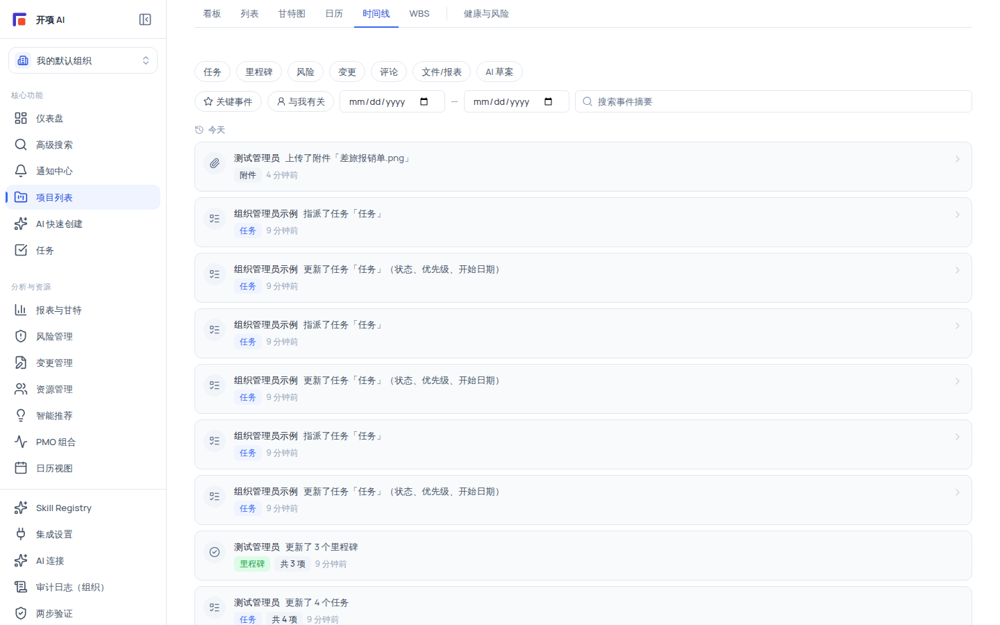

# 使用时间线视图回顾项目动态

时间线是**只读的项目记忆视图**：随着任务、WBS、依赖、甘特、里程碑、风险、变更、评论与 AI 草案等推进，系统在这里记录项目的关键历程。它不用于排程编辑——页脚明确说明「Timeline 为只读的项目记忆视图，展示项目历程，不用于排程编辑。」

数据以 REST 接口为事实来源（WebSocket 只提供「项目有新动态」的提示，不直接驱动列表），适合做项目周报素材、复盘与交接。

## 适用范围

| 角色                                                                                  | 查看时间线 |
| ------------------------------------------------------------------------------------- | ---------- |
| `system_admin` / `org_admin` / `project_manager` / `member` / `external_collaborator` | ✓          |
| `readonly_observer`                                                                   | ✓          |

时间线页面级权限为 `project:view`（项目内全部角色均具备）；所有角色只读，无任何写操作。

## 开始之前

- 已进入项目详情页。
- 项目内需要有已产生的动态（任务创建/状态变化、依赖建立、里程碑、风险、变更、评论等）才有内容可看；全新空项目显示「项目暂无动态」空态。
- 想快速回看某类动作（如只看里程碑），先想好要用的类型分组。

## 操作步骤

### 步骤 1：进入时间线并读懂事件卡片

在顶部视图切换器点 **「时间线」**。事件卡片包含：

| 元素       | 说明                                        |
| ---------- | ------------------------------------------- |
| 类别 Badge | 中文类别标签（见下表）                      |
| 重要性     | 低 / 一般 / 重要 / 关键                     |
| 摘要       | 事件内容摘要                                |
| 相对时间   | 刚刚 / N 分钟前 / N 小时前 / N 天前 / MM-DD |

列表按时间分组（倒序）：`今天 / 昨天 / 本周 / 更早`（一周起点为周一）。

### 步骤 2：按类型筛选

顶部类型分组 pills 覆盖 17 类事件：

| 分组      | 包含类别                                 |
| --------- | ---------------------------------------- |
| 任务      | task / wbs / dependency / gantt          |
| 里程碑    | milestone                                |
| 风险      | risk                                     |
| 变更      | change                                   |
| 评论      | comment                                  |
| 文件/报表 | document / attachment / diagram / report |
| AI 草案   | ai_draft / draft_layer                   |

分组内任一类别命中即激活该 pill；再次点击取消整组。筛选条件写入 URL（`category=` 逗号分隔），可复制链接分享。

### 步骤 3：使用「关键事件」与「与我有关」

- **关键事件**（星形图标）：只看系统判定为关键的事件（如里程碑达成、项目状态变更等）。
- **与我有关**（用户图标）：只看与当前登录用户相关（如指派给我、我创建/更新）的事件。

两者可叠加使用，也可再叠加类型筛选与日期范围。

### 步骤 4：按日期范围与关键词搜索

1. 开始日期 / 结束日期两个日期框：只看该窗口内的动态，两个日期互相钳制（起点不能晚于终点）。
2. 搜索框（占位「搜索事件摘要」）：输入关键词后按 <kbd>Enter</kbd> 或在输入框失焦时提交；搜索词按 100 字符截断。
3. 使用 **「清除筛选」** 一键回到全量动态。

### 步骤 5：处理新动态与分页

- 页面打开期间有新的动态产生时，顶部出现提示条「项目有新动态」+ **「刷新」/「忽略」** 按钮（WebSocket 只发提示，点「刷新」才拉取新数据）。
- 列表每页 20 条、最多 50 条；底部 **「加载更多」** 按需加载，加载失败时提示「加载更多失败。」并可重试。

## 验证结果

- 对项目做过若干操作（新建任务、拖看板、建依赖、建里程碑）后切到时间线，能看到对应的事件卡片并按时间分组。
- 勾选「里程碑」分组后，列表只剩里程碑类事件；叠加「与我有关」后只显示与你相关的那部分。
- 浏览到列表底部时点「加载更多」，能看到更早的动态（上限 50 条）。

## 常见问题

### 症状：时间线没有任何动态

- **可能原因**：项目很新、还没有任何任务/里程碑/评论等操作，或当前筛选把结果过滤光了。
- **检查**：顶部筛选 pills 与日期范围是否为空。
- **修复**：清除筛选；去列表或看板做几个操作（如创建任务）后回来刷新。
- **仍失败时**：记录项目 id 反馈。

### 症状：某条事件看不到

- **可能原因**：事件类别被某个分组 pill 过滤，或超出 50 条加载上限之外。
- **检查**：当前激活的分组。
- **修复**：取消分组；时间线只保留最近动态，更早记录请以审计日志为准（见管理员的审计日志功能）。
- **仍失败时**：记录事件时间与类别反馈。

### 症状：提示「项目有新动态」但列表没变化

- **可能原因**：提示只表示有新事件到达，列表需要手动刷新。
- **检查**：提示条上的按钮。
- **修复**：点 **「刷新」** 拉取新数据；点 **「忽略」** 关闭提示。
- **仍失败时**：记录操作时间与 request id 反馈。

### 症状：想用 AI 生成项目但时间线里没有入口

- **可能原因**：AI 生成项目的入口在**侧边栏「AI 快速创建」**，不在时间线内。
- **修复**：点左侧导航的「AI 快速创建」；AI 只会生成草案，需人工审查确认后才落库。

## 限制与安全边界

- **纯只读**：时间线不提供任何编辑入口，不用于排程编辑；对排程的改动请到甘特图/日历进行。
- **数据来源**：REST 是事实来源，WebSocket 仅提示「有新动态」。
- **配额**：每页 20 条、最多加载 50 条；更早记录请查审计日志。
- **组织隔离**：时间线只展示当前项目、当前组织的动态。
- **AI 边界**：AI 草案类事件只出现在时间线中作为记录；AI 生成的内容不会自动写入正式数据。

## 下一步

- [项目视图总览](../projects/views-overview.mdx)
- [使用列表视图筛选、排序与批量处理任务](../projects/list.mdx)
- [使用甘特图排程：改期、依赖、进度与基线](../projects/gantt.mdx)
- [权限参考](../reference/permissions.mdx)
