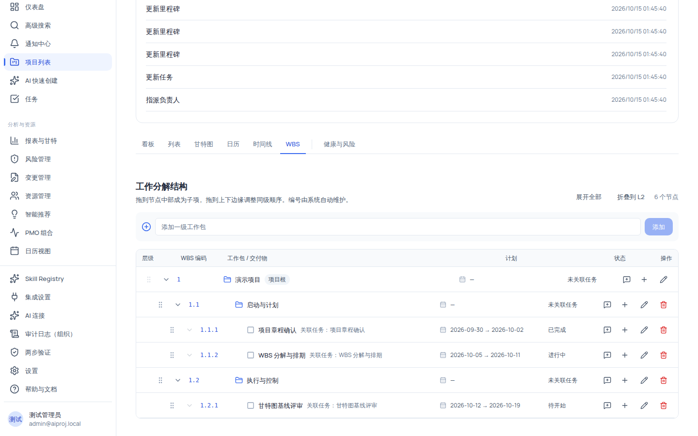
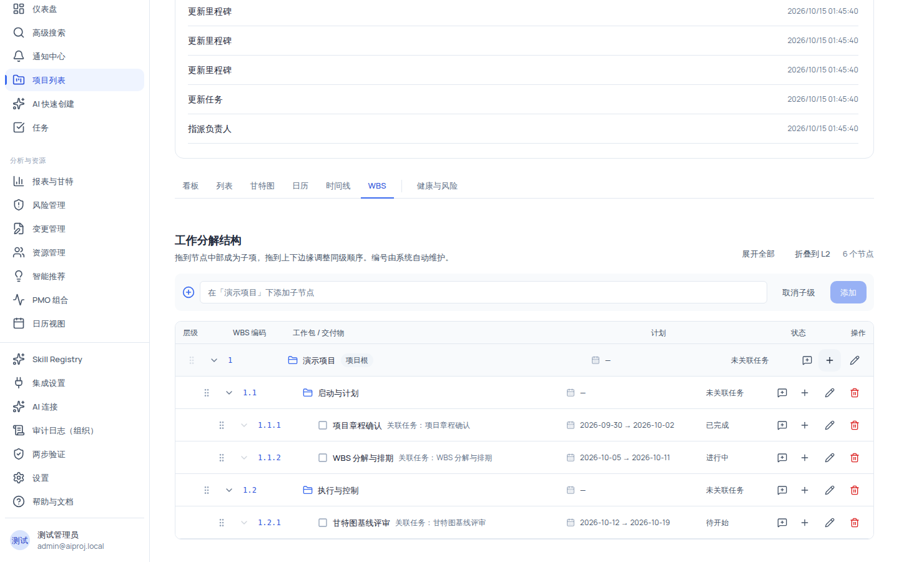

# 用 WBS 分解项目工作

WBS（工作分解结构）把项目范围组织成一棵树：从根节点出发，自上而下拆出阶段、工作包与交付物，**编号与层级由系统自动维护**。可以在树上挂接任务（节点关联任务后，计划与状态自动从任务汇总），也可以先建结构、后补任务。

三个关键规则请先记住：

1. **层级最多 20 层**（「WBS 最多支持 20 层」）。
2. **根节点锁定**：不可拖动、不可删除。
3. **删除非根节点后，其直接子节点会自动提升为一级节点**（不会连带删除子节点）。

## 适用范围

| 角色                                             | 查看（`wbs:view`） | 创建/重命名/删除/移动（`wbs:create` `wbs:update` `wbs:delete` `wbs:move`） | 折叠/展开状态                           |
| ------------------------------------------------ | ------------------ | -------------------------------------------------------------------------- | --------------------------------------- |
| `system_admin` / `org_admin` / `project_manager` | ✓                  | ✓                                                                          | ✓                                       |
| `member`                                         | ✓                  | ✗（只有 `wbs:view`）                                                       | ✓（`collapsed` 字段所有可查看者均可改） |
| `external_collaborator` / `readonly_observer`    | ✓                  | ✗                                                                          | ✓                                       |

WBS 页面无页面级守卫，数据接口以 `task:view` 为最低门槛；写操作按钮按上述权限渲染（`member` 看不到「添加子节点/重命名/删除」按钮，只能折叠展开与查看）。

## 开始之前

- 已进入项目详情页。
- 想清楚分解粒度：建议一层「阶段」，二层「工作包」，再往下才是可执行任务。
- 结构与任务的关系：在列表/看板里创建任务后，可以在 WBS 节点上关联任务；也可以先搭 WBS 骨架再逐个补任务。

## 操作步骤

### 步骤 1：进入 WBS 并读懂树表

在顶部视图切换器点 **「WBS」**。树表列：

| 列       | 含义                                                                                        |
| -------- | ------------------------------------------------------------------------------------------- |
| 层级     | 缩进与展开/折叠按钮（叶子节点无展开按钮）；非叶节点显示文件夹图标，叶节点显示方块图标       |
| WBS 编码 | 系统自动维护的编号（如 `1.1.1`），等宽字体、主色显示                                        |
| 工作包   | 节点名称；根节点带「项目根」徽章；已关联任务时显示灰色「关联任务：{名称}」                  |
| 计划     | `{开始日期} → {结束日期}`；缺任一日期显示「未排期」；未关联任务显示 `—`                     |
| 状态     | 显示关联任务的状态（待开始/进行中/已完成/受阻/已暂停/已取消）；未关联任务显示「未关联任务」 |
| 操作     | Copilot 内联触发、添加子节点、重命名、删除（按权限渲染）                                    |

空项目显示空态「从项目目标开始拆解」「建立第一层工作包后，再逐层补充交付物与任务。系统会自动维护编号和层级。」，并显示 **「创建根节点」** 按钮（滚动到创建表单）。

### 步骤 2：添加一级工作包与子节点

1. 顶部快速创建表单输入名称（输入框占位「添加一级工作包」），点 **「添加」**（空名称时按钮禁用）。
2. 二级及以下：在某行点 **「添加子节点」**，表单切换为「在「{父节点名}」下添加子节点」，并出现 **「取消子级」** 按钮返回一级模式。

新节点由系统自动生成编码、路径、深度与显示顺序，无需手工维护编号。

### 步骤 3：重命名节点

1. 在某行点 **「重命名」**（需 `wbs:update`）：名称变为行内输入框。
2. 修改后按 <kbd>Enter</kbd> 或点 **「保存名称」**（对勾）保存；按 <kbd>Esc</kbd> 或点 **「取消编辑」** 放弃。

### 步骤 4：拖拽调整层级与顺序

1. 按住行首拖动柄（GripVertical 图标）拖动；根节点的手柄禁用（aria 提示「项目根节点不可移动」）。
2. 落点判定：**拖到节点中部成为子项（child），拖到上下边缘调整同级顺序（before/after）**——边缘落点优先于整行子项落点。页面顶部说明：「拖到节点中部成为子项，拖到上下边缘调整同级顺序。编号由系统自动维护。」
3. 拖动中：原行半透明（opacity-40），悬停的目标子项行显示主色底纹。
4. 位置规则：成为子项 → 放到目标节点子级末尾；同级调序 → 插入到目标节点前/后。

**不能拖入自身或其后代**（会被拦截并提示「不能将节点移动到自身或其后代下」）；移动后层级超过 20 层时提示「移动后 WBS 将超过 20 层」并拒绝。

### 步骤 5：删除节点

1. 在某行点 **「删除」**（红图标，需 `wbs:delete`；根节点无删除按钮）。
2. 浏览器弹出确认框：「删除「{节点名}」？其直接子节点会提升为一级节点，此操作会写入审计日志。」
3. 确认后删除：**该节点的直接子节点提升为一级节点**并重排显示顺序，编码自动重排。

> [!WARNING]
> 删除是结构操作：子节点会保留并提升，而不是被连带删除；后代层级会整体减一。所有 WBS 写操作（创建/改名/删除/移动）都会写入审计日志。

### 步骤 6：展开、折叠与批量折叠

- 点击行首展开/折叠按钮切换单个节点（叶子节点无按钮）。
- 工具栏 **「展开全部」** 展开整棵树。
- **「折叠到 L2」**：折叠所有第 2 级以下的节点（批量保存折叠状态）。
- 折叠状态（`collapsed` 字段）写入服务端，**所有可查看者都可以修改**，且刷新/换设备后保持。

## 验证结果

- 添加节点后，WBS 编码自动出现（如根下第一个节点为 `1`，其子节点为 `1.1`、`1.2`…），无需手动填写。
- 把节点拖到另一节点中部，它成为子项且编码从 `1.2` 变为 `1.2.1`；拖到边缘则保持同级、编码顺序调整。
- 删除一个含子节点的节点：确认后子节点仍在树上，但提升为一级节点。
- `member` 登录：看不到「添加子节点/重命名/删除」按钮，但可以折叠/展开；`readonly_observer` 同样只能查看。
- 尝试把节点拖入自己的子节点下：被拦截并提示不能移动到自身或后代下。

## 常见问题

### 症状：节点拖不进目标位置

- **可能原因**：落点判定（中部=子项、边缘=同级）与直觉不符，或你试图拖入自身/后代。
- **检查**：悬停时目标行是否出现主色底纹（child 落点）。
- **修复**：把鼠标对准节点边缘或中部再松开；审视拖拽方向是否构成循环。
- **仍失败时**：记录来源/目标节点与层级反馈。

### 症状：提示「WBS 最多支持 20 层」

- **可能原因**：新建或移动后层级超过 20 层上限。
- **检查**：当前最深节点的层级。
- **修复**：减少分解深度，把深层节点提升到更上层。
- **仍失败时**：记录节点路径反馈。

### 症状：根节点拖不动/删不掉

- **可能原因**：产品设计：根节点锁定（不可移动、不可删除）。
- **检查**：根节点行首手柄是否禁用、是否有删除按钮。
- **修复**：根节点是整棵树的锚，只能重命名；如需重来，请在项目设置层面处理。
- **仍失败时**：记录操作意图反馈。

### 症状：删除节点后子节点还在

- **可能原因**：这是设计行为——直接子节点会提升为一级节点，不连带删除。
- **检查**：删除前的确认文案（明确写了「其直接子节点会提升为一级节点」）。
- **修复**：若确实要清理，先逐个删除子节点，再删除父节点。
- **仍失败时**：记录操作顺序反馈。

### 症状：计划与状态列显示「未排期/未关联任务」

- **可能原因**：节点还没有关联任务。
- **检查**：行的「关联任务」提示。
- **修复**：在列表/看板创建任务后回到 WBS 关联；任务有起止日期后「计划」列显示 `开始 → 结束`。
- **仍失败时**：记录节点与任务 id 反馈。

## 限制与安全边界

- **结构规则**：层级 ≤ 20 层；根节点不可移动/删除；不能移动到自身或后代下。
- **删除语义**：删除非根节点后，直接子节点提升为一级节点；所有写操作进入审计日志。
- **权限边界**：`member` 及以下只有 `wbs:view`（可改折叠状态）；结构调整仅 `org_admin`/`project_manager`。
- **编号与顺序由系统维护**：手动改编号无效，展示顺序由系统重排。
- **关联任务校验**：只能关联当前项目的任务；一个任务只能关联一个 WBS 节点。
- **组织隔离**：WBS 数据严格按当前组织过滤。

## 下一步

- [使用甘特图排程：改期、依赖、进度与基线](../projects/gantt.mdx)
- [使用列表视图筛选、排序与批量处理任务](../projects/list.mdx)
- [项目视图总览](../projects/views-overview.mdx)
- [权限参考](../reference/permissions.mdx)
